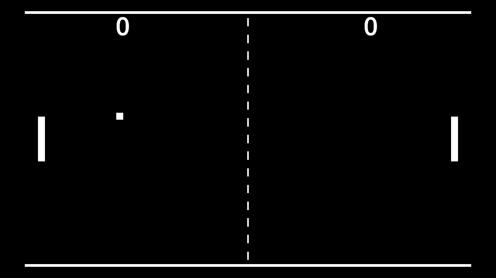

# 動作証跡：001. Pong

記録日：2026-11-15 / Unity 6000.6.9f1 / Windows 11

## スクリーンショット

`dev capture 001` で撮影した。Windows ビルドを 1280×720 のウィンドウで起動し、撮影台本 [PongCaptureScenario](../Assets/Game/Unity/PongCaptureScenario.cs) が画面を進めて撮る。

- 固定シード（1）で試合を Tick 単位で進め、補間せずにその Tick の状態を描く。同じビルドなら毎回同じ画像になる（2 回撮って同じ世代になることを確認済み）。
- プレイヤーのパドルは動かさないので CPU が勝つ。
- 画像は内容で決まる世代ごとの不変フォルダ `captures/<画像世代>/` に、撮影ごとの記録（ビルド GUID、日時、シード、設定値、撮影 Tick、各画像の SHA-256）は `runs/<撮影 ID>/manifest.json` に置き、公開中の組を [current.json](current.json) が指す。
- 画像世代は画像の内容から決まるので、同じ画像なら撮り直してもリンクは変わらない（撮影記録は撮影ごとに新しくなる）。画像が変わったら、このファイルの画像リンクを新しい世代に直す（`dev lint` が、公開中でない世代へのリンクを検出する）。
- 現在の画像世代は `6e7ff08af5a2abbf`。最新の撮影記録は [current.json](current.json) の `Run` が指す `runs/<撮影 ID>/manifest.json`。

| 画面 | 内容 |
|---|---|
|  | タイトル。操作説明と勝利条件 |
|  | 試合開始から 100 Tick。サーブされたボールが左へ飛んでいる |
|  | 決着（1268 Tick、1-5）後の結果。勝者・スコア・再戦の案内 |

4:3（960×720）のウィンドウでも撮影し、コートとパドルが画面内に収まることを目で確認した（画像は保存していない）。

結果オーバーレイの表示と Enter での再戦は、PlayMode テスト `MatchEnd_ShowsWinnerOnResultOverlay_ThenEnterRematches` でも確認している。

## 通しプレイ

| 日付 | 対象 | 結果 |
|---|---|---|
| 2026-11-15 | 初回実装 | 決着まで遊べた。CPU が強すぎる・音量が大きすぎるという指摘を受け、CPU の速度と狙いの精度、効果音の音量を下げた |
| 2026-11-15 | 1 回目のコードレビュー対応後（画面比率、動くパドルの衝突判定、再戦のシード） | 決着まで遊べた |

2 回目のコードレビュー対応（証跡の公開、接触回数の保証、撮影 Tick の描画、コート端でのパドル位置）は、自動テストと撮影で確認した。遊んだときの挙動に関わる変更は、コート端に着く Tick のパドル位置の求め方だけ。3・4 回目のコードレビュー対応（証跡の公開方式と撮影記録）は、ゲームの挙動に関わらない。

## テスト結果

| 種類 | 実行方法 | 結果 |
|---|---|---|
| Core / App | `dev test`（dotnet） | 39 / 39、14 / 14 成功 |
| Core + App（EditMode） | `dev test 001 -Unity` | 53 / 53 成功 |
| シーン・入力・カメラ・証跡（PlayMode） | `dev test 001 -Unity -Mode PlayMode` | 20 / 20 成功 |
| lint / 型チェック | `dev lint`、`dev check` | 成功 |

証跡の公開が失敗したときの動作も、実際のビルドで確かめた。公開中の世代の画像を別のプロセスで開いたまま `dev capture 001` を実行すると（同じ内容の世代を再検証するときに読めない）、5 秒で終了コード 1 になり、公開中の世代とポインタは変わらず、一時フォルダも残らなかった。どの操作の間で止まってもポインタが完全な組（画像世代と撮影記録）を指し続けることは、PlayMode テストで各操作の直前に失敗を注入して確かめている。これは操作と操作の間で止まった場合の整合性で、電源断を含む記憶装置への永続性までは保証しない。

## ビルド結果

- `dev build 001` 成功（約 20 秒、出力 約 100 MB）
- ビルドログに `[Licensing::Module] LicensingClient has failed validation; ignoring` が出るが、ビルドと起動には影響しない
- Player.log に、URP の未使用ポストプロセス用シェーダ（Bloom、被写界深度など）がビルドから除外された旨の警告が起動時に出る。ポストプロセスは使っていないため影響なし
