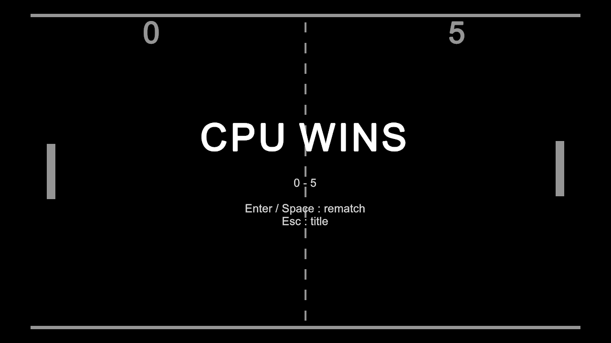

# 動作証跡：001. Pong

記録日：2026-11-15 / Unity 6000.6.9f1 / Windows 11

## スクリーンショット

`dev capture 001` で撮影した。Windows ビルドを 1280×720 のウィンドウで起動し、撮影台本 [PongCaptureScenario](../Assets/Game/Unity/PongCaptureScenario.cs) が画面を進めて撮る。プレイヤーのパドルは動かさないので CPU が勝つ。

| 画面 | 内容 |
|---|---|
|  | タイトル。操作説明と勝利条件 |
|  | 開始から 2.5 秒後 |
|  | 決着後の結果。勝者・スコア・再戦の案内 |

結果オーバーレイの表示と Enter での再戦は、PlayMode テスト `MatchEnd_ShowsWinnerOnResultOverlay_ThenEnterRematches` でも確認している。

人間の通しプレイ（2026-11-15）：決着まで遊べることを確認。CPU が強すぎる、音量が大きすぎるという指摘を受け、CPU の速度と狙いの精度、効果音の音量を下げた。

## テスト結果

| 種類 | 実行方法 | 結果 |
|---|---|---|
| Core | `dev test`（dotnet） | 30 / 30 成功 |
| Core + App（EditMode） | `dev test 001 -Unity` | 43 / 43 成功 |
| シーン・入力（PlayMode） | `dev test 001 -Unity -Mode PlayMode` | 6 / 6 成功 |
| lint / 型チェック | `dev lint`、`dev check` | 成功 |

## ビルド結果

- `dev build 001` 成功（約 20 秒、出力 約 100 MB）
- ビルドログに `[Licensing::Module] LicensingClient has failed validation; ignoring` が出るが、ビルドと起動には影響しない
- Player.log に、URP の未使用ポストプロセス用シェーダ（Bloom、被写界深度など）がビルドから除外された旨の警告が起動時に出る。ポストプロセスは使っていないため影響なし
