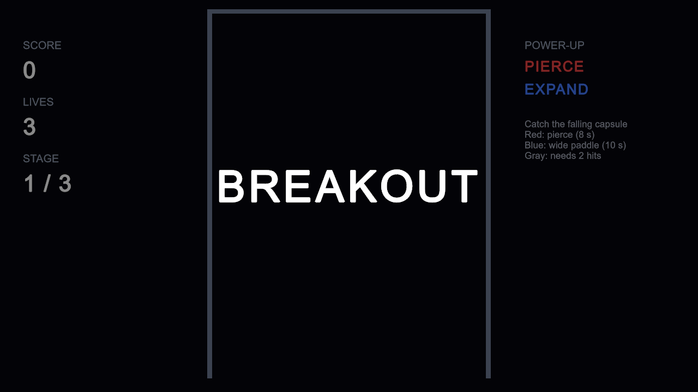
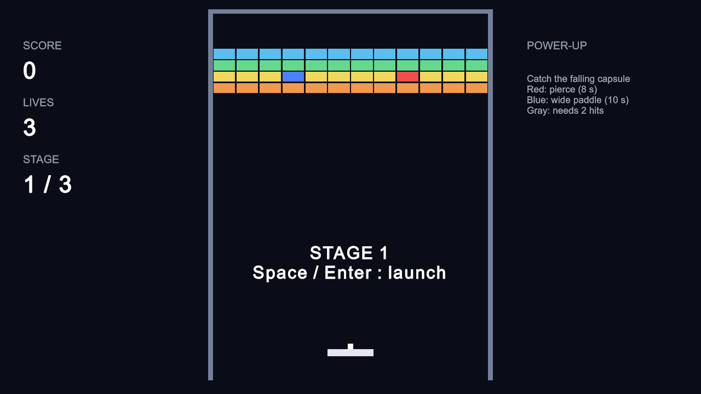
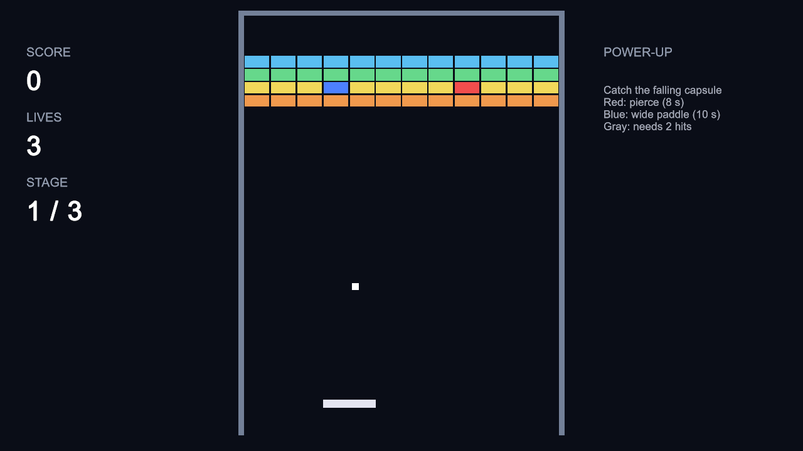
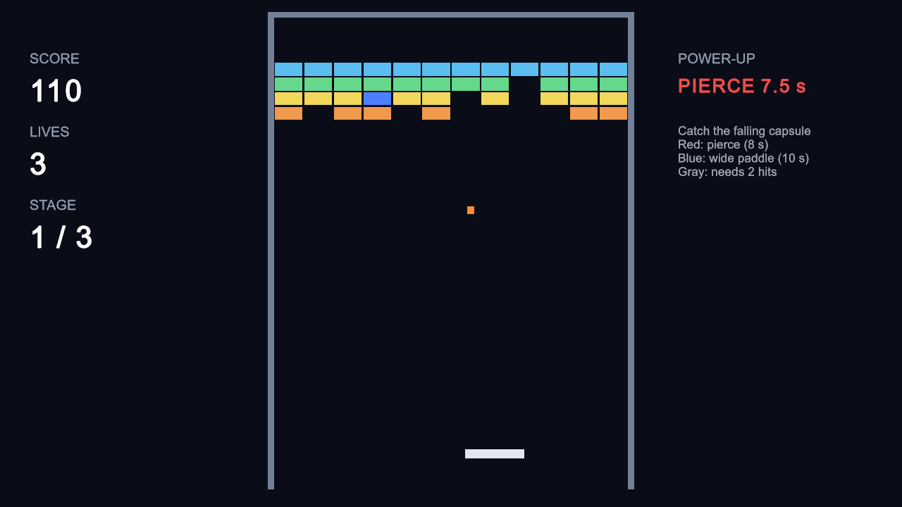
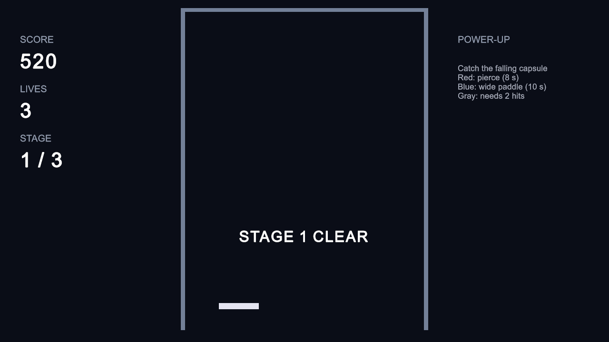
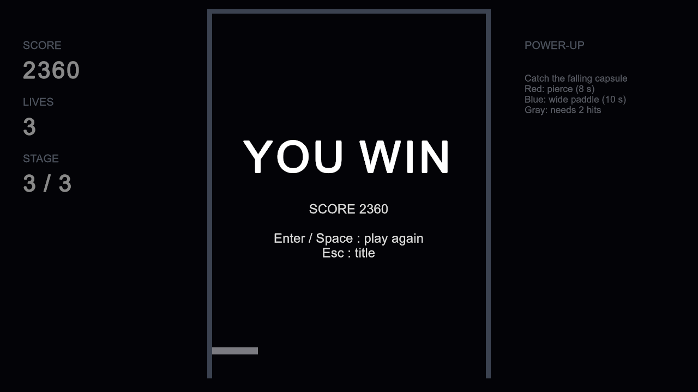

# 動作証跡：002. ブロック崩し

記録日：2026-11-15 / Unity 6000.6.9f1 / Windows 11

## スクリーンショット

`dev capture 002` で撮影した。Windows ビルドを 1280×720 のウィンドウで起動し、撮影台本 [BreakoutCaptureScenario](../Assets/Game/Unity/BreakoutCaptureScenario.cs) が画面を進めて撮る。

- 固定シード（ゲーム 1、操縦役 5）でゲームを Tick 単位で進め、補間せずにその Tick の状態を描く。同じビルドなら毎回同じ画像になる（2 回撮って同じ世代になることを確認済み）。
- パドルは自動の操縦役 [Autopilot](../Assets/Game/App/Autopilot.cs) が動かす（ボールを追い、ボールが上がっている間はカプセルを取りに行く）。
- 画像は内容で決まる世代ごとの不変フォルダ `captures/<画像世代>/` に、撮影ごとの記録（ビルド GUID、日時、シード、設定値、撮影 Tick、各画像の SHA-256）は `runs/<撮影 ID>/manifest.json` に置き、公開中の組を [current.json](current.json) が指す。
- 画像が変わったら、このファイルの画像リンクを新しい世代に直す（`dev lint` が、公開中でない世代へのリンクを検出する）。
- 現在の画像世代は `fba3c3cb147a73a0`。最新の撮影記録は [current.json](current.json) の `Run` が指す `runs/<撮影 ID>/manifest.json`。

| 画面 | 内容 |
|---|---|
|  | タイトル。勝利条件・残機と操作説明 |
|  | 1 面の開始。ボールがパドルに乗り、発射の案内が出ている。赤・青がアイテムブロック |
|  | 発射から 40 Tick。ボールが最初のブロックへ向かっている |
|  | 貫通弾のカプセルを取って 30 Tick 後（1391 Tick）。右に残り時間、ボールが橙色になっている |
|  | 1 面クリア（9141 Tick）。次の面までの待ち |
|  | 3 面クリアで勝利（34434 Tick、2360 点、残機 3）。得点と再戦の案内 |

画面比率（16:9・16:10・4:3・1:1・9:16）でフィールドと壁が画面内に収まることは、PlayMode テスト `FieldAndWalls_FitInsideViewport` で確認している。

ゲームオーバーの表示（`GAME OVER`、残機 0）と Enter での再戦は、PlayMode テスト `LosingAllLives_ShowsGameOver`、`GameEnd_ShowsResultMatchingOutcome_ThenEnterStartsNewGame` で確認している。

## 通しプレイ

| 日付 | 対象 | 結果 |
|---|---|---|
| （未実施） | 初回実装 | 人間による `dev run 002` の通しプレイ待ち |

## テスト結果

| 種類 | 実行方法 | 結果 |
|---|---|---|
| Core / App | `dev test`（dotnet） | 110 / 110、18 / 18 成功 |
| Core + App（EditMode） | `dev test 002 -Unity` | 128 / 128 成功 |
| シーン・入力・描画・HUD・カメラ・証跡（PlayMode） | `dev test 002 -Unity -Mode PlayMode` | 23 / 23 成功 |
| lint / 型チェック | `dev lint`、`dev check` | 成功 |

## ビルド結果

- `dev build 002` 成功（出力 約 100 MB）
- ビルドログに `[Licensing::Module] LicensingClient has failed validation; ignoring` が出るが、ビルドと起動には影響しない（001 と同じ）
