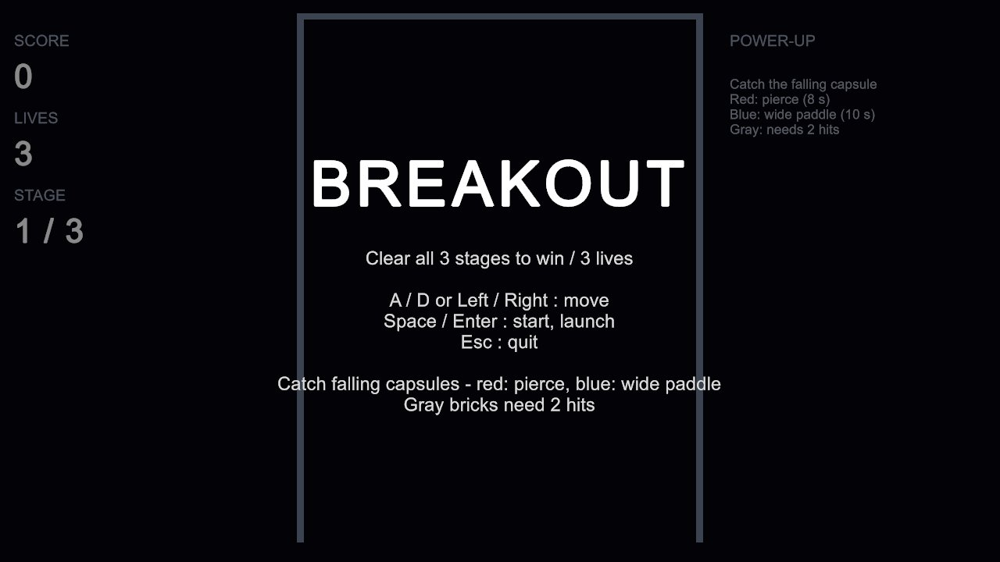
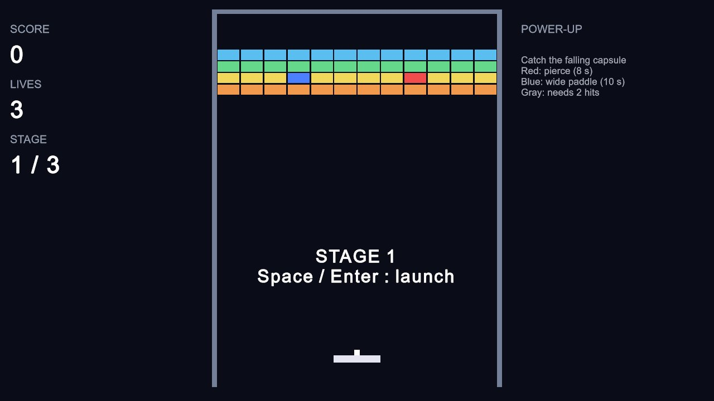
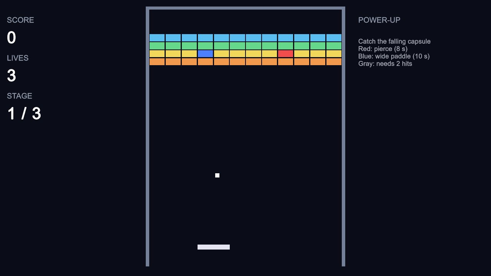
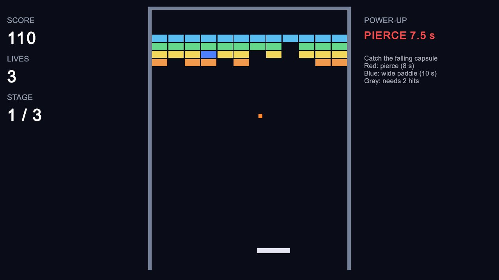
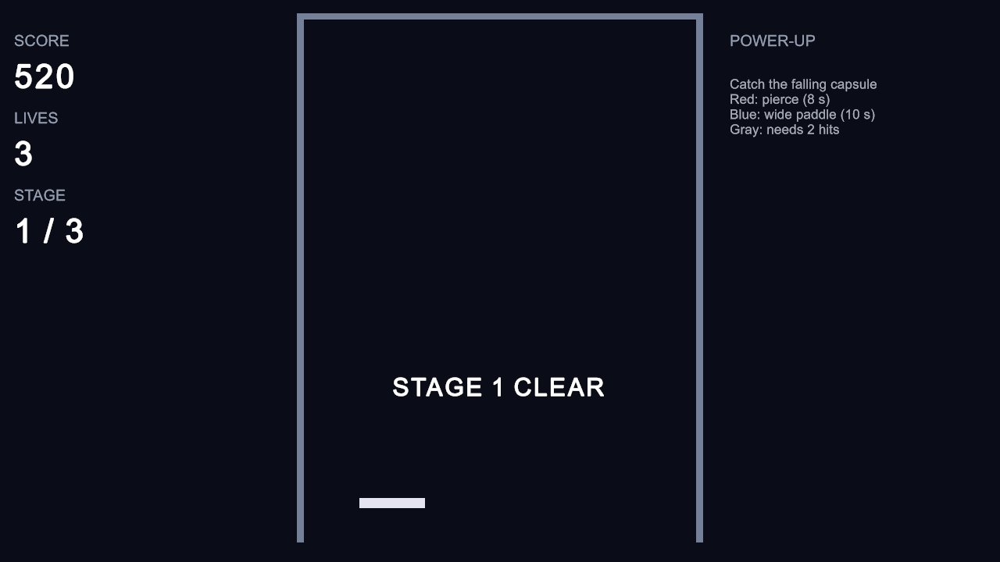
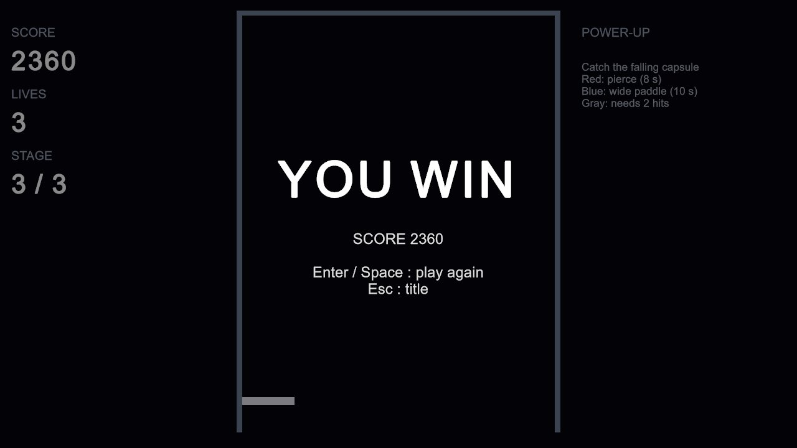

# 動作証跡：002. ブロック崩し

記録日：2026-11-15 / Unity 6000.6.9f1 / Windows 11

## スクリーンショット

`dev capture 002` で撮影した。Windows ビルドを 1280×720 のウィンドウで起動し、撮影台本 [BreakoutCaptureScenario](../Assets/Game/Unity/BreakoutCaptureScenario.cs) が画面を進めて撮る。

- 固定シード（ゲーム 1、操縦役 5）でゲームを Tick 単位で進め、補間せずにその Tick の状態を描く。同じビルドなら毎回同じ画像になる（2 回撮って同じ世代になることを確認済み）。
- パドルは自動の操縦役 [Autopilot](../Assets/Game/App/Autopilot.cs) が動かす（ボールを追い、ボールが上がっている間はカプセルを取りに行く）。
- 画像は内容で決まる世代ごとの不変フォルダ `captures/<画像世代>/` に、撮影ごとの記録（ビルド GUID、日時、シード、設定値、撮影 Tick、各画像の SHA-256）は `runs/<撮影 ID>/manifest.json` に置き、公開中の組を [current.json](current.json) が指す。
- 画像が変わったら、このファイルの画像リンクを新しい世代に直す（`dev lint` が、公開中でない世代へのリンクを検出する）。
- 現在の画像世代は `585cfd535bcedeeb`。最新の撮影記録は [current.json](current.json) の `Run` が指す `runs/<撮影 ID>/manifest.json`。

| 画面 | 内容 |
|---|---|
|  | タイトル。勝利条件・残機と操作説明 |
|  | 1 面の開始。ボールがパドルに乗り、発射の案内が出ている。赤・青がアイテムブロック |
|  | 発射から 40 Tick。ボールが最初のブロックへ向かっている |
|  | 貫通弾のカプセルを取って 30 Tick 後（1391 Tick）。右に残り時間、ボールが橙色になっている |
|  | 1 面クリア（9141 Tick）。次の面までの待ち |
|  | 3 面クリアで勝利（34434 Tick、2360 点、残機 3）。得点と再戦の案内 |

画面比率が変わっても HUD がフィールドに重ならないことは、PlayMode テスト（`FieldFramingTests`：21:9〜9:16 の 7 種類でフィールドが画面内かつ HUD の領域の外、`HudLayoutTests`：5 種類で HUD がその領域の中）で確認している。加えて、4:3（960×720）・1:1（800×800）・9:16（540×960）のウィンドウで撮影台本を流し、全画面を目で確認した（画像は保存していない）。4:3 までは HUD が左右の余白に、1:1 と 9:16 では上部の帯に並ぶ。

ゲームオーバーの表示（`GAME OVER`、残機 0）と Enter での再戦は、PlayMode テスト `LosingAllLives_ShowsGameOver`、`GameEnd_ShowsResultMatchingOutcome_ThenEnterStartsNewGame` で確認している。

## 通しプレイ

| 日付 | 対象 | 結果 |
|---|---|---|
| 2026-11-15 | 初回実装 | クリア・ゲームオーバーとも最後まで遊べた。調整の指摘なし。ウィンドウを閉じた直後に Unity のクラッシュハンドラが一瞬出た（エンジン内の終了処理。作品 README の「未解決事項」） |

コードレビュー対応（狭い画面での HUD の配置、合計得点の上限の検証、正の無限大の経過時間）は、自動テストと撮影で確認した。遊んだときの挙動に関わる変更は HUD の配置だけで、16:9 の見た目は位置が少し変わった程度。

カプセルの取得を Tick 中の軌跡で判定する修正（動くパドルが途中で触れたカプセルを取り逃さない）は、自動テストで確認した。撮影の画像は修正前と同じ世代のまま（台本の展開は変わらなかった）。

## テスト結果

| 種類 | 実行方法 | 結果 |
|---|---|---|
| Core / App | `dev test`（dotnet） | 117 / 117、19 / 19 成功 |
| Core + App（EditMode） | `dev test 002 -Unity` | 136 / 136 成功 |
| シーン・入力・描画・HUD・カメラ・証跡（PlayMode） | `dev test 002 -Unity -Mode PlayMode` | 30 / 30 成功 |
| lint / 型チェック | `dev lint`、`dev check` | 成功 |

## ビルド結果

- `dev build 002` 成功（出力 約 100 MB）
- ビルドログに `[Licensing::Module] LicensingClient has failed validation; ignoring` が出るが、ビルドと起動には影響しない（001 と同じ）

## 2026-11-18 画像形式の標準化

JPEG品質85・元の解像度を標準とする。既存PNGを新しい画像世代として再エンコードした。ゲームの再撮影ではなく、元の撮影日時・ビルドGUID・設定・Tickを保持している。変換履歴はmanifestのInfoに記録した。画像合計は0.36MBから0.30MBになった。

共通撮影形式変更後のUnity再検証：EditMode 136/136、PlayMode 31/31成功（JPEG保存・復号・公開の追加テストを含む）。
