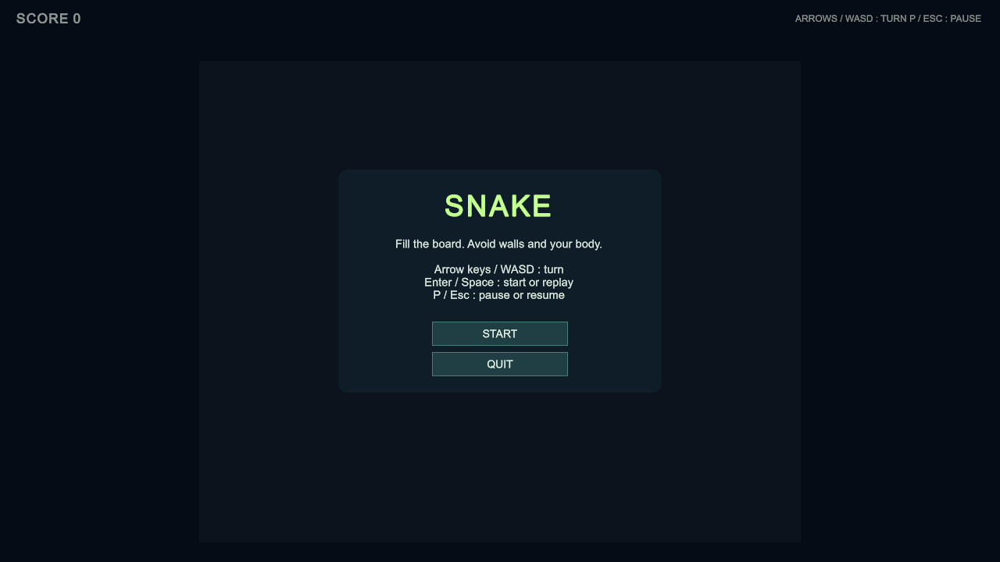
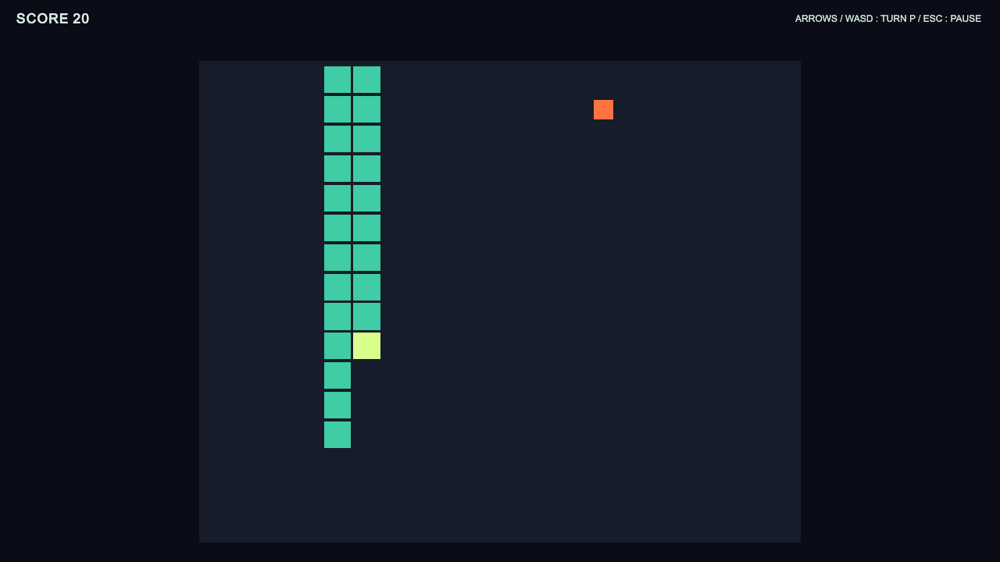
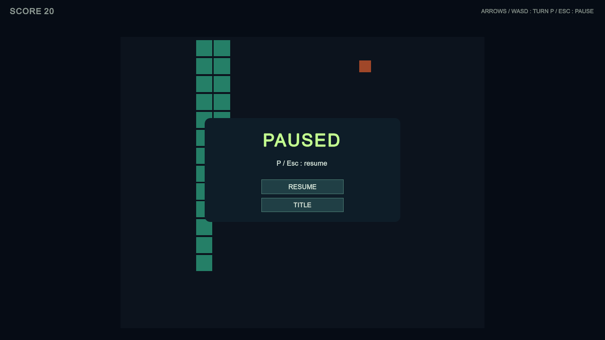
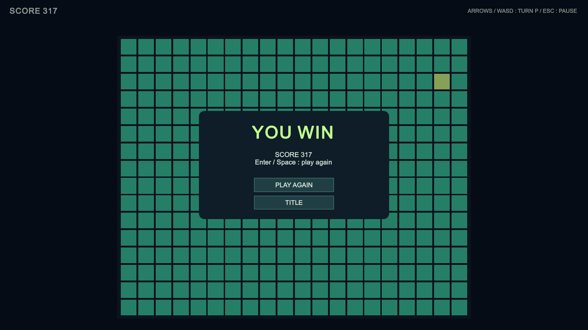
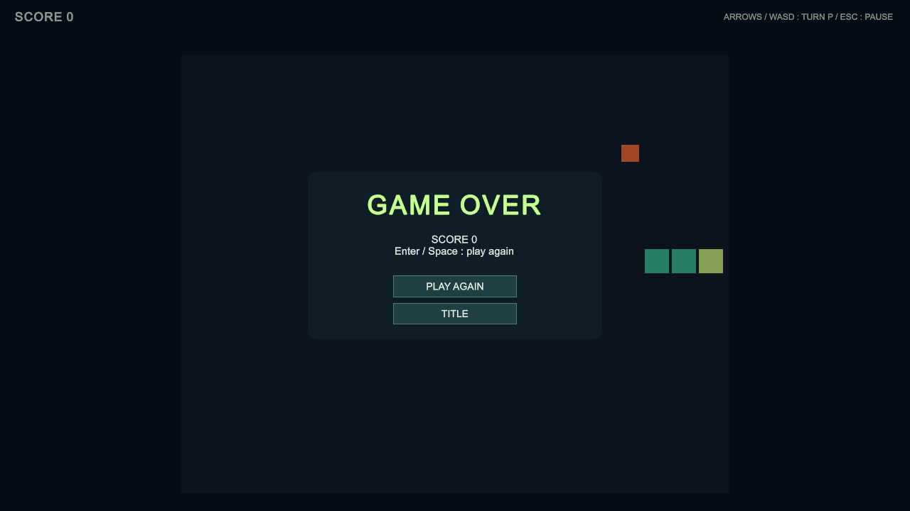

# 動作証跡：003. Snake

Unity 6000.6.9f1 / Windows 11 / Windows x64 ビルド。人間の通しプレイ・操作感・速度・音量は確認済み（2026-11-16にユーザーより連絡）。

## スクリーンショット

`dev capture 003` で1280×720のWindowsビルドを起動し、シード1・Tick駆動で撮影した。成長と勝利はAppの巡回操縦役、敗北は新しいシード2の試合で直進して作る。実時間とプレイヤー入力は撮影中に進行へ影響しない。

画像世代は `62c5578c5bf71721`。ビルドGUID・撮影日時・設定・Tick・画像SHA-256は [current.json](current.json) の `Run` が指す最新の撮影記録に保存する。

| 場面 | 画像 | 撮影時点 |
|---|---|---|
| タイトル・操作説明 |  | Title / Tick 0 |
| 餌20個取得・長さ23 |  | Tick 3321 |
| 一時停止 |  | Tick 3321 |
| 全面クリア・317点 |  | Tick 24639 |
| 再戦後の壁衝突 |  | Tick 10 |

最終ビルドを2回撮影し、画像世代 `62c5578c5bf71721` が一致することを確認した。

全5場面を目視し、文字の可読性・盤面の収まり・状態と表示の整合を確認した。カメラは16:10・16:9・21:9でもPlayModeテストで検証している。

## 自動検証

| 種類 | コマンド | 結果 |
|---|---|---|
| Core | `dev test` | 24 / 24 成功 |
| App | `dev test` | 16 / 16 成功 |
| Unity EditMode | `dev test 003 -Unity` | 40 / 40 成功 |
| Unity PlayMode | `dev test 003 -Unity -Mode PlayMode` | 16 / 16 成功（シーン7・最大盤面計測1・証跡公開8） |
| メタ・整形 | `dev lint` | 成功 |
| 型・静的解析 | `dev check` | 成功、警告0・エラー0 |
| Windowsビルド | `dev build 003` | 成功 |
| ビルド起動・証跡 | `dev capture 003` | 5枚を公開して終了コード0 |

`dev test` は全作品が対象で、001（43+14件）・002（117+19件）の回帰テストも成功。003のAppテストではシード0・1・42について全面クリアまで同じ入力列を再生し、体節の連続性・重複なし・餌の非重複と一致を確認した。

毎秒10マスで1秒進めた後の端数が重複計上されないこと、最大有限時間を渡しても1フレームの処理上限を超えないことを回帰テストで確認した。

Unityの詳細ログとXMLは生成物の `Logs/` に保存される。ビルド時にライセンスクライアントの署名検証メッセージが出るが、ビルド・起動は成功している。

## 人間による確認・レビュー対応

2026-11-16、ユーザーより通しプレイ・操作感・速度・音量が確認済みと連絡を受けた。レビュー修正後の通しプレイ再実施は不要との指示を受領。

- P2-1：幅32・高さ20へ上限を制限。最大盤面で生成・成長・CPU描画更新・リソース数を計測し、回帰テストを追加した。[条件と実測](capacity.md)
- P3-1：フォーカス喪失時に保留操作を消し、フォーカス喪失中は入力と画面遷移を抑止する。停止キーとフォーカス喪失の両順序、復帰後の手動再開をPlayModeで確認した。
- P3-2：manifestのコメントを `evidence/runs/<撮影 ID>/manifest.json` に修正。003と雛形を更新した。
