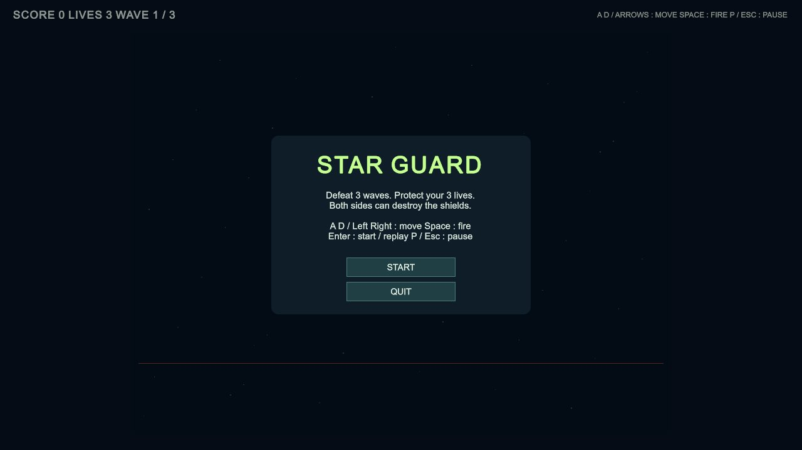
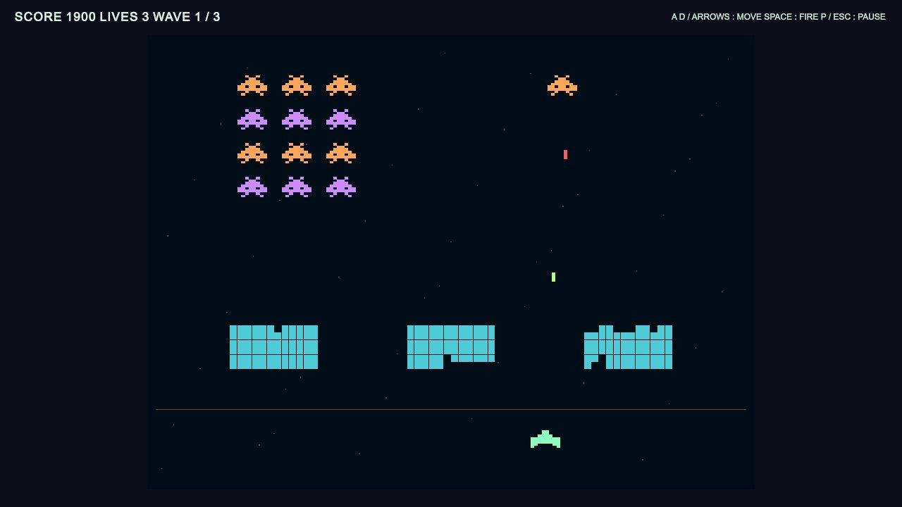
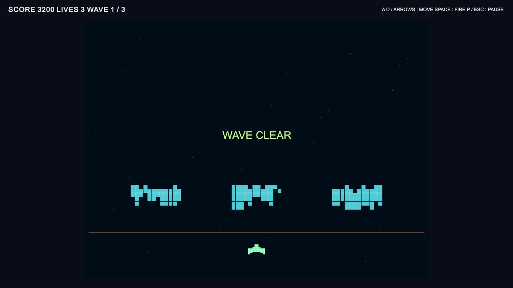
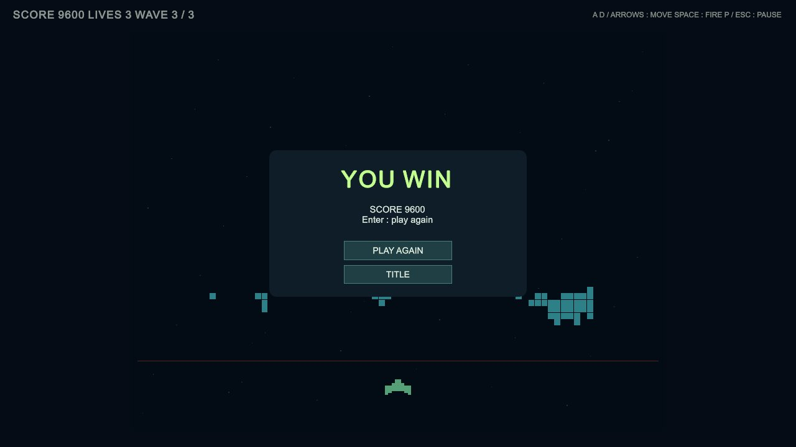
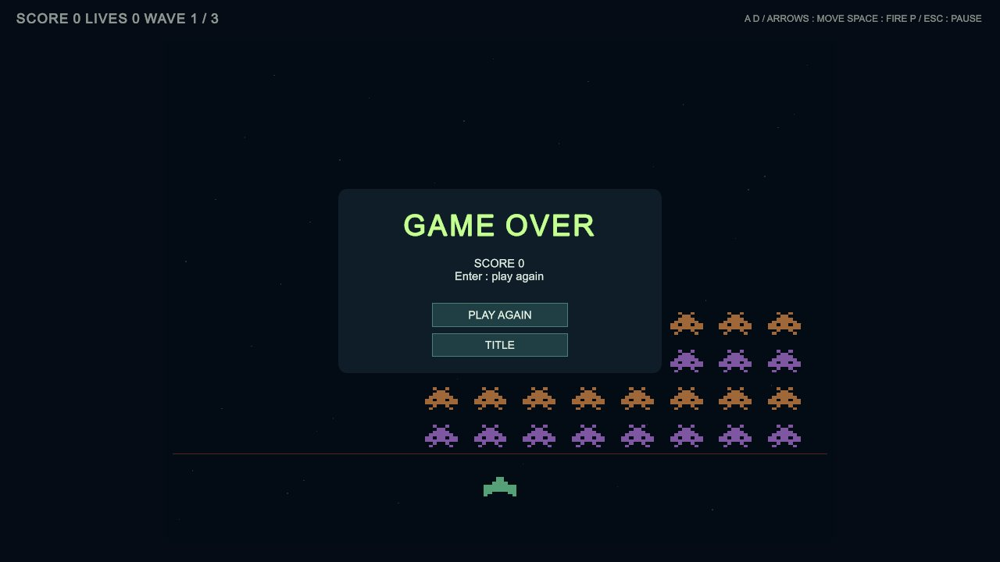

# 動作証跡：004. Space Invaders

2026-11-16、Unity 6000.6.9f1 / Windows 11 / Windows x64ビルドで自動検証を実施。同日、ユーザーから実際のゲーム起動・動作確認OKと完了承認を受領し、状態を完了に更新した。

## スクリーンショット

`dev capture 004`で1280×720のWindowsビルドを起動し、シード1・60HzのTick駆動で撮影した。Appの操縦役で3Waveを攻略し、その後シード2の新しい試合を無操作で進めて敗北を撮る。撮影中は実時間とプレイヤー入力で進めない。

画像世代は `08de7e85e3c29970`。[current.json](current.json) の `Run` が指す撮影記録に、ビルドGUID・Unity版・シード・設定・撮影日時・各画像のTickとSHA-256を保存する。

| 場面 | 画像 | 撮影時点 |
|---|---|---|
| タイトル・操作説明 |  | Tick 0 |
| 敵との交戦・盾の損傷 |  | Tick 600 |
| Wave1全滅・次Wave待ち |  | Tick 1667 |
| 3Wave勝利・9,600点 |  | Tick 4531 |
| 再戦後の敗北・残機0 |  | Tick 7578 |

全5場面を目視し、文字の可読性・プレイ領域の収まり・状態と表示の整合を確認した。最終ビルドを2回撮影し、画像世代が一致することを確認した。横長16:10・16:9・21:9のカメラの収まりはPlayModeテストで確認している。

## 自動検証

| 種類 | コマンド | 結果 |
|---|---|---|
| Core | `dev test` | 37 / 37成功 |
| App | `dev test` | 9 / 9成功 |
| Unity EditMode | `dev test 004 -Unity` | 46 / 46成功 |
| Unity PlayMode | `dev test 004 -Unity -Mode PlayMode` | 17 / 17成功（シーン・負荷9、証跡公開8） |
| メタ・整形 | `dev lint` | 成功 |
| 型・静的解析 | `dev check` | 全作品成功、警告0・エラー0 |
| Windowsビルド | `dev build 004` | 成功 |
| ビルド起動・証跡 | `dev capture 004` | 5枚公開、終了コード0。同一ビルドで画像再現 |

`dev test`は全作品が対象。001（43+14件）・002（117+19件）・003（24+16件）の回帰テストも成功した。

- 編隊端で一度だけ下降・反転し、外側の列が消えたら生存範囲を使う。
- 両陣営の弾による盾損傷、二重ヒット防止、同陣営・弾同士の通過、移動中の対象への接触時刻を検証。
- 最後の撃破と致命傷の同時発生は敗北、非致命傷なら次Waveでも復帰後の無敵が続く。
- 1〜180Tickの整数境界に対応するfloat値と、隣接する直前・直後のfloat値を.NET・Monoで検証。無敵の最後のTickと期限切れも確認。
- 固定シード1・123・2026の操縦役は.NET・Monoの両方で3Wave勝利。特定のTick数を期待せず、勝利・9,600点・60,000Tick以内を確認。
- 最大設定と乱択入力で弾数・自機と敵の左右境界を検証。最大設定の負荷は [capacity.md](capacity.md) に記録。
- 実シーンでキー入力、停止とフォーカス喪失の両順序、保持入力の破棄、HUD、再戦、生成リソースの破棄を検証。

詳細ログとテストXMLは生成物の `Logs/` に保存する。Unityビルドログにライセンスクライアントの署名検証メッセージが出るが、ビルド・起動・撮影は終了コード0で成功した。

## レビュー対応（2026-11-16）

- P2-1：敵→盾の接触を弾の命中と同じ時系列へ統合。盾接触が撃破より先／後の両ケース、同時刻の撃破、敵が先に壊した盾を後続の自弾・敵弾が通過するケースをCoreで検証した。
- P2-2：タイトルの残機表示と説明を設定値へ変更。PlayModeで残機1・5についてタイトル、開始後、タイトルへ戻った後の表示を確認した。
- P3-1：相対誤差での丸めを廃止し、整数Tickに対応するfloat秒表現との一致で判断。1/60秒・0.1秒を含む1〜180Tickについて隣接float値を区別する。
- 修正後に全作品のlint・check・Core/Appテスト、004のUnity両モード、Windowsビルド・撮影を再実行した。画像世代は修正前と同じで、最終ビルドでの2回撮影も一致した。

## 人間による確認

2026-11-16、ユーザーから実際のゲーム起動・動作確認OKと完了承認を受領した。追加の調整指示はなし。調整値は `Assets/Game/Unity/InvadersSettings.asset`。

## 2026-11-18 画像形式の標準化

JPEG品質85・元の解像度を標準とする。既存PNGを新しい画像世代として再エンコードした。ゲームの再撮影ではなく、元の撮影日時・ビルドGUID・設定・Tickを保持している。変換履歴はmanifestのInfoに記録した。画像合計は0.22MBから0.20MBになった。

共通撮影形式変更後のUnity再検証：EditMode 46/46、PlayMode 18/18成功（JPEG保存・復号・公開の追加テストを含む）。
