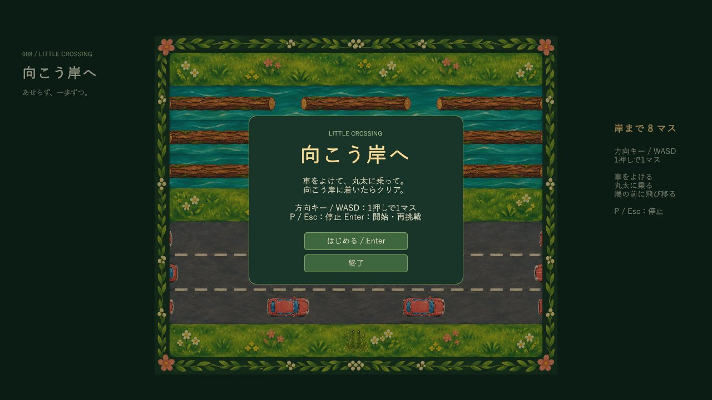
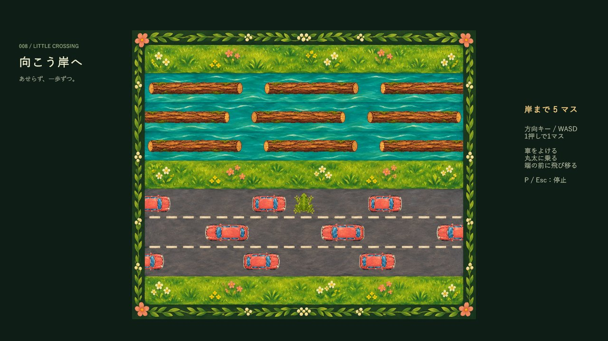
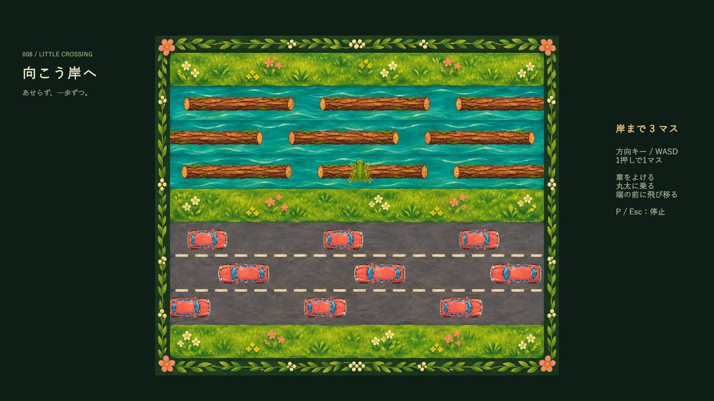
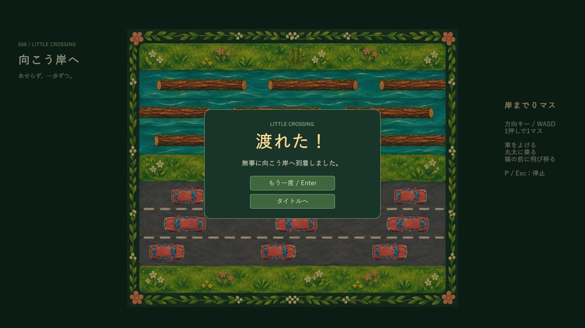
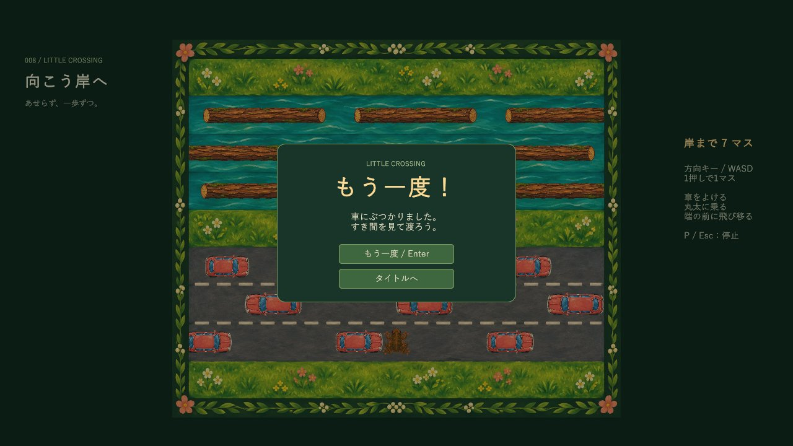
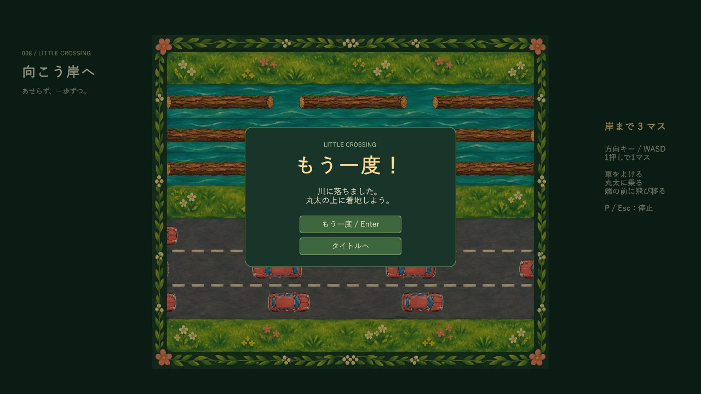
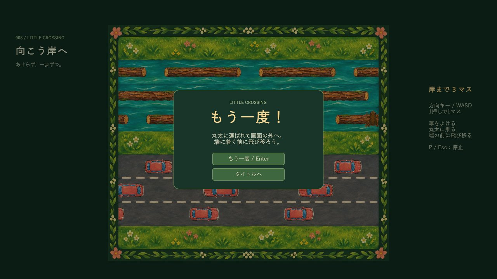
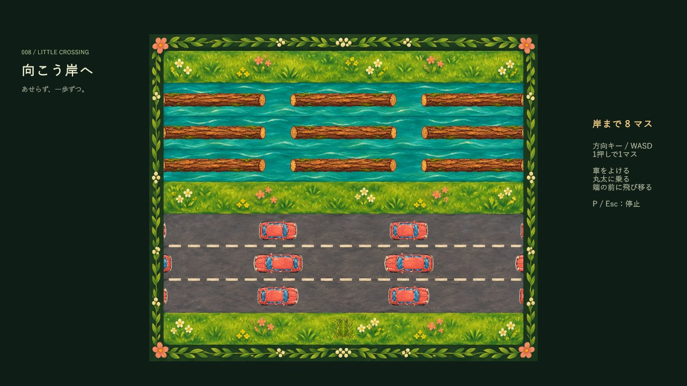

# 008 検証記録

2026-11-18実施。2026-11-18に人間の完了承認を受領。

## 自動検証

| 項目 | 結果 |
|---|---|
| dev lint | 成功（全作品） |
| dev check | 成功（全作品、警告0・エラー0） |
| dev test | 成功（全作品）。008 Core 19/19、App 9/9 |
| Unity EditMode | 28/28（Core/App、Mono） |
| Unity PlayMode | 34/34（実シーン18、共通証跡公開16） |
| Windowsビルド | 成功、StandaloneWindows64 |
| ビルド起動 | dev captureで起動・全場面撮影・正常終了 |
| 証跡 | 1280×720、JPEG品質85、8枚。全画像を目視確認 |
| 撮影再現 | 同一ビルドを2回撮影し、画像世代98e53d9a33792f95が一致 |

Build GUID：`5b5baa8722dd4937bd32c32695821e9a`。公開ポインタは[current.json](current.json)、実行記録は[manifest.json](runs/20261118T041541Z-068d6d2e/manifest.json)。SHA-256は保存したJPEGに対して照合した。乱数は使用しない（共通撮影基盤のSeed欄は1）。

Unityのビルドログにライセンスクライアントの署名検証警告が出たが、エディタは継続し、ビルドとPlayerの撮影起動は成功した。ゲーム側のコンパイルエラーはない。

## 最大設定の負荷

Unity 6000.6.9f1、Windows、Intel Core i9-13900KF、バッチPlayModeの640×480。全レーンの速度絶対値12、幅3.5、カエル半幅0.4。条件ごとに100回ウォームアップ後、Coreの1Tick更新＋View描画反映を1000回測定。状態の複製・配置・結果の検証は計測外とし、サンプルごとに未終了の状態を用意する。

| 条件 | p50 | p95 | 測定した処理 |
|---|---:|---:|---|
| 開始岸（Row 0） | 0.0165ms | 0.0167ms | 危険判定なしの1Tickと描画 |
| 道路（Row 1） | 0.0170ms | 0.0179ms | 現在レーンの車4台×周期コピー3個の掃引判定と描画 |
| 川（Row 5） | 0.0165ms | 0.0179ms | 最後の丸太で支持される位相で4本の探索・相対移動と描画 |

最大幅・半幅の道路は必ず接触する。道路の各サンプルは接触前から始め、判定ループを完走して車接触で終わったことを確認する。川では支持IDが3、全条件で1Tickを処理したことを検証する。テスト内の位置設定は計測前に行い、ゲーム用の状態変更APIは追加していない。

- 移動物体24個、SpriteRenderer 26個。更新中に描画物を追加しない。
- 特定の行・位相でのCPU処理時間。全位相を探索した最悪値、GPU時間、PlayerのFPS、他PCでの性能を保証する値ではない。
- 以前のp95 0.0147msは開始岸だけの計測だったため、今回の3条件の値に置き換えた。
- タイトル描画を100回ウォームアップ後に100回実行し、管理ヒープの割り当て0バイトを確認。設定の位相を変更した初期表示も反映される。

## 画面証跡

### タイトル

### 道路の横断

### 丸太に乗る

### クリア

### 車との接触

### 川への落下

### 足場による場外移動

### 再挑戦

## 人間の確認

2026-11-18に完了承認を受領。画像容量の調整後もlint・check・全作品Core/Appテスト・Unity全62件・Windowsビルド・証跡8枚・同一ビルド再撮影を確認済み。

## 制作画像の容量調整

BoardはJPEG品質95（835142バイト）、CarはRGBA画素が完全一致する可逆PNG再圧縮（2034079バイト）で、2000KB制限に対応。GUIDを維持してUnity参照を再確認した。
