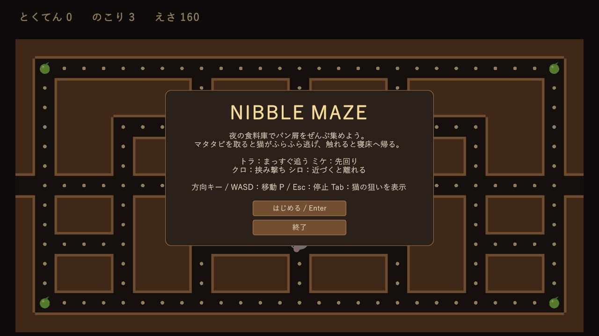
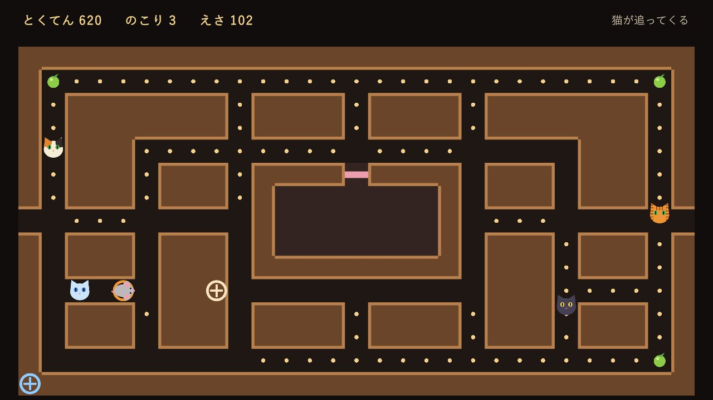
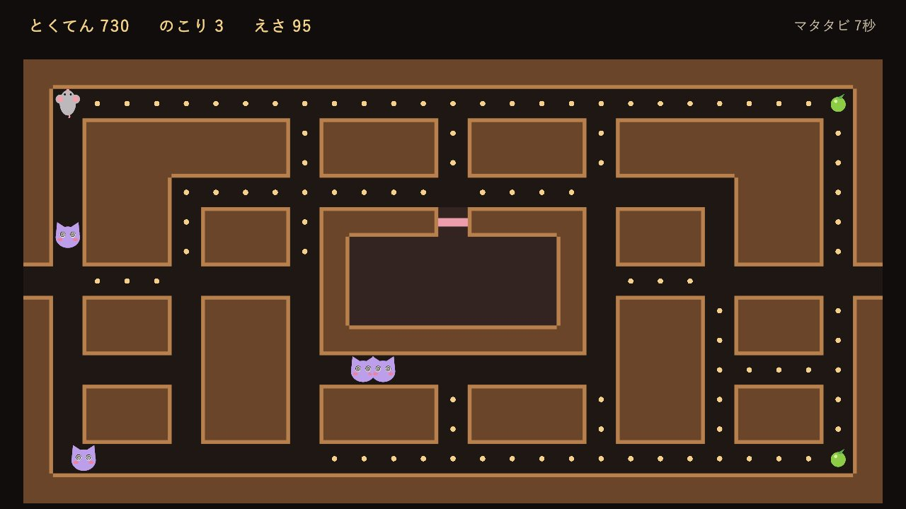
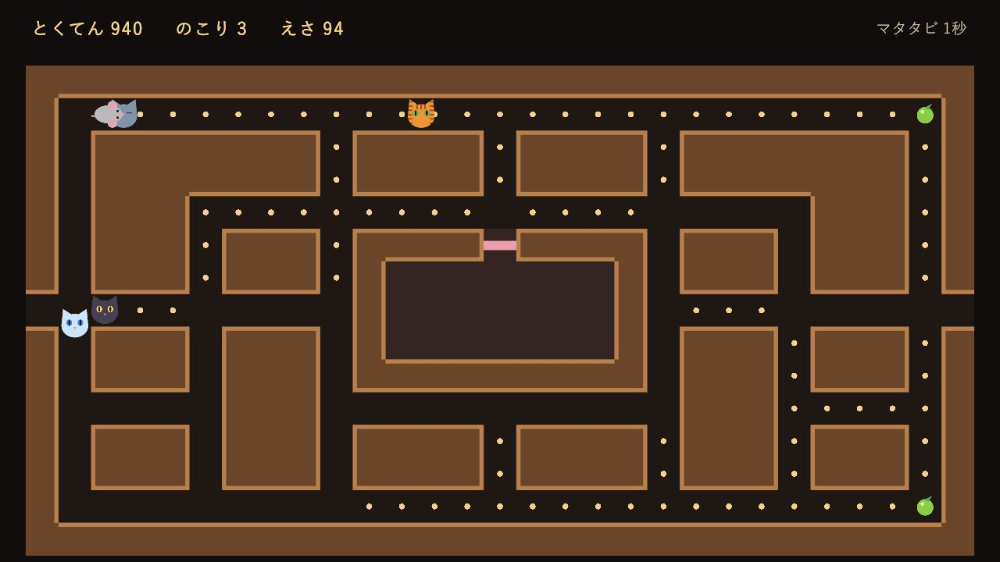
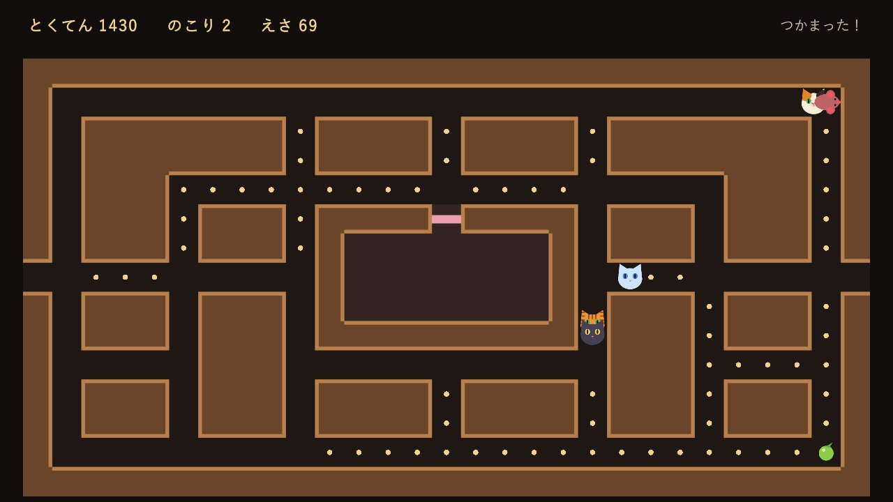
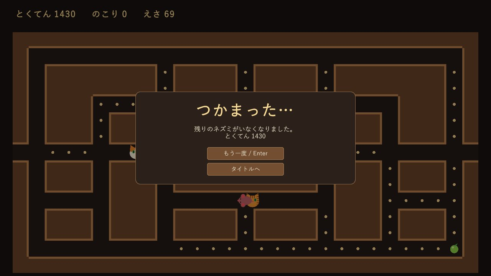
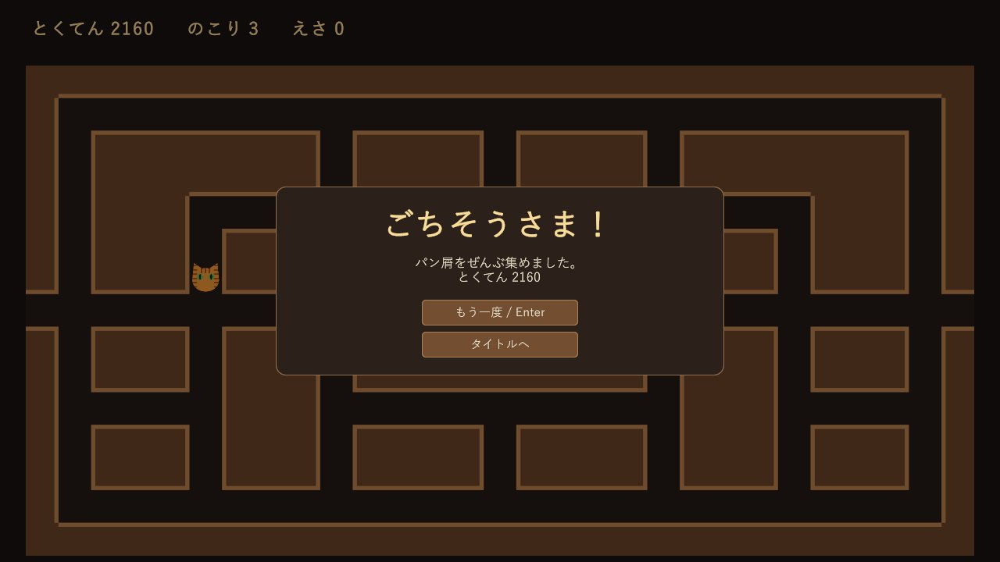
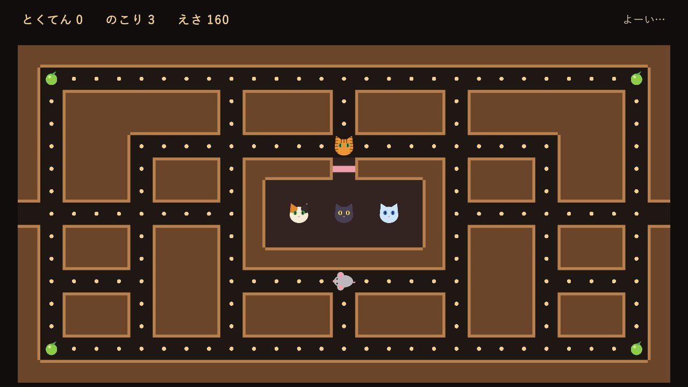

# 009 検証記録

2026-11-18実施。2026-11-19に人間の完了承認を受領。

## 自動検証

| 項目 | 結果 |
|---|---|
| dev lint | 成功（全作品） |
| dev check | 成功（全作品、警告0・エラー0） |
| dev test | 成功（全作品）。009 Core 62/62、App 25/25 |
| Unity EditMode | 87/87（Core/App、Mono） |
| Unity PlayMode | 28/28（実シーン12、共通証跡公開16） |
| Windowsビルド | 成功、StandaloneWindows64 |
| ビルド起動 | dev captureで起動・全場面撮影・正常終了 |
| ✖ボタンでの終了 | 実クリックで対策前は8回中8回クラッシュ、対策後は15回中0回（終了コード0）。`OnDestroy` とエンジンの終了処理まで動くことをログで確認 |
| スクリプトからの終了 | `Application.Quit` で5回中0回クラッシュ（終了コード0） |
| 証跡 | JPEG品質85、9枚 |
| 撮影再現 | 同一ビルドを2回撮影し、画像世代0e1009d915da455aが一致 |

Build GUID：`874d54f3769445778cf6e869bed841f9`。公開ポインタは[current.json](current.json)、実行記録は[manifest.json](runs/20261118T153623Z-5630e29c/manifest.json)。撮影は試合ごとにシード1から順に使う。

クリア場面（08）は、猫を止めた設定で撮影している。Unityのビルドログにライセンスクライアントの検証メッセージが出たが、ビルドとPlayerの撮影起動は成功した。

## 画面証跡

### タイトル

### 準備

### 追跡（猫の目標マスを表示）

丸い印が各猫の目標マス。盤面の外を指す目標は端のマスに寄せて表示するため、複数の印が同じマスに重なることがある。この画像で見える印は3つ。4匹分の印が出ることはPlayModeテストで確認している。

### 逃走

### 帰還

### ミス

### ゲームオーバー

### クリア

### 再戦

## 人間の確認

2026-11-19に完了承認を受領。
