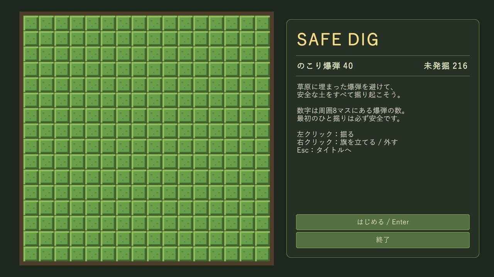
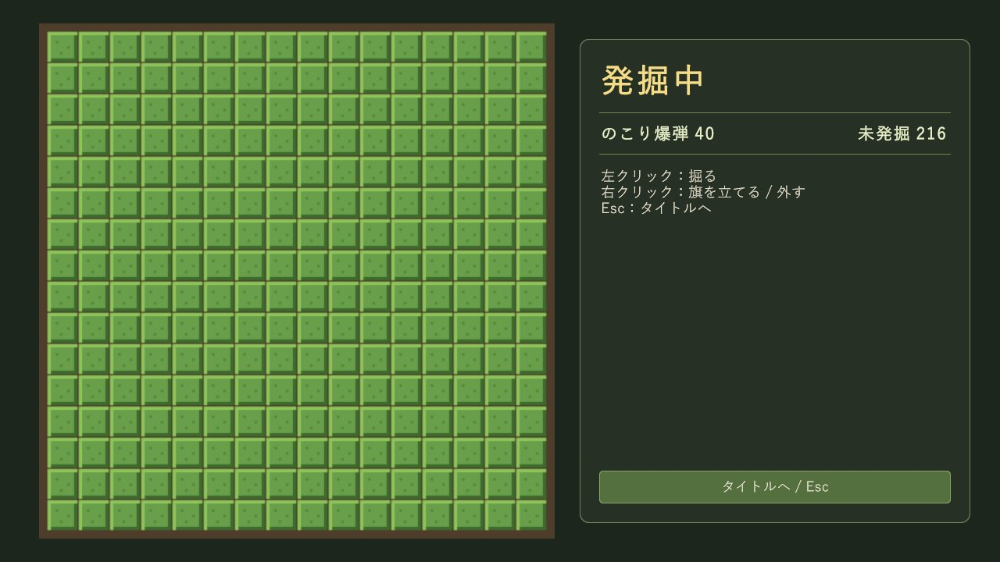
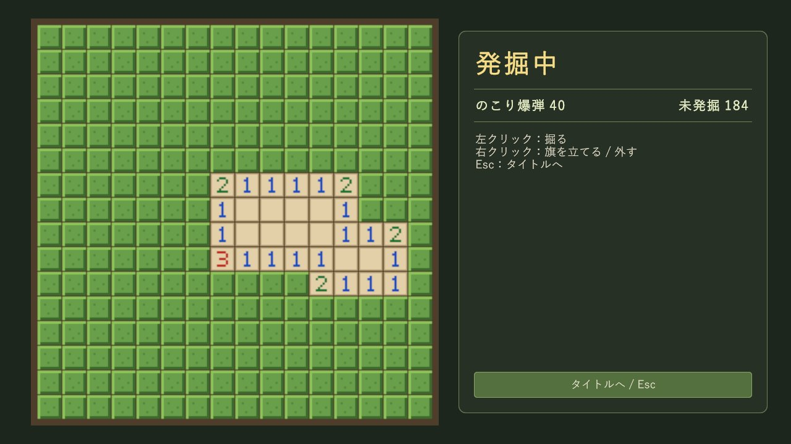
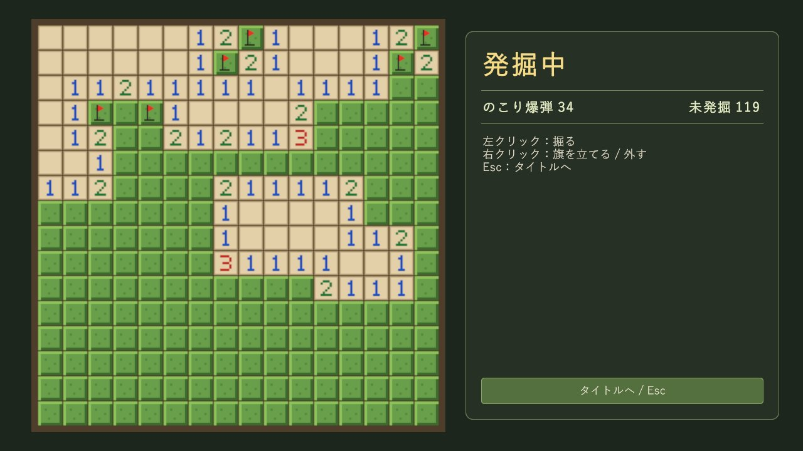
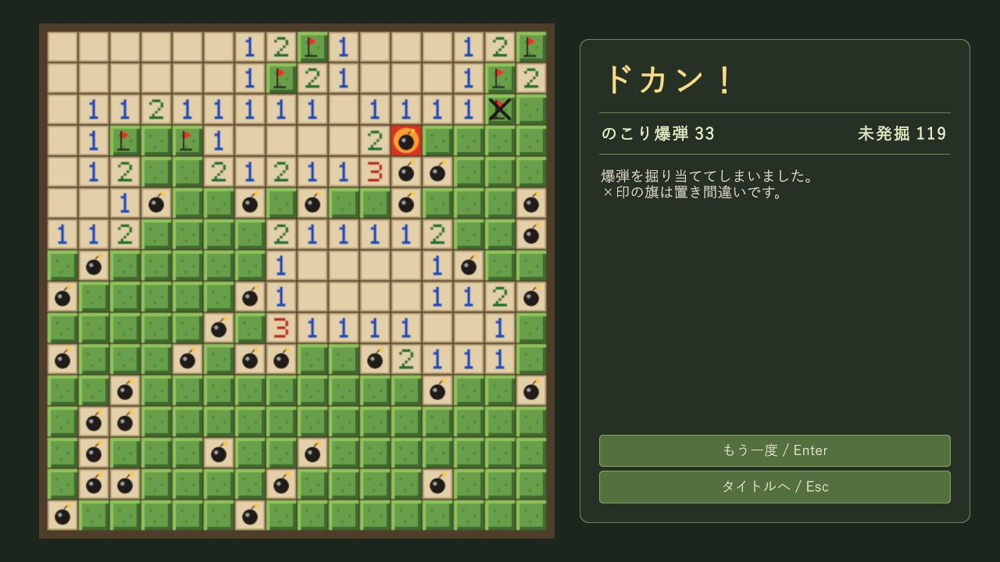
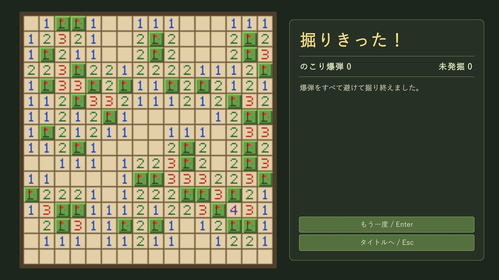
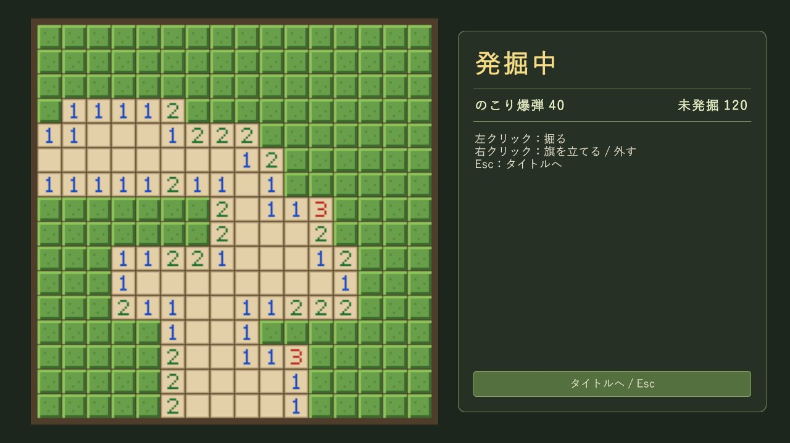

# 010 検証記録

2026-11-19実施。人間の通しプレイは未実施。

## 自動検証

| 項目 | 結果 |
|---|---|
| dev lint | 成功（全作品） |
| dev check | 成功（全作品、警告0・エラー0） |
| dev test | 成功（全作品）。010 Core 48/48、App 12/12 |
| Unity EditMode | 60/60（Core/App、Mono） |
| Unity PlayMode | 33/33（実シーン17、共通証跡公開16） |
| Windowsビルド | 成功、StandaloneWindows64 |
| ビルド起動 | dev captureで起動・全場面撮影・正常終了 |
| 証跡 | JPEG品質85、7枚 |
| 撮影再現 | 同一ビルドを2回撮影し、画像世代b94788f77f2e63d3が一致 |

Build GUID：`6307796314494b34a78f43c961007935`。公開ポインタは[current.json](current.json)、実行記録は[manifest.json](runs/20261118T160232Z-b3c1bba5/manifest.json)。撮影は試合ごとにシード1から順に使う。

Unityのビルドログにライセンスクライアントの検証メッセージが出たが、ビルドとPlayerの撮影起動は成功した。

## 画面証跡

### タイトル

### 初手の前

### 連鎖公開

### 旗を立てた途中

### 敗北

踏んだ爆弾は赤い背景、×印の旗は置き間違い。

### 勝利

### 再戦

## 人間の確認

未実施。`dev run 010` での通しプレイを待っている。
