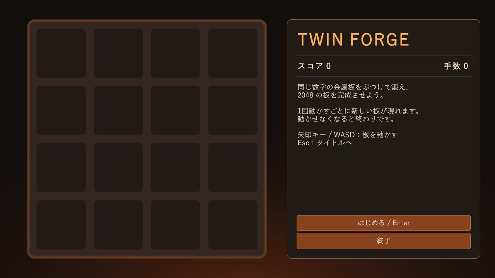
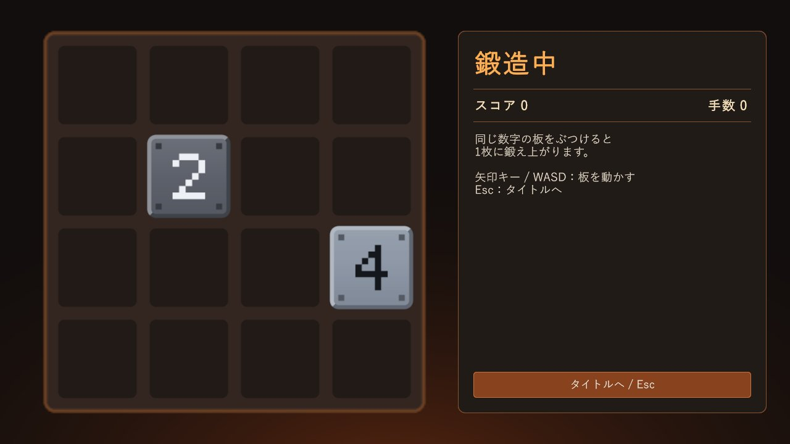
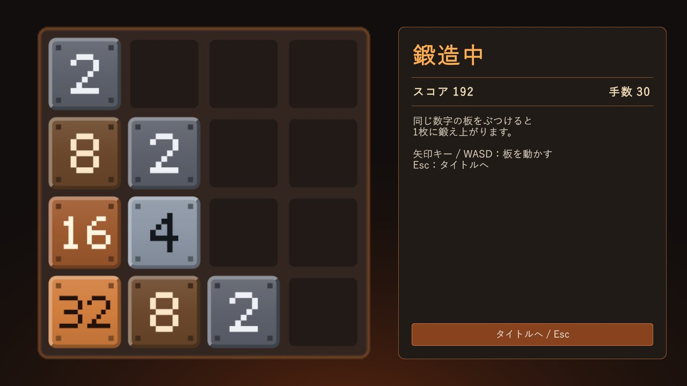
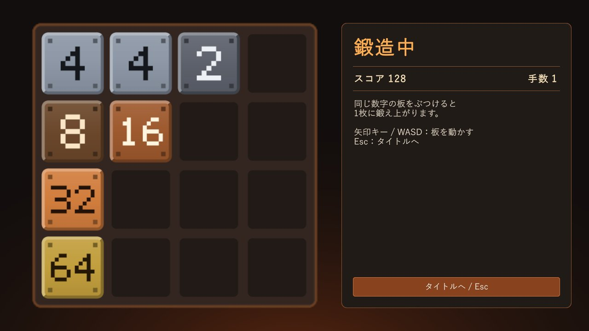
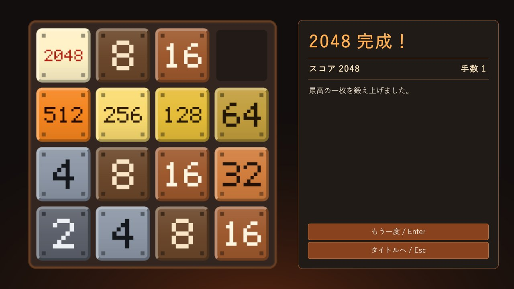
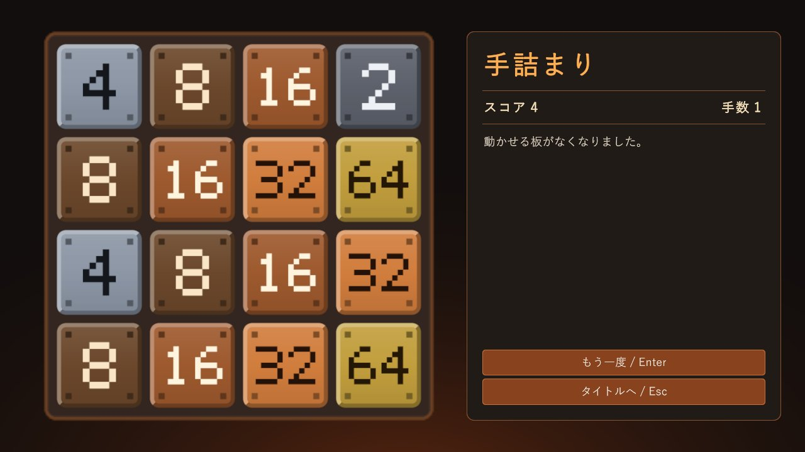
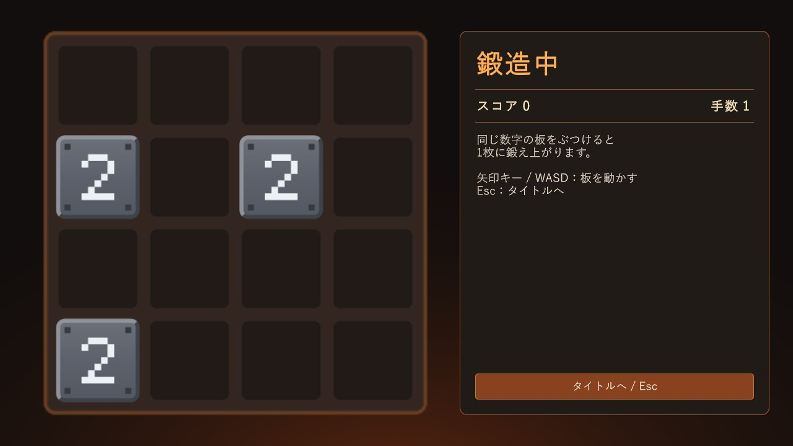

# 011 検証記録

2026-11-19実施。人間の動作確認は未実施。

## 自動検証

| 項目 | 結果 |
|---|---|
| dev lint | 成功（全作品） |
| dev check | 成功（全作品、警告0・エラー0） |
| dev test | 成功（全作品）。011 Core 66/66、App 13/13 |
| Unity EditMode | 79/79（Core/App、Mono） |
| Unity PlayMode | 36/36（実シーン20、共通証跡公開16） |
| Windowsビルド | 成功、StandaloneWindows64 |
| ビルド起動 | dev captureで起動・全場面撮影・正常終了 |
| 証跡 | JPEG品質85、7枚 |
| 撮影再現 | 同一ビルドを2回撮影し、画像世代0f0ead955b128d6aが一致 |

Build GUID：`f8d859b94be04b40a6fc72f058cb75ac`。公開ポインタは[current.json](current.json)、実行記録は[manifest.json](runs/20261118T172332Z-08008385/manifest.json)。撮影は試合ごとにシード1から順に使う。

終了ボタンは、押すと終了処理を1回呼ぶことをPlayModeテストで確認している。エディタでは `Application.Quit` が働かないため、ビルドで実際に終了する動作は自動テストの対象外。

Unityのビルドログにライセンスクライアントの検証メッセージが出たが、ビルドとPlayerの撮影起動は成功した。

## 画面証跡

### タイトル

### 開始直後

### 中盤

### 合体

各行を左へ動かした直後。`2,2,2,2` は `4,4` になる。

### 勝利

用意した盤面から1手で2048を作った場面。勝利した手では新しい板が出ない。

### 敗北

用意した盤面から1手で手詰まりになった場面。

### 再戦

## 人間の確認

未実施。`dev run 011` での通しプレイと、速度・音量の確認を待っている。
