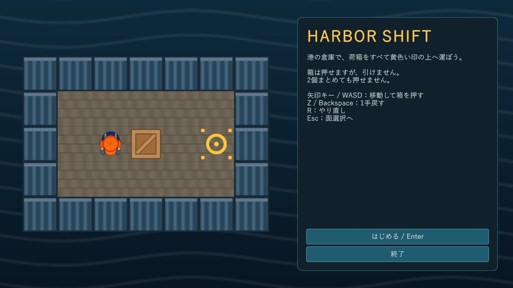
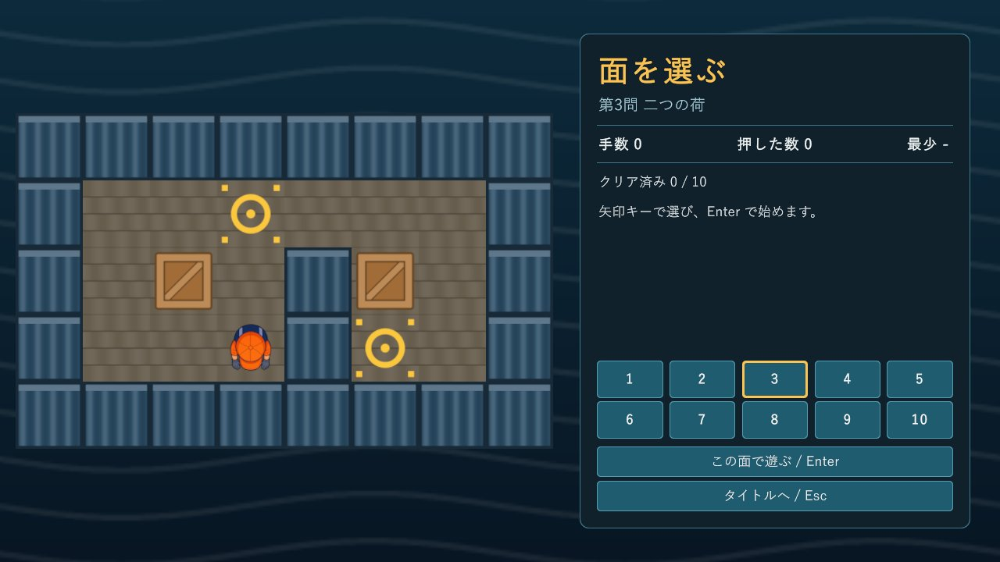
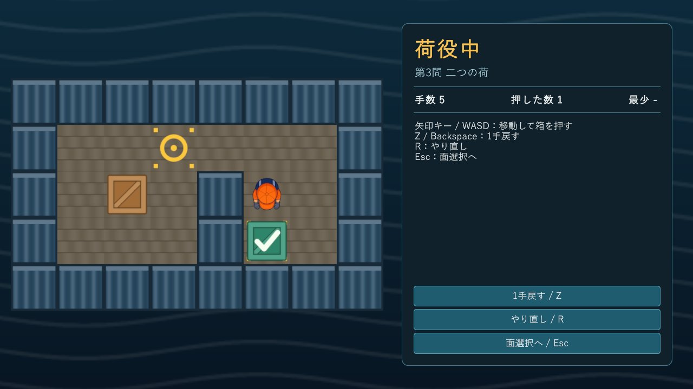
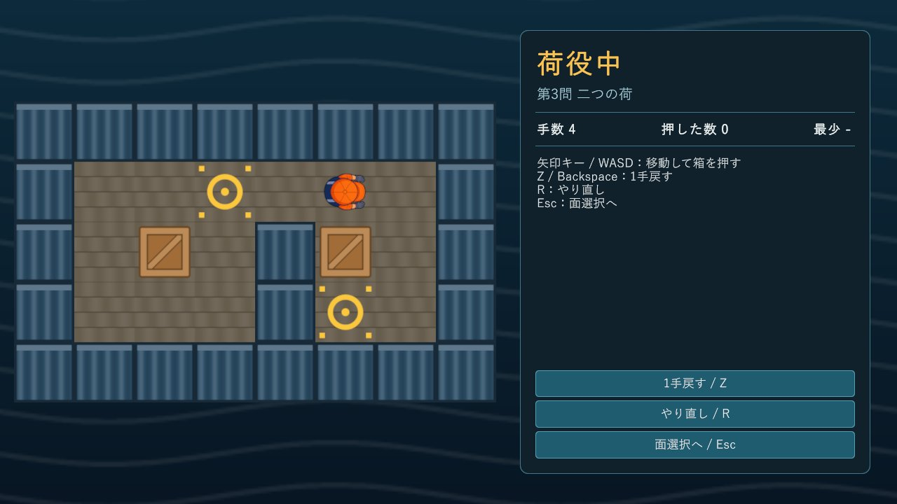
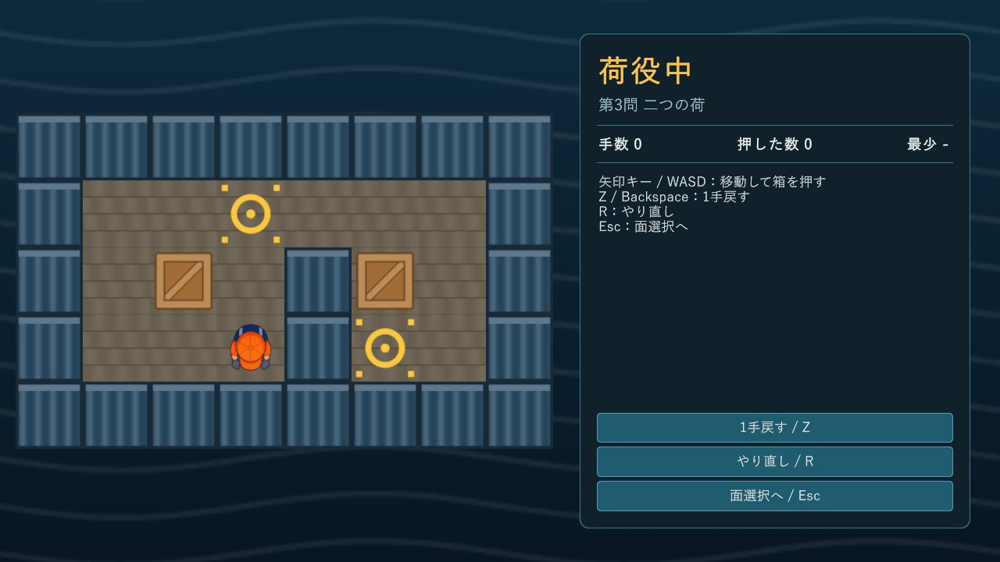
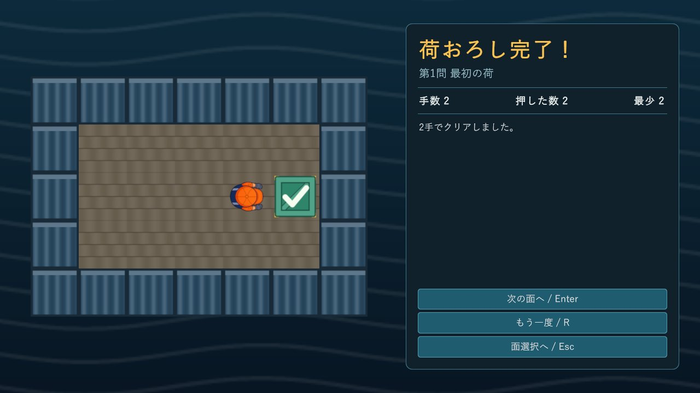
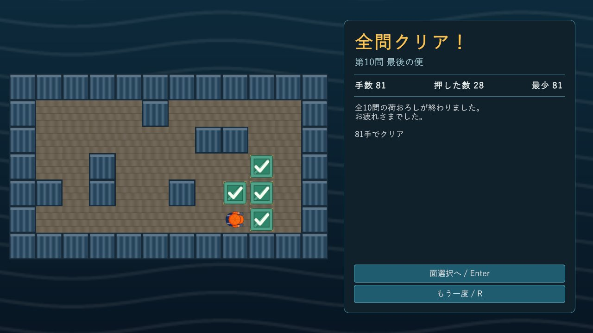
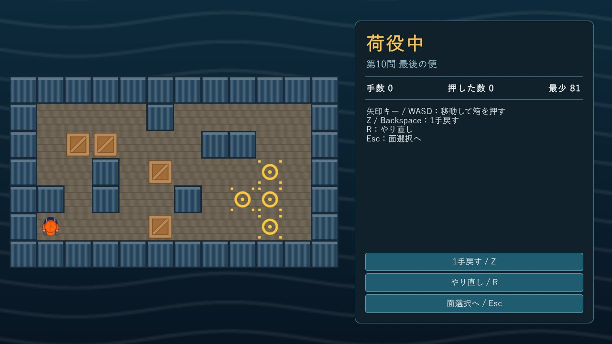

# 012 検証記録

2026-11-19実施。同日に人間の動作確認OKと完了承認を受領。

## 自動検証

| 項目 | 結果 |
|---|---|
| dev lint | 成功（全作品） |
| dev check | 成功（全作品、警告0・エラー0） |
| dev test | 成功（全作品）。012 Core 94/94、App 42/42 |
| Unity EditMode | 136/136（Core/App、Mono） |
| Unity PlayMode | 43/43（実シーン27、共通証跡公開16） |
| Windowsビルド | 成功、StandaloneWindows64 |
| ビルド起動 | dev captureで起動・全場面撮影・正常終了 |
| 証跡 | JPEG品質85、9枚 |
| 撮影再現 | 同一ビルドを2回撮影し、画像世代e9302e389bb64b99が一致 |

Build GUID：`43b2c22cd81c479081b7ad9091eeae4b`。公開ポインタは[current.json](current.json)、実行記録は[manifest.json](runs/20261118T185758Z-93970097/manifest.json)。このゲームは乱数を使わないので、マニフェストのシードは結果に影響しない。

全10問は、Coreテストで解答手順を再生してクリアできることを確認している。

終了ボタンは、押すと終了処理を1回呼ぶことをPlayModeテストで確認している。エディタでは `Application.Quit` が働かないため、ビルドで実際に終了する動作は自動テストの対象外。

Unityのビルドログにライセンスクライアントの検証メッセージが出たが、ビルドとPlayerの撮影起動は成功した。

## 画面証跡

### タイトル

### 面選択

カーソルの位置の面を盤面に表示する。

### プレイ開始

### 箱押し

目標に載った箱は緑色になり、チェック印が付く。

### 1手戻す

直前の押しを取り消し、箱が目標から離れた場面。

### やり直し

初期盤面へ戻り、手数と押した数も0になる。

### クリア

### 全問クリア

第2問から第9問はクリア記録だけを用意し、第1問と最終問は解答手順を実際に再生して撮影した。

### 再プレイ

## 人間の確認

2026-11-19に動作確認OKと完了承認を受領。
