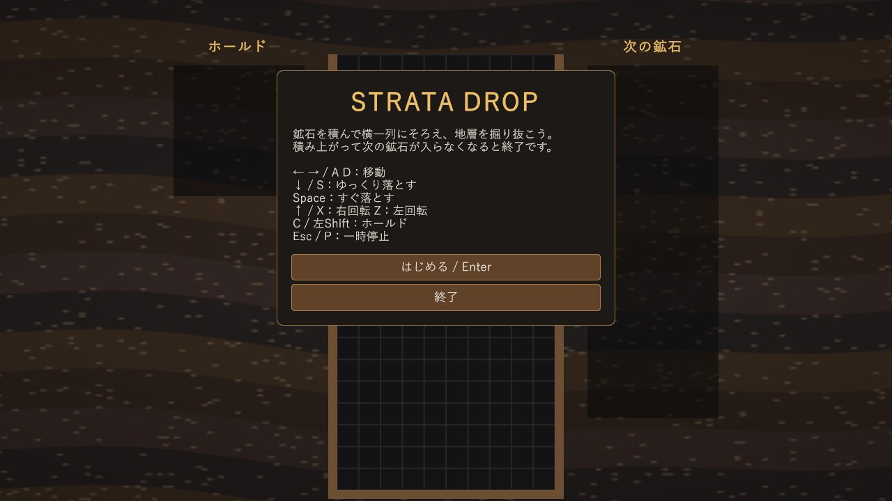
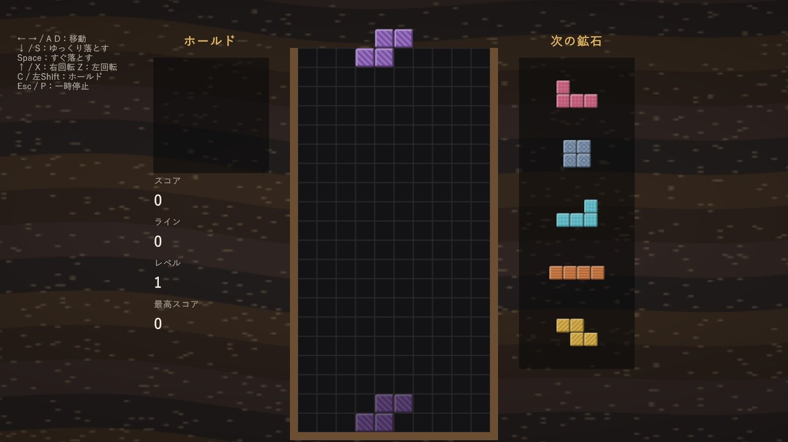
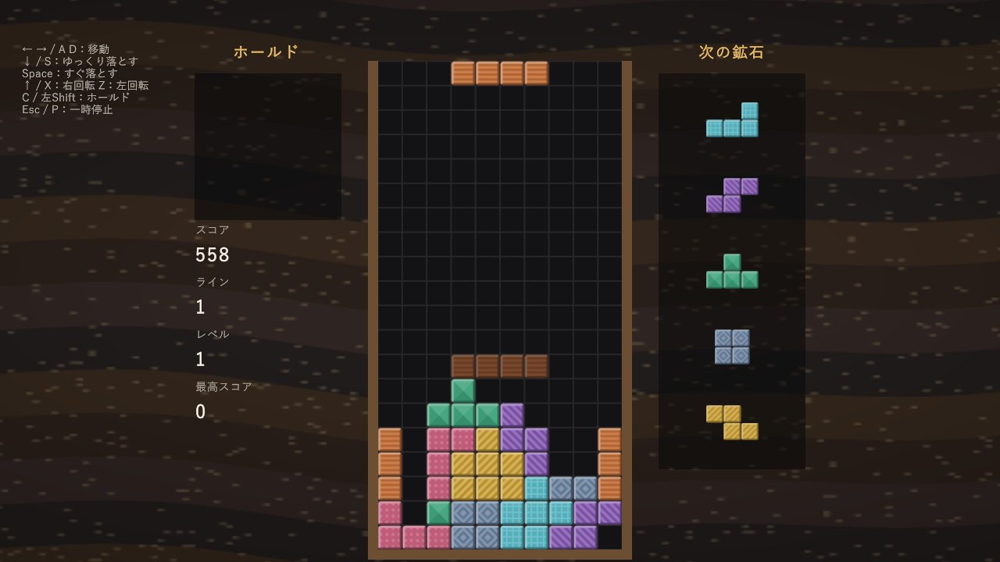
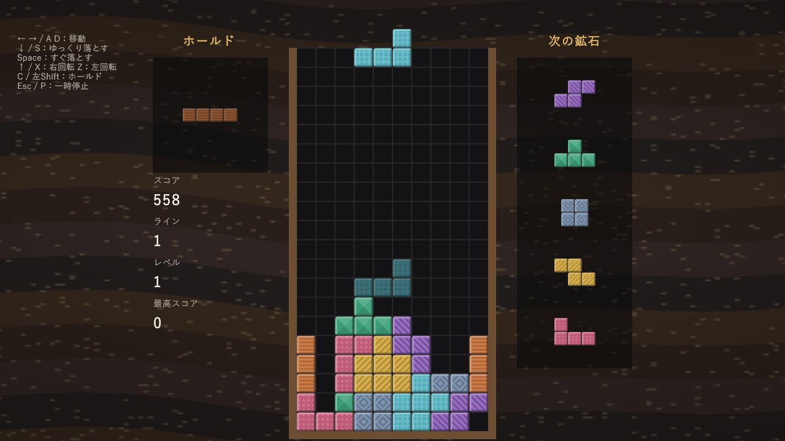
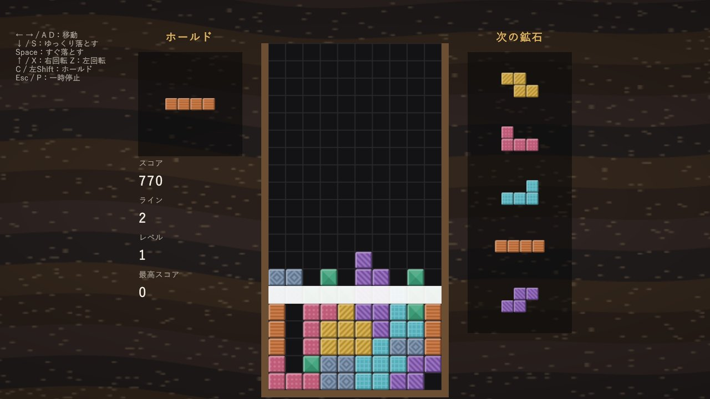
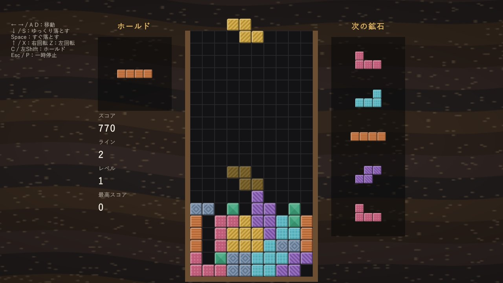
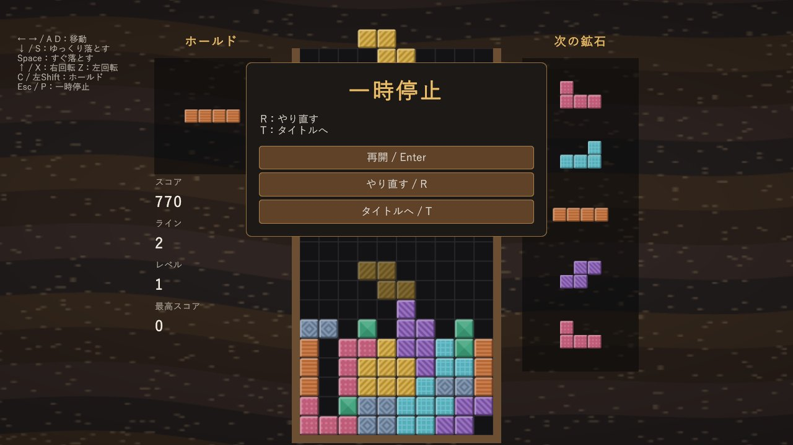
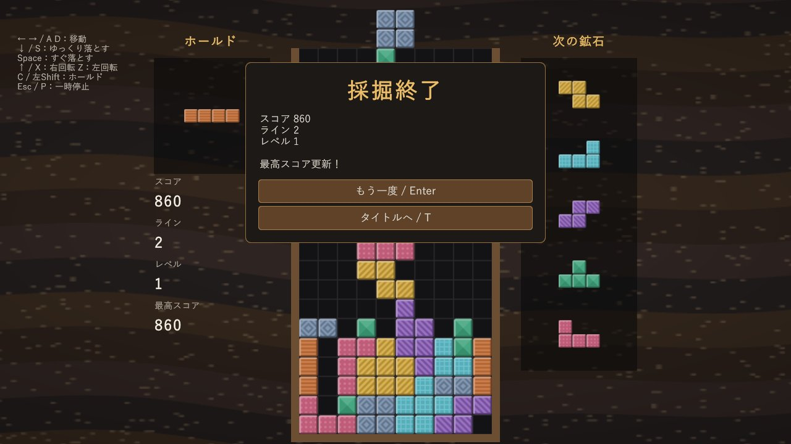
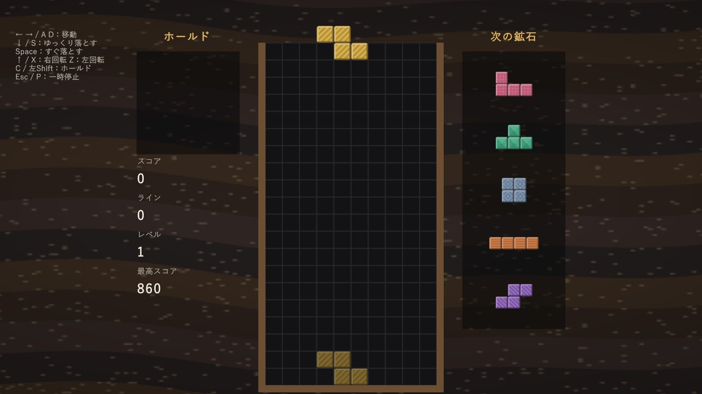

# 013 検証記録

2026-11-19実施。同日に人間の完了承認を受領。

## 自動検証

| 項目 | 結果 |
|---|---|
| dev lint | 成功（全作品） |
| dev check | 成功（全作品、警告0・エラー0） |
| dev test | 成功（全作品）。013 Core 80/80、App 49/49 |
| Unity EditMode | 129/129（Core/App、Mono） |
| Unity PlayMode | 35/35（実シーン19、共通証跡公開16） |
| Windowsビルド | 成功、StandaloneWindows64 |
| ビルド起動 | dev captureで起動・全場面撮影・正常終了 |
| 証跡 | JPEG品質85、9枚 |
| 撮影再現 | 同一ビルドを2回撮影し、画像世代e8f32410a1a454e5が一致 |

Build GUID：`5f47131b33154224b14bf54db650f830`。シード：1。公開ポインタは[current.json](current.json)、実行記録は[manifest.json](runs/20261118T203631Z-9a63b2d7/manifest.json)。

同じシードと入力列の最終盤面は、固定のハッシュ値と照合するテストが dotnet（.NET）と Unity EditMode（Mono）の両方で通っている。

終了ボタンは、押すと終了処理を1回呼ぶことをPlayModeテストで確認している。エディタでは `Application.Quit` が働かないため、ビルドで実際に終了する動作は自動テストの対象外。

Unityのビルドログにライセンスクライアントの検証メッセージが出たが、ビルドとPlayerの撮影起動は成功した。

## 画面証跡

### タイトル

### プレイ開始

### プレイ中

薄く表示しているのがハードドロップの着地点。

### ホールド

### ライン消去の演出

### ライン消去後

消した段の上のブロックが下へ詰まった場面。

### 一時停止

### 結果

### 再プレイ

## 人間の確認

2026-11-19に完了承認を受領。
