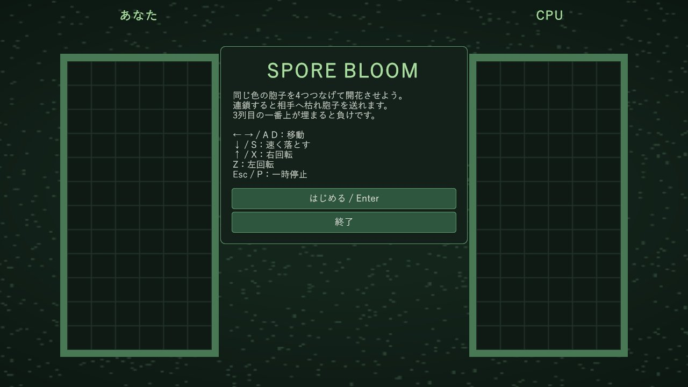
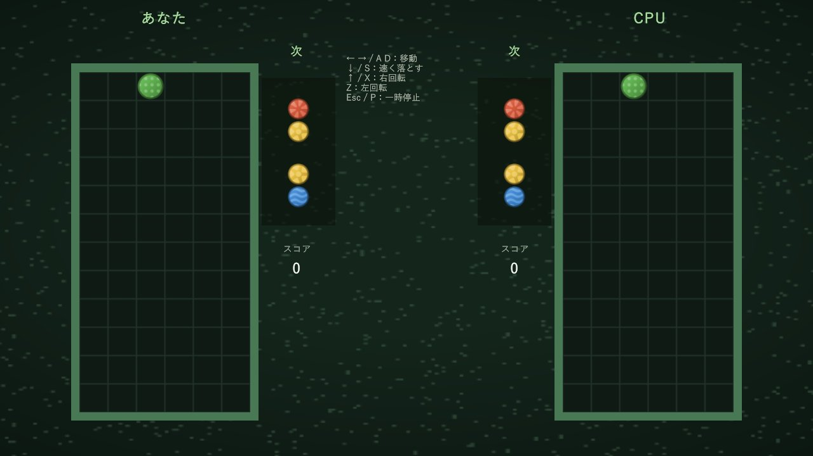
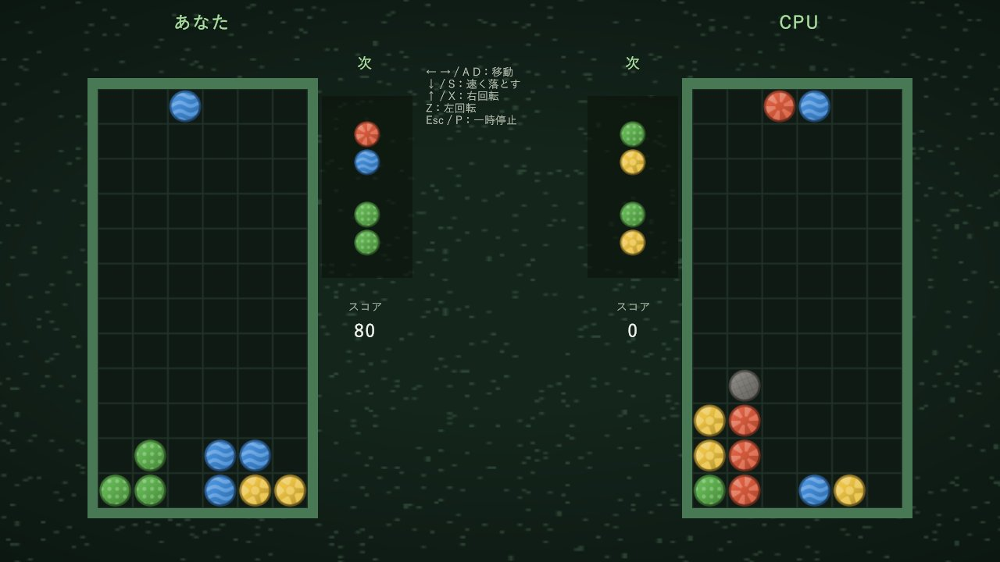
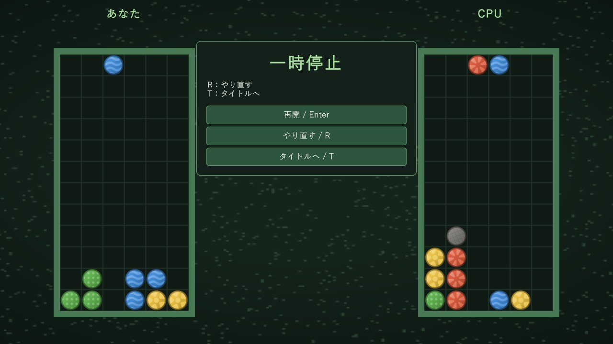
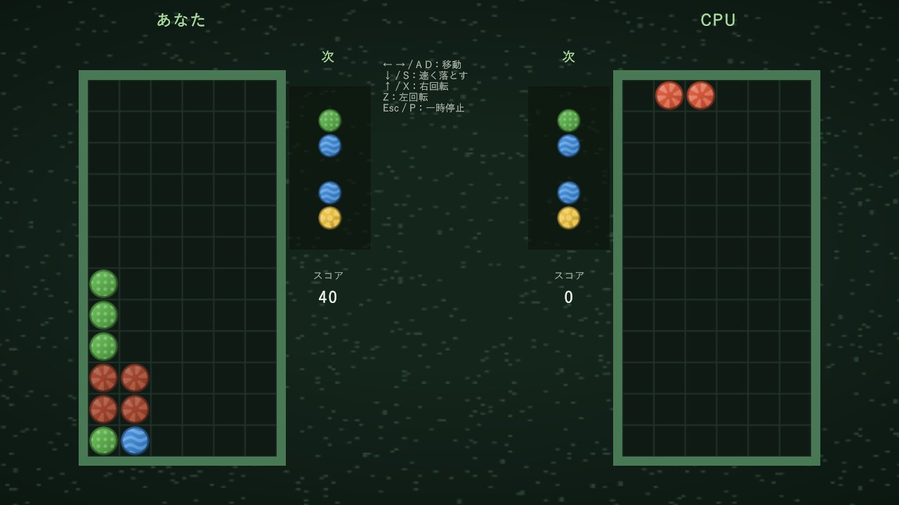
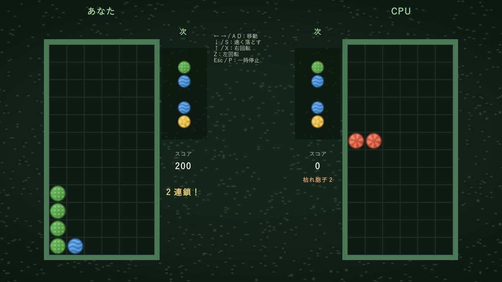
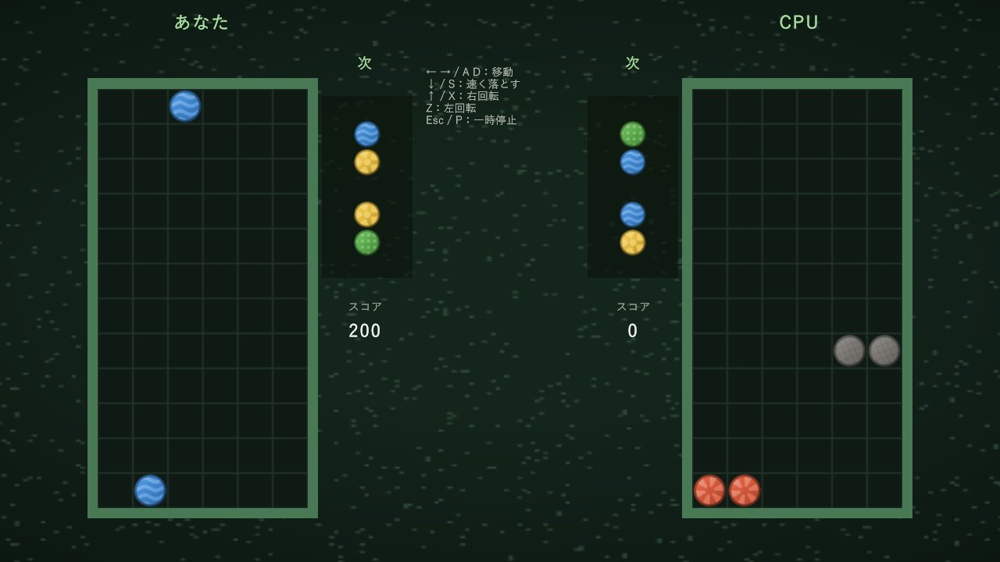
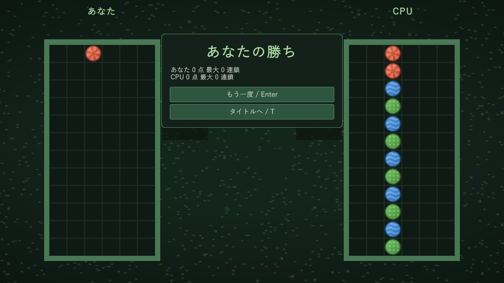
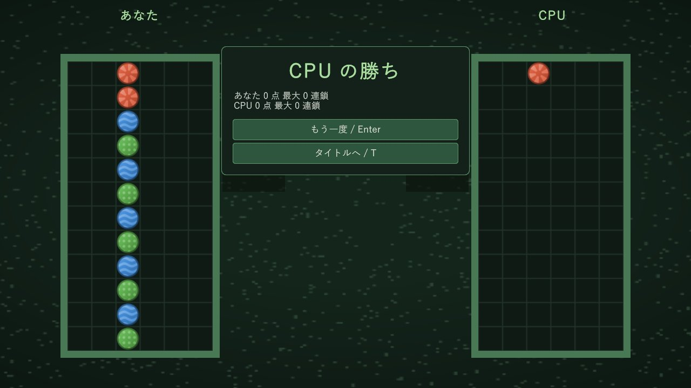
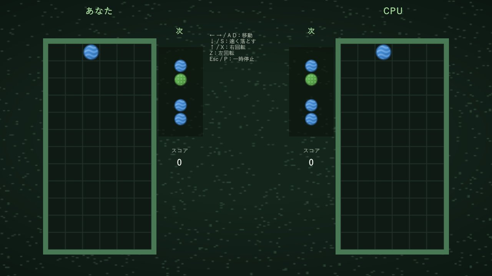

# 014 検証記録

2026-11-19実施。人間のプレイ確認は未実施。

## 自動検証

| 項目 | 結果 |
|---|---|
| dev lint | 成功（全作品） |
| dev check | 成功（全作品、警告0・エラー0） |
| dev test | 成功（全作品）。014 Core 86/86、App 44/44 |
| Unity EditMode | 130/130（Core/App、Mono） |
| Unity PlayMode | 37/37（実シーン21、共通証跡公開16） |
| Windowsビルド | 成功、StandaloneWindows64 |
| ビルド起動 | dev captureで起動・全場面撮影・正常終了 |
| 証跡 | JPEG品質85、11枚 |
| 撮影再現 | 同一ビルドを2回撮影し、画像世代861e6587f065edfeが一致 |

Build GUID：`386c8cc794884512b2fd9ad7b8f5efa6`。シード：1。公開ポインタは[current.json](current.json)、実行記録は[manifest.json](runs/20261119T014311Z-236a864a/manifest.json)。

同じシードと入力列の最終盤面は、固定のハッシュ値と照合するテストが dotnet（.NET）と Unity EditMode（Mono）の両方で通っている。

意図的な2連鎖は、PlayModeテストで実際のキー入力（左へ移動して下キーを押し続ける）から成立することを確かめている。

終了ボタンは、押すと終了処理を1回呼ぶことをPlayModeテストで確認している。エディタでは `Application.Quit` が働かないため、ビルドで実際に終了する動作は自動テストの対象外。

Unityのビルドログにライセンスクライアントの検証メッセージが出たが、ビルドとPlayerの撮影起動は成功した。

## 画面証跡

### タイトル

### プレイ開始

### プレイ中

### 一時停止

### 1連鎖目

ペアを置いて4個つながり、消える演出の途中の場面。

### 2連鎖目

1連鎖目の消去で落ちた胞子がつながった場面。

### 攻撃の予告

2連鎖の攻撃が CPU の予告に届いた場面。

### 枯れ胞子の着弾

### 勝利

### 敗北

### 再戦

