# 015 検証記録

2026-11-19実施。自動検証まで通し、人間のプレイ確認待ち。

## 自動検証

| 項目 | 結果 |
|---|---|
| dev lint | 成功（全作品） |
| dev check | 成功（全作品、警告0・エラー0） |
| dev test | 成功（全作品）。015 Core 87/87、App 40/40 |
| Unity EditMode | 127/127（Core/App、Mono） |
| Unity PlayMode | 29/29（実シーン13、共通証跡公開16） |
| Windowsビルド | 成功、StandaloneWindows64 |
| ビルド起動 | dev captureで起動・全場面撮影・正常終了 |
| 証跡 | JPEG品質85、12枚 |
| 撮影再現 | 同一ビルドを2回撮影し、画像世代bb0170b2edaffc3cが一致 |

Build GUID：`0f76442cbdc043caba4339659fbcf806`。シード：1。公開ポインタは[current.json](current.json)、実行記録は[manifest.json](runs/20261119T042535Z-33ada00d/manifest.json)。

同じシードと入れ替えの列の最終盤面と得点は、固定値と照合するテストが dotnet（.NET）と Unity EditMode（Mono）の両方で通っている。

マウスのクリック2回・ドラッグ・キーボード（矢印と Space）の入れ替えは、PlayModeテストで実際の入力デバイスから成立することを確かめている。

終了ボタンは、押すと終了処理を1回呼ぶことをPlayModeテストで確認している。エディタでは `Application.Quit` が働かないため、ビルドで実際に終了する動作は自動テストの対象外。

Unityのビルドログにライセンスクライアントの検証メッセージが出たが、ビルドとPlayerの撮影起動は成功した。

## 画面証跡

### タイトル

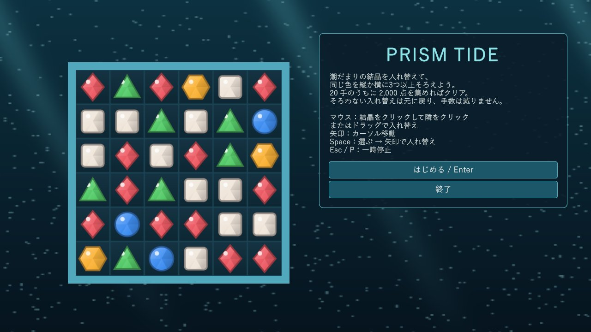

### プレイ開始

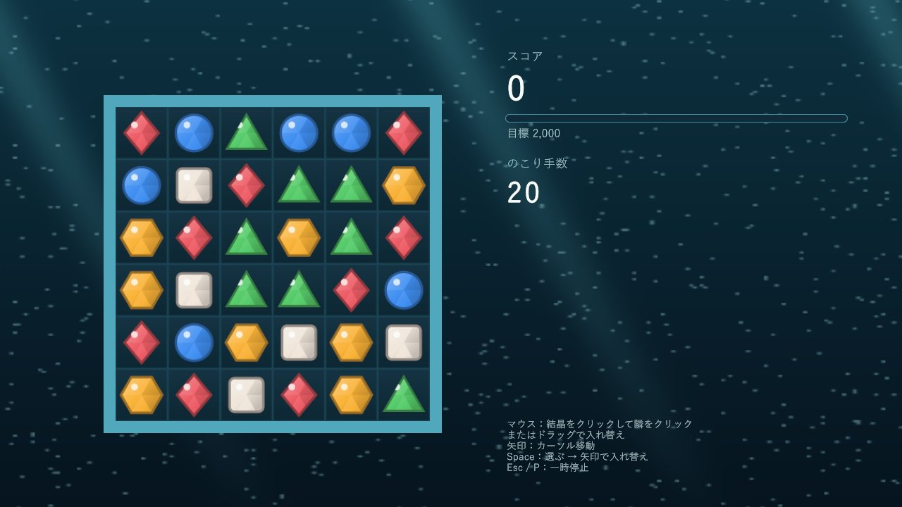

### 結晶の選択

序盤を4手進めた後、キーボードのカーソルで結晶を選んだ場面。

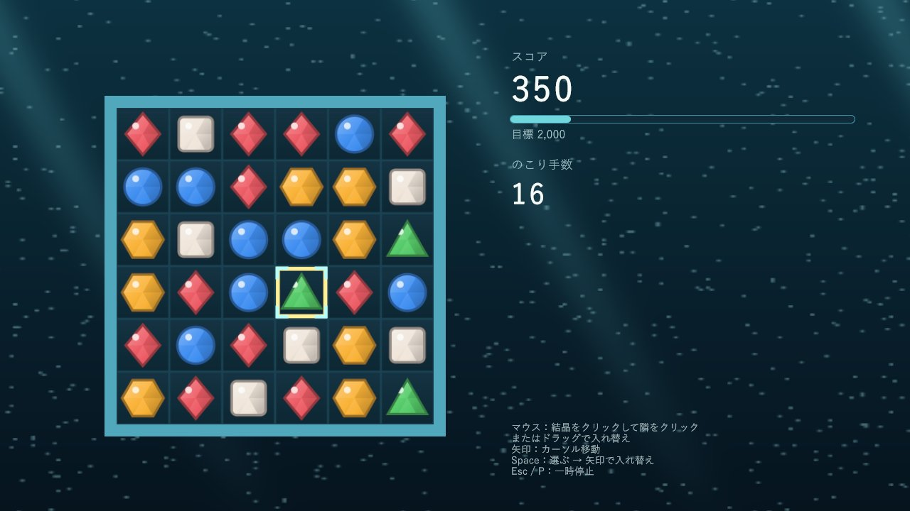

### 不成立の入れ替え

並びができない入れ替えが、元へ戻る途中の場面。

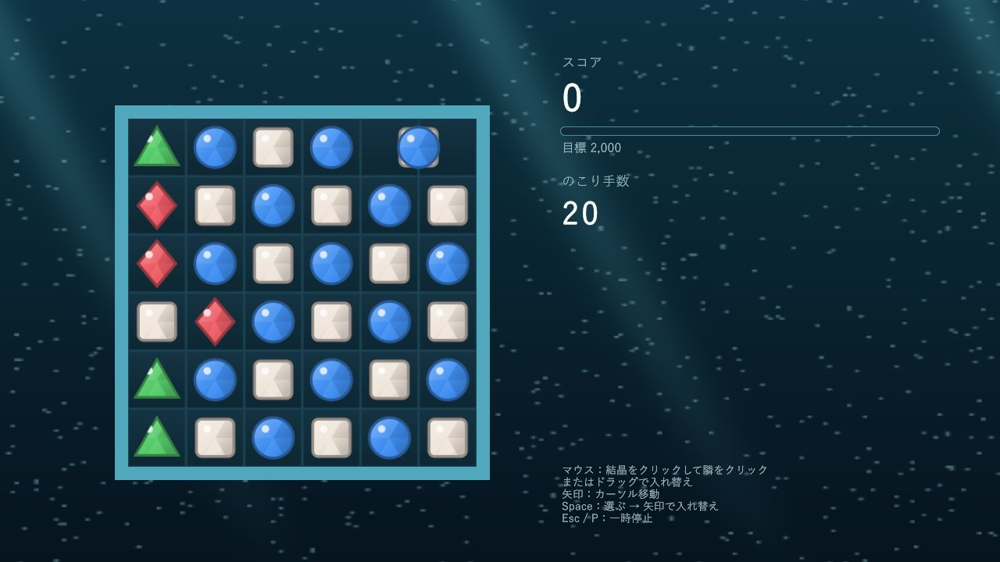

### 落下と補充

1段目の消去の後、上の結晶が落ち、補充の結晶が盤面の上から入ってくる場面。

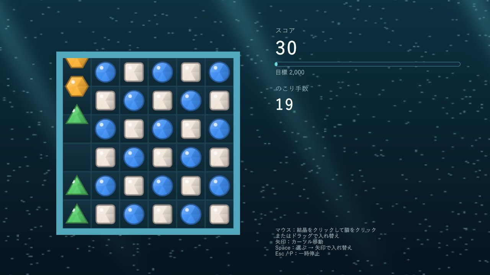

### 2連鎖目

落ちた結晶が並んで、2段目が消える途中の場面。

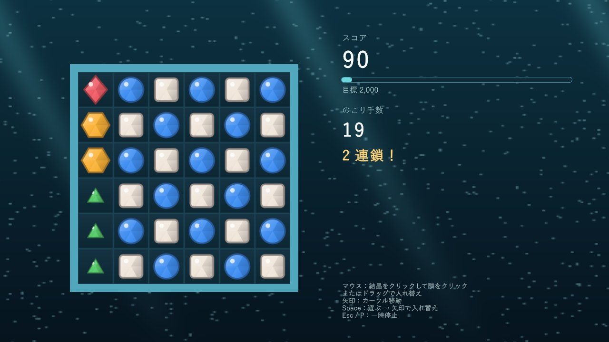

### T字の消去

縦横の並びが交わる5個が消える途中の場面。重なるマスは1回だけ数え、50点になる。

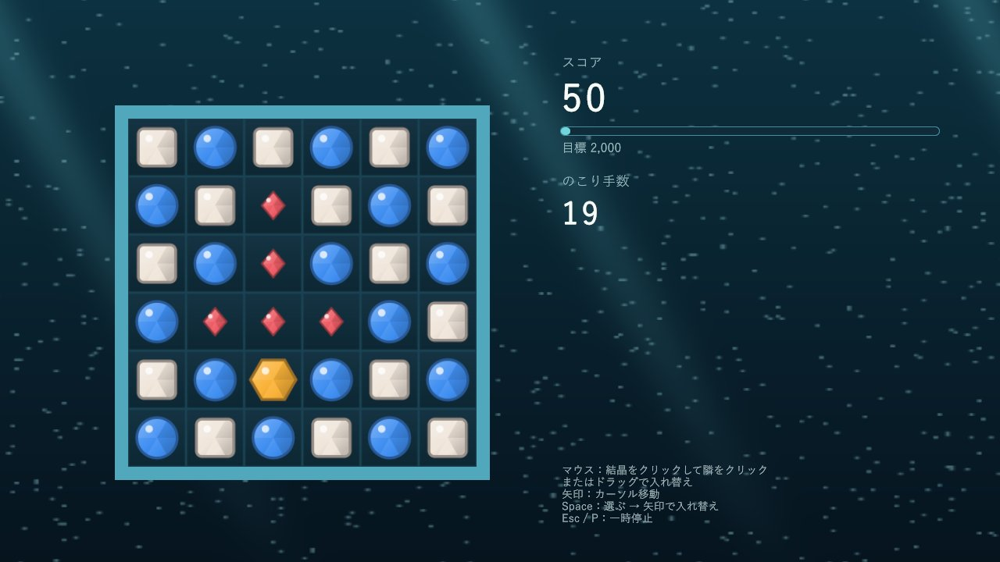

### 手詰まりの作り直し

合法手のない盤面を、手数を減らさずに作り直している場面。

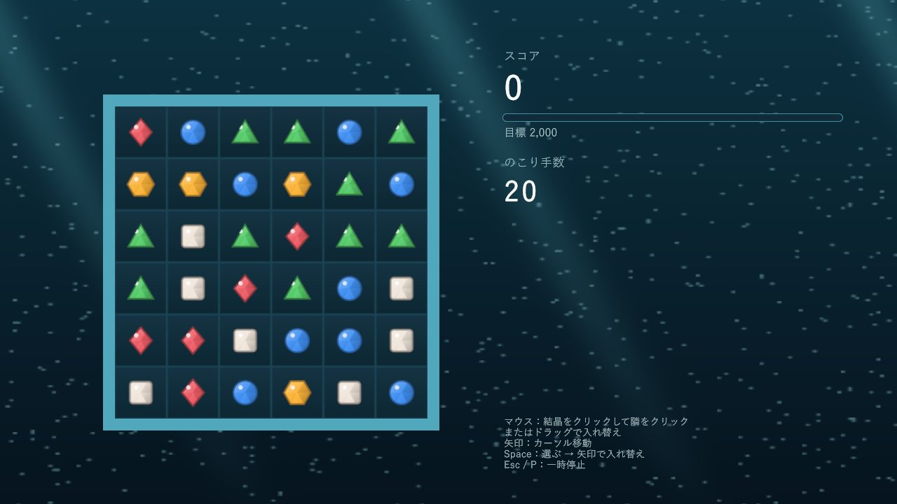

### 一時停止

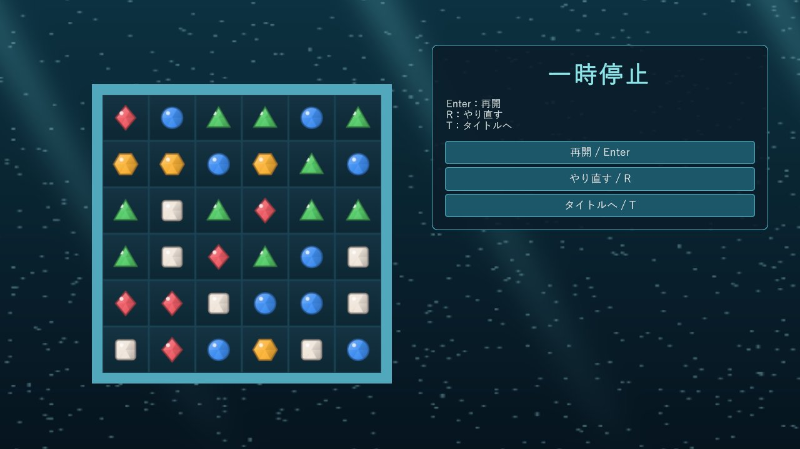

### 目標達成

目標を60点にした試合で、2連鎖して達成した場面。

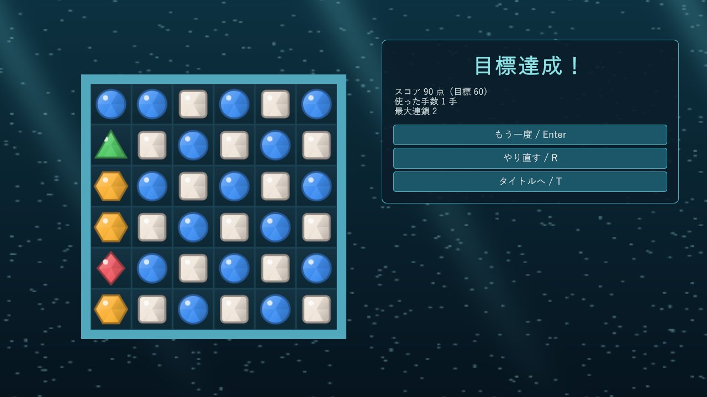

### 手数切れ

手数を1にした試合で、目標に届かずに手数を使い切った場面。

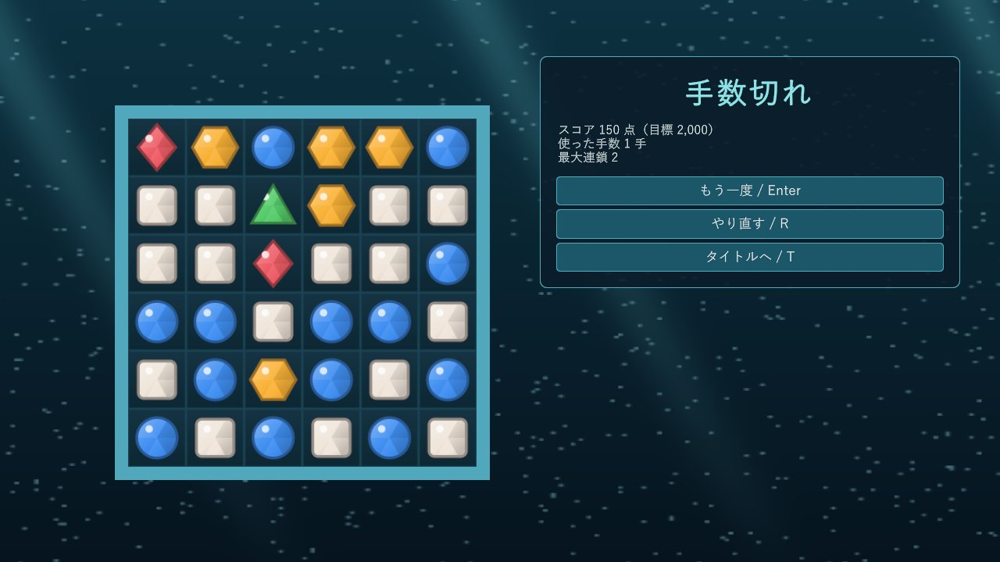

### 再戦

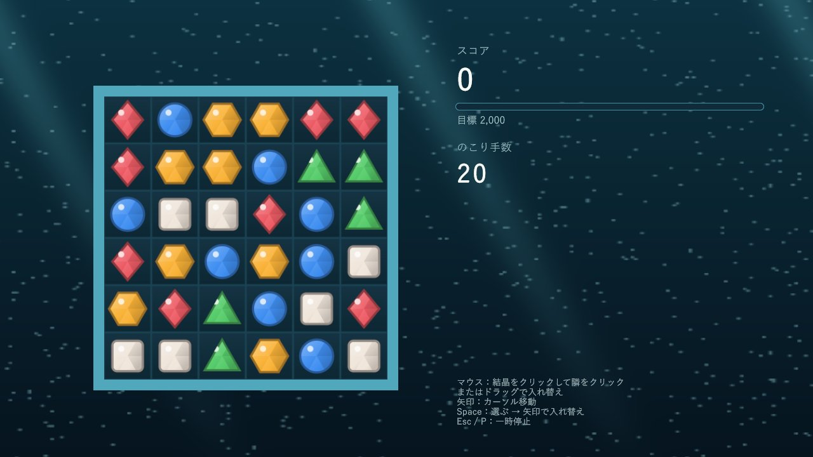
