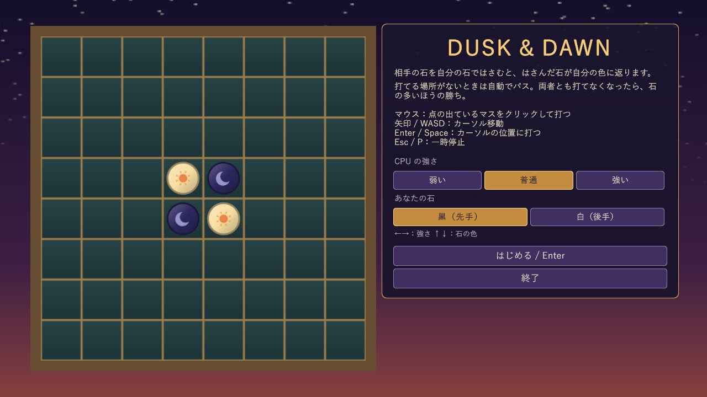
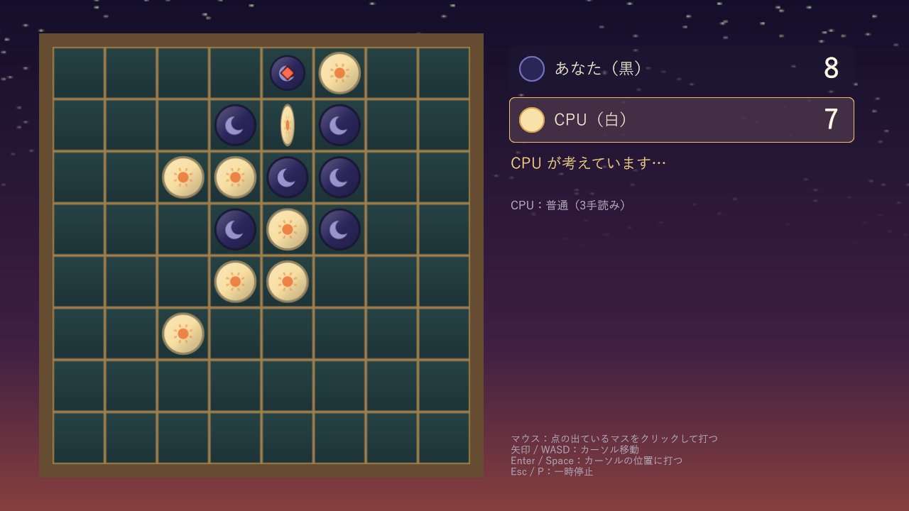
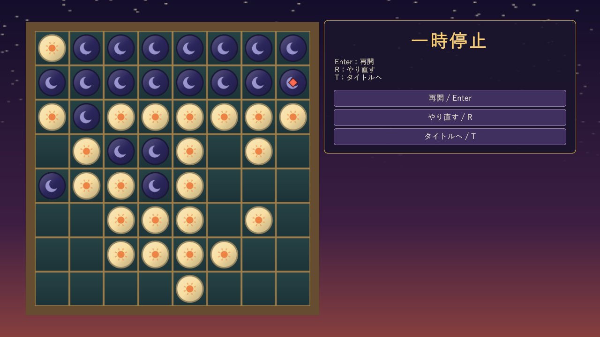
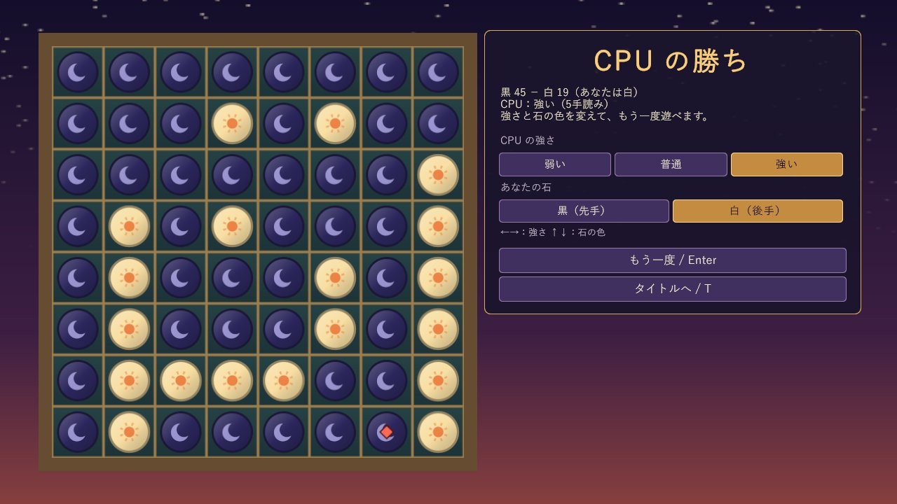

# 016 検証記録

2026-11-19実施。人間のプレイ確認待ち。

## 自動検証

| 項目 | 結果 |
|---|---|
| dev lint | 成功（全作品） |
| dev check | 成功（全作品、警告0・エラー0） |
| dev test | 成功（全作品）。016 Core 75/75、App 37/37 |
| Unity EditMode | 112/112（Core/App、Mono） |
| Unity PlayMode | 32/32（実シーン16、共通証跡公開16） |
| Windowsビルド | 成功、StandaloneWindows64 |
| ビルド起動 | dev captureで起動・全場面撮影・正常終了 |
| 証跡 | JPEG品質85、10枚 |
| 撮影再現 | 同一ビルドを2回撮影し、画像世代bd050bc431a26f20が一致 |

Build GUID：`b3f649aa879e4cfcbdd058c4e1e4fc99`。シード：1。公開ポインタは[current.json](current.json)、実行記録は[manifest.json](runs/20261119T141000Z-d94e9ba5/manifest.json)。

合法手の生成は、64マス×8方向を1マスずつ歩く参照実装と、ランダム対局300局の全局面・両方の手番で照合している。固定シードの CPU 同士の対局の最終局面は、dotnet（.NET）と Unity EditMode（Mono）の両方で固定値と一致した。

マウスのクリック・キーボード（矢印と Space）の着手、非合法手のクリックの拒否、CPU の手番のクリックを捨てることは、PlayModeテストで実際の入力デバイスから確かめている。返す演出は、Tick をテストから進めて、前半は元の色で細くなり、後半は新しい色で太くなり、終わると全石が通常の大きさになることを確かめている。

終了ボタンは、押すと終了処理を1回呼ぶことをPlayModeテストで確認している。エディタでは `Application.Quit` が働かないため、ビルドで実際に終了する動作は自動テストの対象外。

Unityのビルドログにライセンスクライアントの検証メッセージが出たが、ビルドとPlayerの撮影起動は成功した。

## 画面証跡

### タイトル（強さと石の色を選ぶ）

### プレイ開始

### 合法手の印とキーボードのカーソル

### 石を返す途中

### CPU が考えている間

### パス

### 一時停止

### 勝ち

### 負け（白・強い）

### 白で再戦（CPU の初手の後）

