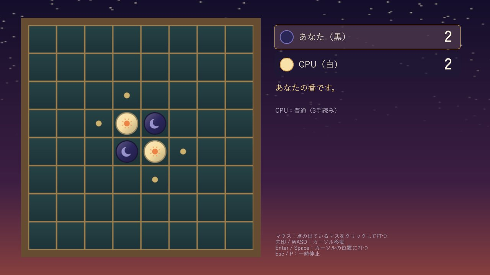
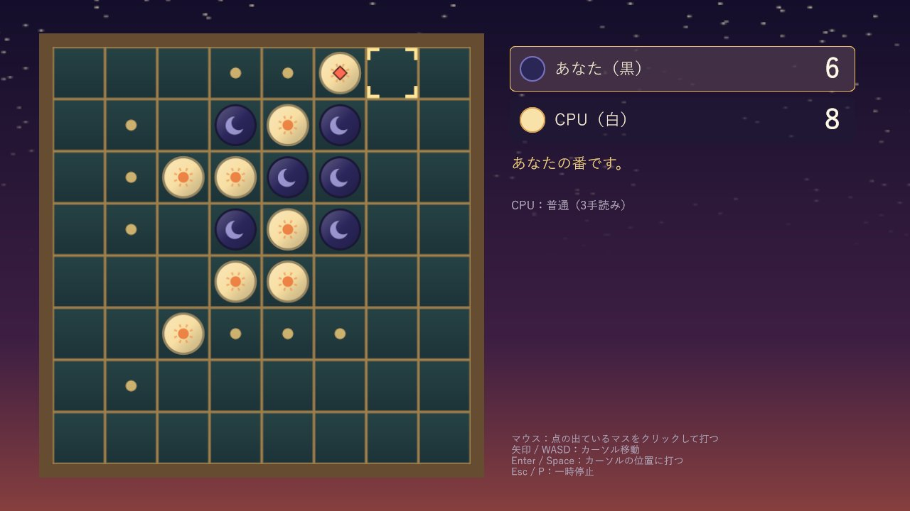
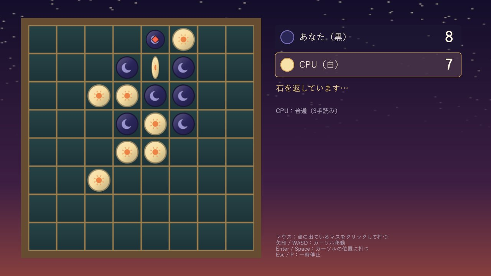
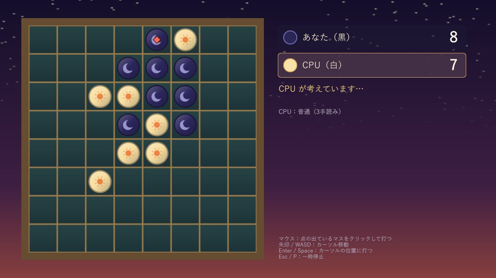
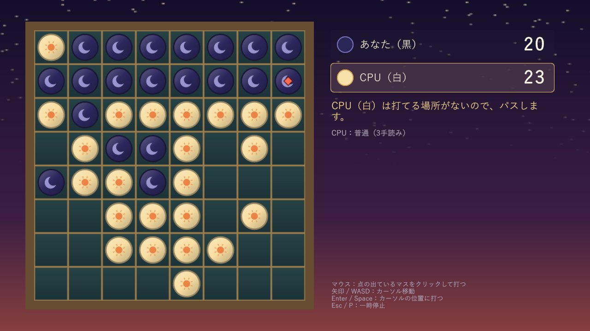
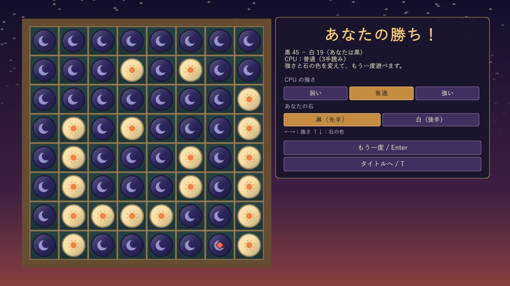
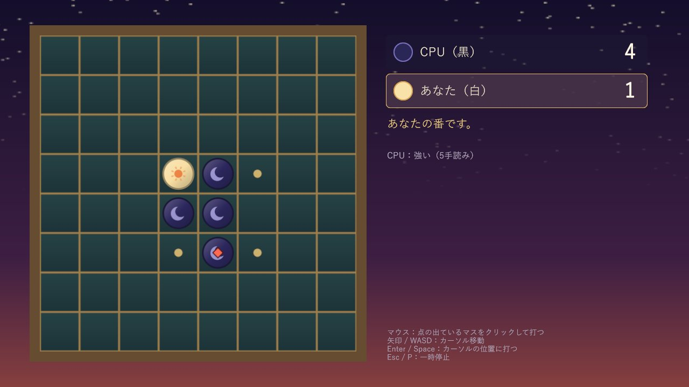

# 016 検証記録

2026-11-19実施。人間のプレイ確認を受け、同日に完了承認を受領した。

## 自動検証

| 項目 | 結果 |
|---|---|
| dev lint | 成功（全作品） |
| dev check | 成功（全作品、警告0・エラー0） |
| dev test | 成功（全作品）。016 Core 79/79、App 38/38 |
| Unity EditMode | 117/117（Core/App、Mono） |
| Unity PlayMode | 35/35（実シーン19、共通証跡公開16） |
| Windowsビルド | 成功、StandaloneWindows64 |
| ビルド起動 | dev captureで起動・全場面撮影・正常終了 |
| 証跡 | JPEG品質85、10枚 |
| 撮影再現 | 同一ビルドを2回撮影し、画像世代fafe2d2fb66f1ae8が一致 |

Build GUID：`bb33993496ab4112b8728f5235f39b23`。シード：1。公開ポインタは[current.json](current.json)、実行記録は[manifest.json](runs/20261119T143528Z-d7fc2c2e/manifest.json)。

合法手の生成は、64マス×8方向を1マスずつ歩く参照実装と、ランダム対局300局の全局面・両方の手番で照合している。固定シードの CPU 同士の対局の最終局面は、dotnet（.NET）と Unity EditMode（Mono）の両方で固定値と一致した。

マウスのクリック・キーボード（矢印と Space）の着手、非合法手のクリックの拒否、CPU の手番のクリックを捨てることは、PlayModeテストで実際の入力デバイスから確かめている。返す演出は、Tick をテストから進めて、前半は元の色で細くなり、後半は新しい色で太くなり、終わると全石が通常の大きさになることを確かめている。着手の直後は手番が相手へ移っていても返し終わるまで打てないので、その間は「石を返しています…」と出し、「あなたの番です。」と合法手の印は返し終わってから出すことを、CPU の着手とプレイヤーの着手の両方で確かめている。結果画面は勝ち・負け・引き分けの3通りを実シーンで確かめている。

終了ボタンは、押すと終了処理を1回呼ぶことをPlayModeテストで確認している。エディタでは `Application.Quit` が働かないため、ビルドで実際に終了する動作は自動テストの対象外。

Unityのビルドログにライセンスクライアントの検証メッセージが出たが、ビルドとPlayerの撮影起動は成功した。

## 画面証跡

### タイトル（強さと石の色を選ぶ）

### プレイ開始

### 合法手の印とキーボードのカーソル

### 石を返す途中

### CPU が考えている間

### パス

### 一時停止

### 勝ち

### 負け（白・強い）

### 白で再戦（CPU の初手の後）

