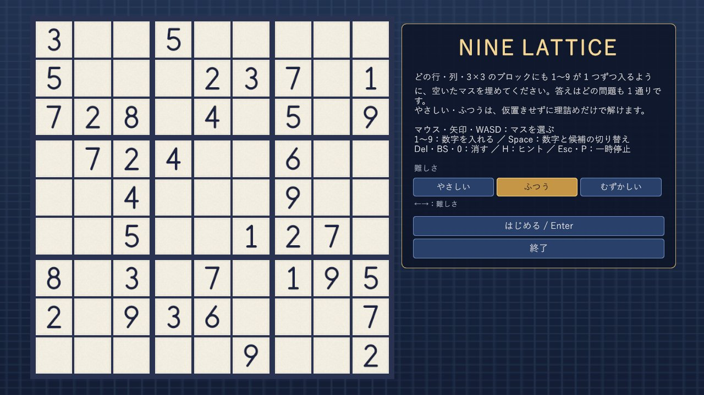
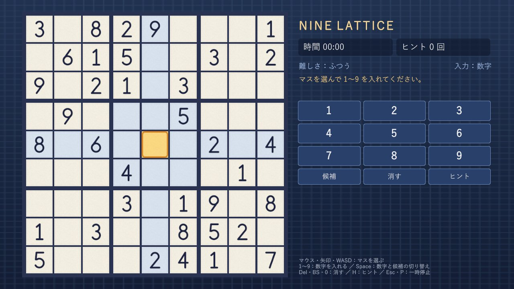
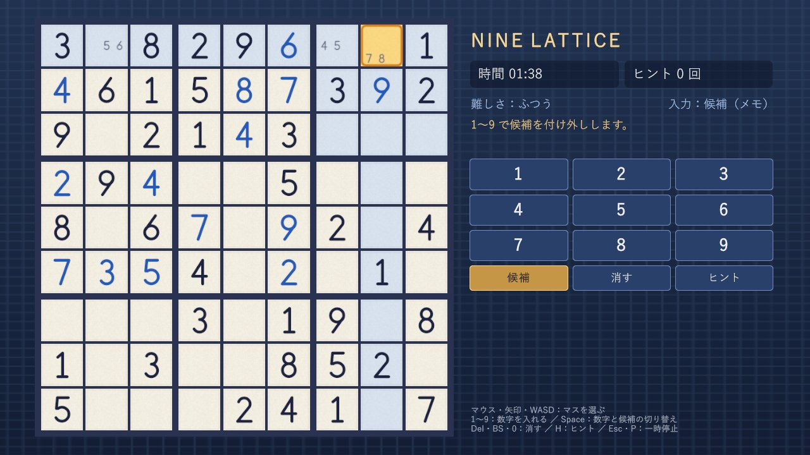
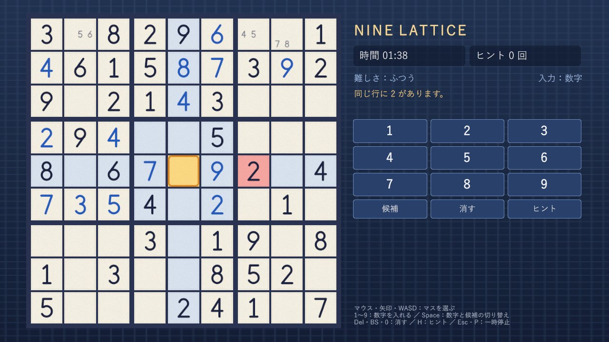
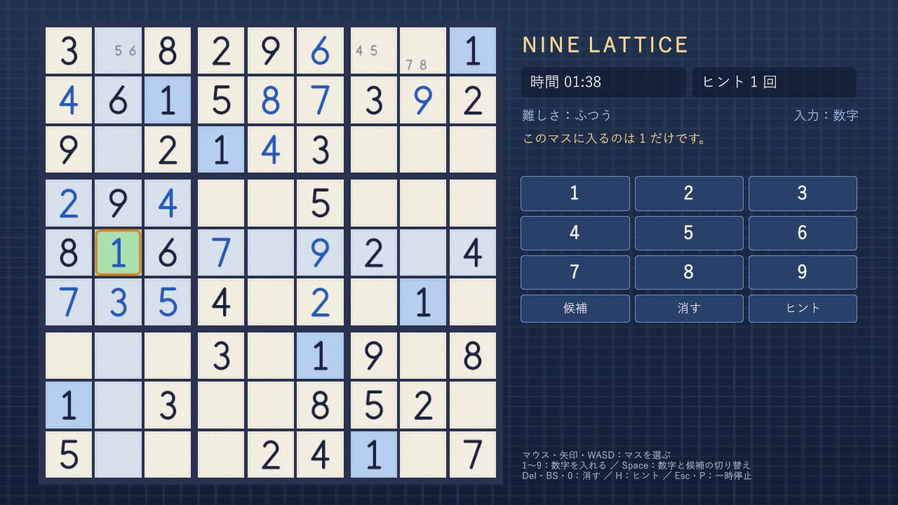
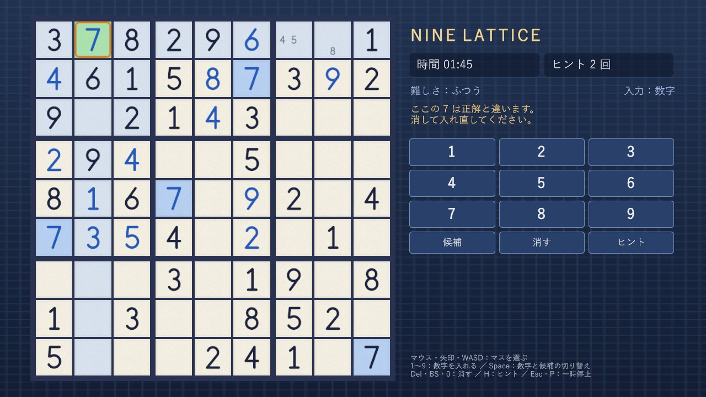
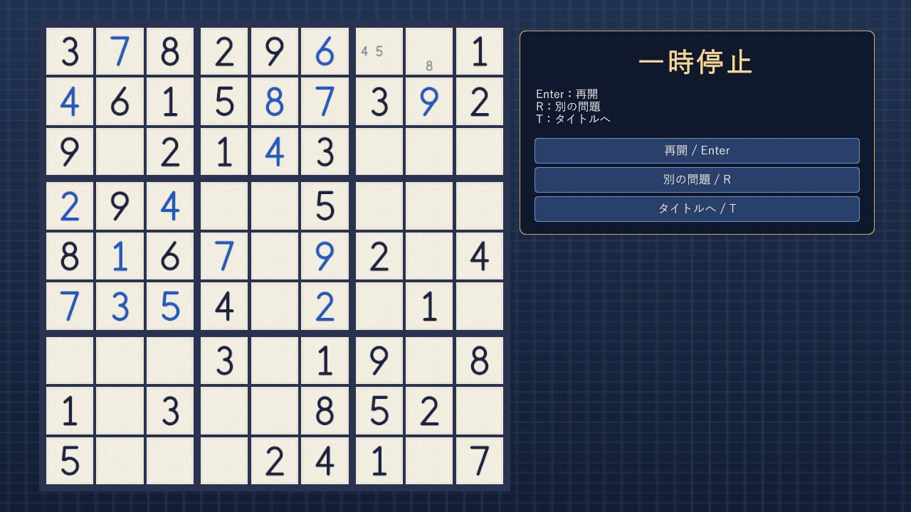
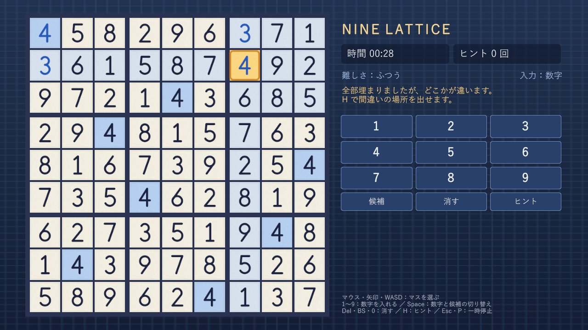
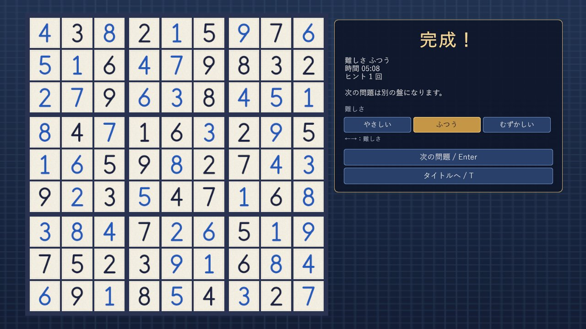

# 017 検証記録

2026-11-20実施。人間のプレイ確認を受け、同日に完了承認を受領した。

## 自動検証

| 項目 | 結果 |
|---|---|
| dev lint | 成功（全作品） |
| dev check | 成功（全作品、警告0・エラー0） |
| dev test | 成功（全作品）。017 Core 84/84、App 34/34 |
| Unity EditMode | 118/118（Core/App、Mono） |
| Unity PlayMode | 34/34（実シーン18、共通証跡公開16） |
| Windowsビルド | 成功、StandaloneWindows64 |
| ビルド起動 | dev captureで起動・全場面撮影・正常終了 |
| 証跡 | JPEG品質85、9枚 |
| 撮影再現 | 同一ビルドを2回撮影し、画像世代2cf38517fffa9d9aが一致。レビュー対応後のビルドでも同じ画像世代になった |

Build GUID：`6509d46524d441b0b1f9cd93ab707427`。シード：1。公開ポインタは[current.json](current.json)、実行記録は[manifest.json](runs/20261119T163202Z-0189cf7b/manifest.json)。

難しさごとに生成した100問すべてで解が1つだけで、保存した解と一致することを確かめている。やさしい・ふつうの100問は、すべて制約伝播だけで最後まで解ける。シード1の難しさごとの問題と解は、dotnet（.NET）と Unity EditMode（Mono）の両方で固定のハッシュ値と一致した。

難しさの選択（タイトルの ← キーとボタン）、選んだ難しさで生成した問題で始まること、結果画面の難しさの表示は、PlayModeテストで確かめている。

経過時間は、低FPS（0.1秒刻み）・0.5秒の処理落ち・10秒と1時間の停止のいずれも実時間どおりに数え、一時停止中は数えず、上限で止まることを App テストで確かめている。

マウスでのマスの選択（ブロックの境目の両側と四隅）、数字キー・テンキー・数字パッドでの入力、候補モード、消去、ヒント、重複の拒否は、PlayModeテストで実際の入力デバイスから確かめている。数字パッドは、空きマスでは置け、与えのマスでは何も変わらないことを同じ手順で確かめている。

終了ボタンは、押すと終了処理を1回呼ぶことをPlayModeテストで確認している。エディタでは `Application.Quit` が働かないため、ビルドで実際に終了する動作は自動テストの対象外。

Unityのビルドログにライセンスクライアントの検証メッセージが出たが、ビルドとPlayerの撮影起動は成功した。

## 画面証跡

### タイトル（飾りの問題と難しさの選択）

### プレイ開始（ふつう）

### 候補（メモ）の書き込み

### 重複の拒否

### ヒント（制約伝播で決まるマスと理由）

### ヒント（誤りの指摘）

### 一時停止

### 誤りを含んだまま全マスが埋まった

### 完成

