# 018 検証記録

2026-11-20〜21実施。人間のプレイ確認を受け、2026-11-21に完了承認を受領した。試遊の指摘を受けてスートを一般的なハート・ダイヤ・クラブ・スペード（赤黒 2 色）に替え、札の隅のランクと印を縁から内側へ寄せ、「自動で仕上げる」を追加して、検証をやり直した。完了承認後のレビュー対応（ダブルクリックの判定）の後にも全検証を通した。

## 自動検証

| 項目 | 結果 |
|---|---|
| dev lint | 成功 |
| dev check | 成功（018、警告0・エラー0） |
| dev test | 成功（全作品）。018 Core 76/76、App 45/45 |
| Unity EditMode | 121/121（Core/App、Mono） |
| Unity PlayMode | 34/34（実シーン18、共通証跡公開16） |
| Windowsビルド | 成功、StandaloneWindows64 |
| ビルド起動 | dev captureで起動・全場面撮影・正常終了 |
| 証跡 | JPEG品質85、14枚 |
| 撮影再現 | 同一ビルド（Build GUID `b076888a374d468c960712f9eeabfbe6`）を2回撮影し、14枚すべての SHA-256 が一致した（画像世代d4cf5442d0726a27）。比較した撮影記録は1回目 `20261121T120007Z-19cba86b` と2回目（公開中）`20261121T120023Z-274e8d7f` で、両 manifest の Build GUID・シード・14枚の SHA-256 を照合した |

Build GUID：`b076888a374d468c960712f9eeabfbe6`。シード：1。公開ポインタは[current.json](current.json)、実行記録は[manifest.json](runs/20261121T120023Z-274e8d7f/manifest.json)。

Unityのビルドログにライセンスクライアントの検証メッセージが出たが、ビルドとPlayerの撮影起動は成功した。

## ルールと不変条件

- 移動・めくり・戻しの合法性（表裏・色・ランク・空の列の K・組札の A とスート、捨て札と組札は 1 枚ずつ）を、拒否の理由ごとに Core テストで確かめている。
- 乱数で遊び取り消しも混ぜた 1 枚めくり・3 枚めくり各 40 試合で、毎手の後に「52 枚がちょうど 1 つの山にある（同じ札が二重に属さない）」などの不変条件を検査し、取り消し後の盤が以前の盤と一致すること、全部取り消すと配札直後に戻ることを確かめている。伏せ札の自動公開は取り消すと伏せ直る。
- 置き先から逆引きする合法手の列挙は、全コマンドを総当たりで検証する素朴な列挙と、乱数で遊んだ全局面で一致した。
- シード 1 のシャッフルの並びは、dotnet（.NET）と Unity EditMode（Mono）の両方で固定値と一致した。

## 手詰まりの判定

乱数で遊んで手詰まりと判定された局面（1 枚めくり・3 枚めくり各 20 試合から）を、並べ替えの同一視をしない素朴な幅優先探索でも調べ、どれも前進できないこと（まだ勝てる盤を手詰まりと判定していないこと）を確かめている。

判定の手間は、乱数で遊んだ全局面（1 枚めくり 7,275 局面、3 枚めくり 4,590 局面）で、調べた局面数が上限（既定 2,000）+1 以内に収まることを検査している。時間は次のとおり（Windows 11、同じ PC、局面の準備は含まない）。乱数の手は組札との行き来が多く、人の手より重い側に寄る。

| 環境 | めくり | 調べた局面数 p50 / p95 / 最大 | 時間 p50 / p95 / 最大 |
|---|---|---|---|
| .NET 9（dotnet test） | 1 枚 | 1 / 5 / 1,280 | 0.010 / 0.041 / 26.6 ms |
| .NET 9（dotnet test） | 3 枚 | 1 / 6 / 640 | 0.011 / 0.052 / 15.6 ms |
| Mono（Unity EditMode） | 1 枚 | 1 / 5 / 1,280 | 0.033 / 0.134 / 123.6 ms |
| Mono（Unity EditMode） | 3 枚 | 1 / 6 / 640 | 0.032 / 0.163 / 65.8 ms |

ほとんどの手は直後の合法手で前進が見つかり 1 局面で終わる。まれに数百〜千局面を調べる手があり、Mono では 1 手に最大 0.13 秒かかった。

## 入力

- 実シーンの PlayMode テストで、仮想マウスから次を確かめている：ドラッグで札の連続を動かし下の伏せ札が開く、ドラッグ中は掴んだ札がポインタに付いて手前に描かれ盤は変わらない、何もない所や置けない所で離すと盤は変わらず札が元の位置へ戻る（置けない理由を表示）、クリックで選ぶと縁が光り別の山のクリックで動かす、山札のクリックでめくり・戻す、ダブルクリックで組札へ送る（最後の 1 枚で勝利）。ダブルクリックは捨て札・場札の一番上の札だけで、間に背景や伏せ札のクリックを挟んだ場合と、組札の札を 2 回クリックした場合は成立しないことを App テストで確かめている。
- 「自動で仕上げる」は、伏せ札と山札が残るうちは出ず、仕上げられる局面で出ること、押すと送っている間はボタンが消えて取り消しが無効になり、最後に勝つことを PlayMode テストで確かめている。F キーでも始まる。1 枚ずつ送る間隔、一時停止で止まること、処理落ちの分をまとめて送ることは App テストで確かめている。
- 1 手戻すは Z キーと HUD のボタンの両方で、戻す手がないときボタンが押せないことと、押すと戻ることを同じテストで確かめている。
- フォーカスを失うとドラッグ中の札を落とさずに取り消し、復帰直後のクリックで再開しないことを確かめている。
- 終了ボタンは、押すと終了処理を1回呼ぶことをPlayModeテストで確認している。エディタでは `Application.Quit` が働かないため、ビルドで実際に終了する動作は自動テストの対象外。

## 画面証跡

### タイトル（飾りの配札）

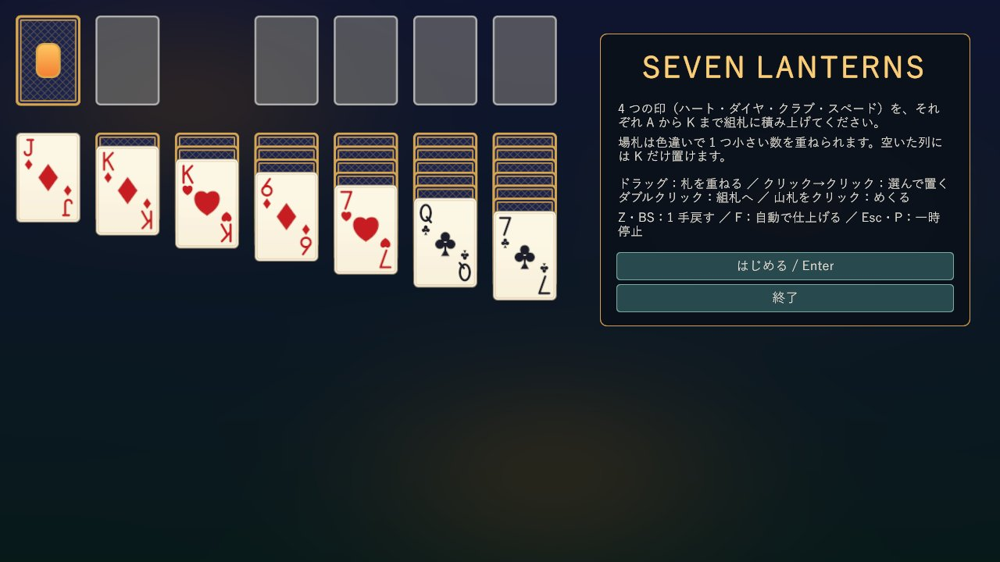

### 配札

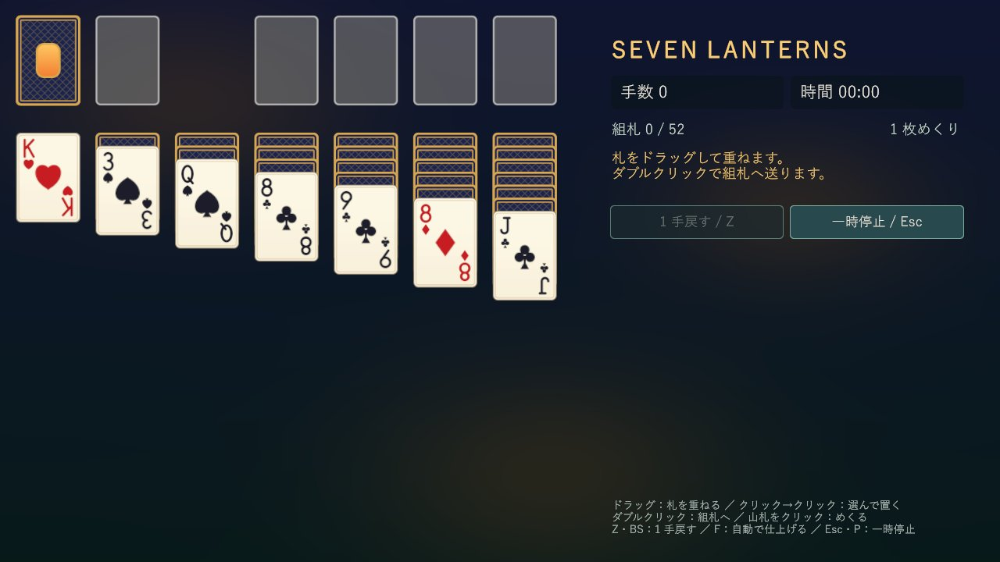

### クリックで選んだ札

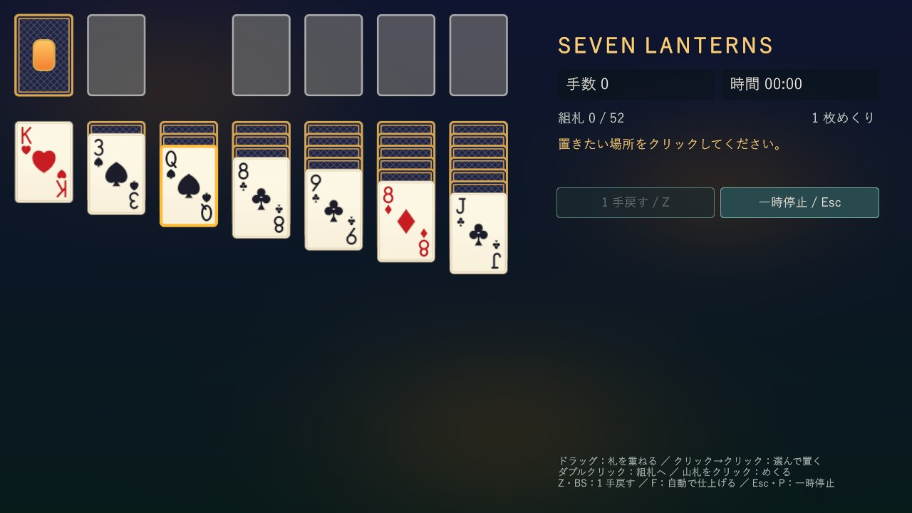

### ドラッグ中

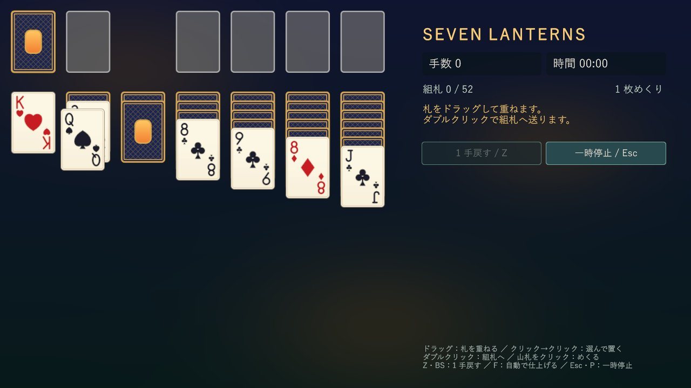

### ドロップ

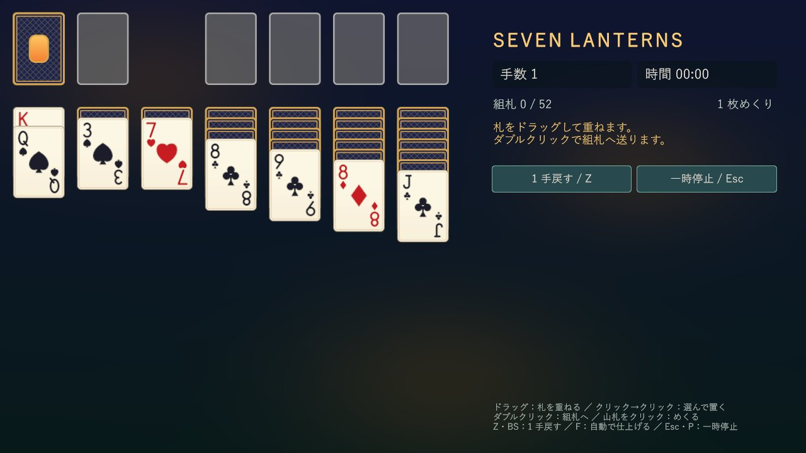

### 置けない場所（理由の表示）

### 進行中（自動操縦で 31 手）

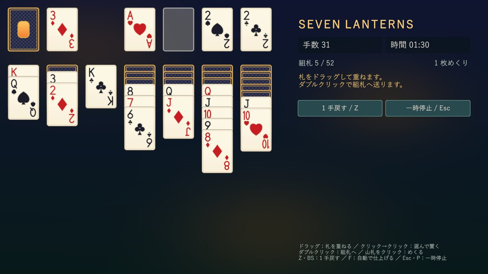

### 1 手戻す

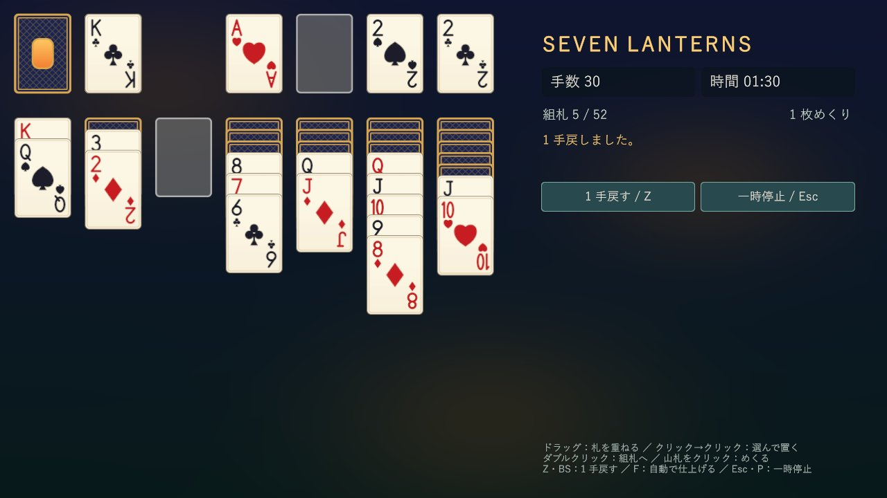

### 一時停止

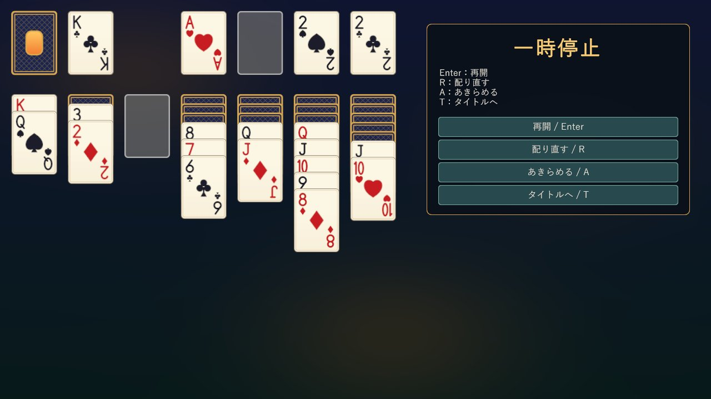

### 3 枚めくり

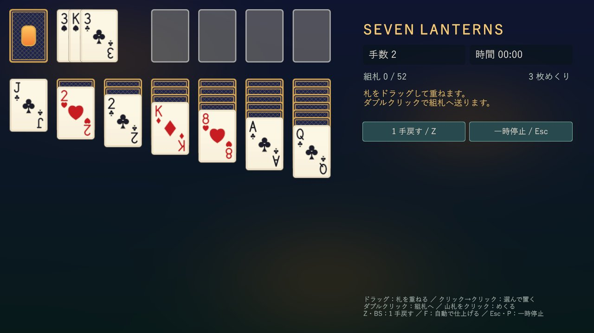

### 手詰まり

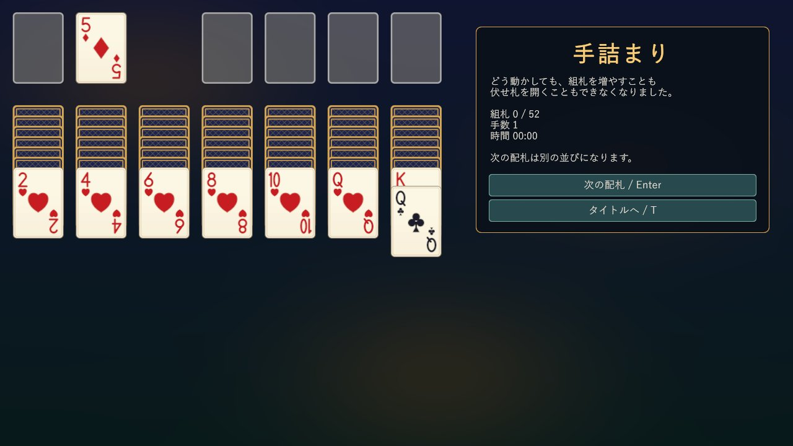

### 完成

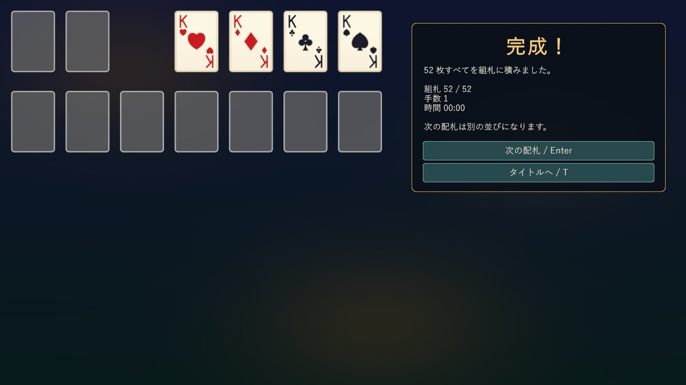

### 自動で仕上げられる（ボタン）

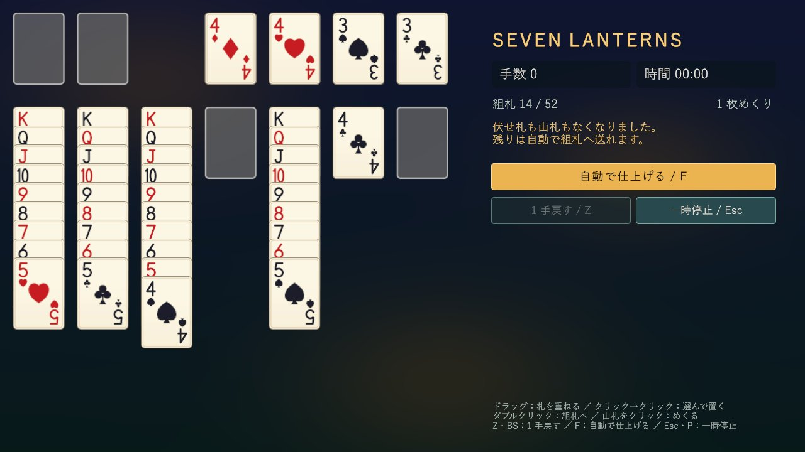

### 自動で仕上げている途中

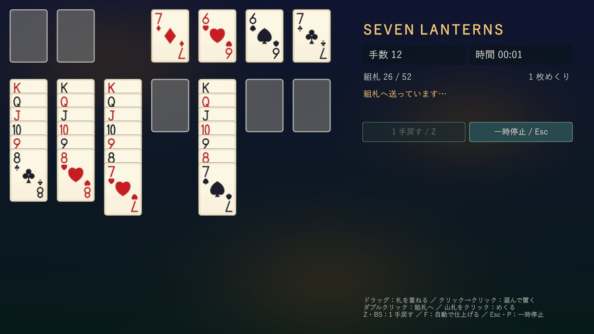
