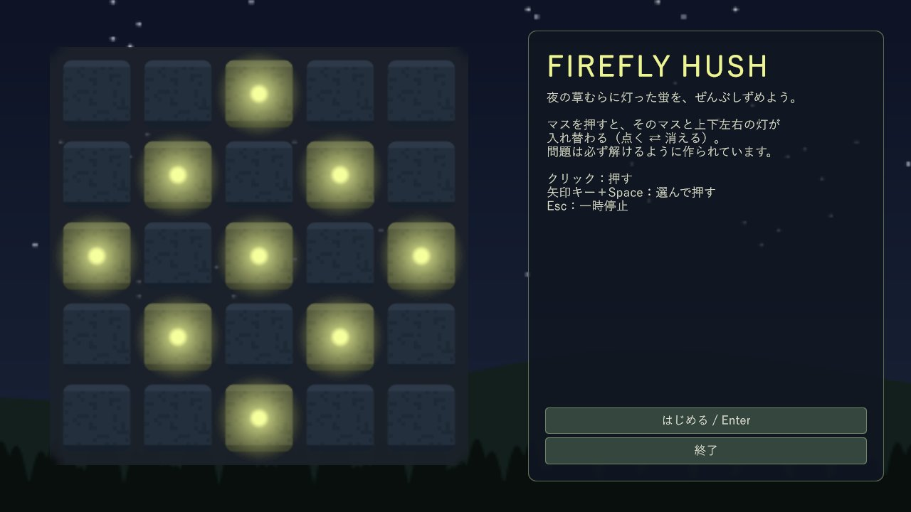
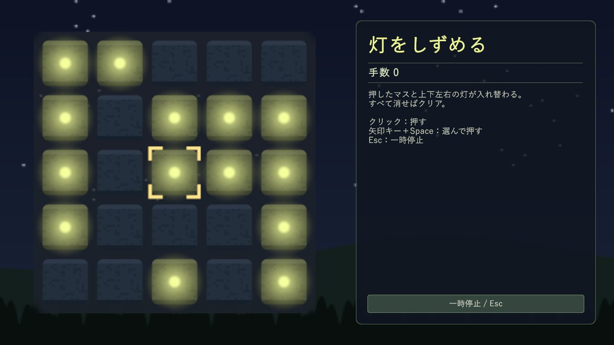
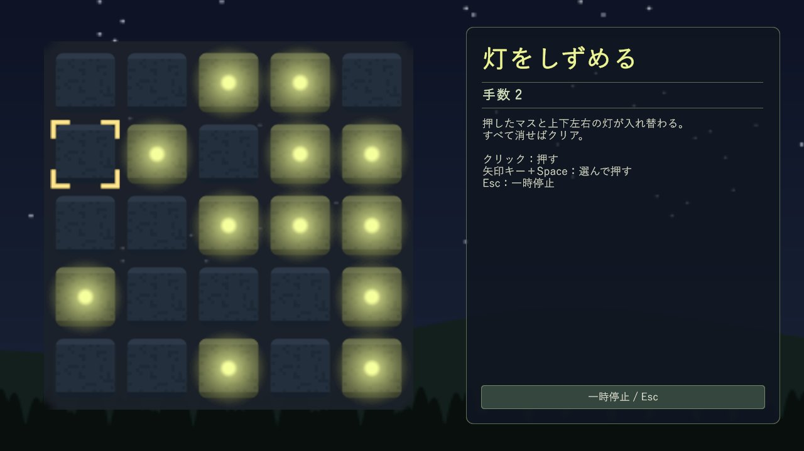
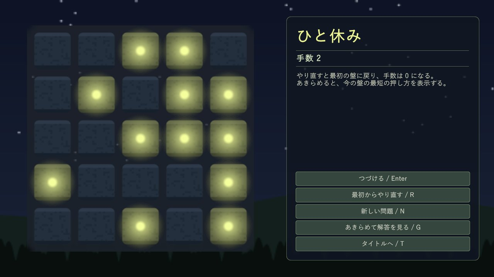
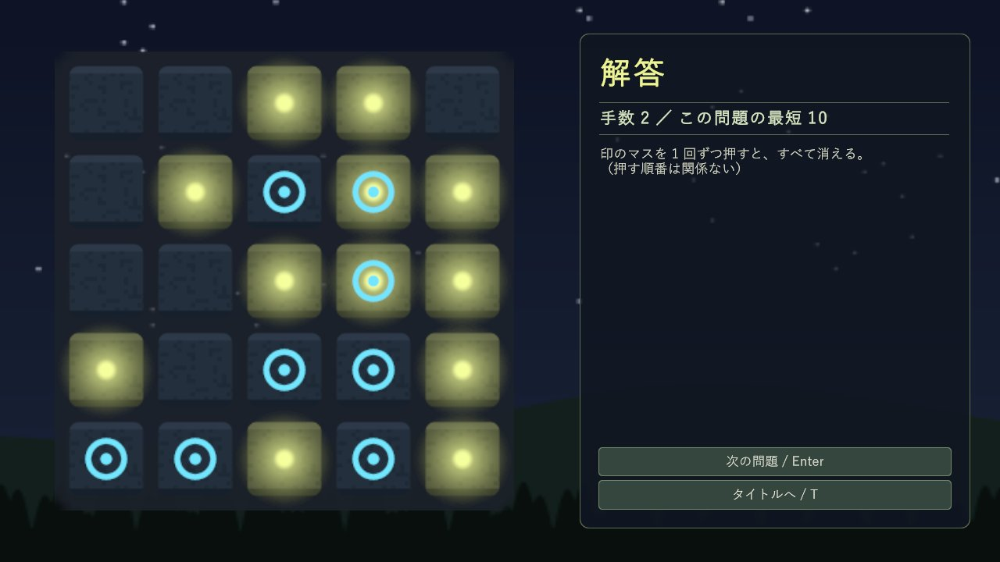
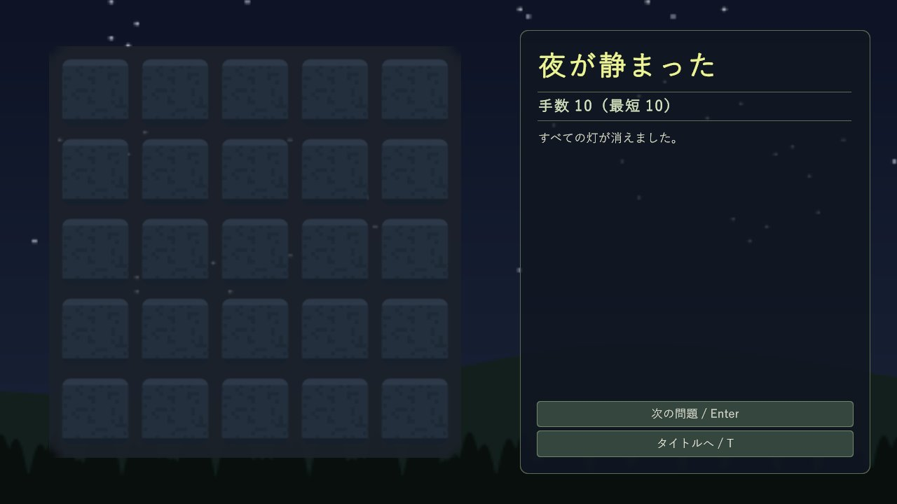
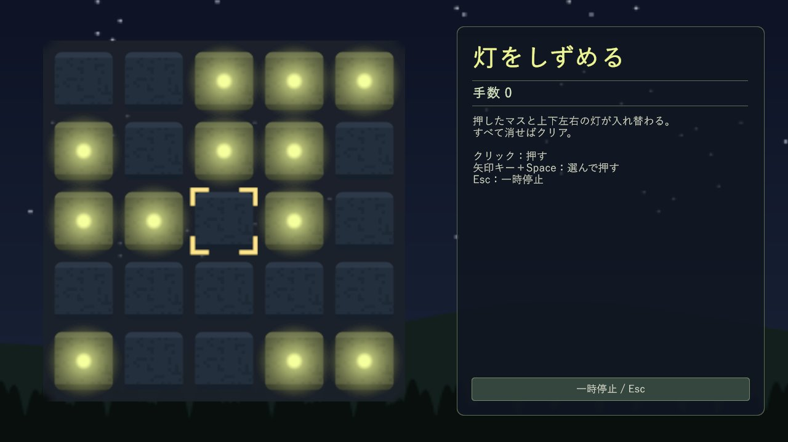

# 019 検証記録

2026-11-21実施。自動検証まで通した段階（人間のプレイ確認待ち）。

## 自動検証

| 項目 | 結果 |
|---|---|
| dev lint | 成功 |
| dev check | 成功（019、警告0・エラー0） |
| dev test | 成功。019 Core 57/57、App 33/33 |
| Unity EditMode | 90/90（Core/App、Mono） |
| Unity PlayMode | 35/35（実シーン19、共通証跡公開16） |
| Windowsビルド | 成功、StandaloneWindows64 |
| ビルド起動 | dev captureで起動・全場面撮影・正常終了 |
| 証跡 | JPEG品質85、7枚 |
| 撮影再現 | 同一ビルド（Build GUID `0832d60287314b01aa4c65bfed11a730`）を2回撮影し、7枚すべての SHA-256 が一致した（画像世代d0a3387eec1660ed）。比較した撮影記録は1回目 `20261121T124922Z-3db365f0` と2回目（公開中）`20261121T124944Z-37f36c26` で、両 manifest の Build GUID・シード・7枚の SHA-256 を照合した |

Build GUID：`0832d60287314b01aa4c65bfed11a730`。シード：1。公開ポインタは[current.json](current.json)、実行記録は[manifest.json](runs/20261121T124944Z-37f36c26/manifest.json)。

## ルールと解の検証

- 押下が「自分と上下左右だけ」を反転することを、25 マスすべてについて、bool の 2 次元配列を 1 マスずつ書き換える素朴な参照実装と照合した（乱数の盤 20 通り）。角は 3 マス・辺は 4 マス・中央は 5 マスで、端は折り返さない。
- 同じマスを 2 回押すと元に戻ること、押す順序を入れ替えても同じ盤になることを確かめた。
- ソルバ（GF(2) の掃き出し法）の可解判定を、素朴な「ライト追い」（1 行目の押し方 32 通りを総当たりし、2 行目以降は真上が点灯していたら押す）と、乱数の盤 2,000 通り（可解・不可解とも）で照合した。可解な盤では解がちょうど 4 通りあり、ソルバの解はその 1 つ、最少解は 4 通りのうち押下数が最少のもの（同数なら数値が小さい方）と一致した。
- 核（押しても盤が変わらない押下）の基底 2 本が、全消灯の盤のライト追いの解と一致した。
- 生成した盤は、押下数 1〜25 の各 40 シードと既定 10 の 1,000 シードで、すべてソルバで解けた。既知解を適用すると盤が再現し、盤は全消灯でない。
- シード 1〜100 の生成結果（盤と既知解）のハッシュが、dotnet（.NET）と Unity EditMode（Mono）の両方で固定値と一致した。

## 入力

- 実シーンの PlayMode テストで、仮想キーボード（矢印キーでカーソル、Space で押す）と仮想マウス（クリックで押す、動かすとカーソルが付いてくる）の両方で盤が変わることを確かめている。マスの間の隙間・盤の外・タイトル・一時停止中・結果画面のクリックでは盤を変えない。
- 最短解をクリックしてクリアし結果画面に「手数（最短）」が出ること、一時停止→G であきらめると今の盤の最短解のマスにだけ印が出て、次の問題では印が消えることを確かめている。
- HUD のボタン（はじめる・一時停止・あきらめる・次の問題・新しい問題・タイトルへ）で一巡できること、各画面で出るボタンを確かめている。ボタンはポインタイベントで押している。
- フォーカスを失うとプレイ中は一時停止し、保留中のクリックを捨てる。復帰直後のクリック（復帰の前後どちらの順序でも）では終了ボタンが働かず、次のクリックでは働くことを確かめている。
- 終了ボタンは、押すと終了処理を1回呼ぶことをPlayModeテストで確認している。エディタでは `Application.Quit` が働かないため、ビルドで実際に終了する動作は自動テストの対象外。

Unityのビルドログにライセンスクライアントの検証メッセージが出たが、ビルドとPlayerの撮影起動は成功した。

## 画面証跡

### タイトル（飾りの灯。試合はまだない）

### 出題直後

### 進行中（キーボードとクリックで 2 手）

### 一時停止

### あきらめた結果（印は今の盤の最短解）

### クリア（最短手数で）

### 次の問題（新しいシード）

