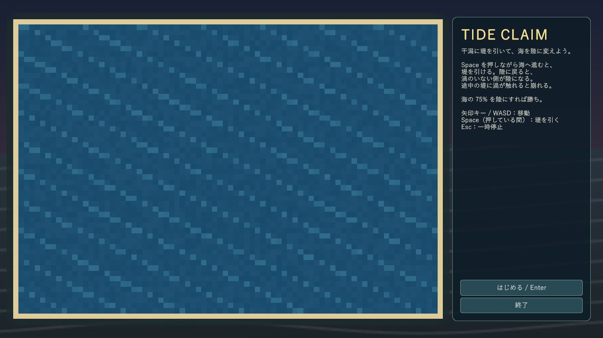
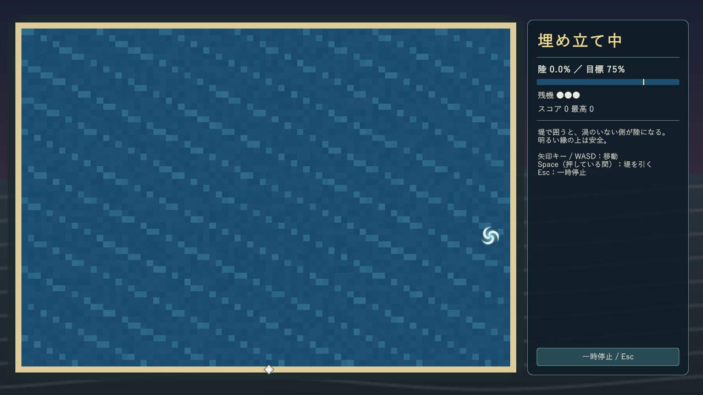
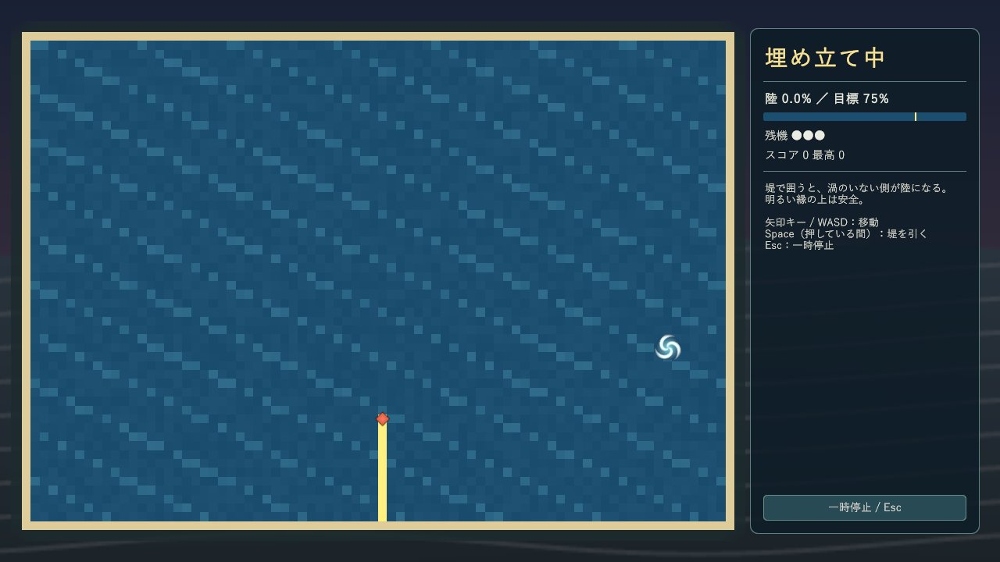
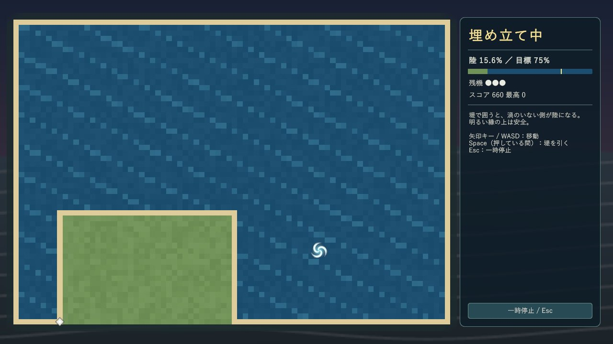
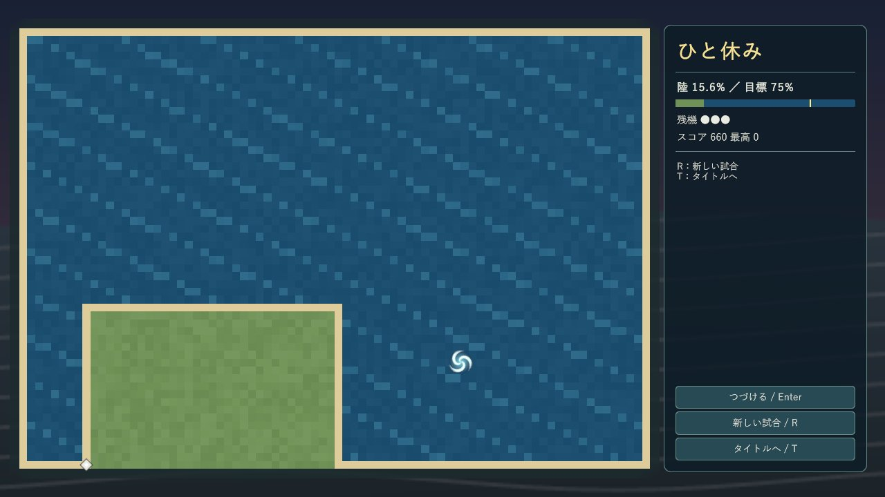
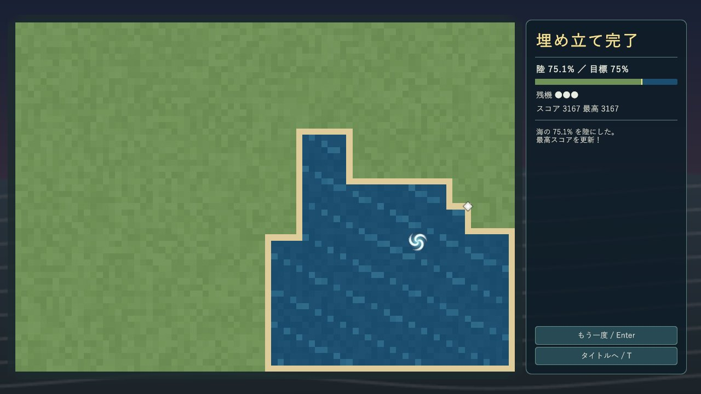
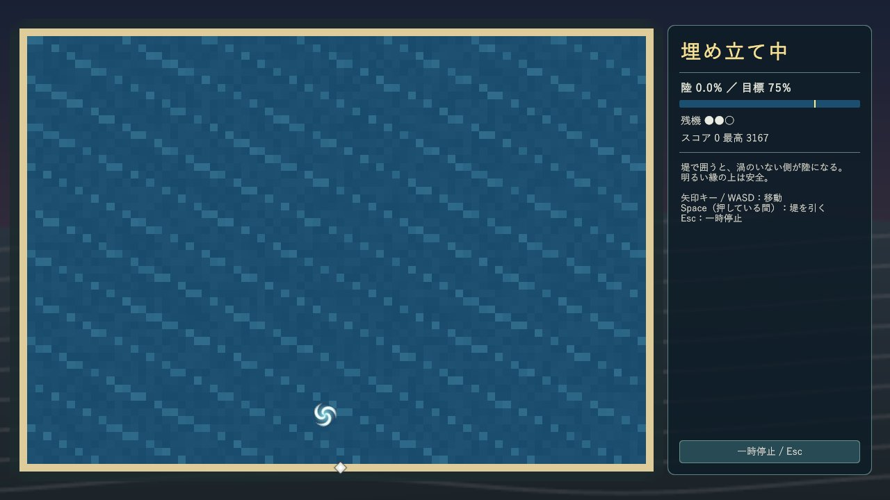
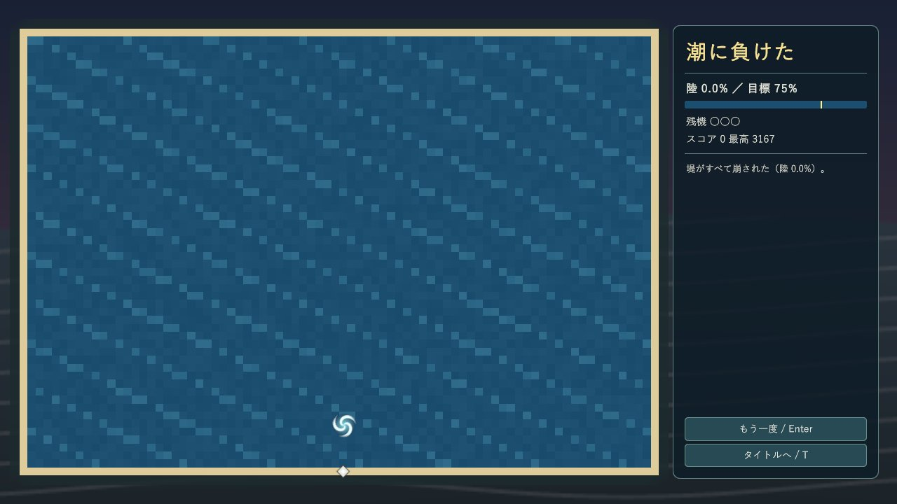
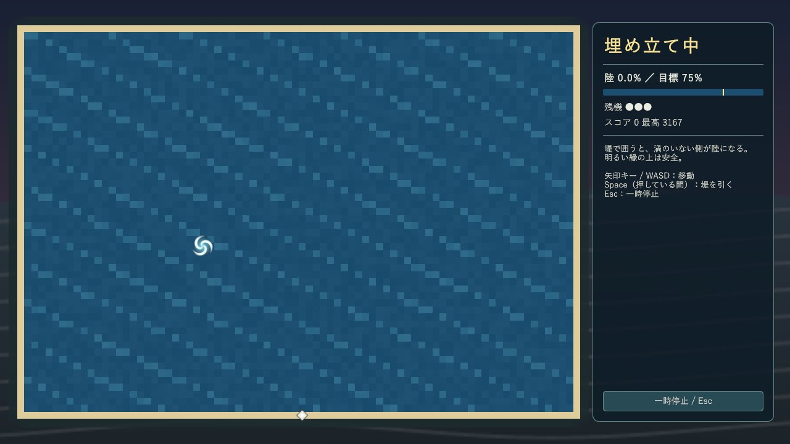

# 020 検証記録

2026-11-21実施。人間の動作確認はまだ受けていない（検証待ち）。

## 自動検証

| 項目 | 結果 |
|---|---|
| dev lint | 成功 |
| dev check | 成功（020、警告0・エラー0） |
| dev test | 成功。020 Core 339/339、App 28/28 |
| Unity EditMode | 367/367（Core/App、Mono） |
| Unity PlayMode | 32/32（実シーン16、共通証跡公開16） |
| Windowsビルド | 成功、StandaloneWindows64 |
| ビルド起動 | dev captureで起動・全場面撮影・正常終了 |
| 証跡 | JPEG品質85、9枚 |
| 撮影再現 | 同じビルドを2回撮影し、9枚すべての SHA-256 が一致した（画像世代 6e88884713bfceb7）。比較した撮影記録は1回目 `20261121T141302Z-5582599a` と2回目（公開中）`20261121T141343Z-8d073279` で、両 manifest の Build GUID・シード・9枚の SHA-256 を照合した |

Build GUID：`e6e83109c18f4b55a0bf6a53e43d03b9`。シード：1。公開ポインタは[current.json](current.json)、実行記録は[manifest.json](runs/20261121T141343Z-8d073279/manifest.json)。

## ルールの検証

- **線未閉鎖では領域が確定しない**：途中で止めた線、描画キーを離して止まった線、逆走・自分の線への進入を拒否された線のどれでも、陸のセル数・スコア・海のセル数（線の分だけ減る）が変わらないことを確かめた。
- **敵側を誤消去しない**：敵が線の左右どちらにいても敵の側が海のまま残り、反対側だけが陸になる。3 領域に分かれる場合は敵の領域だけが残り、敵が 2 領域に重なる場合は両方が残る。敵を左下の 2×2 の入り江に閉じ込めると、盤の残り全体が陸になり、着いたセルが縁でなくなった自機は最も近い縁へ移る。
- **面積率が単調に増加**：乱数の入力で 40 試合 × 最大 4,000 Tick 進め、毎 Tick、陸のセル数が前の Tick 以上であること（ミスで線が消えても減らない）、敵が海にだけ重なること、自機が線の先端か縁にいること、スコアが陸のセル数と等しいことを検査した。
- Flood Fill（明示的なスタック、4 連結）を、テスト側の素朴な実装（各セルに番号を振り、隣の小さい番号に寄せることを変化がなくなるまで繰り返す）と、大きさ・密度の違う乱数の盤 200 枚で照合した。領域の分け方（番号の一対一の対応）と各領域の面積が一致した。斜めにしか接しないセルは別の領域になる。
- 接触判定：右へ進む敵が、線に初めて重なる位置（`10 × 256 − 半径 + 1`）で止まってミスになることと、1 Tick の間に線の先端の角をかすめる斜めの移動（Tick の始めと終わりの位置ではどちらも線に重ならない）を検出することを確かめた。
- 勝敗：216 セルの海のうち 108 セル（ちょうど 50%）を取ると目標 50% で勝ち、目標 51% では勝たない。残機 0 で負け、その後の入力と Tick は状態を変えない。
- 試合は整数だけで進むので、シード 20 の乱数の入力で 3,000 Tick 進めた盤面のハッシュ（2407590067）が dotnet（.NET）と Unity EditMode（Mono）の両方で一致した。
- 自動操縦（撮影・テスト用）は、既定の設定で 100 シードすべてを勝利まで進め、ミスはなかった（平均 1,829 Tick、最長 11,754 Tick）。

## 入力と画面

- 実シーンの PlayMode テストで、仮想キーボードの矢印キーを押している間だけ縁を歩き、離すと止まること、Space なしでは海へ出ないことを確かめた。
- Space と ↑ を押している間は線を引き、↑ を離すと Space を押したままでもその場で止まる。線のセルは線の色で描かれ、閉じるまで占有率の表示は 0.0% のまま。↓（自分の線の方向）へは戻れない。
- 線を閉じた直後、盤の全 4,480 セルの描画色が Core の状態（海・陸・縁・線）から決まる色と一致し、HUD の占有率・スコア・進み具合の棒が更新される。盤が変わらないフレームではテクスチャを書き直さない。
- 一時停止中は Tick が進まず、一時停止中から押していたキーでは再開後も動かない（押し直すと動く）。フォーカスを失うと一時停止し、それ以前から押していたキーは押し直すまで効かない。
- 勝利・敗北の結果画面の見出しと文言、各画面で出るボタン、HUD のボタン（はじめる・一時停止・新しい試合・タイトルへ）で一巡できることを確かめた。ボタンはポインタイベントで押している。
- フォーカスを戻すクリックでは終了ボタンが働かず、次のクリックでは終了処理を 1 回呼ぶ。エディタでは `Application.Quit` が働かないため、ビルドで実際に終了する動作は自動テストの対象外。
- 盤全体が画面内に収まり、HUD のパネルが盤に重ならないことを確かめた（16:9）。

## 性能

線を閉じた Tick（Flood Fill を含む）と、その直後の描画（盤全体 80×56 のテクスチャの書き直し）を、自動操縦で 20 試合を勝つまで進めて計測した。閉じない Tick と自動操縦の計画の時間は含めない。閉じるたびに描画が実際にテクスチャを書き直したことを確かめている。

| 項目 | p50 | p95 | 最大 |
|---|---:|---:|---:|
| 閉じた Tick（282 回） | 0.576 ms | 1.070 ms | 3.675 ms |
| 直後の描画 | 0.993 ms | 1.322 ms | 1.836 ms |

計測環境：Intel Core i9-13900KF、Windows 11、Unity 6000.6.9f1 の PlayMode テスト（バッチ実行、Mono、エディタ内）。GPU の時間や他の PC での FPS は保証しない。

Unityのビルドログにライセンスクライアントの検証メッセージが出たが、ビルドとPlayerの撮影起動は成功した。

## 画面証跡

### タイトル（試合の前の盤。試合はまだない）

### 開始直後（自機は下の縁の中央）

### 線を引いている途中

### 線を閉じた直後（渦のいない側が陸になった）

### 一時停止

### 勝利（占有率 75.1%）

### ミス直後（止めた線に渦が触れ、線が消えて自機は始点へ戻った）

### 敗北（残機 0）

### 結果から次の試合（新しいシード）

