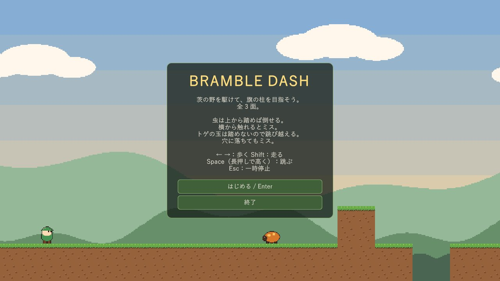
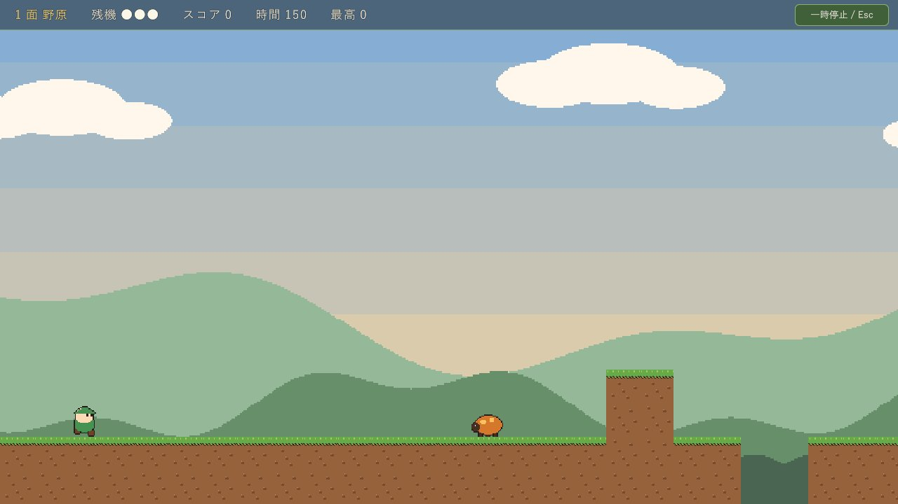
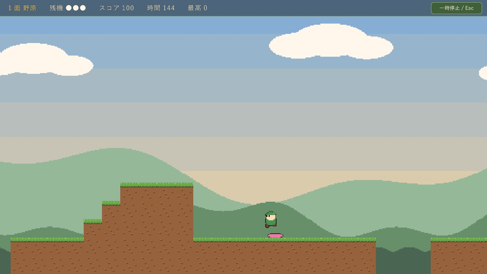
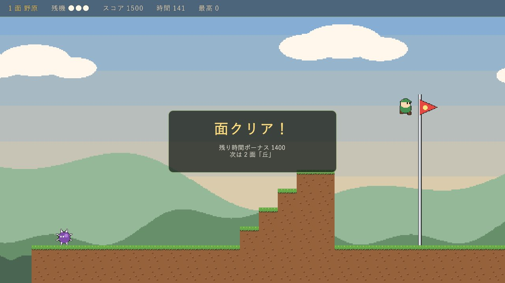
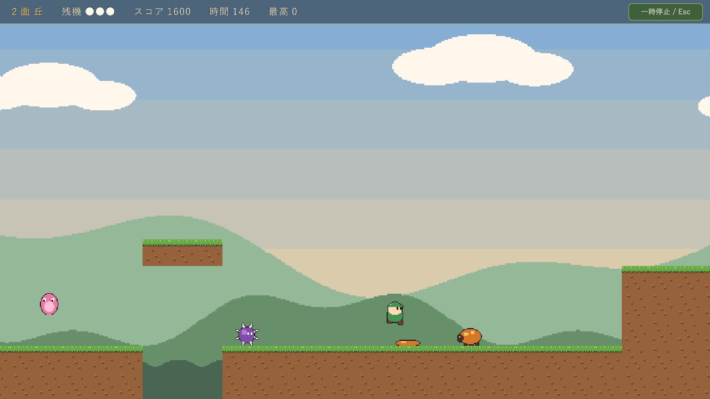
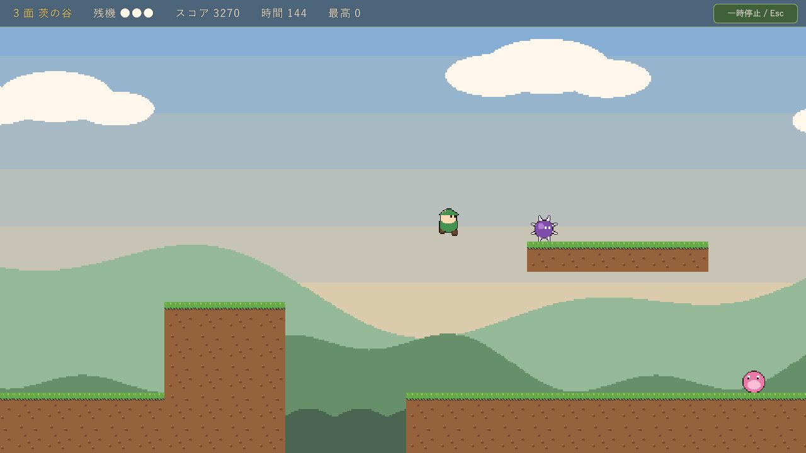
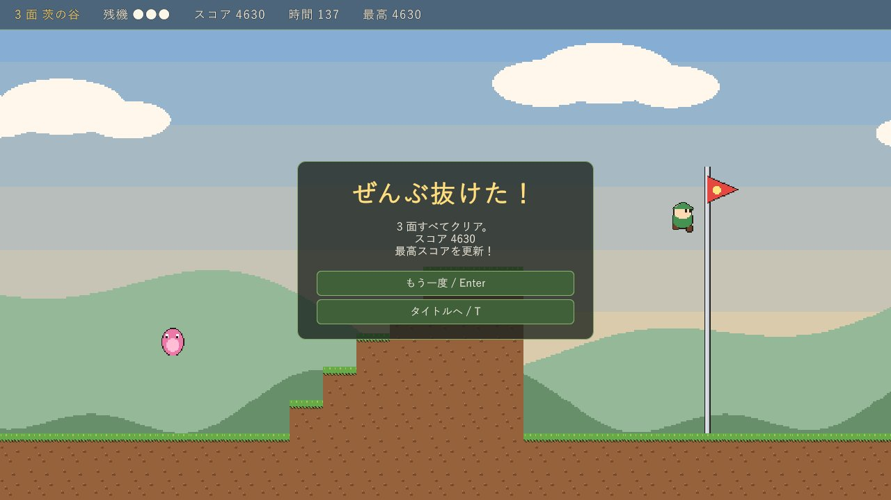
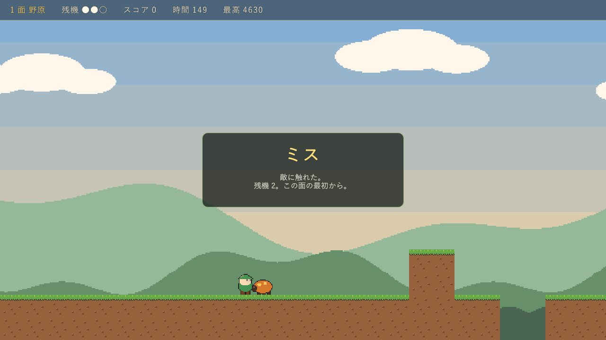
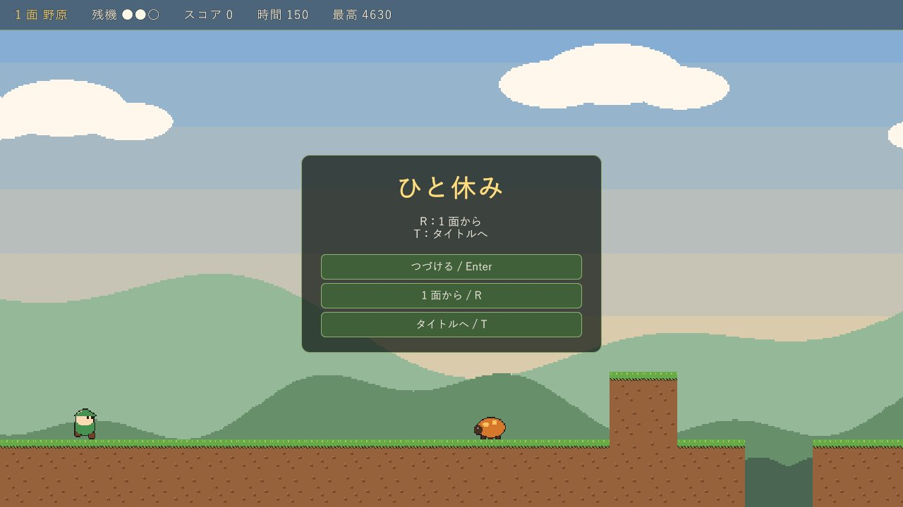
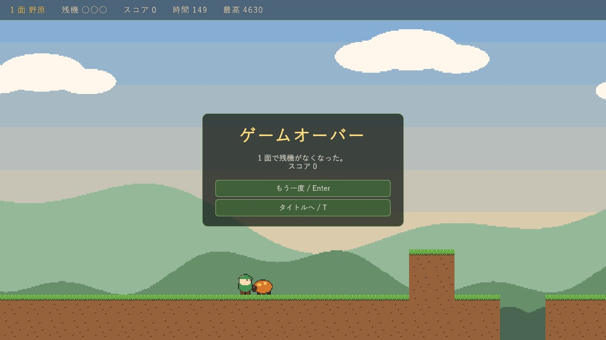

# 021 検証記録

2026-11-22実施。2026-11-22に人間の動作確認OKと完了承認を受領した。コードレビュー（P2-1：タイトルへ戻ると自機と敵が前の試合の位置・姿で残る、P3-1：未定義の操作キーを右移動として受け付ける）を受けて修正し、全検証をやり直した。続く PR レビュー（P1：個々の値は範囲内でも、跳んでも上昇しない JumpSpeed = 4 などで 3 面を通れない設定が検証を通る）を受けて、設定の組み合わせの検証を追加し、全検証をやり直した。

## 自動検証

| 項目 | 結果 |
|---|---|
| dev lint | 成功 |
| dev check | 成功（021、警告0・エラー0） |
| dev test | 成功。021 Core 141/141、App 29/29 |
| Unity EditMode | 170/170（Core/App、Mono） |
| Unity PlayMode | 32/32（実シーン16、共通証跡公開16） |
| Windowsビルド | 成功、StandaloneWindows64 |
| ビルド起動 | dev captureで起動・全場面撮影・正常終了 |
| 証跡 | JPEG品質85、11枚 |
| 撮影再現 | 修正前のビルドを2回撮影し、11枚すべての SHA-256 が一致した（画像世代 f038eff26c0d5202、撮影記録 `20261121T161108Z-ddf42d53` と `20261121T161418Z-0e229c47`）。レビュー対応はタイトルの初期表示だけを変え、撮影する場面の描画を変えないので、修正後のビルドでも同じ画像世代になり、`20261121T161418Z-0e229c47` と11枚の SHA-256 が一致した。設定の組み合わせの検証の追加（既定の設定の遊び方は変えない）後のビルド（公開中）でも、`20261121T171916Z-c229f925` と11枚の SHA-256 が一致した。比較した古い撮影記録は次の公開で消える |

Build GUID：`890e803f03a2432db79d52143455a7e8`。公開ポインタは[current.json](current.json)、実行記録は[manifest.json](runs/20261121T173342Z-278b9d0a/manifest.json)。台本は乱数を使わず、意図と Tick を順に渡すだけで場面を作る（manifest のシード 1 は共通処理の記録で、ゲームには使っていない）。

## ルールの検証

- **踏みつけと横衝突の区別**：真上から落ちれば踏みつけ、横から歩いて触れる・下から上昇して触れる・Tick の始めから重なっているのは横衝突。下へ動いていても先に触れたのが横の面なら横衝突。Tick の始めと終わりではどちらも重ならない斜めのかすりも、横の面・上の面のどちらが先かで正しく分かれる。角にちょうど当たれば上からは踏みつけ、下からは横衝突。敵が下から跳ね上がってきた場合も相対的な動きで踏みつけになる。茨玉は上からでもミス。同じ時刻に 2 体を踏むと両方倒れ、茨玉と跳ね虫にまたがって落ちると先に触れる茨玉でミスになる。
- **空中で無制限ジャンプ不可**：空中で何度押し直しても跳ばない、押したまま着地しても跳び直さない（離して押し直すと跳ぶ）、足場から歩いて落ちた後も跳べない、踏みつけの跳ね返りの後も空中ジャンプにならない、面の開始時に押したままでも跳ばない。実シーンでも Space を押したまま着地して 0.3 秒待っても接地したままだった。
- **ゴール後の多重クリア防止**：旗の柱に触れた Tick に 1 回だけクリアになり、その後 30 Tick 入力を送っても状態のハッシュ・位置・Tick が変わらず、2 回目のクリアは起きない。同じ Tick に敵が届く配置でもゴールが優先する。面の合間に何 Tick 進めても面は 1 つだけ進み、残り時間ボーナスも 1 回だけ加わる。2 回目の Continue は拒否する。
- 衝突解決：乱数の大きさ・位置・移動量（±1000 単位）2 万回で、固体に重なった状態で止まらないことを確かめた。落下の最高速を上限（255）にしても、どの高さから落ちても 1 タイルの床をすり抜けない。
- **設定の組み合わせ（PR レビュー P1）**：面の地面の道（浮いた足場を使わない）から段と穴を取り出し、設定の自機を障害だけの地形で動かして越えられるかを確かめる。段を越えられるかは、押し続けたジャンプの最高点（自機を実際に動かした値）が段の高さに届くかと、ジャンプの速さ 11 通り × 高さ 1〜8 タイルですべて一致した。高さ 2 タイルにちょうど届く最小のジャンプの速さでは越えられ、その 1 つ下では越えられない。既定の設定で越えられる穴の幅は 1 から連続し、3 面で最も広い穴（4 タイル）を越えられる。レビューの例（JumpSpeed 4・JumpCutSpeed 0・StompBounce 4）は個々の値の検証を通るが、1 面「野原」の段を越えられないとして拒否し、制限時間 10 秒も走りきれないとして拒否する（Core と、設定アセットの検証の PlayMode テスト）。同梱の設定アセットで自動操縦が 3 面をミスなしで抜けることは、実シーンの PlayMode テストで確かめている。
- 決まった入力列で 600 Tick 進めた 1 面の状態のハッシュ（3356844846）が .NET と Mono の両方で一致した。
- 自動操縦（撮影・テスト用）は既定の設定で 3 面ともミスなしでクリアする（594・759・824 Tick）。

## 入力と画面

- 実シーンの PlayMode テストで、→ を押している間だけ右へ進み、離すと止まること、Shift で走りの最高速になり離すと歩きに戻ること、Space を押し続けると 4 タイル以上、すぐ離すとその半分未満しか跳ばないことを確かめた。
- 3 面を通して、今の面の Stage だけが表示され、各 Stage の地形と敵の数が Core の地図と一致する。カメラは自機を追って右へ進み、面の左右の端より外を映さず、自機はいつも画面の中にある。
- 踏まれた敵はつぶれた姿で 30 Tick 残ってから消える。ミスすると自機の姿と HUD（見出し・理由・残機）が変わり、面の最初からやり直す。
- **タイトルへ戻ったときの表示（レビュー P2-1）**：1 面で敵を踏んで 30 タイル以上進んだ後、一時停止からタイトルへ戻ると、自機と全ての敵の位置・姿・向き・表示が開始前と一致する。タイトルの配置は Core の地図の開始位置・出現位置から作り直す。この回帰テストは、位置の作り直しを外すと失敗することを確かめた。
- 一時停止中は Tick が進まない。フォーカスを失うと一時停止し、押していたキーは押し直すまで効かない。HUD のボタン（はじめる・一時停止・1 面から・タイトルへ）で一巡でき、フォーカスを戻すクリックでは終了ボタンが働かない。

Unityのビルドログにライセンスクライアントの検証メッセージが出たが、ビルドとPlayerの撮影起動は成功した。

## 画面証跡

### タイトル（1 面の配置を Stage Prefab のまま描く）

### 1 面の開始直後

### 走りながら跳んでいる途中

### 敵を上から踏んだ直後（敵はつぶれ、自機は跳ね返る）

### 1 面クリア（残り時間ボーナスと次の面の案内）

### 2 面の途中

### 3 面の途中

### 勝利（自動操縦で 3 面をミスなしで抜けた）

### ミス（歩き虫に横から触れた）

### 一時停止

### 敗北（残機 0）

