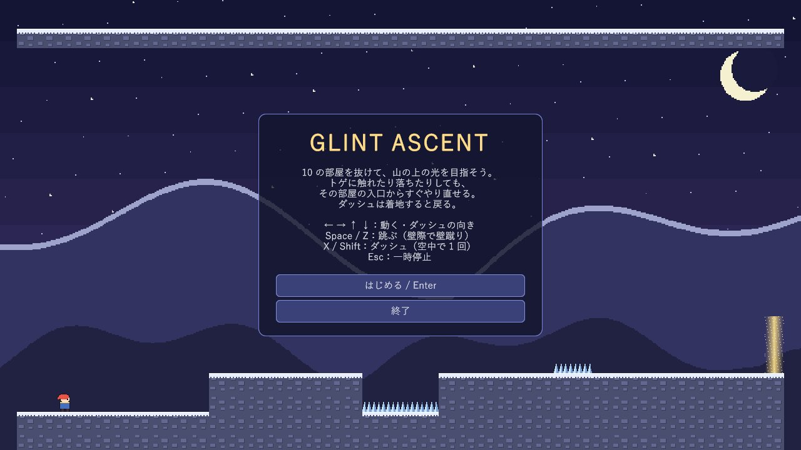
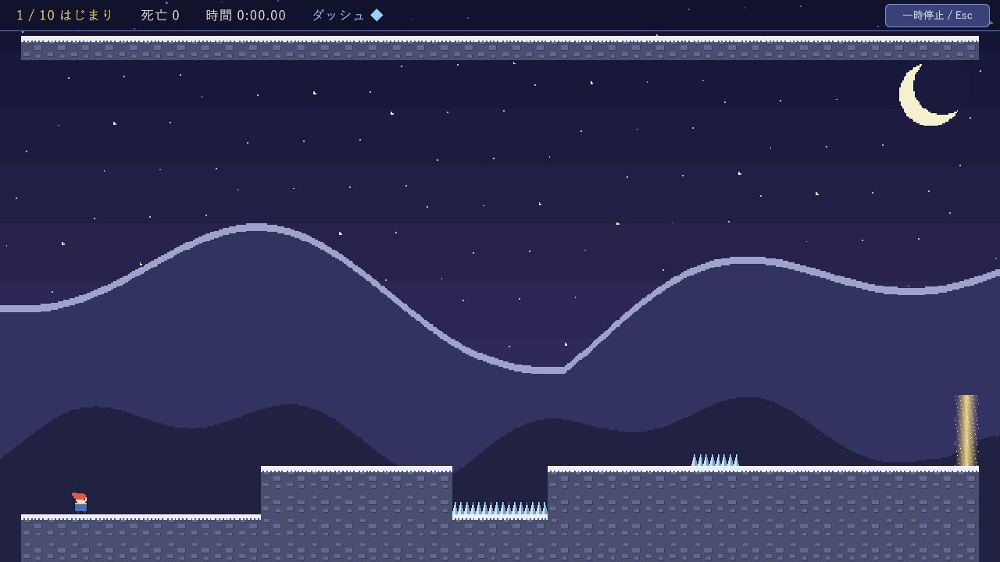
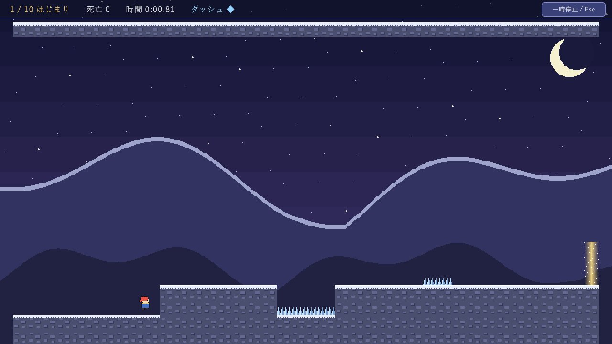
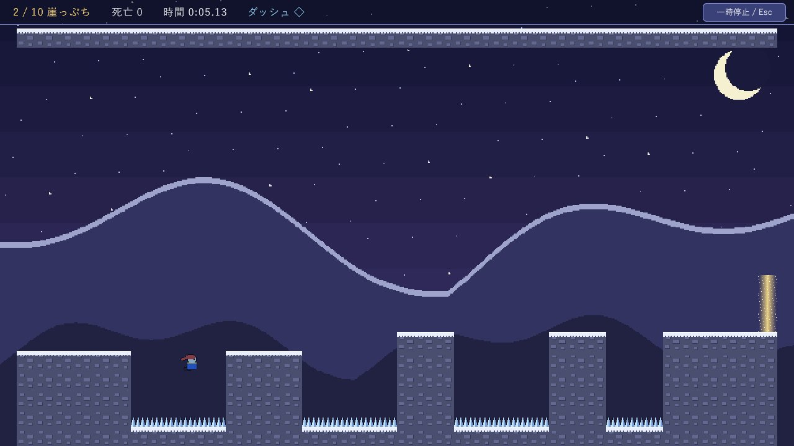
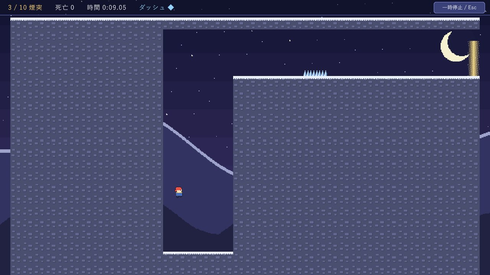
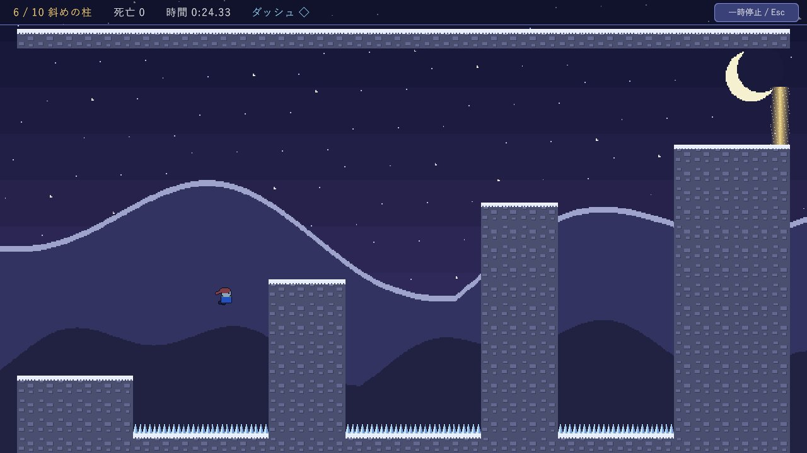
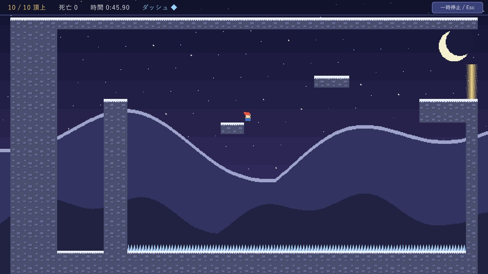
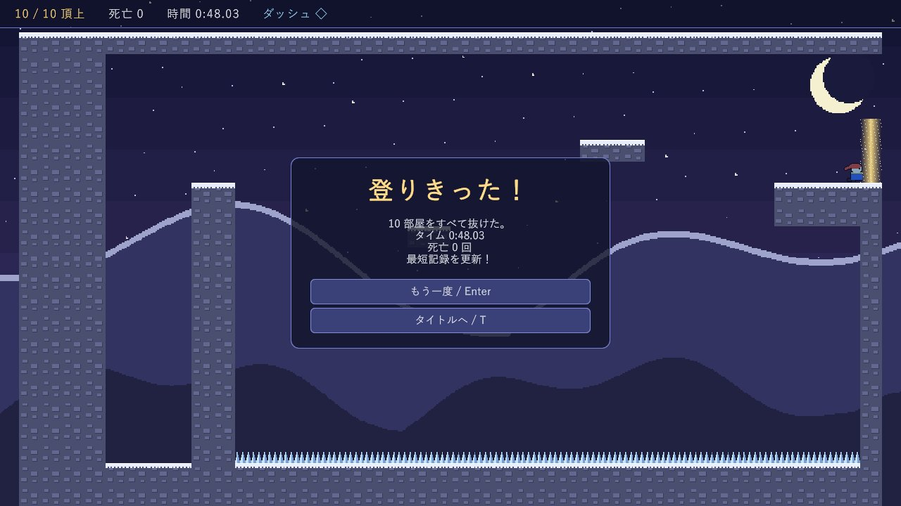
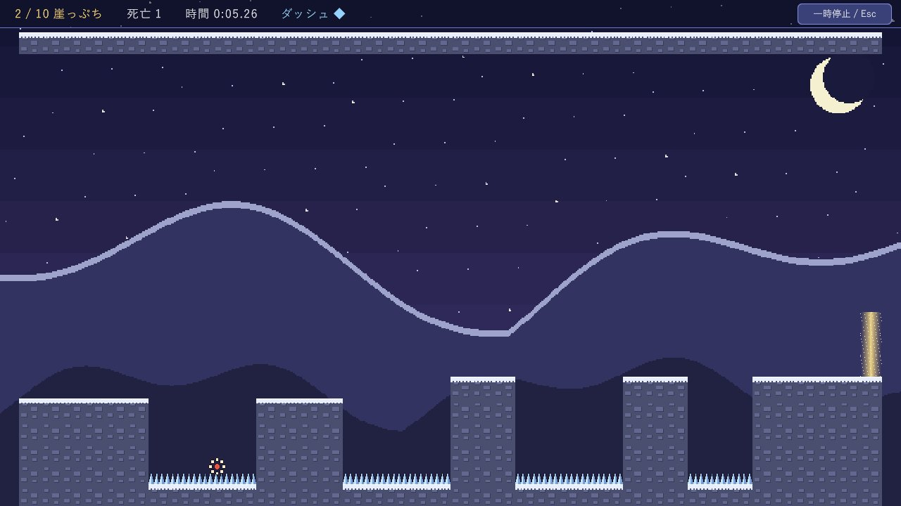
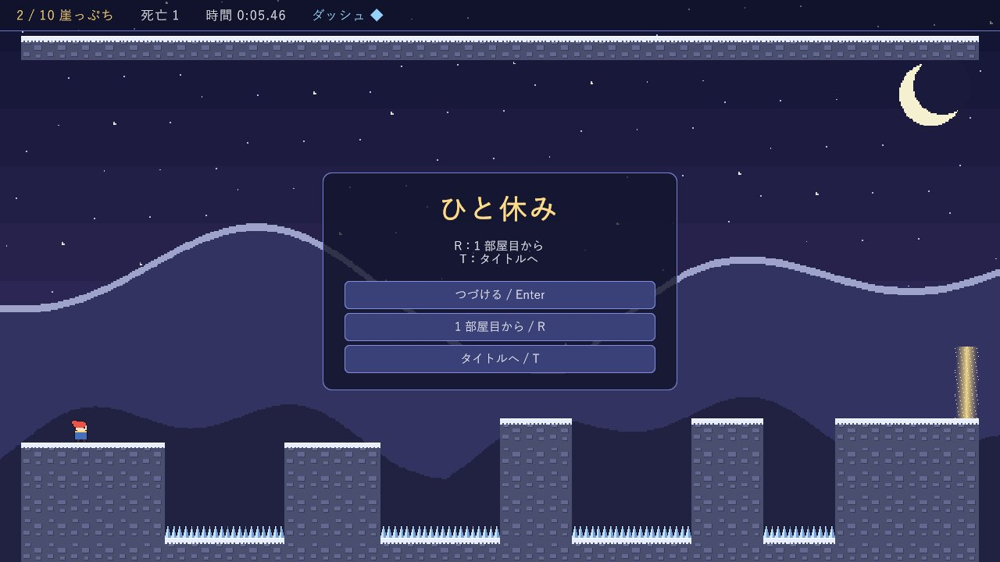

# 022 検証記録

2026-11-22実施。2026-11-22に人間の動作確認OKと完了承認を受領した。コードレビュー（P2-1：1 フレームに入力が複数たまると Tick の上限を超えて進む、P3-1：DashSpeed 1 で斜めのダッシュが動かない、P3-2：状態のハッシュが猶予・バッファなどの内部状態を含まない）を受けて修正し、全検証をやり直した。

## 自動検証

| 項目 | 結果 |
|---|---|
| dev lint | 成功 |
| dev check | 成功（警告0・エラー0） |
| dev test | 成功。022 Core 121/121、App 34/34（ルート探索の道具 1 件は `[Explicit]` で対象外） |
| Unity EditMode | 155/155（Core/App、Mono。`[Explicit]` 1 件は対象外）。レビュー対応後は、人間が開いていたエディタに `unity command test run` で実行した |
| Unity PlayMode | 33/33（実シーン17、共通証跡公開16）。レビュー対応後は開いていたエディタで実行（消音） |
| Windowsビルド | 成功、StandaloneWindows64（レビュー対応後は `unity command build run`） |
| ビルド起動 | dev captureで起動・全場面撮影・正常終了 |
| 証跡 | JPEG品質85、11枚 |
| 撮影再現 | 修正前の同じビルドを2回撮影し、11枚すべての SHA-256 が一致した（画像世代 498cb29b438d1abc、撮影記録 `20261121T183617Z-d8240150` と `20261121T183830Z-97f0e9d9`）。レビュー対応は描画を変えないので、修正後のビルド（公開中）でも同じ画像世代になり、`20261121T183830Z-97f0e9d9` と 11 枚の SHA-256 が一致した。比較した古い撮影記録は次の公開で消える |

Build GUID：`e9751ae005564c2096ffeeaa7a5ec376`。公開ポインタは[current.json](current.json)、実行記録は[manifest.json](runs/20261121T191104Z-52b93726/manifest.json)。台本は乱数を使わず、意図と Tick を順に渡すだけで場面を作る（manifest のシード 1 は共通処理の記録で、ゲームには使っていない）。

## ルールの検証

- **着地直前の入力がバッファで発火**：10 タイルの高さから落とし、着地後の最初の Tick の 0〜(バッファ+2) Tick 前にジャンプを押した。バッファ 0・1・6・30 のそれぞれで、バッファ以内なら着地後の最初の Tick にちょうど跳び、1 Tick でも早ければ跳ばない（その後押し続けても跳ばない）。押し続けた場合と 1 Tick だけ押した場合の両方で確かめ、離した後に発火したジャンプは低いジャンプになる。ダッシュ中に押したジャンプはバッファの中で待ち、ダッシュの後に発火する（バッファより長いダッシュの後は発火しない）。
- **猶予時間外のジャンプ不可**：床の端から歩いて離れ、空中 1〜(猶予+2) Tick 目にジャンプを押した。猶予 0・1・6・30 のそれぞれで、空中 k Tick 目は k ≤ 猶予なら跳べ、猶予+1 Tick 目からは跳べない。跳んだ後・ダッシュした後は猶予が消え、空中で 2 回跳べない。
- **死亡後にダッシュ回数が戻る**：ダッシュ回数 1・2・3 の設定で空中で使い切ってからトゲで死亡させると、再開時に最大回数に戻り、位置・速度・バッファも初期値になる。死亡の演出中（1・18・120 Tick）の入力は状態を変えず、ちょうど設定の Tick 数で開始位置に戻る。押したままのジャンプ・ダッシュは離して押し直すまで効かない。
- **フレームレート**：1・2 部屋目のルートを、Tick の区間の途中で起きた時刻付きのキー操作に直し、30・60・144・240fps と不規則なフレーム間隔（1/240〜1/15 秒）で届けた。どの場合も途中の各時点と最後の状態のハッシュが 60fps と一致した。入力の時刻を使わずフレームで反映するように変えると、このテストが失敗することを確かめた。実シーンでは、Input System の入力の時刻がゲームの時計（`Time.realtimeSinceStartupAsDouble`）と同じ時計の上にあることを確かめた。
- **10 画面を連続で完走**：入力の列で 10 部屋を死亡なしで連続完走し（2882 Tick ≒ 48 秒）、最終状態のハッシュ `0x4FC97CE8` が .NET と Mono の両方で一致した。実シーンでも同じ列で 10 部屋を抜け、部屋ごとに Stage が切り替わり、結果画面にタイムと死亡回数が出る。
- **1 フレームの Tick の上限（レビュー P2-1）**：処理停止の後、1 フレームで「右を押す（2 秒）・離す（3 秒）・Advance（4 秒）」を処理すると、以前は 5 Tick ずつ合わせて 15 Tick 進んだ。上限を Flow が 1 フレーム単位で持ち、入力と Advance が分け合うように直し、合わせて 5 Tick になることと、飛ばした区間の押下・解放も順に反映されて右が離れた状態になることを確かめた。40 個の入力をためても 5 Tick を超えない。飛ばした区間で押したキーは押したままになる。
- **斜めのダッシュの最低速度（レビュー P3-1）**：斜め成分は切り捨てで 0 にならないよう最低 1 にした。DashSpeed 1・2・72 で 8 方向とも動く。
- **状態のハッシュ（レビュー P3-2）**：自機の位置・速度に加え、接地猶予・入力バッファ・壁蹴りの固定・ダッシュの残り Tick、ダッシュの向き、直前のジャンプ・ダッシュの押下、上昇中か、死亡からの再開までの Tick を含めた。着地の 3 Tick 前にジャンプをバッファへ入れただけの状態（位置・速度は同じ）が別のハッシュになり、着地後に実際に動きが分かれることを確かめた。フレームレートの比較もこのハッシュで行う。
- 同じ Tick にトゲと出口に触れたら死亡が優先し、クリアの後・勝利の後の Tick と入力は状態を変えない。

## 入力と画面

- 実シーンの PlayMode テストで、→ を押している間だけ進み離すと止まること、Space で跳び押したまま着地しても跳び直さないこと、空中で ↑＋X でダッシュし、使い切っている間は自機の色が変わり着地で戻ることを確かめた。
- カメラは部屋全体と上の HUD の帯を 1 画面に収める。全 10 部屋の Stage の地形・トゲ・出口が Core の地図と一致する。
- 遊んだ後に一時停止からタイトルへ戻ると、自機の位置・姿・向き・色が起動直後と一致する。
- 一時停止中は Tick が進まない。フォーカスを失うと一時停止し、押していたキーは押し直すまで効かない。HUD のボタンで一巡でき、フォーカスを戻すクリックでは終了ボタンが働かない。

## 画面

| タイトル | 1 部屋目 | ジャンプ |
|---|---|---|
|  |  |  |

| ダッシュ（使い切りで青） | 壁蹴り | 斜めのダッシュ |
|---|---|---|
|  |  |  |

| 10 部屋目 | 結果 | 死亡 |
|---|---|---|
|  |  |  |

| 即時リトライ | 一時停止 |
|---|---|
|  |  |

Unityのビルドログにライセンスクライアントの検証メッセージが出たが、ビルドとPlayerの撮影起動は成功した。
