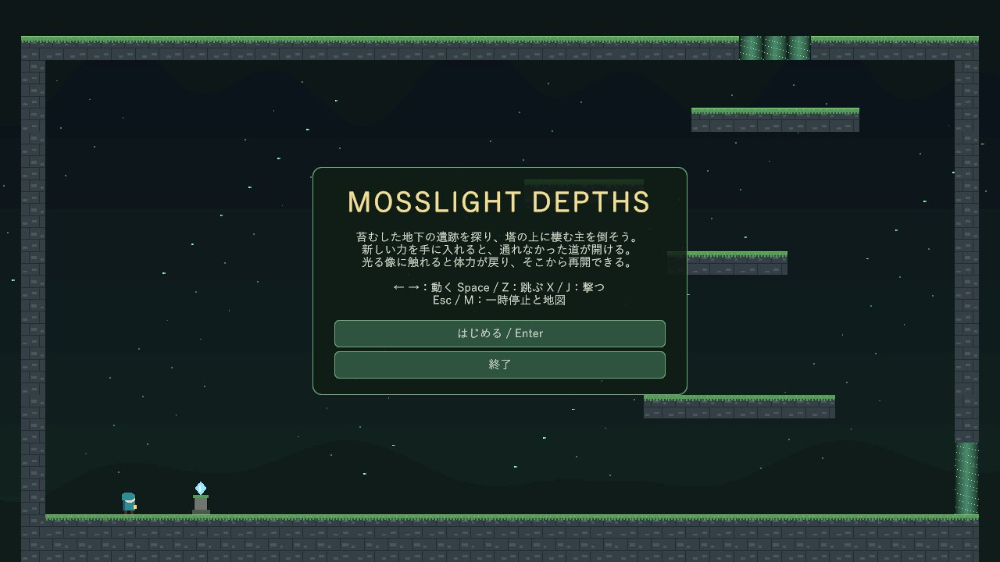
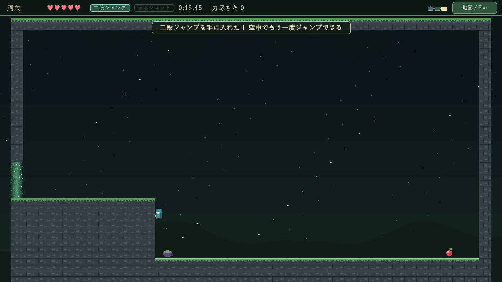
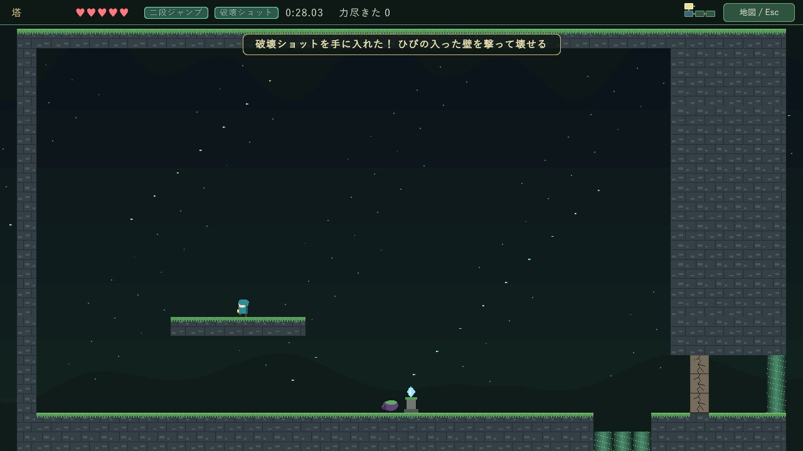
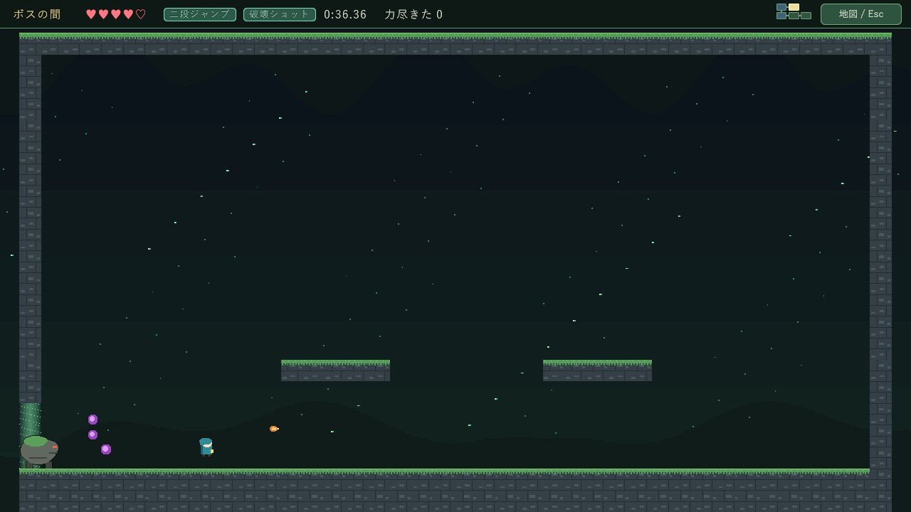
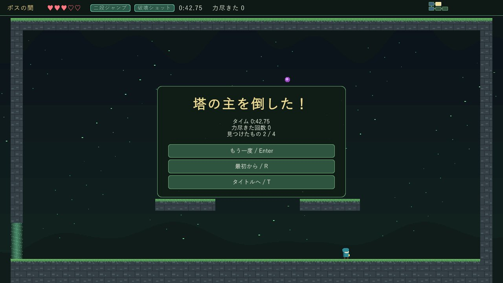
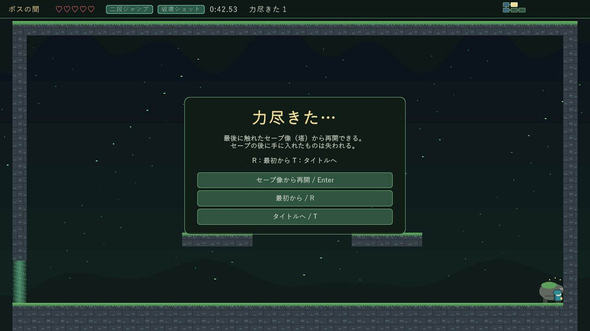

# 023 検証記録

2026-11-22実施。自動検証まで通し、人間の動作確認待ち（検証待ち）。

## 自動検証

| 項目 | 結果 |
|---|---|
| dev lint | 成功 |
| dev check | 成功（警告0・エラー0） |
| dev test | 成功。共通パッケージ tile-motion 10/10、023 Core 75/75、App 21/21（ルート探索の道具 1 件は `[Explicit]` で対象外） |
| Unity EditMode | 106/106（tile-motion・Core・App、Mono。`[Explicit]` 1 件はスキップ） |
| Unity PlayMode | 35/35（実シーン19、共通証跡公開16） |
| Windowsビルド | 成功、StandaloneWindows64 |
| ビルド起動 | dev captureで起動・全場面撮影・正常終了 |
| 証跡 | JPEG品質85、13枚 |
| 撮影再現 | 同じビルドを2回撮影し、13枚すべての SHA-256 が一致した（画像世代 75e7ca3ae36ac7d7、撮影記録 `20261122T042124Z-5914682e` と `20261122T044043Z-167028b4`、Build GUID はどちらも `47f7e04c6585404f8bf88e56eb577906`）。比較した 1 回目の撮影記録は次の公開で消える |

公開ポインタは[current.json](current.json)、実行記録は[manifest.json](runs/20261122T044043Z-167028b4/manifest.json)。台本は乱数を使わず、意図と Tick を順に渡すだけで場面を作る（manifest のシード 1 は共通処理の記録で、ゲームには使っていない）。

## ルールの検証

- **未取得能力ではゲートを通れない**：4 Tick ごとに左右 × ジャンプの 6 通りを試す到達範囲の探索（位置と速さをまとめた近似）で、二段ジャンプなしの拠点からは約 10 万手を尽くしても塔へ行けず、足は高い段（床から 5 タイル）に届かない（最高 3.28 タイル）。二段ジャンプの玉を取っただけで能力のない状態では、洞穴の穴の底から約 14 万手を尽くしても回廊へ戻れない。塔のひびの壁の列は床から天井まで通れず、能力のない弾を 600 Tick 撃ち続けても壊れない。
- **取得後に戻れる**：二段ジャンプがあれば拠点から塔へ、玉を取れば穴から回廊へ戻れる（探索で到達）。破壊ショットで壁を壊すとボスの間へ進める。通しの入力の列は「拠点 → 回廊 → 洞穴 → 回廊 → 拠点 → 塔 → ボスの間」の順に部屋を移る。
- **部屋再入室で重要状態が保持される**：壊した壁・取った回復の実・能力・体力は、扉から出て入り直しても残る。敵は出現位置・満タンに戻り、弾は部屋をまたがない。実シーンでも、ひびの壁を壊した後にボスの間へ入って戻ると、塔の壁は壊れたまま描かれる。
- **セーブと再開**：像に触れると全回復して世界の状態を記録し、触れたまま止まっていても記録し直さない。体力 0 で止まり、再開すると記録の時点に戻る（セーブ後に取った能力・アイテム・壊した壁は失い、セーブ前の物は残る）。実シーンでは、塔の像で破壊ショットを持ってセーブし、壁を壊した後にボスの間で倒れて再開すると、壁が戻って描かれ、破壊ショットと玉の消えた表示は残る。
- **ゲートが成り立つ設定**：設定の検証で、自機を実際に動かして跳躍の高さを測る（1 回 3.28 タイル・二段 5.66 タイル）。1 回で高い段に届く・二段でも届かない・足場に届かない設定は拒否する。
- **全編の通し**：滞在ごとの入力の列とボスの先読み操縦で、全編を 2565 Tick（約 43 秒）で被弾なしにボスの間まで進み、ボスを倒す。最終状態のハッシュ `0xD0072BE8` が .NET と Mono の両方で一致した。
- **フレームレート**：拠点 → 回廊 → 洞穴のルートを時刻付きのキー操作に直し、30・60・144・240fps と不規則なフレーム間隔で届けた。途中の各時点と最後の状態のハッシュが 60fps と一致した。
- **負例**：未定義の操作・入力の向き・未定義の能力、範囲外・NaN の設定、同じアイテムの二重取得、倒れた後・勝った後の Tick と入力（状態は変わらない）、倒れていないときの再開を拒否する。

## 入力と画面

- 実シーンの PlayMode テストで、→ を押している間だけ進み離すと止まること、Space で跳び押したまま着地しても跳び直さないこと、二段ジャンプは能力を取った後だけ空中でもう一度跳べること、X で 1 発撃ち押したままでは撃ち直さないことを確かめた。
- 被弾すると HUD の体力が減り、押し戻しの間は被弾の姿、無敵の間は点滅する。能力を取ると HUD の能力の表示が点き、案内が出て、試合の Tick で消える。
- 地図は訪れた部屋だけを描き、今いる部屋を光らせる。一時停止で大きな地図を出す。
- 全 5 部屋の Stage の地形・ひびの壁・扉と、置かれた物の数が Core の地図と一致する。カメラは部屋全体と上の HUD の帯を 1 画面に収める。
- 遊んだ後に一時停止からタイトルへ戻ると、拠点の自機の位置・姿・向きが起動直後と一致し、次の試合では壊した壁が描き直されている。
- 一時停止中は Tick が進まない。フォーカスを失うと一時停止し、押していたキーは押し直すまで効かない。HUD のボタンで一巡でき、フォーカスを戻すクリックでは終了ボタンが働かない。
- 設定アセットの値で、全編の入力の列とボスの操縦役が勝てることを確かめる（値を調整したら列の作り直しが要ることを知らせる）。

## 画面

| タイトル | 拠点（開始） | 回廊 |
|---|---|---|
|  |  |  |

| 二段ジャンプを入手 | 穴の壁を二段ジャンプで越える | 拠点の高い段から塔へ |
|---|---|---|
|  |  |  |

| 破壊ショットを入手 | ひびの壁を壊した直後 | 一時停止の地図 |
|---|---|---|
|  |  |  |

| ボス戦 | 勝利 | ゲームオーバー |
|---|---|---|
|  |  |  |

| セーブ像から再開（壁は戻り、破壊ショットは残る） |
|---|
|  |

Unityのビルドログにライセンスクライアントの検証メッセージが出たが、ビルドとPlayerの撮影起動は成功した。
