# 024 検証記録

2026-11-22実施。2026-11-22に人間の動作確認OKと完了承認を受領した。コードレビュー（P1-1：CPU のサーブの時機のぶれがサーブの幅を超える設定で、トスを落として持ち直しても同じ値で空振りし続ける、P3-1：ポイントの間の得点板のサーブの印が前のポイントのまま、P3-2：Tick の終わりにちょうど地面に着いた球のバウンドが 1 Tick 遅れる）を受けて修正し、全検証をやり直した。画像はポイントの間を撮った 07・12 だけが変わり、サーブの印が次のサーバーへ移った。PR のレビュー（P2：同じ Tick の中で「右 → Z → 右を離す」と押すと、打球の狙いが中央になる）を受け、狙いを移動の向きとは別に、打球キーを押した時点の左右で持つようにした。試遊で 2 回「難しすぎる」との指摘を受け、打ち方・届く範囲・補助・サーブを調整して全検証をやり直した（下の「試遊を受けた調整」）。

## 自動検証

| 項目 | 結果 |
|---|---|
| dev lint | 成功 |
| dev check | 成功（警告0・エラー0） |
| dev test | 成功。024 Core 146/146、App 23/23 |
| Unity EditMode | 179/179（tile-motion 10・Core 146・App 23、Mono） |
| Unity PlayMode | 33/33（実シーン17、共通証跡公開16） |
| Windowsビルド | 成功、StandaloneWindows64 |
| ビルド起動 | dev captureで起動・全場面撮影・正常終了 |
| 証跡 | JPEG品質85、14枚 |
| 撮影再現 | 同じビルド（Build GUID `45df2573d743445a91c01fdb73138db0`）を2回撮影し、14枚すべての SHA-256 が一致した（撮影記録 `20261122T132253Z-9f8a7402` と `20261122T132313Z-19a5d15c`）。打球の狙いを押した時点の左右に固定した後のビルド（Build GUID `947322aeaed549fda21799b58c8142e6`、撮影記録 `20261122T140852Z-d2edd9ea`）でも、14枚すべてが同じ画像世代 dce7bfec4a1fc86d になった。照合した古い記録は次の公開で消える |

公開ポインタは[current.json](current.json)、実行記録は[manifest.json](runs/20261122T140852Z-d2edd9ea/manifest.json)。試合のシードは撮影用の 1 で、台本は意図と Tick を順に渡すだけで場面を作る（実時間とキー入力を使わない）。早打ち・遅打ち・アウト・ネットの場面は `TennisMatch.StageRally` で球を置き直して作る。

## ルールの検証

- **ネット・アウト・ツーバウンドで正しく失点**：判定ごとの勝者（ネット・アウトは打った側、2 回目のバウンド・壁の線を越えた球は受けた側）、ラインちょうどはイン・1 単位外はアウト、打った側のコートへの落下はアウト。サーブは対角のサービスボックス（ライン上を含む）に入らなければフォルト、2 本でダブルフォルト、トスを落としてもフォルトにならない。試合の中で実際に飛ばした球で、ネット・アウト・返せない球・遅いサーブ 2 本のダブルフォルト・早いサーブの長いフォルトになる。実シーンでは、アウトの判定と得点した側が表示され、バウンドの跡が落ちた位置に描かれ、得点板が進む。
- **得点後にサーブ権が更新**：タイブレーク（既定の試合）のサーバーが A・BB・AA の順、サーブのコートがポイントごとに交互。通常のゲームのデュースとアドバンテージ、ゲームごとのサーバーの交代、6-4・7-5 で決着し 6-5 は未決、6-6 からタイブレーク。試合の中でポイントのたびにサーバー・コート・立ち位置が変わる（撮影 08 で CPU のサーブに交代）。
- **届かない球を打てない**：届く範囲（理想の打点から 1.8 m）・高さ（0.1〜2.6 m）の境界ちょうどは打て、1 単位外は打てない。離れていく球・ネットの向こうの球・自分が打った球・バウンド前のサーブは打てない。実シーンでは、届く球に Z で返し、横 3.5 m に来た球は Z を押しても返らない。
- **早打ちと遅打ちで球筋が変化**：同じ入球を 2 Tick 早く・遅く打つと、着地が左・右に分かれ、早打ちは長くなる。最大の遅打ちはネット、最大の早打ちはアウト。撮影 09・10 で、同じ入球が届く範囲に入ってから 6 Tick 早く・5 Tick 遅く押した球が左・右へ飛び、案内が「少し早い／遅い」になる。
- **着地点予測**：ストローク・ロブ各 100 本で、CPU の予測（球を複製して本番と同じ `Ball.Step` で進める）と実際のバウンドの Tick・位置が一致した。予測でアウトになる球は CPU が見送る。
- **CPU と 1 セット完走**：CPU どうし（手前は同じ判断の自動操縦）で、既定の試合 50 シードと通常の 1 セット 2 シードが決着し、スコアが規則どおり。シード 1 の最終状態のハッシュ `0x346EBABB` が .NET と Mono の両方で一致した。実シーンでも、自動操縦で結果の画面まで進み、勝者・最後の得点・いちばん長いラリーが表示される。設定アセットの値でも決着する。
- **フレームレート**：トス・サーブ・移動のキー操作（時刻つき）を 30・60・144・240fps と不規則な間隔で届け、4 秒後の状態のハッシュが一致した。
- **負例**：未定義の操作・方向・側・判定、範囲外の設定（ずれ 0 の打球が入らない設定・打点を飛び越える速さを含む）、試合終了後の Tick と入力（状態は変わらない）、同じ人の連続打球、1 つのトスへの 2 回目の振り、ポイント後の判定を拒否する。

## 試遊を受けた調整

1 回目の試遊で「難しすぎる。サーブがフォルトになりやすい。体の正面の球を拾えない」との指摘を受け、マリオテニスを手本に次のように変えた。

- **早押しの待ち**：打点の Tick に球がまだ向かってくる途中なら、最大 20 Tick 打点で待ち、球が理想の打点に来たら打つ。球が来る前に押しておけば「ちょうど」で返る。球が近づいてから押すと、今までどおり早打ち・遅打ちになる（`EarlyPressWaitsAtTheImpactAndHitsOnTime`・`PressTooEarlyWhiffsWhenTheHoldRunsOut`）。
- **届く範囲**：理想の打点から 1.3 m → 1.8 m、打てる高さの上限 2.2 m → 2.6 m。体の真横の球も返る（`BallAtTheBodyCanStillBeReturned`）。
- **プレイヤーの補助**：プレイヤーの早打ち・遅打ちのずれ（サーブを含む）を 50% に弱める。CPU はそのまま（`PlayerTimingIsSoftenedButCpuTimingIsNot`）。案内のしきい値も半分（150‰・350‰）にした。
- **サーブ**：打てる幅を頂点 ±12 → ±20 Tick。補助と合わせ、頂点の 16 Tick 前から 12 Tick 後まで（狙いの左・中・右、両方のコート）サービスボックスに入る。
- **CPU**：早すぎる押下は待つので CPU のミスが減り、時機のぶれを ±2 → ±4 Tick にした。補助つきの自動操縦との 20 試合でラリーは平均 16.5 本、1 試合約 3 分。早打ちの横のずれの最大も 4 m → 3 m にした（補助の後のずれでは、左右に狙ってもサイドラインの内側に収まる）。

### 2 回目の試遊を受けた調整

「まだ難しすぎる。体の周りにボールがあれば全部返せるように（ネット・アウトはありうる）。CPU のショットのほうが速いのでは。サーブのときに左右に動いて場所を選べるように」との指摘を受けた。

- **押すと構え、球が来たら打つ**：8 Tick 後に打点が来る方式をやめた。押した Tick に球が届く範囲にあればその場で打ち、まだ向かってくる途中なら構えたまま最大 90 Tick 待ち、理想の打点に来たら打つ。球が向かってくる間のどの Tick に押しても、届く範囲を通り過ぎる前なら必ず返る（`AnyPressWhileTheBallIsComingOrWithinReachReturnsIt`）。構えている間はふつうに動ける。
- **CPU の球は速かった（気のせいではない）**：1 回目の作りでは、遅打ちでネットの余裕を減らしたぶん弾道が平らで速くなり、補助のない CPU は遅打ちが多かった。補助つきの自動操縦との 10 試合の実測で、CPU 25.4 m/s・プレイヤー側 23.9 m/s。飛ぶ時間をずれ 0 の弾道で決め、ずれは着地点だけを変える（遅打ちは同じ時間で手前に落ち、低くなってネットにかかりうる）ようにして、どちらも約 22 m/s にそろえた（`ShotSpeedDoesNotDependOnTiming`）。
- **サーブの立ち位置**：トスを上げるまで ← → でベースラインに沿って横に動ける（センターマークの 0.3 m 外からサイドラインまで、球も手と一緒に動く）。両端から打っても頂点で打てば入る（`ServeFromTheChosenPositionStillLandsInTheBox`）。
- **CPU のぶれ**：構えて待つので CPU のミスがさらに減り、±5 Tick にした（ラリー平均 15 本、1 試合約 3 分）。

## 入力と画面

- 実シーンの PlayMode テストで、サーブ待ちのサーバーは ← → で横にだけ動き（立ち位置を選ぶ）、トス中は動かず、Z でトスを上げ、頂点の近くでもう一度 Z を押すとサーブが飛ぶこと、レシーバーは ← を押している間だけ動き離すと止まること、X のロブはネットの 2.5 m 以上上を越えることを確かめた。
- 案内：サーブ待ちは「Z でトスを上げる」、トス中は「頂点でもう一度 Z」、打った後は時機（ちょうど・少し早い・遅い）を出し、試合の Tick で消す。2 本目のサーブの前は FAULT、ポイントの間は判定と得点した側を出し、次のポイントで消える。
- 描画：ネットの向こうの球はネットの後ろ、手前の球は前に描く。影は球の真下の地面。カメラは両ベースラインの後ろ 5 m・サイドの外・奥のロブの高さと上の HUD の帯を 1 画面に収める。
- 遊んだ後に一時停止からタイトルへ戻ると、両選手の位置・姿・向き・球・バウンドの跡の表示が起動直後と一致する。
- 一時停止中は Tick が進まない。フォーカスを失うと一時停止し、押していたキーは押し直すまで効かない。HUD のボタンで一巡でき、フォーカスを戻すクリックでは終了ボタンが働かない。

## 気づいたこと

- 設定アセットは生成スクリプトが上書きしないので、コードの既定値を変えても反映されない。撮影の記録で `TimingSpan` が古い値（12000）のままだったことに気づき、アセットを 13000 に直した。

## 画面

| タイトル | 開始（サーブ待ち） | トス |
|---|---|---|
| 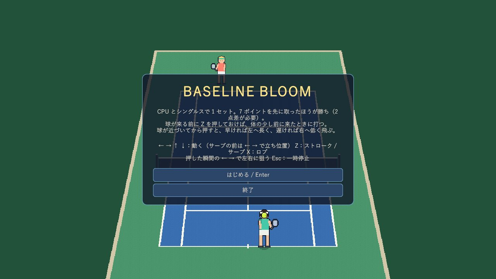 | 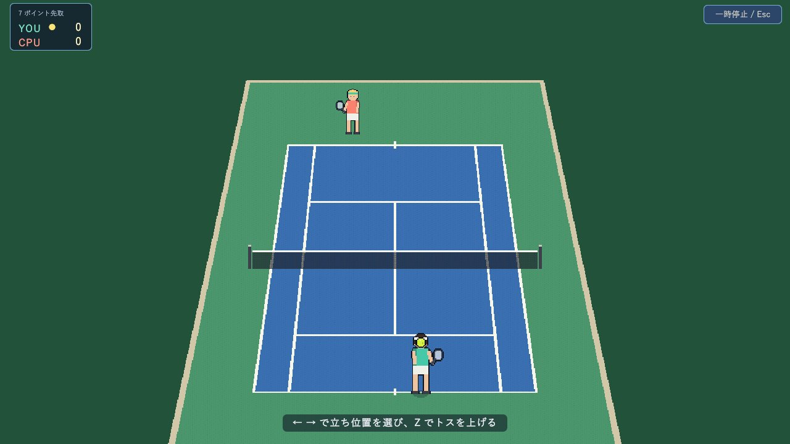 | 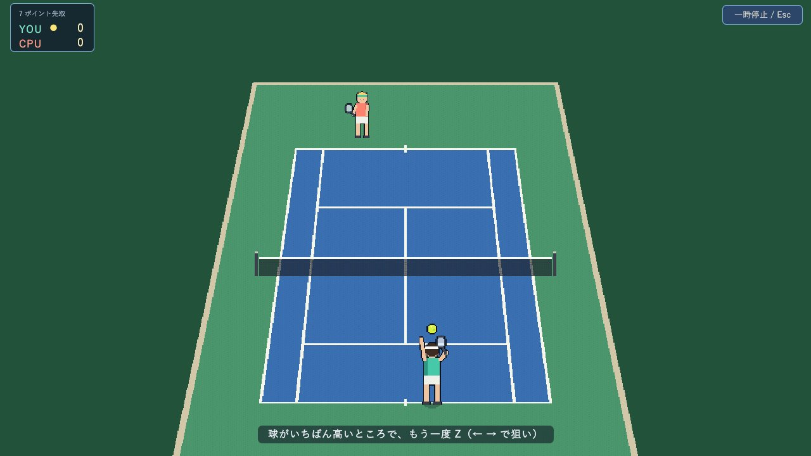 |

| 遅いサーブのフォルト | セカンドサーブ | ラリー |
|---|---|---|
| 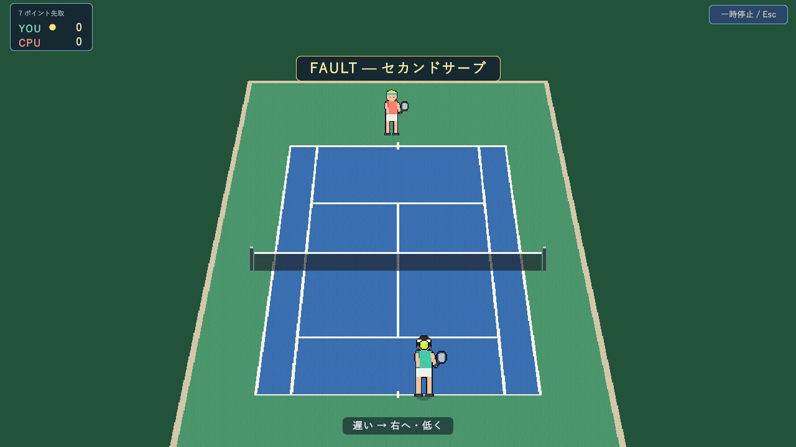 | 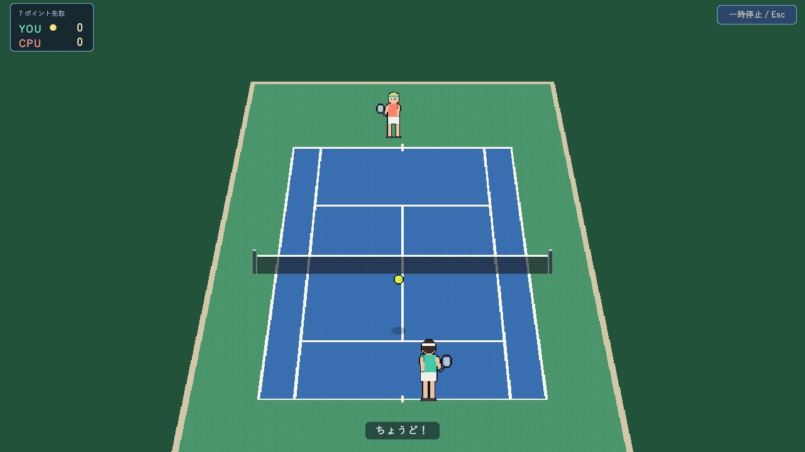 | 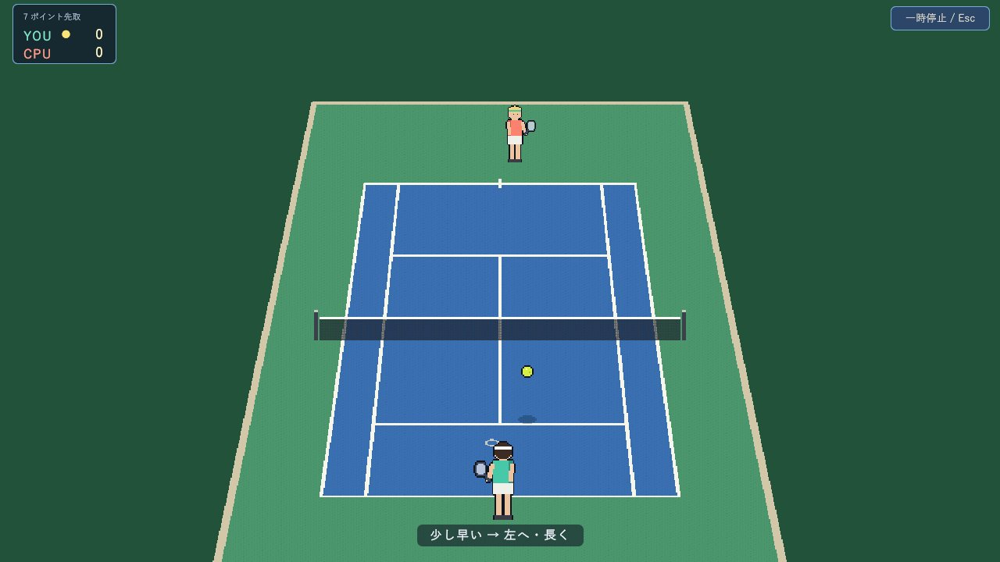 |

| ポイント | サーバーの交代 | 早打ち |
|---|---|---|
| 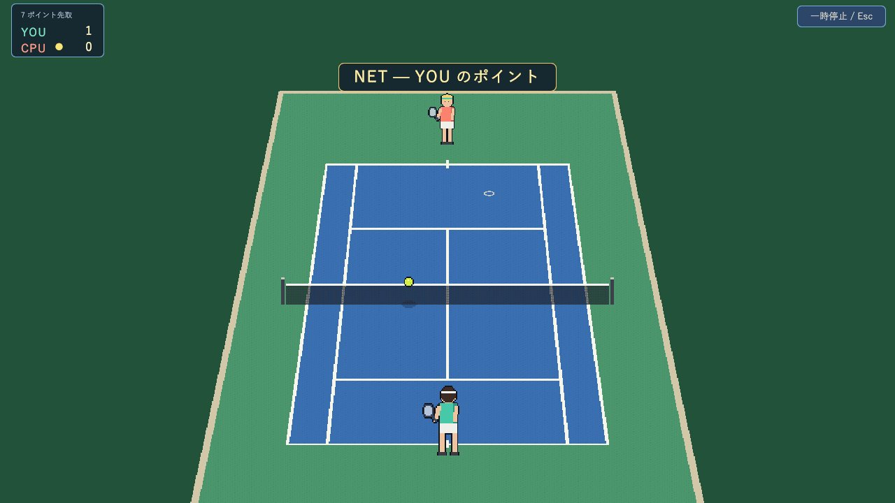 | 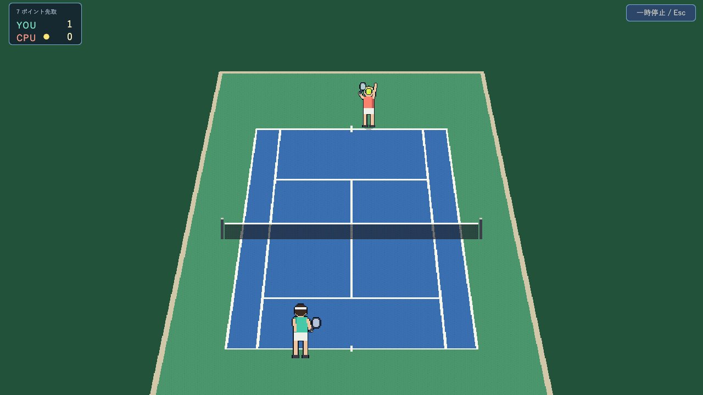 | 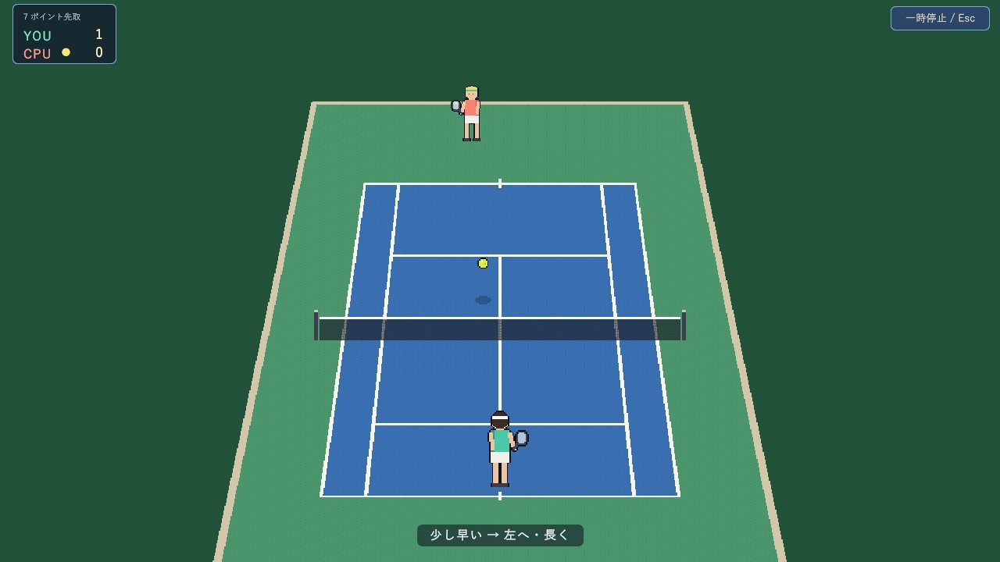 |

| 遅打ち | アウト | ネット |
|---|---|---|
| 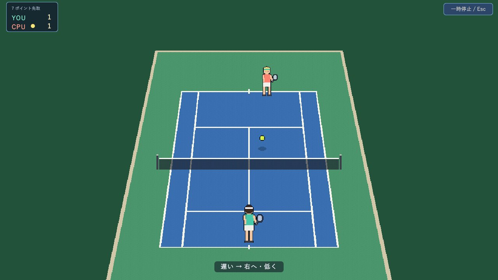 | 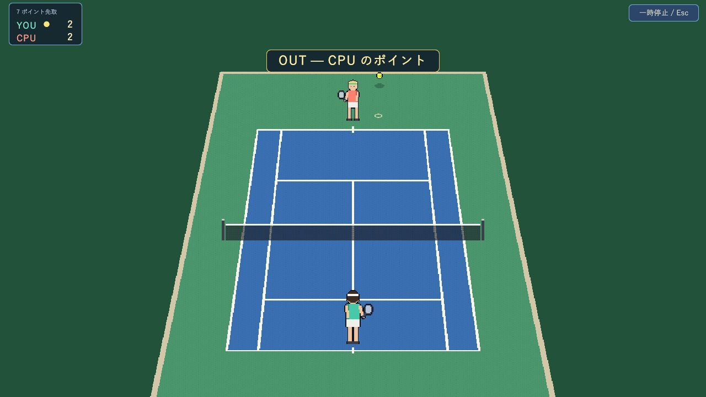 | 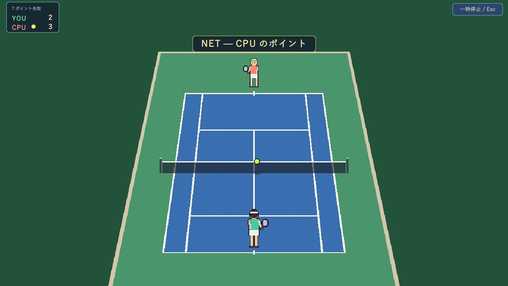 |

| 一時停止 | 結果 |
|---|---|
| 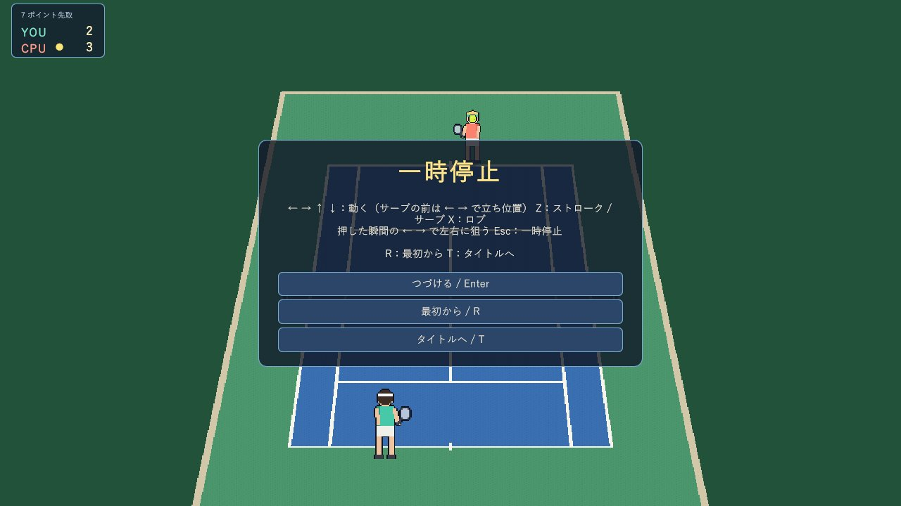 | 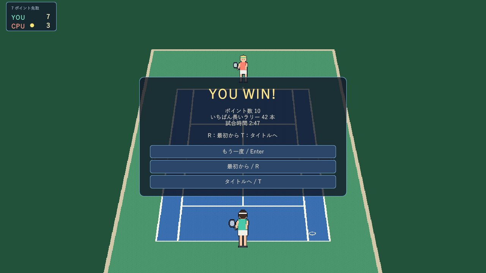 |

Unityのビルドログにライセンスクライアントの検証メッセージが出たが、ビルドとPlayerの撮影起動は成功した。
