# 025 検証記録

2026-11-23実施（同日、レビュー対応の後に再検証）。

## 自動検証

| 項目 | 結果 |
|---|---|
| dev lint | 成功 |
| dev check | 成功（警告0・エラー0） |
| dev test | 成功。025 Core 82/82、App 20/20 |
| Unity EditMode | 112/112（tile-motion 10・Core 82・App 20、Mono） |
| Unity PlayMode | 37/37（実シーン21、共通証跡公開16） |
| Windowsビルド | 成功、StandaloneWindows64 |
| ビルド起動 | dev captureで起動・全場面撮影・正常終了 |
| 証跡 | JPEG品質85、15枚 |
| 撮影再現 | レビュー対応（被弾の経路・タイトルの文言）の後の同じビルド（Build GUID `b9abe520e1cd45e3933380a5b7b52dfc`）を 2 回撮影し、15 枚すべての SHA-256 が一致した（撮影記録 `20261122T181854Z-24507c89` と `20261122T181929Z-8701e7a9`）。対応前のビルド（画像世代 eef77b84b748fe7d）と比べて変わったのは 01-title（文言）と 13-victory（結果のタイムの文字の周り 8×8 px、差は最大 12/255。タイトルの文字が増えてフォントの文字の並びが変わったためとみられる）だけで、撮影時の試合の状態（経過 Tick・位置・体力）はすべて同じ。照合した古い記録は次の公開で消える |

公開ポインタは[current.json](current.json)、実行記録は[manifest.json](runs/20261122T181929Z-8701e7a9/manifest.json)。試合のシードは撮影用の 1（App テストの通しと同じ試合）で、台本は意図と Tick を順に渡すだけで場面を作る（実時間とキー入力を使わない）。場面は操縦役（`Autopilot`）で進め、ゲームオーバーだけは新しい試合（シード 2）で、敵に向かって剣を振らずに歩く操縦役で作る。

## ルールの検証

- **鍵消費後のみ扉が開く**：鍵なしで押し当てても固体のまま個数は変わらず、1 本で開いて 0 本になり、反対側からも開いている。2 枚目は 2 本目が要る。小鍵でボス扉は開かず（小鍵も減らない）、ボス鍵で小扉は開かない。ボス鍵は無くならない。同じ宝箱は 2 回目に中身を出さない。実シーンでは、入口の上の小扉に ↑ で押し当てると「小鍵が必要」と出て扉のタイルが残り、小鍵を持って押し当てると扉のタイルが消え、小鍵の表示が ×1 → ×0 になり、そのまま前室へ移る。
- **被弾の経路**：自機は地形の解決と同じ横 → 縦の経路で動くので、敵・弾との接触もその経路（横の区間と縦の区間、相手は区間の分け目の時刻の位置へ補間）で判定する。斜めの移動で、実際の経路では触れて直線では触れない場面は当たり、直線だけが角をかすめる場面は当たらない。壁で片方の軸が止まった Tick は止まった経路で判定する（`ContactPathTests`）。操縦役の 20 シードの結果とシード 1 のハッシュは変わらなかった。
- **無敵中に二重ダメージなし**：同じ Tick に 2 発の弾が当たっても 1 回、触れたままでも被弾の次の Tick から 60 Tick は減らず 61 Tick 目に減る（試合の中と自機の単体の両方）。ロールの無敵は始めた Tick から 12 Tick 目まで。1 回の振りで同じ敵には 1 回だけ（敵の無敵を 1 Tick にしても）。実シーンでは、被弾の後の無敵の間は自機が点滅し、切れると点滅しない。
- **ボス撃破フラグを維持**：倒した後に部屋を出入りしてもボスは出ず、秘宝は残る。撃破の後にゲームオーバーから再開しても残る。撃破の前に取った複製は変わらない。倒す前に部屋を出ると、ボスは次に入ったとき満タン。実シーンでは、倒すとボスが消えて秘宝が現れ、秘宝を取ると結果の画面になる。
- **探索 → 鍵 → ボスの一連体験**：操縦役で 20 シードすべてが「東の間の宝箱（小鍵）→ 西の回廊の全滅（小鍵）→ 入口の小扉 → 前室の小扉 → 宝物庫の宝箱（ボス鍵）→ ボス扉 → ボス → 秘宝」を 10 分以内に完走（平均 2951 Tick、死亡 0）。シード 1 の最終状態のハッシュ `0xFCD220F3` が .NET と Mono の両方で一致した。設定アセットの値でも同じハッシュになる。
- **部屋跨ぎで状態一貫**：全滅の小鍵・宝箱・小鍵の個数・開いた扉が往復で残り、敵は出現位置・満タンに戻り、体力は持ち越す。切り替えの 30 Tick は入力・被弾・敵の動きがない。同じ Tick の致死の被弾と出入口は倒れるほうが先。実シーンでは、前室 → 宝物庫 → 前室と入り直しても開けた 2 枚の小扉は開いたまま描かれ、ボス扉だけが閉じている。
- **フレームレート**：操縦役の 1500 Tick の入力を時刻つきのキー操作に直し、30・60・144・240fps と不規則な間隔で届けて、途中と最後の状態のハッシュが一致した。
- **負例**：未定義の操作・キー、範囲外の設定（すべての int の設定に負の値）、不正な地図（端でない出入口・角・種類の混在・合わない隣・壁に埋まる敵）、勝利・ゲームオーバーの後の Tick と入力（状態は変わらない）、二重の再開・二重の宝箱・二重の全滅の小鍵・二重のボス撃破を拒否する。

## 入力と画面

- 実シーンの PlayMode テストで、← と ↑ を同時に押すと左上へ両軸に同じだけ動き、離すと止まること、Z は押すたびに 1 回だけ振り（押したままでは振り直さない）、剣の弧が当たりの箱の中央に描かれること、X で向き（上）へ転がり始めは無敵であることを確かめた。
- 切り替え：途中ではカメラが残り Tick に比例した位置にあり、2 部屋とも描かれ、出ていく部屋に自機と敵は描かない。終わると出ていく部屋は消え、カメラは入った部屋の中央。HUD の部屋名と小地図（訪れた部屋だけ）が変わる。
- 宝箱を開けると開いた絵になり案内が出て、Tick で消える。全滅の小鍵は現れ、取ると消える。ボス鍵を持つと HUD のボス鍵が点く。
- ゲームオーバーから Enter で入口に戻り、体力満タン・小鍵の個数そのまま・倒れた回数 1 になる。
- 遊んだ後に一時停止からタイトルへ戻ると、自機の位置・姿・向き・表示、開けた扉、カメラの位置が起動直後と一致する。
- 一時停止中は Tick が進まず、大きな地図に閉じた小扉が黄色で出る。フォーカスを失うと一時停止し、押していたキーは押し直すまで効かない。HUD のボタンで一巡でき、フォーカスを戻すクリックでは終了ボタンが働かない。
- 6 部屋の Stage Prefab は Core の地図と一致し、宝箱・敵・全滅の小鍵・ボスを 1 マス動かす・種類を変える・扉の種類を変えた地図では、照合が不一致を報告する。設定アセットの試合の設定はコードの既定値と同じ。

## 気づいたこと

- 撮影の 1 回目で、一時停止の地図を部屋の切り替えの途中で撮っていた（画面が半分ずれる）。前室に着いてから一時停止するよう台本を直した。
- テストで Tick をまとめて進めて最後に 1 回だけ描くと、途中で離れた部屋の Stage は最後の状態に描き直されない（実際の画面は毎フレーム描くので問題ない）。部屋の表示は、その部屋にいる間に確かめる。

## レビュー対応

- 斜めの移動の被弾が、始めと終わりを結ぶ直線で判定され、地形の解決（横 → 縦）と経路が食い違っていた。上の「被弾の経路」のとおり直した。
- タイトルの説明「回避ロールの間は攻撃を受けない」は、後半 6 Tick の無敵がない規則と食い違っていた。「回避ロールは転がり始めの短い間だけ攻撃を受けない」に直した。

## 画面

| タイトル | 開始 | 回避ロール |
|---|---|---|
| 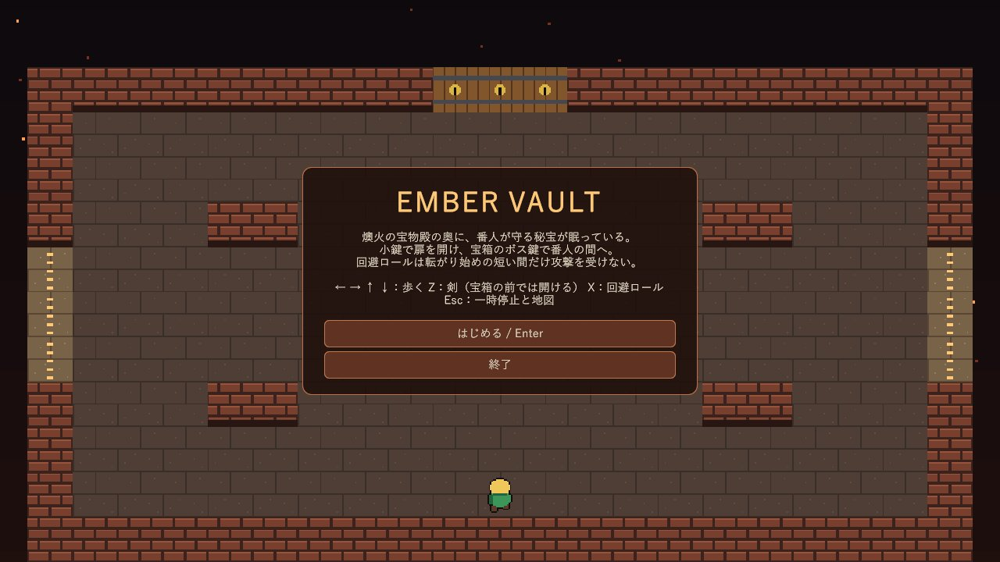 | 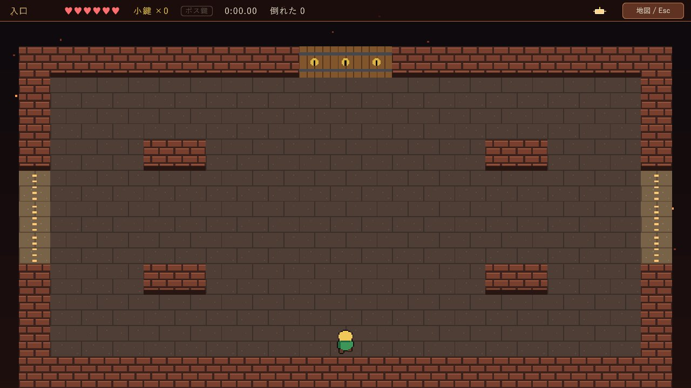 | 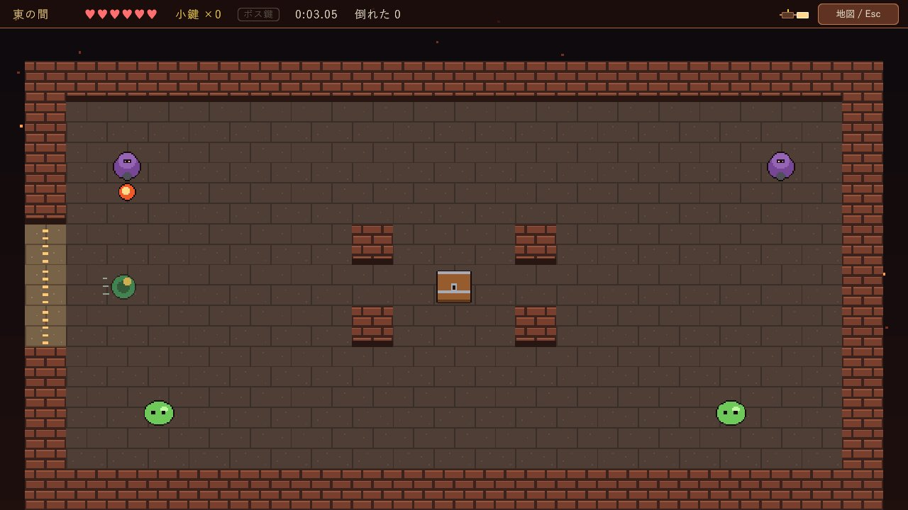 |

| 宝箱（小鍵） | 部屋の切り替え | 剣の命中 |
|---|---|---|
| 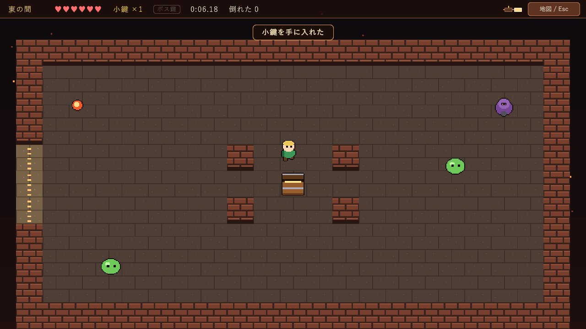 | 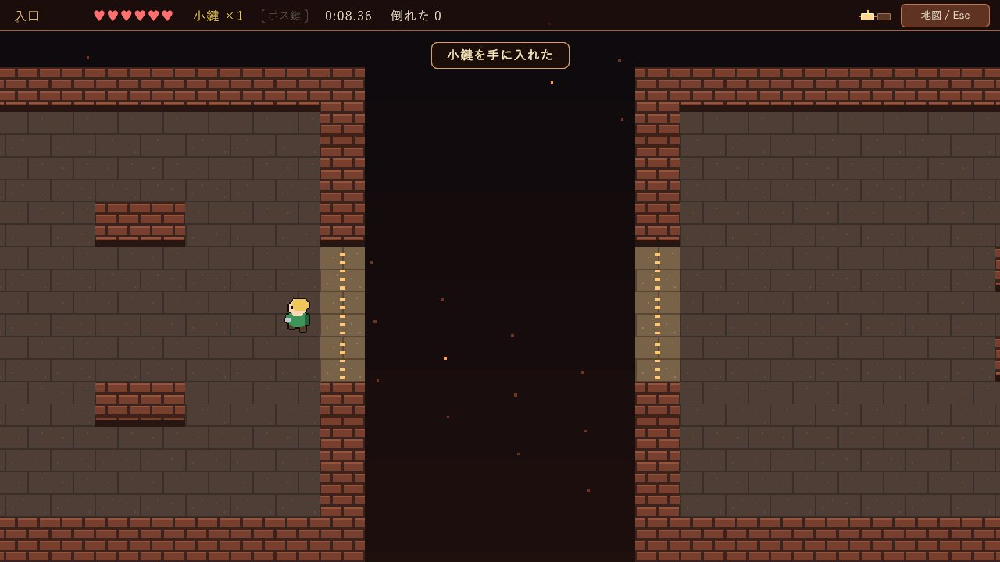 | 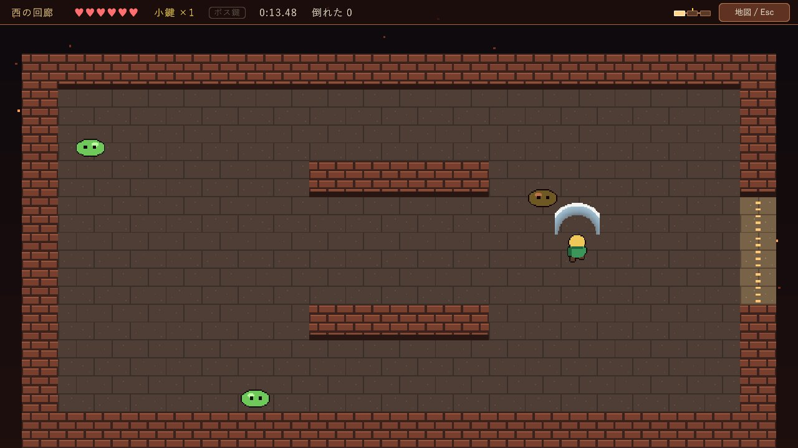 |

| 全滅の小鍵 | 小扉を開ける | 地図 |
|---|---|---|
| 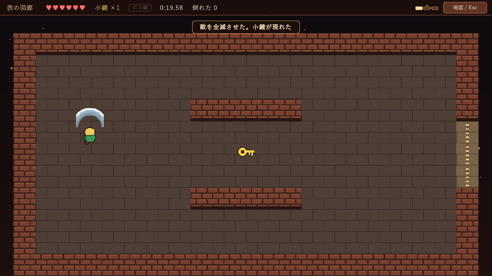 | 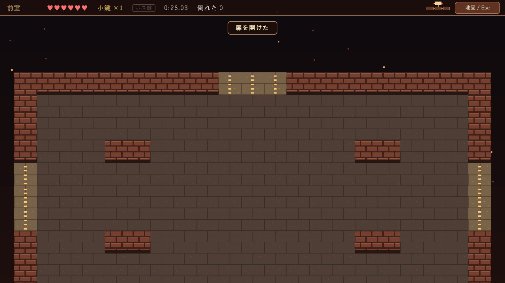 | 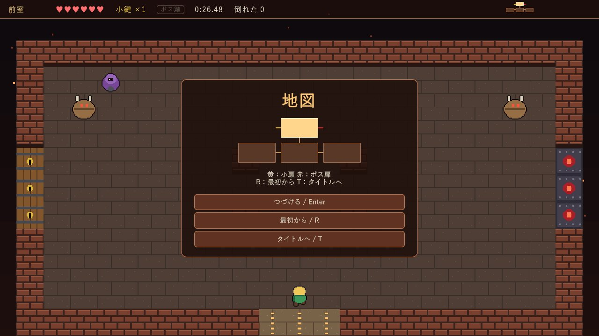 |

| ボス鍵 | ボス戦 | ボス撃破と秘宝 |
|---|---|---|
| 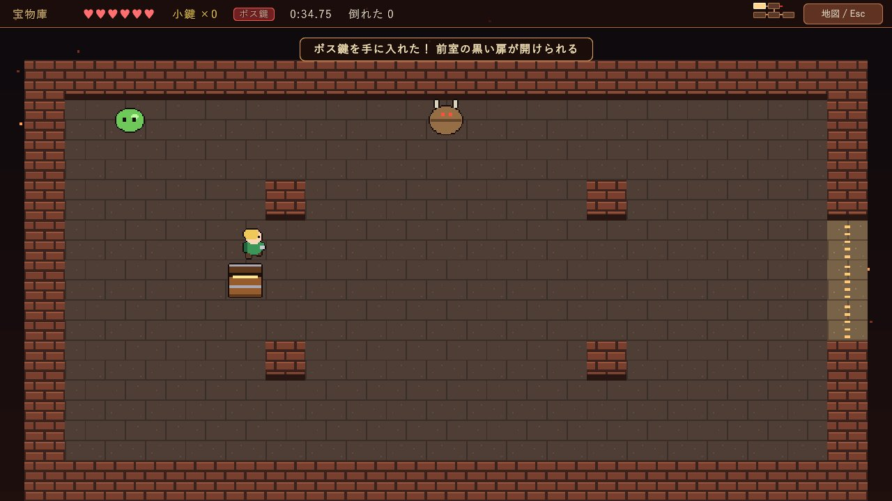 | 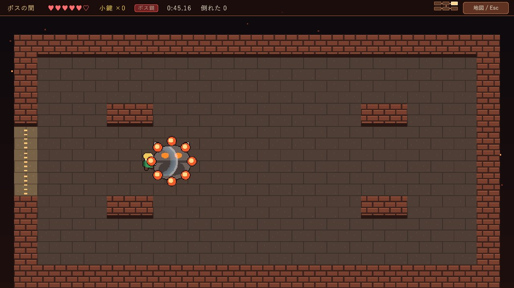 | 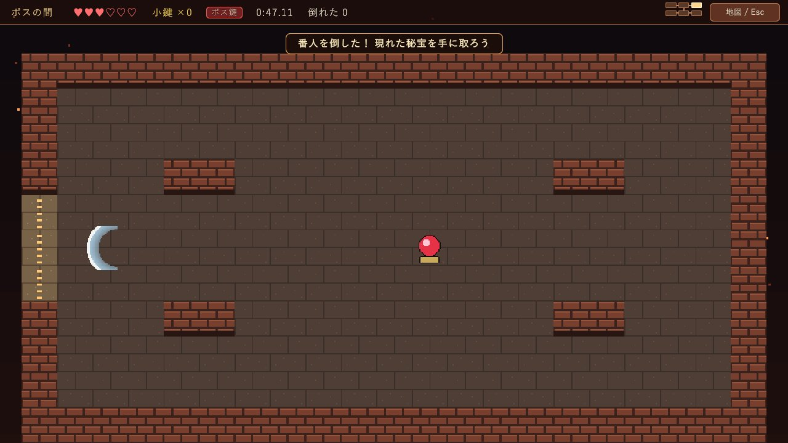 |

| 結果 | ゲームオーバー | 入口から再開 |
|---|---|---|
| 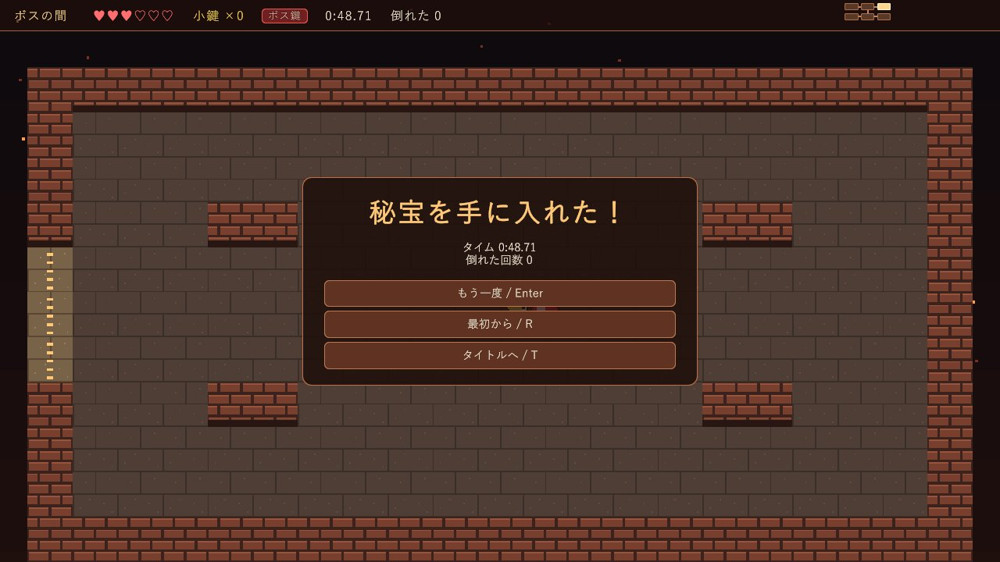 | 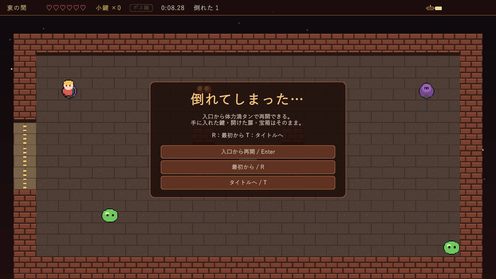 | 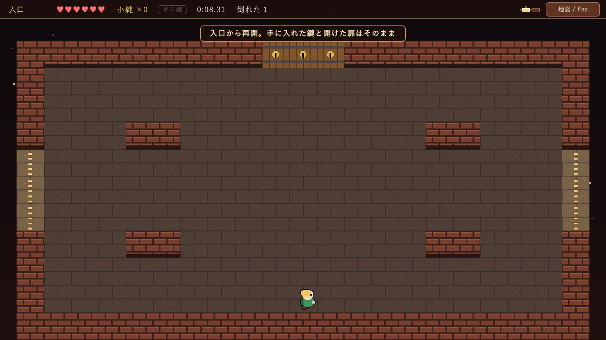 |
