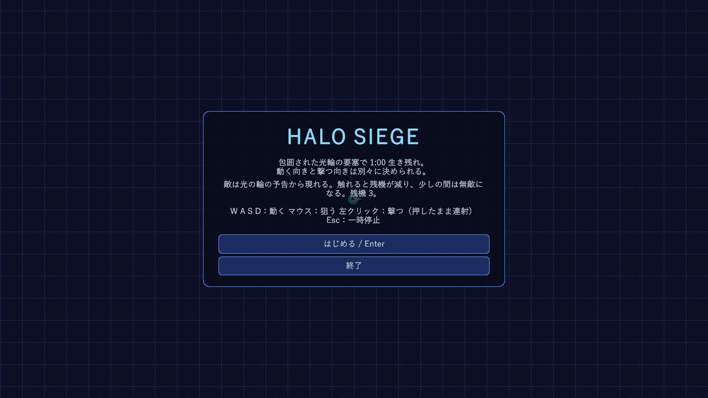
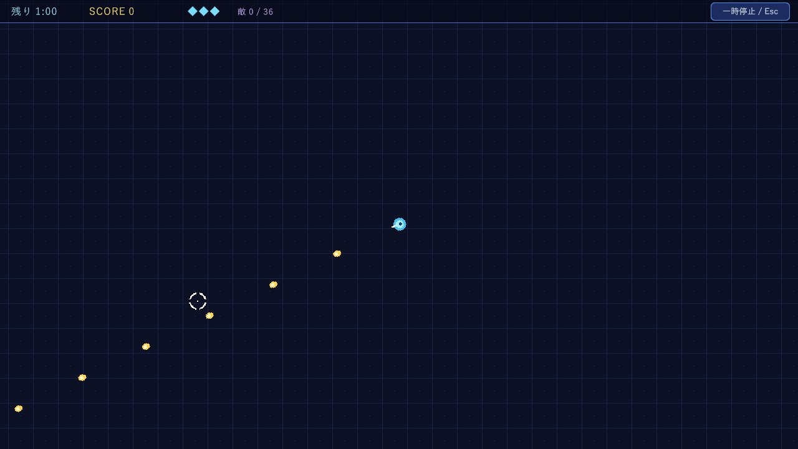
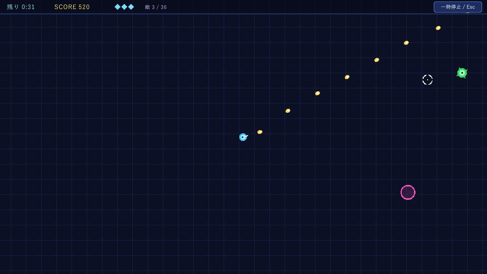
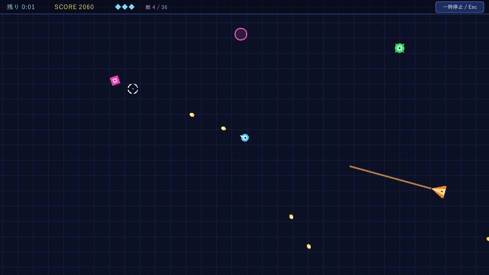
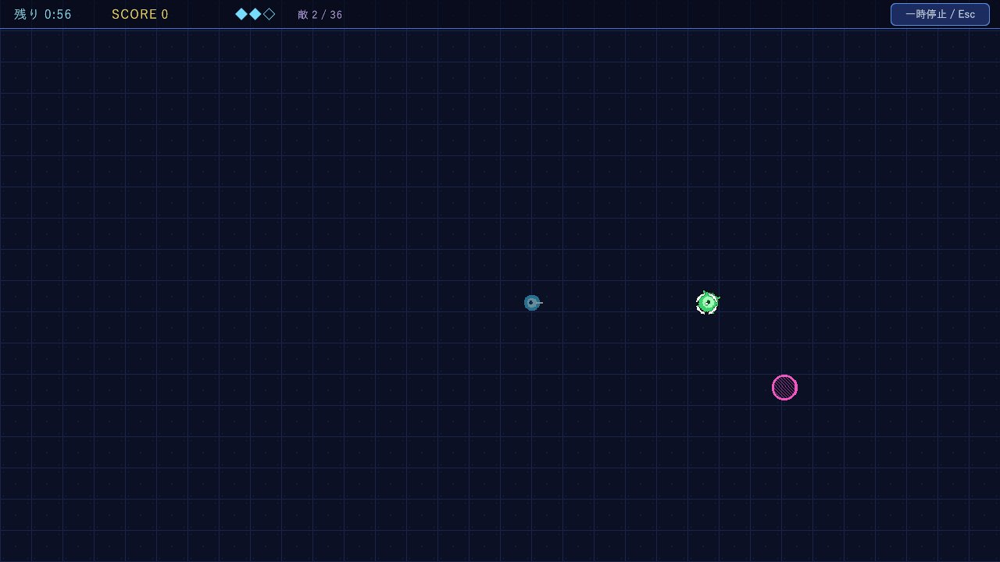
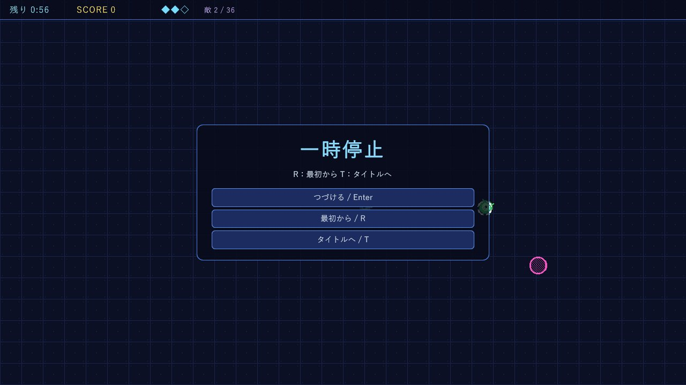
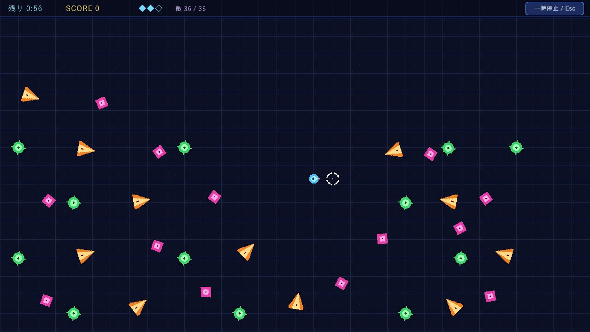
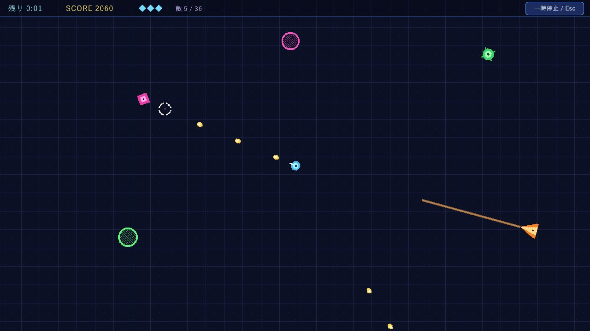
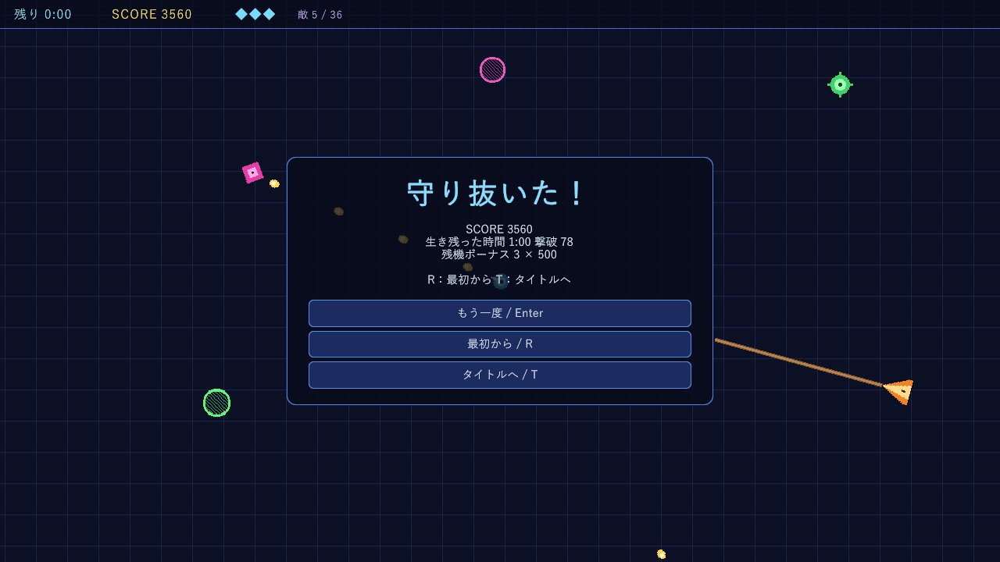
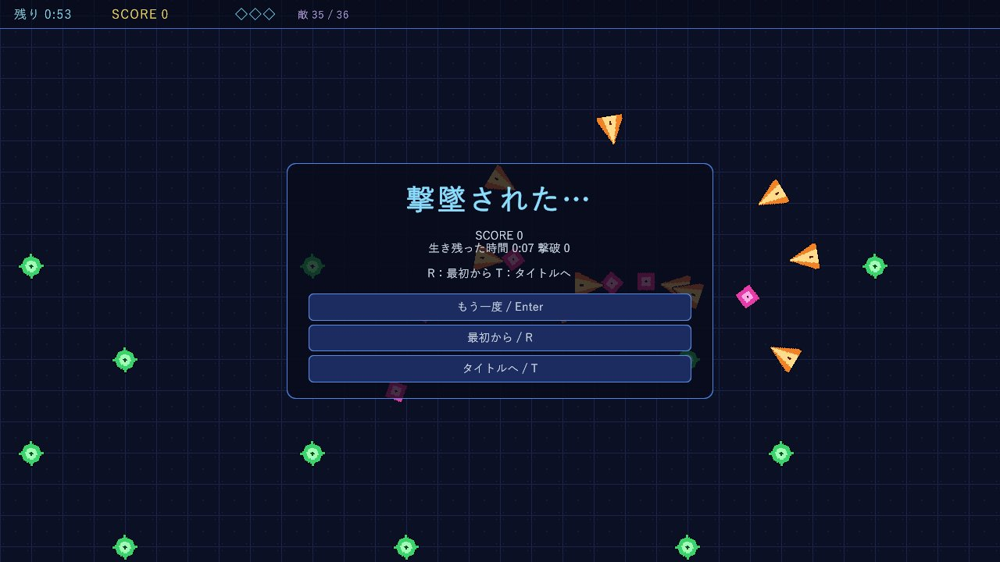

# 026 検証記録

2026-11-23実施（同日、試遊の指示で試合を 1 分・出現を最後に 3 倍の頻度にして再検証）。

## 自動検証

| 項目 | 結果 |
|---|---|
| dev lint | 成功 |
| dev check | 成功（警告0・エラー0） |
| dev test | 成功。026 Core 80/80、App 17/17 |
| Unity EditMode | 107/107（tile-motion 10・Core 80・App 17、Mono） |
| Unity PlayMode | 35/35（実シーン19、共通証跡公開16） |
| Windowsビルド | 成功、StandaloneWindows64 |
| ビルド起動 | dev captureで起動・全場面撮影・正常終了 |
| 証跡 | JPEG品質85、11枚 |
| 撮影再現 | 2 回目のレビュー対応の後の同じビルド（Build GUID `9fe8a06232ff4323a7d228044c0086aa`）を 2 回撮影し、11 枚すべての SHA-256 が一致した（撮影記録 `20261122T202828Z-5937afc4` と `20261122T202850Z-9f426ea6`）。対応前と比べると、01・02 は同じで、03〜11 は予告の輪の大きさ（敵の半径に合わせた）が変わった。11 は敵が自機のすぐ近くで向きを変える正規化の精度が変わり、撮影時の自機の位置も少し変わった（経過 Tick は同じ）。照合した古い記録は次の公開で消える |

公開ポインタは[current.json](current.json)、実行記録は[manifest.json](runs/20261122T202850Z-9f426ea6/manifest.json)。試合のシードは撮影用の 1（App テストの通しと同じ）で、台本は意図と Tick を順に渡すだけで場面を作る（実時間とマウス・キー入力を使わない）。最初の試合（シード 1）は、02 を決まった向きに動いて決まった向きを狙う操縦役で、03〜05・09・10 を自動操縦（`Autopilot`）で勝利まで通す。次の試合（シード 2）は撃たずに敵へ向かう操縦役で 06・07 を作り、08 は台本で敵を画面の内側に置いて上限まで満たした場面、11 はそのまま残機 0 まで進めた敗北。

## ルールの検証

- **移動方向と射撃方向を独立指定**：移動 9 通り × 照準 8 方向のすべてで、自機は移動キーどおり（斜めは 181/256 倍）に動き、弾は移動の後の自機から照準点への向きに飛ぶ。照準点が自機に重なる Tick は直前の向きを保つ。App では移動キーは時刻付きの列、照準はフレームごとの値と別の経路で渡す。実シーンでは、D を押しながら左のマウスの位置で左ボタンを押すと、自機は右へ動き、弾はすべて左へ飛ぶ。マウスを動かさなくても、カメラが動けば照準点も動く。
- **画面外の敵が累積しない**：画面外に 180 Tick 続けて居た敵は得点なしで消え、179 Tick 目までは残る。画面に戻れば数え直す。自機が隅にとどまり続けても（5 シード × 6000 Tick）、生存数は上限の 36 体以下、画面外の連続 Tick は上限未満のまま。
- **無敵時間中の被弾無効**：被弾した Tick を h とすると h〜h+119 は触れても残機が減らず（その間に触れた敵も消えない）、h+120 に当たる。同じ Tick に 2 体触れても 1 減るだけ。実シーンでは、無敵の間は自機が半透明に点滅し、切れると戻る。
- **スポーンレート**：既定は 10 秒ごとに間隔を 75 → 25 Tick へ縮め、最後は最初の 3 倍の頻度（コードの既定値と設定アセットの両方をテストで確認）。区間の表どおりの数が出る（例：間隔 10・25 の 100 Tick ずつで 10 体・4 体）。上限に張り付いている間は予算が間隔 1 回分で頭打ちになり、空いた Tick に 1 体出た後は次の間隔まで出ない。出現位置は画面の内側で自機から 5 セル以上（20 シード）。予告中は当たらず、予告の Tick 数の次の Tick から動いて当たる。
- **敵密度上限を維持**：自動操縦の 1 分通し（30 シード）・PlayMode の通しの毎 Tick で、生存数は上限以下。最大許容設定（敵 64 体・弾 32 発）の計測は下記。
- **1 分生存または死亡までプレイ**（試遊の指示で仕様書の 5 分から短くした）：自動操縦は 30 シードとも 1 分生き残った（平均 3417 点、同時に居た敵は最大 6 体）。シード 1 の最終ハッシュ `0xE8B259C2` が .NET・Mono・設定アセットの値で一致した。撮影では勝利（10）と敗北（11）の両方を通した。
- **負例**：未定義の移動・操作・キー、範囲外の設定（弾の数の上限を超える寿命、画面に収まらない安全距離、5 分を覆わない区間の表、重み 0 の区間、空の区間・性能）、終わった試合の Tick と入力（状態は変わらない）、上限を超える配置を拒否する。

## 性能（最大許容設定）

PlayMode テスト `Performance_AtTheMaximumDensity`（Unity エディタのバッチ実行・Mono、開発機の Windows 11）。敵を上限の 64 体まで置き、毎 Tick 撃って弾を 32 発に保った状態で 600 Tick、Core の 1 Tick と描画の更新（SpriteRenderer の位置・絵・色・表示の書き換え。GPU の描画時間は含まない）を別々に測った。各サンプルで生存数 64・弾 32 を確かめている。

| 対象 | p50 | p95 | 最大 |
|---|---|---|---|
| Core の Step | 0.340 ms | 0.355 ms | 0.460 ms |
| 描画の更新（CPU） | 0.056 ms | 0.073 ms | 0.853 ms |

描画物は 116 個（敵 64・弾 32・予告・突進の筋の見本を含む）。他の PC の FPS を保証するものではない。

## 入力と画面

- 起動直後はアリーナの中央を映し、カメラの範囲に画面の範囲（32×18 セル）が収まる。Stage Prefab は設定のアリーナと一致する（床と外周の壁）。
- 自機が右端まで動くと、カメラは画面の範囲（`View.Of`）の中央に置かれ、アリーナの端で寄せ止まる。
- HUD の一時停止ボタンをクリックしても弾は出ない（ボタンの上のクリックは撃たない）。HUD のボタンで一巡でき、フォーカスを戻すクリックでは終了ボタンが働かない。フォーカスを失うと一時停止し、押していたキーとマウスのボタンは持ち越さない。
- 予告・動いている敵・狙い中の Lancer の筋・弾は Core の状態の数だけ描かれる。
- 負けてからタイトルへ戻ると、自機の位置・向き・表示・色とカメラの位置が起動直後と一致し、敵・弾は描かれない。
- 設定アセットの試合の設定はコードの既定値と同じ。

## 気づいたこと

- 試合を 1 分にすると、最初の試合が被弾の場面を作る前に終わり、撮影が失敗した。台本を「最初の試合は自動操縦で勝利まで」「次の試合で被弾・一時停止・上限・敗北」の 2 つに分けた。
- 1 回目の撮影で、被弾直後の場面が点滅の「消える」側の Tick に当たり、自機が写っていなかった。点滅を「消す」から「半透明」に変えて撮り直した（遊んでいるときも被弾の直後に自機を見失わない）。

## レビュー対応

- **P2-1 自機がアリーナからはみ出す設定**：自機の半径は 1 から「アリーナの短い辺の半分」までにした（中心の制限の上下限が逆転しない）。1×1 セルに半径 512 の例・半径 129 を拒否し、128 を受け付ける。検証を通った乱数の設定 500 通り（通ったもの 50 以上）で、自機をアリーナの外の点へ置いても・動かしても円がアリーナの中に収まる。
- **P2-2 同じ Tick の複数の弾**：弾ごとの最初の接触の候補から、全弾でいちばん早いものを順に当て、倒れた敵を狙っていた弾だけ次の候補を探し直すようにした。同じ時刻なら古い弾、1 発が同じ時刻に 2 体へ触れるなら先に出た敵に当てる。レビューの例（新しい弾が先に触れる）で新しい弾が当たり古い弾が残ること、同じ時刻では古い弾が当たること、倒れた敵の奥の敵に次の候補として当たること、倒れない敵には触れた弾がすべて当たることをテストした。修正前のコードでは、このうち 2 件（と P2-1 の 2 件）が失敗することを確かめた。
- **P3-1 敵の被弾の点滅が見えない**：点滅の色が白のままだった（Prefab にも白で保存）。薄い赤（1, 0.3, 0.3）にし、Prefab も直した。実シーンで、撃たれた Lancer の色が点滅の間だけ白から変わり、終われば戻ることをテストした。
- 自動操縦の 30 シード全勝とシード 1 の最終ハッシュ `0xE8B259C2` は変わらなかった。

## レビュー対応（2 回目）

- **P2 短い向きの正規化で弾速が変わる**：向きの長さを整数へ切り捨ててから割っていたため、照準点が自機のすぐ近くだと弾速が設定を超えた（(1, 1) を長さ 96 にすると (96, 96)、実際の長さ約 136）。長さを 2^10 倍してから整数平方根を取るようにし、(1, 1) は (68, 68) になる。向きの成分の範囲（±1・±4・±300・±20000）× 長さ（1・32・96・256）の乱数 8000 組で、長さと向きが期待どおり（各成分の誤差 0.75 以内）であることをテストした。大きすぎる向きは両成分を半分ずつにして桁あふれを防ぐ。シード 1 の最終ハッシュは変わらなかった（自動操縦の照準点は自機から十分遠い）。
- **P2 当たりの半径を描画に反映する**：設定で半径を変えても絵の大きさが変わらなかった。自機・弾・敵の絵は既定の半径の大きさで描いてあるので、「設定の半径 ÷ 絵の半径」で拡縮するようにした（予告の輪も敵の半径に合わせる）。Chaser の半径 512・Bouncer 52・自機 144・弾 64 の設定で、描画の倍率が 512/96・0.5・2・2 になることを実シーンでテストした。

## 画面

| タイトル | 移動と照準の独立 | 出現の予告 |
|---|---|---|
|  |  |  |

| 敵 3 種 | Lancer の狙い | 被弾と無敵 |
|---|---|---|
|  |  |  |

| 一時停止 | 敵の密度の上限 | 終盤 |
|---|---|---|
|  |  |  |

| 勝利 | 敗北 |
|---|---|
|  |  |
