# 027 検証記録

2026-11-23 実施（同日、レビュー対応の後に再検証）。

## 自動検証

| 項目 | 結果 |
|---|---|
| dev lint | 成功 |
| dev check | 成功（警告0・エラー0） |
| dev test | 成功。027 Core 155/155、App 27/27 |
| Unity EditMode | 192/192（tile-motion 10・Core 155・App 27、Mono。明示したときだけ走る調整用の計測 1 件は除く） |
| Unity PlayMode | 34/34（実シーン 18、共通証跡公開 16） |
| Windowsビルド | 成功、StandaloneWindows64 |
| ビルド起動 | dev captureで起動・全場面撮影・正常終了 |
| 証跡 | JPEG品質85、14枚 |
| 撮影再現 | 同じビルド（Build GUID `c3bc6c75d7a8437c947705adb38250fd`）を 2 回撮影し、14 枚すべての SHA-256 が一致した（撮影記録 `20261123T045821Z-58d604a6` と `20261123T045833Z-95e73fe6`）。レビュー対応の後のビルド（Build GUID `744d94e7330748fc9613f35e4a8d8dab`）でも 14 枚の SHA-256 が対応前と同じ（撮影記録 `20261123T053220Z-c57385f8`）。照合した古い記録は次の公開で消える |

公開ポインタは[current.json](current.json)、実行記録は[manifest.json](runs/20261123T053220Z-c57385f8/manifest.json)（設定と 2 つの台本の全文も記録している）。試合のシードは撮影用の 1（App テストの通しと同じ）で、台本は意図と Tick を順に渡すだけで場面を作る（実時間とキー入力を使わない）。最初の試合（シード 1）は自動操縦（`Autopilot`）で 6 弾幕を通して勝ち、次の試合（シード 2）は動かずに低速で撃ち続ける操縦役で、低速の表示・被弾・ボム・一時停止・負けを作り、最後に「このボスから再挑戦」を自動操縦で撮る。

| | | |
|---|---|---|
| 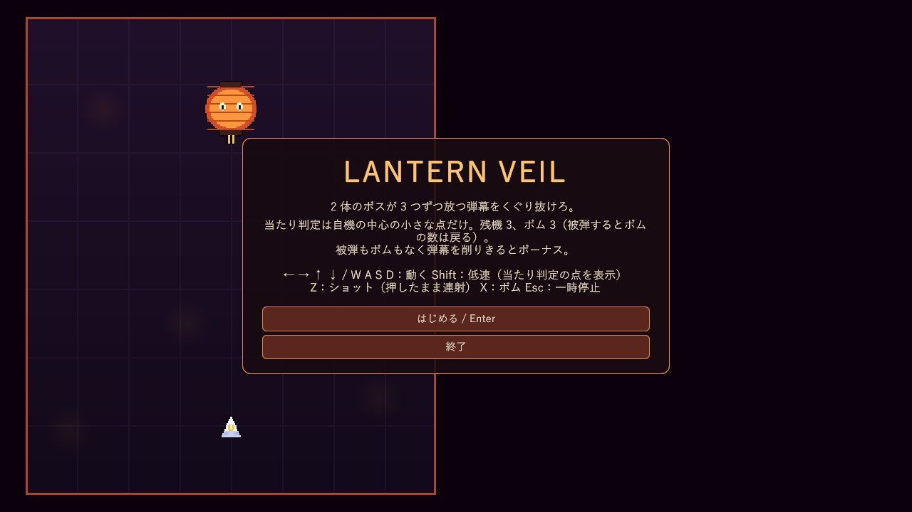 | 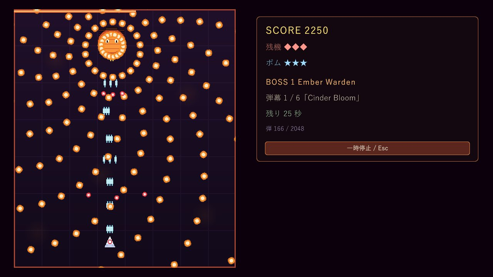 | 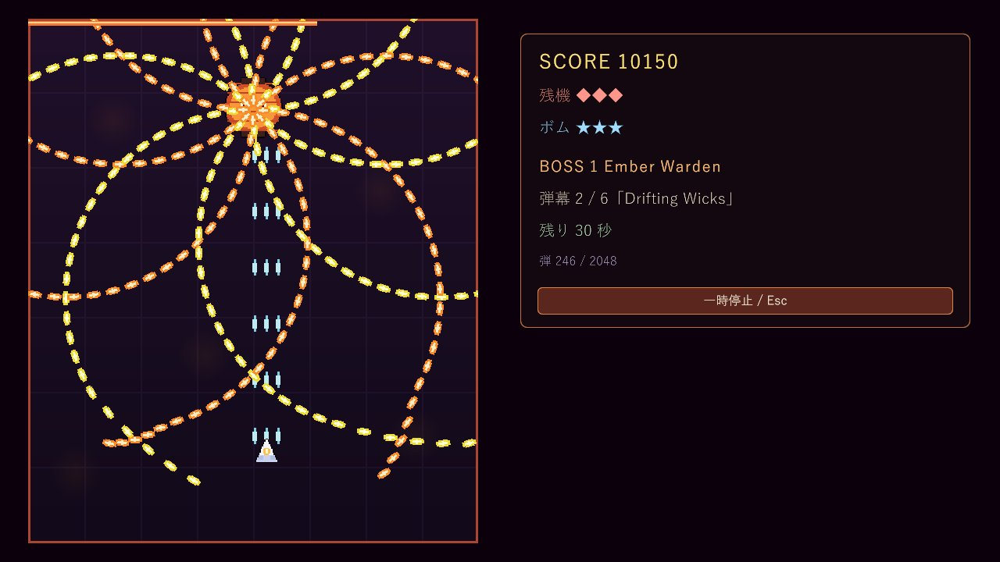 |
| 01 タイトルと操作説明 | 02 弾幕 1「Cinder Bloom」 | 03 弾幕 2「Drifting Wicks」 |
| 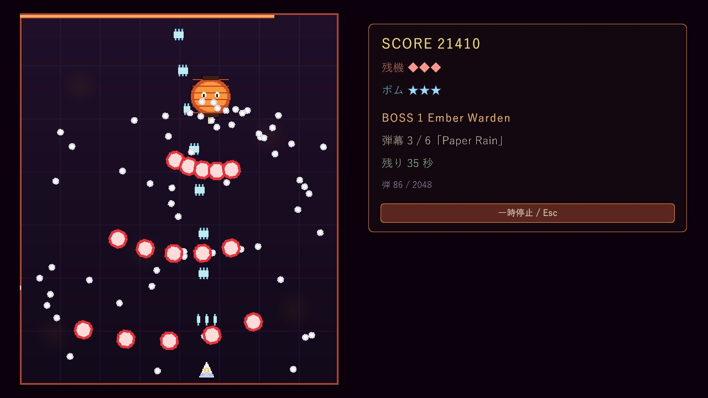 | 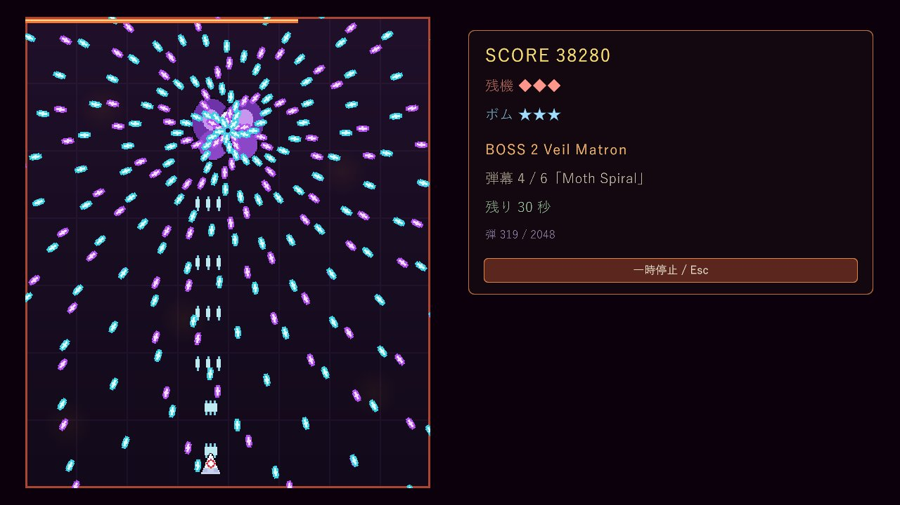 | 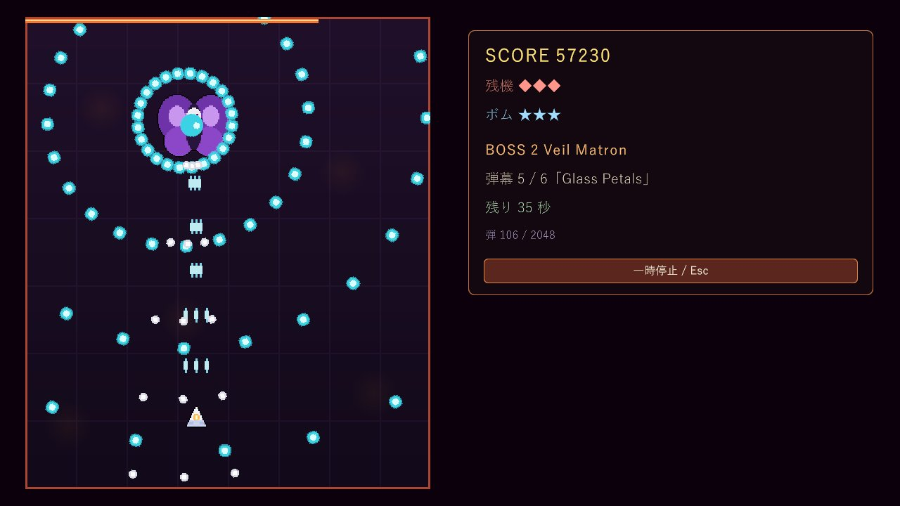 |
| 04 弾幕 3「Paper Rain」 | 05 弾幕 4「Moth Spiral」 | 06 弾幕 5「Glass Petals」 |
| 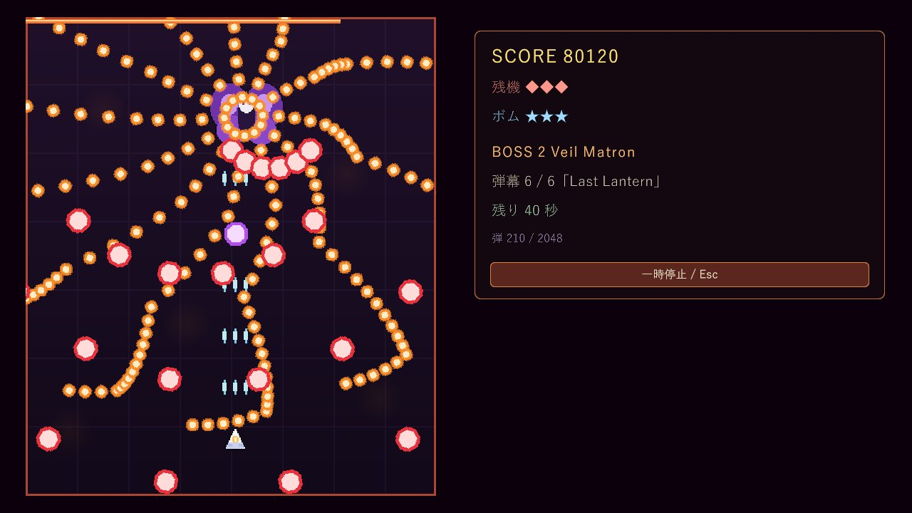 | 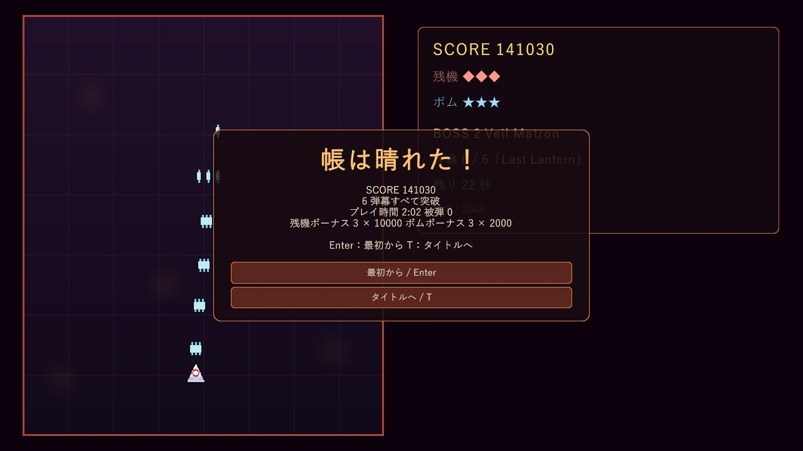 |  |
| 07 弾幕 6「Last Lantern」 | 08 6 弾幕を突破した結果 | 09 低速中の当たり判定の点 |
| 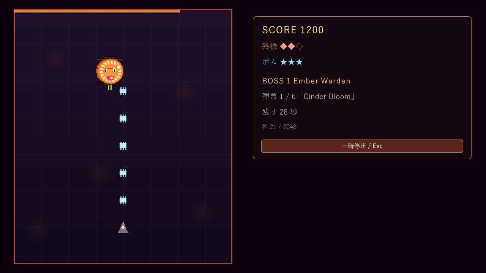 | 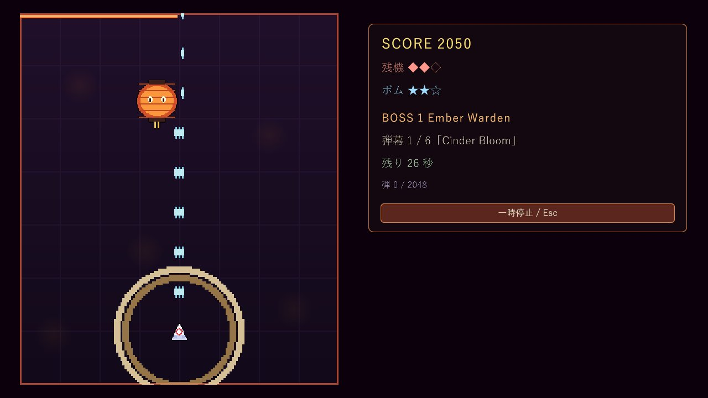 | 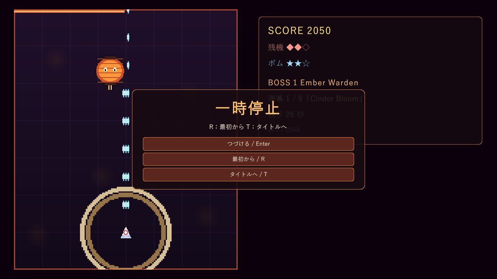 |
| 10 被弾（敵弾の全消去・半透明の点滅） | 11 ボム（輪が広がる間は無敵） | 12 一時停止 |
| 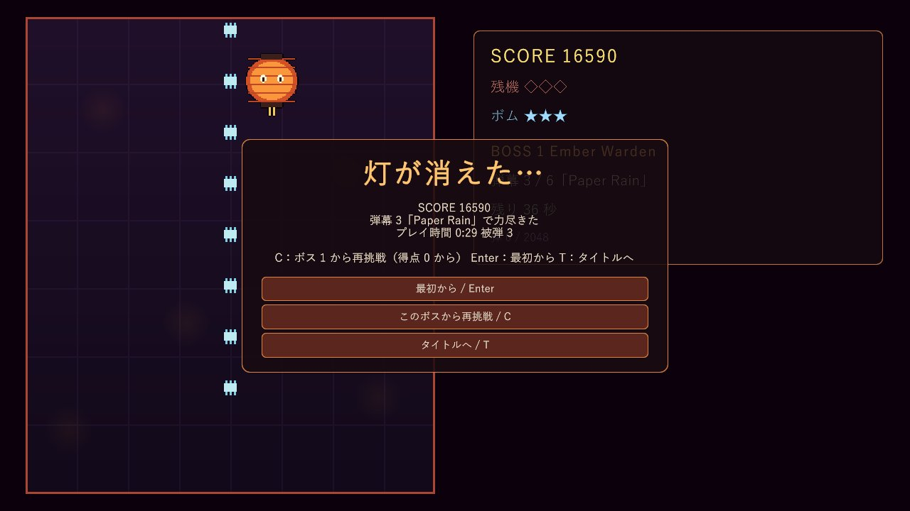 | 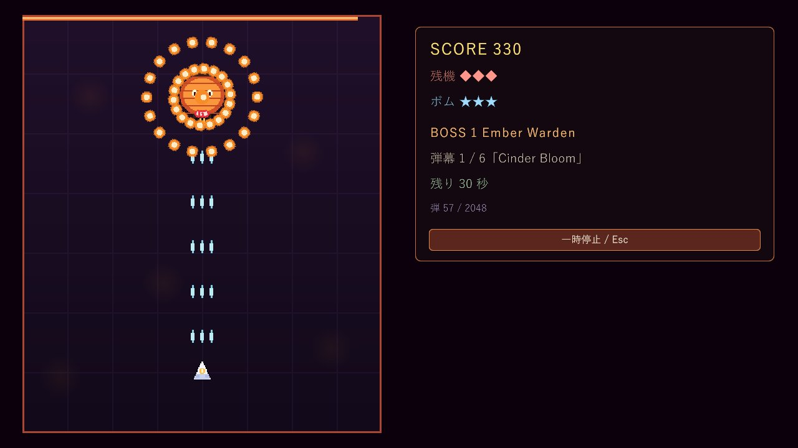 | |
| 13 残機 0 の結果（再挑戦のボタン） | 14 負けたボスからの再挑戦 | |

## ルールの検証

- **弾道式の軌跡が期待値と一致**：直進の弾の各 Tick の位置は「出た位置 + t × 速度」と整数でちょうど一致する（5 通りの向きと速さ × 40 Tick）。加速の弾は等差数列の和と一致し、上限に届く Tick の前後で速さが頭打ちになる。曲がる弾は円弧の閉じた式と 600 Tick の間 1 px 以内で一致し、1/256 周ずつ 256 Tick 回ると出た位置へ戻る。SoA の置き場は、テスト側に別に書いた 1 発ずつの参照実装と、乱数の 400 発（直進・加速・減速・曲がる・寿命・領域外へ出る）× 400 Tick で、消える弾の順序まで含めて一致する。角度表は `Math.Sin` との差が 1 以内で、表の検査値は .NET と Mono で一致する。
- **無敵中の二重被弾なし**：同じ Tick に 3 発触れても残機は 1 減るだけ。被弾した Tick を h とすると h〜h+99（設定 100 Tick）は弾が触れていても（実際に触れた Tick を数えて確認）残機が減らず、h+100 に当たる。ボムの間（使った Tick を含めて 200 Tick）は弾を毎 Tick 消して被弾しない。ボムと被弾が同じ Tick ならボムが先に効く。実シーンでは、無敵の間は自機が半透明に点滅し、切れると戻る。
- **弾数上限で破綻しない**：容量ちょうどまで入り、1 発超えは捨てて数える。容量 64 に毎 Tick 24 発を 3000 Tick 撃ち続けても数は容量を超えず、捨てた数と入れた数の和が撃った数に一致する。本番の台本を容量 64 で流しても同じ。空きが出た次の Tick から再び入る。Core の Step は割り当てをしない（.NET で計数。Mono では次の性能の計測でフレームの割り当てを数えた）。
- **6 パターンを再現しクリア可能**：本番の台本を自動操縦で通し、シード 1 は 6 弾幕とも体力を削りきって勝った。最終の状態ハッシュ `0x3364D004` が .NET・Mono・設定アセットの台本で一致する（同じシードと入力なら同じ試合）。シード 2〜5 も勝利。調整用の計測では 8 シードとも勝ち、48 弾幕のうち 47 を体力で突破（1 つは時間切れ）した。
- **状態遷移と負例**：開始 → 弾幕の間 → 弾幕 → 次の弾幕 → 2 体目 → 勝利、負け → このボスから再挑戦（新しいシード・残機とボムを戻す・得点はボスを始めたときの値）・最初から・タイトル。勝った結果では再挑戦しない。終わった試合の Tick と入力は状態を変えない。台本の誤り 30 種を行と列付きで報告する。範囲外の設定・台本の組の形（2 体 × 3 弾幕でない）・未定義の操作を拒否する。

## 性能（弾数の上限いっぱい）

PlayMode テスト `Performance_AtFullBulletCapacity`（Unity エディタのバッチ実行・Mono、開発機の Windows 11）。容量 2048 発の置き場を満杯に保つ弾幕（毎 Tick 256 発の遅い輪）で 600 Tick、Core の 1 Tick と描画の更新（`BulletLayer` が Mesh の頂点と UV を書く CPU の時間。GPU の描画時間は含まない）を別々に測った。各サンプルで弾が 2048 発であることを確かめている。

| 対象 | p50 | p95 | 最大 |
|---|---|---|---|
| Core の Step | 0.367 ms | 0.388 ms | 0.485 ms |
| 描画の更新（CPU） | 0.347 ms | 0.365 ms | 0.519 ms |

- 割り当て：Step と描画の更新を 600 回ずつ行ったフレームの割り当て（Unity の `GC Allocated In Frame`）は、何もしないフレームと同じ 330 バイト（テストの実行器の分）。4096 バイトを割り当てたフレームでは 4566 バイトになり、計数が働いていることも確かめた。
- 本番の 6 弾幕の同時の弾数（自動操縦の通し、8 シード）は弾幕ごとの最大で約 185・295・106・333・122・265 発で、容量の 16% 以下。
- 他の PC の FPS を保証するものではない。

## 入力と画面

- 起動直後はタイトルと操作説明を出し、プレイ領域の四隅が画面の内側に映る。Stage Prefab は設定と一致する（描画物・ボスの絵 2 枚・領域の外を覆う幕 4 枚・背景の大きさ）。
- 矢印と WASD で動き、離すと止まる。Shift の間は低速（1 Tick ちょうど 1.75 px）で、当たり判定の点が自機の中心に出る。Z でショットが出てボスの体力が減り、体力のバーが残りの割合の長さになる。X でボムを使うと敵弾が消え、輪が出て、HUD のボムが 1 つ減る。
- 敵弾は弾の数だけ Mesh の四角形に描かれ、各四角形の中心は弾の位置と一致する。使わない四角形は大きさ 0。
- 被弾すると HUD の残機が減り、無敵の間は自機が点滅する。負けると結果に「このボスから再挑戦」が出て、C で同じボスから残機を戻して始まる。タイトルへ戻ると、自機・当たり判定の点・ボス（絵・位置・色）・体力のバー・ボムの輪・弾・ショット・カメラが起動直後と一致する。
- HUD のボタン（はじめる・一時停止・最初から・このボスから再挑戦・タイトルへ）で一巡でき、フォーカスを戻すクリックでは終了ボタンが働かない。フォーカスを失うと一時停止し、押していたキーは持ち越さない。
- 設定アセットの試合の設定はコードの既定値と同じで、台本は `Assets/Game/Patterns/boss1.txt`・`boss2.txt`。壊れた台本（引数の欠け）・弾幕の数が違う台本・音量 NaN などは設定の検証で拒否する。

## 気づいたこと

- 最初の撮影で、敵弾が 1 発も描かれていなかった（HUD の弾数は 319）。`Mesh.SetVertices(配列, 開始, 長さ)` が頂点の数をその長さに縮め、三角形の番号が範囲外になっていた。容量ぶんの配列をそのまま渡すようにした。
- 弾は領域の外の余白（32 px）でも生きているので、枠の外に弾が見えた。領域の外を覆う幕を Stage に足した。
- Mono では `GC.GetAllocatedBytesForCurrentThread` が常に 0 を返すので、Core の EditMode テスト（`Step_DoesNotAllocate`）は Mono では何も確かめていない（.NET では有効）。Unity では `ProfilerRecorder` の `GC Allocated In Frame` で、何もしないフレームと 4096 バイトを割り当てたフレームと比べて測った。最初は弾を満杯にした直後（8 Tick）から測り、1080 バイトが入った。600 回の計測で 1 回あたり 2 バイト未満なので一度きりの割り当てと見て（ショットの描画物を見本から増やす分と考えられる）、120 Tick 進めてから測ると 0 になった。
- 描画の更新で `ReadOnlyCollection` を `foreach` で回すと列挙子の箱詰めで割り当てが起きるので、番号で回した。

## レビュー対応

- **P2-1 Prefab の検査が幕の配置の異常を見逃す**：幕 4 枚の名前・位置・大きさを `LanternVeilStage.CurtainLayout()` 1 つで決め、生成スクリプトと `Mismatch` の両方が使うようにした。`Mismatch` は各幕の位置・大きさ・向き・描画順（弾より手前）・同じ描画レイヤー・不透明さ・表示・絵の形（左下を基準にした 1 単位の四角）と、弾の Mesh と体力のバーの描画順を照合する。実シーンの Stage の複製を 8 通り（右の幕を 1 単位ずらす・左を 0.5 単位・上を低く・下を細く・弾より奥へ・半透明・非表示・回転）に壊し、どれも不一致になることを PlayMode でテストした。今の Prefab はこの検査を通る。
- **P3-1 大きな移動の掃引で、接するだけの組を触れたと判定する**：座標を縮めて判定する近似をやめ、座標が大きい組は 2 次式を `BigInteger` で厳密に判定する（小さい組は今までどおり long の掃引）。レビューの例（最短距離 257 = 半径の和 257）が触れないこと、258 で触れること、斜めに動く 2 つの円の接線・1 単位内側・外側、長さ 1 単位〜領域の幅の移動で接線は触れず半径 +1 で触れること、乱数の 2 万組がテスト側の別の式（外積の 2 乗と |d|^2 R^2 の比較、`BigInteger`）と一致することをテストした。修正前のコードでは 2 件が失敗することを確かめた。
- **P3-2 ボムの重複した押下**：`HeldControls` にボムを押している印を足し、離すまでの間に届いた押下は 2 回目にしない。押す → 使う → 離さずに押下 → 使わない → 離して押す → 使う、と、一時停止などで消した後は持ち越さないことをテストした。修正前のコードでは失敗することを確かめた。
- いずれも試合の結果は変わらない（シード 1 の最終ハッシュ `0x3364D004` と証跡 14 枚の SHA-256 は対応前と同じ）。
