# 030 検証記録

2026-11-24実施（同日、レビュー対応の後に再検証）。

## 自動検証

| 項目 | 結果 |
|---|---|
| dev lint | 成功 |
| dev check | 成功（警告0・エラー0） |
| dev test | 成功。030 Core 75/75、App 36/36 |
| Unity EditMode | 173/173（int-geometry 52・tile-motion 10・Core 75・App 36、Mono） |
| Unity PlayMode | 38/38（実シーン22、共通証跡公開16） |
| Windowsビルド | 成功、StandaloneWindows64 |
| ビルド起動 | dev captureで起動・全場面撮影・正常終了 |
| 証跡 | JPEG品質85、12枚 |
| 撮影再現 | レビュー対応の後の同じビルド（Build GUID `e6ffe58b334b469f98b2fa3e216cb6fb`）を 2 回撮影し、12 枚すべての SHA-256 が一致した（撮影記録 `20261123T171738Z-c6bf12c9` と [`20261123T171817Z-44c02601`](runs/20261123T171817Z-44c02601/manifest.json)、どちらも画像世代 `57b464368f3fbb26`）。対応前（画像世代 `3416ea7927d9395f`）からは扇を知覚に使った姿勢で描くようにしたので画像が変わった。撮影時の試合の状態（経過 Tick・位置・状態）は対応前と同じ。1 回目の記録は次の公開で消える |
| 性能 | 見つかって逃げる試合 1064 Tick で、Core の 1 Tick は p95 0.021 ms・最大 0.145 ms、描画の更新（扇 3 つ・足音のマス・F1 の表示を含む）は p95 0.492 ms・最大 0.624 ms（Unity エディタの PlayMode、開発機。GPU 時間は含まない） |

公開ポインタは[current.json](current.json)。試合のシードは撮影用の 1。台本は意図と Tick を順に渡すだけで場面を作る（実時間とキー入力を使わない）。1 試合目は隠密の操縦役、2 試合目は強行の操縦役、3 試合目は警備員を気にせず歩く操縦役で進める。

## ルールの検証

- **遮蔽物越しに視認しない**：壁・木箱の向こう、角をちょうどかすめる線、壁の面に沿う線は見えない。視線の判定を外積による分離軸の参照実装と乱数 2 万件・乱数の地図 200 枚で照合した。視程と視野角の境界、背後も確かめた。実シーンでは、扇の Mesh の各頂点が判定と同じ `Vision.Fan` の光線の先と一致し、撮影でも扇が壁で切れて扉から廊下へ伸びる。
- **音だけで即発見としない**：足音を 5000 Tick 聞かせても調査のままで、気づき値は 0。壁の向こうでも回り込む経路が遠ければ聞こえず、木箱越しは聞こえる。背後 2 マスの忍び足は聞こえず、歩き・走りは聞こえる。実シーンでは、足音の届いたマスが Core と同じ `Hearing` の結果と 1 マスずつ一致し、時間が経つと消える。
- **見失った後に警戒が減衰**：追跡 → 見失った位置で捜索 → 600 Tick で巡回、気づき値は単調に減って 0 に戻る。施設は追跡のない Tick が 600 で警戒、さらに 900 で平常（境界の Tick ちょうど）。捜索中に再び見えれば、気づき値がいくつでも追跡に戻る。
- **センサと判断の分離**：判断（`GuardBrain`）に作った `Percept` を与えるだけで、巡回・調査・追跡・捜索のすべての遷移を地図なしで確かめた。
- **見つからず／見つかって両経路でクリア**：隠密の操縦役が誰にも気づかれずに 1819 Tick で脱出（どのシードでも同じ、ハッシュ `0xA0BB2468` が .NET と Mono で一致、設定アセットの値でも同じ）。強行の操縦役は 20 シードすべてが発見 1〜2 回から逃げ切って脱出（シード 1 のハッシュ `0x3C5EC9CF` が .NET と Mono で一致）。
- **捕獲**：追跡中の警備員に触れたときだけ捕まる。追跡していない警備員に触れると、その警備員が次の Tick に発見する。捕獲と脱出が同じ Tick なら捕獲（判定の順序を入れ替えるとテストが失敗することを確かめた）。
- **負例**：未定義の操作・キー、範囲外の設定、壊れた施設（幅のずれ・未知の文字・目的物なし／2 つ・つながらない地図・壁の上の巡回点）、終わった試合の Tick（状態は変わらない）を拒否・無視する。

## 入力と画面

- 実シーンの PlayMode テストで、↑ で歩き、Shift を足すと走り、C を足すと忍び足（少し透ける）になり、離すと止まることを確かめた。
- 警備員の頭の上の記号は調査 ?・追跡 !・捜索 …、巡回はなし。気づき値があるときだけゲージが出て、発見で満ちる。発見で HUD の警戒レベルが「厳戒」、発見回数が 1 になり、案内が出る。
- F1 で警備員ごとの状態・気づき値・向かう先の一覧が右下に出て、巡回路の線と向かう先の十字が描かれる。もう一度押すと消える。
- 捕まると結果の画面になり、Enter で新しいシードの試合が始まる。見つからずに脱出すると「未発見（ゴースト）」と出る。
- 遊んだ後に一時停止からタイトルへ戻ると、自機・警備員・扇・記号・足音の表示が起動直後と一致する。一時停止中は Tick が進まない。フォーカスを失うと一時停止し、押していたキーは押し直すまで効かない。HUD のボタンで一巡でき、フォーカスを戻すクリックでは終了ボタンが働かない。
- Stage Prefab は Core の施設と一致し、目的物を動かす・木箱を足す・入口を動かす・警備員の始めの位置を動かす・警備員を減らすと照合が不一致を報告する。設定アセットの試合の設定はコードの既定値と同じ。

## 気づいたこと

- 視界の扇（MeshRenderer）に Sprites/Default のマテリアルを使うと、SpriteRenderer が渡す `_RendererColor`・`_Flip` が渡らず、直前の描画の値が残る。撮影では扇が消えるか（`_Flip` が 0 で潰れる）、F1 の線を描いた直後だけ暗く写った。MaterialPropertyBlock で固定の値を渡して直し、PlayMode で値を確かめる。頂点だけを確かめるテストは、見えていなくても通っていた。
- 足音のマスの色は、設定した不透明度より濃く写った（リニア色空間の合成）。0.12 まで下げた。
- 隠密の操縦役は最短経路だと見張り B の正面を通る。巡回を試走して数えた各マスの見られやすさを重みにした経路にした。

## レビュー対応

- **捜索中の再発見**：捜索が長引いて気づき値が下がると、再び見えても調査になっていた。捜索中に見えた・触れたときは気づき値によらず追跡へ戻す（足音・無線では戻らない）。捜索の直後・20 Tick 後・気づき値 0 の後・視程の端で確かめた。
- **設定の不変性**：`Infiltration.Config` が試合の設定そのものを返し、書き換えると足音の剰余が 0 除算になった。複製を返すようにし、書き換えても試合と複製した試合が変わらないことを確かめた。
- **Stage Prefab の照合**：参照の欠け（自機の向きの絵・忍び足の絵・足音の Tilemap・警備員の部品など）と壁・木箱のタイルの種類を見ていなかった。照合で見るようにし、複製した Stage を 13 通り壊して理由が返ることを確かめた。Stage Prefab は作り直した。
- **知覚と扇の時点**：扇は警備員がその Tick の知覚に使った姿勢（動く前の位置と向き、Tick の始めの視界）で描く。その姿勢で判定し直すと毎 Tick「見えたか」と一致する。
- 修正前のコードで、捜索中の再発見と設定の不変性の回帰テストが失敗することを確かめた。自動操縦の最終ハッシュは変わらない。

## 画面

| タイトル | 開始 | 隠密：廊下 |
|---|---|---|
| 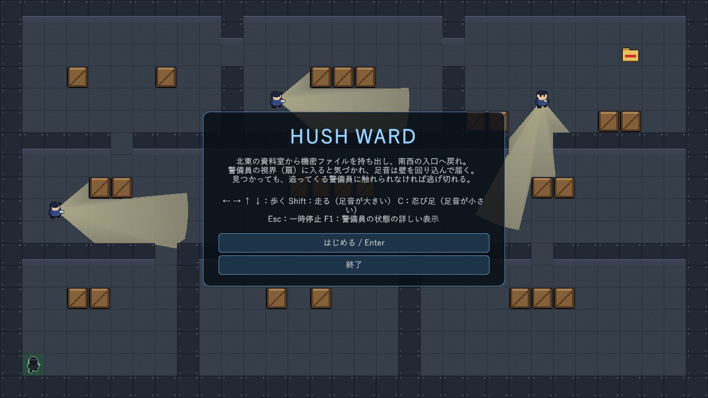 | 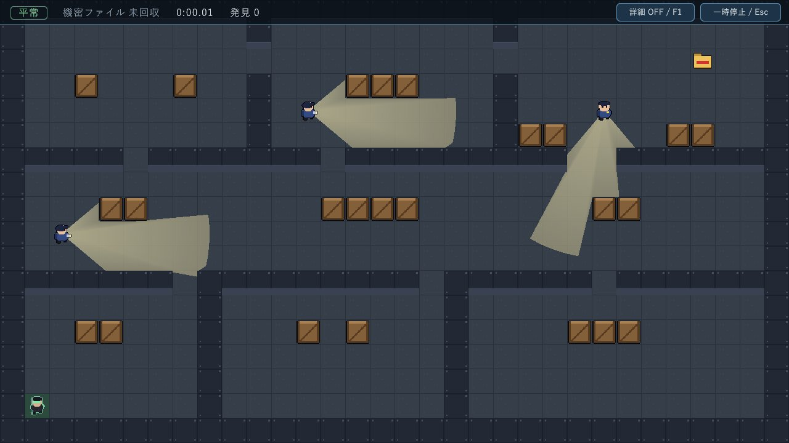 | 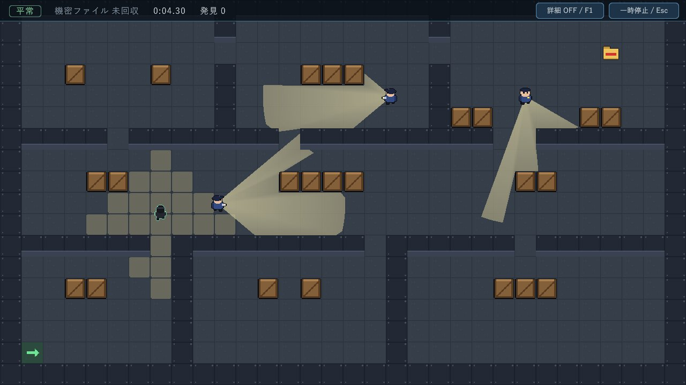 |

| 隠密：北の部屋 | 目的物 | F1 の詳しい表示 |
|---|---|---|
| 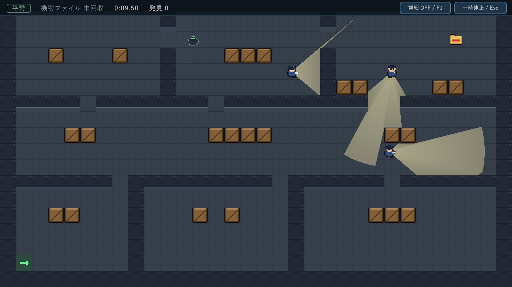 | 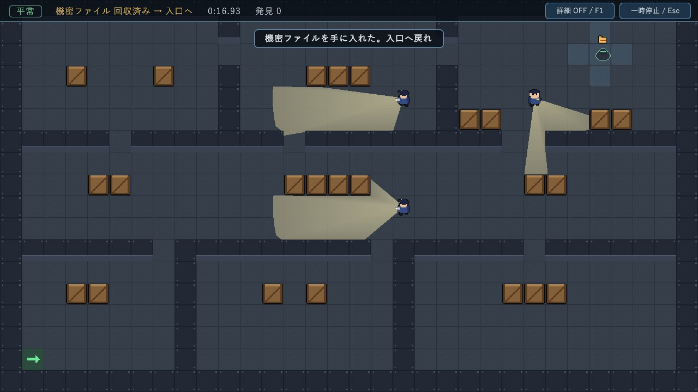 | 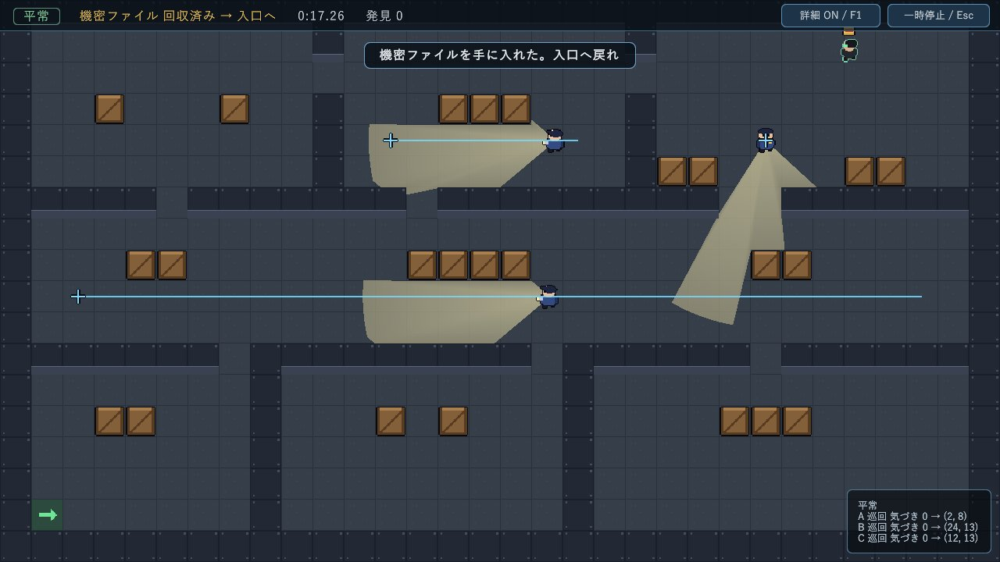 |

| 脱出（未発見） | 調査（?） | 発見（!） |
|---|---|---|
| 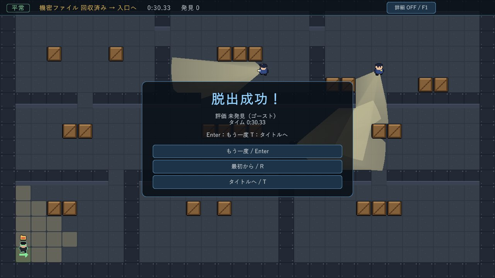 | 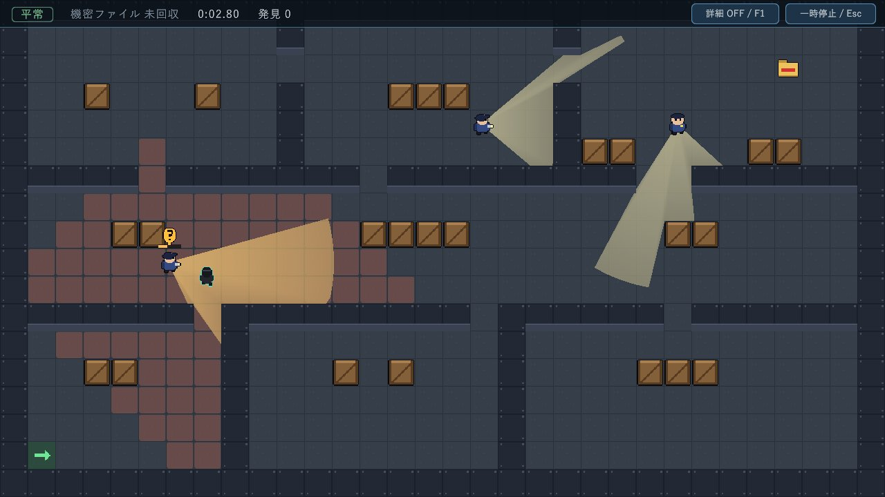 | 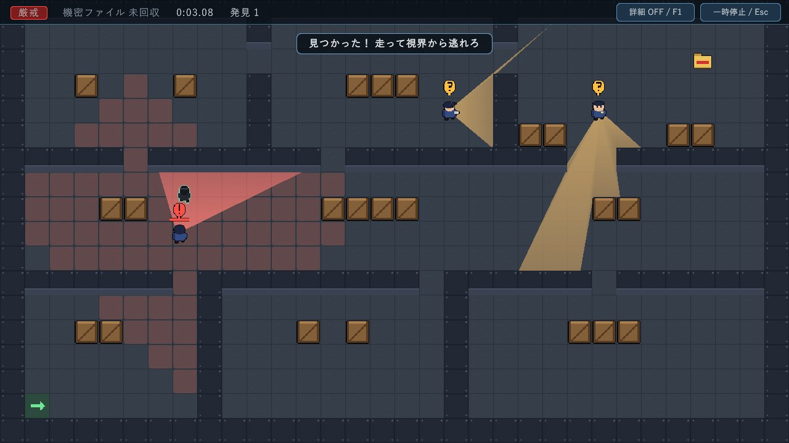 |

| 捜索（…） | 脱出（発見あり） | 捕獲 |
|---|---|---|
| 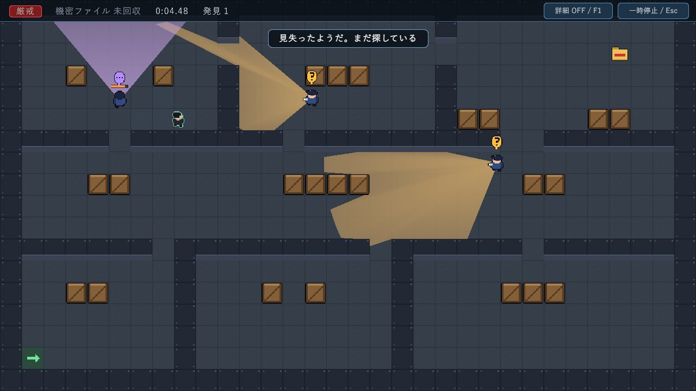 | 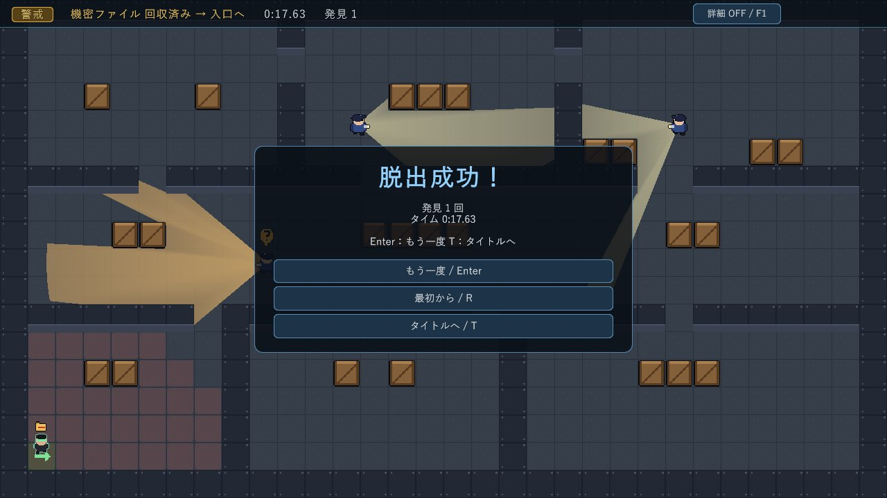 | 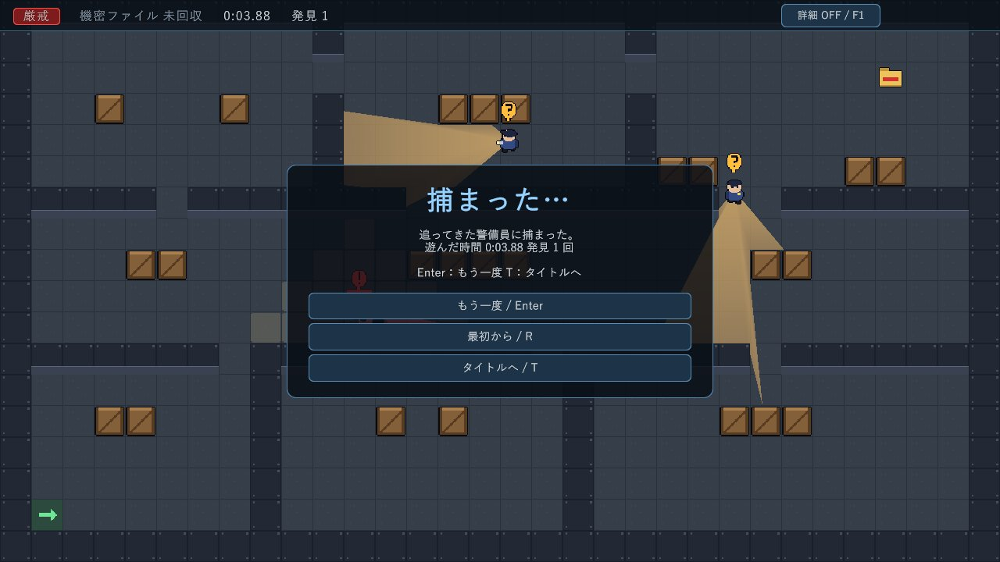 |
