# 032 検証記録

2026-11-24実施（同日、試遊の指摘とレビュー対応の後に再検証）。

## 自動検証

| 項目 | 結果 |
|---|---|
| dev lint | 成功 |
| dev check | 成功（警告0・エラー0） |
| dev test | 成功。032 Core 124/124、App 24/24 |
| Unity EditMode | 200/200（int-geometry 52・Core 124・App 24、Mono） |
| Unity PlayMode | 35/35（実シーン19、共通証跡公開16） |
| Windowsビルド | 成功、StandaloneWindows64 |
| ビルド起動 | dev captureで起動・全場面撮影・正常終了 |
| 証跡 | JPEG品質85、11枚 |
| 撮影再現 | 試遊の指摘とレビュー対応の後の同じビルド（Build GUID `01c96f0b9f4e4c37aa90d0c1bb9ddbba`）を 2 回撮影し、11 枚すべての SHA-256 が一致した（撮影記録 `20261124T005929Z-6b093016` と [`20261124T010011Z-6d6e3eff`](runs/20261124T010011Z-6d6e3eff/manifest.json)、どちらも画像世代 `188fe2330c285685`）。対応前（画像世代 `100e7c01826c73ff`）からはタイトルの難度の一覧の配置が変わった。1 回目の記録は次の公開で消える |

公開ポインタは[current.json](current.json)。試合のシードは撮影用の 1。台本は意図と Tick を順に渡すだけで場面を作る（実時間とキー入力を使わない）。1 試合目（ふつう）は打鍵を 1 つずつ渡し、2 試合目（ふつう）は速い操縦役（8 Tick ごと、誤字 4%）でクリア、3 試合目（むずかしい）は遅い操縦役（30 Tick ごと）で失敗する。

## ルールの検証

- **誤字で進行しない**：全 50 語の既定の綴りの全ての位置で、受け付けない全てのキーを打っても、打った文字列・案内・受け付けるキーの集合が変わらない（誤字数だけ増え、連続が 0 に戻る）。実シーンでも、誤字で札が進まず、上の表示が赤くなって演出の Tick の後に戻る。
- **綴りの照合**：照合器が受け付ける打ち方（打ち終えた文字列と途中の文字列の集合）を、読みを表の単位に区切る全ての方法 × 全ての綴りを総当たりで並べて「ん」「っ」の条件で絞る参照実装と、全 50 語と境界の読み 14 個（かんい・かんな・ほんや・まっちゃ・えっあ・んっか・っっか・ちぇっくいん など）で照合し、一致した。
- **複数敵のターゲットが混線しない**：最初の 1 打を受け付ける敵のうち最も手前、同じなら出現順の早い敵を狙う。狙い中に他の敵の言葉の文字を打つと誤字で、他の敵は進まない。倒した直後・狙っていた敵が手前の線に着いた直後の 1 打は改めて狙いを選ぶ。実シーンでも、同じ k で始まる「かね」「かぎ」で手前の敵だけが進み、札の強調も狙いだけに付く。
- **バックスペースの扱い**：狙いがあれば外して進み具合を最初に戻し、誤字・連続には数えない。狙いがなければ何もしない（状態のハッシュが変わらない）。外した後は別の敵を狙え、同じ敵を別の綴りで打ち直せる。実シーンでも、`sh` の後の Backspace で狙いが外れ、`syasinn` で打ち直して倒せる。
- **50 単語が出題可能**：各難度の山は段の範囲の語を切り混ぜたもので、尽きるまで同じ語を出さない（3 シードで確認）。3 難度の和で 50 語全てが出る。画面の敵と最初の 1 打が重なる語は、重ならない語があれば後回しにする。
- **クリア・失敗を一貫処理**：規定数ちょうどの撃破でクリア、体力 0 で失敗。打鍵は Tick の間に反映するので、同じ Tick なら撃破が先で、規定数に届けば被弾しない。終わった後の打鍵と Tick は状態を変えない。どちらも結果の画面になり、Enter で同じ難度の新しいシードの試合、Esc でタイトルへ戻る。
- **操縦役**：8 Tick ごと（7.5 打/秒）なら全難度で 20 シード全勝・被弾なし。遅い操縦役（やさしい 90・ふつう 40・むずかしい 20 Tick ごと）は負ける。むずかしい・シード 1・誤字 5% の最終ハッシュ `0xCC41215F` が .NET と Mono で一致した（レビュー対応でハッシュに規則の指紋を足したので、対応前の `0x1965DA98` から変わった。試合の動きは変えていない）。
- **負例**：受け付けない文字（大文字・数字・空白・Backspace の文字・かな）、範囲外の設定、壊れた単語帳（列の数・空の表示文・範囲外の段・カタカナ・末尾の「っ」・重複・語がない・50 語でない・段がない）、未定義の難度と操作を拒否する。

## 入力と画面

- 打鍵は物理キー（Input System の Key）を読む PassThrough のアクションで、同時押し（前のキーを離す前に次のキーを押す）でも 1 つずつ拾う。1 フレームに続けて届いた t → s が順に反映されることを PlayMode で確かめた。
- 敵の位置・大きさ・描く順序は `InkVigilPerspective` の値と一致し、札の位置は敵の頭の上を画面座標に直した位置と一致する。
- 被弾で体力の表示が減り、画面が赤く光って揺れる。結果の画面では撃破と被弾の演出を消す。
- 遊んだ後に一時停止からタイトルへ戻ると、敵・札・演出・HUD・カメラの位置が起動直後と一致する。一時停止中の打鍵は試合に届かず、押下が届いた同じフレームにフォーカスを失うとその打鍵は捨てて一時停止し、戻っても自動では再開しない。
- Stage Prefab の部品（回廊・手前の線の高さ・見張りの位置・閃光・煙・敵の置き場 5 つ・敵の絵 6 枚）がそろっているかを照合し、複製した Stage を 9 通り壊すと理由が返る。設定アセットの試合の設定はコードの既定値と同じ。

## 気づいたこと

- NUnit の `Does.Contain(文字列)` は .NET（ICU）でカルチャ依存の比較になり、「ー」を無視して見つからなかった。序数の `string.Contains` で確かめる。Unity の NUnit には `Does.Contain(物)` がなく、`Has.Member` を使う。
- 単独の n は n の前で使えないので、「かんな」は `kanna` ではなく `kannna`。計画の例が誤っていた。
- 画面下に置いた打鍵の表示が見張りと手前の線を隠したので、画面上（HUD の帯の下）に移した。被弾の赤い閃光はリニア色空間で設定より濃く写るので、不透明度を 0.12 にした。

## 試遊の指摘とレビュー対応

- **タイトルの難度の一覧**：▶ を含めて 1 行を中央ぞろえにしていたので、選び直すと難度名が左右に動いた。印・難度名・最高得点を別々の固定幅の列にし、印と最高得点の列を同じ幅にした（選んだ難度名は色だけ変え、太字にしない）。↓・↑ で選び直しても 3 つの難度名の画面上の位置と大きさが変わらないことを PlayMode で確かめた。
- **P2-1 打鍵の案内の書き換え漏れ**：案内と札は（敵の番号・打った文字数）が変わったときだけ書き換えていたので、`f` の後に同じフレームで Backspace と `h` を打つと、Core は `h`＋`ude` なのに画面は `fude` のままだった。照合器に、受け付けた打鍵と Reset で増える版（`Revision`）を足し、（試合・敵の番号・版）で書き換えを決める。敵の番号は試合ごとに 0 から使い直すので試合も含める。回帰テスト 2 件（同じフレームの Backspace → 別の綴り、次の試合の同じ番号の敵）は、修正前のコードで失敗することを確かめた。
- **P3-1 照合器の公開**：`Enemy.Matcher` は書き換えられる照合器そのものだった。状態を変える操作を持たない読み取り専用の窓口 `MatcherView` を返す（照合器へキャストもできない）。
- **P3-2 ハッシュの範囲**：難度と規則（体力・列・段・同時数・手前までの Tick・規定数・出現の間隔）と単語帳の語数をハッシュに入れた。既定の設定・同じシードのやさしいとふつうの開始時、規定数だけが違う設定でハッシュが違う。
- **P3-3 同じ列への配置**：`Place` は敵のいる列への配置を拒否する（同時出現数の上限は撮影の場面づくりのため適用しない）。

## 画面

| タイトル | 迫る敵 | 狙い |
|---|---|---|
| 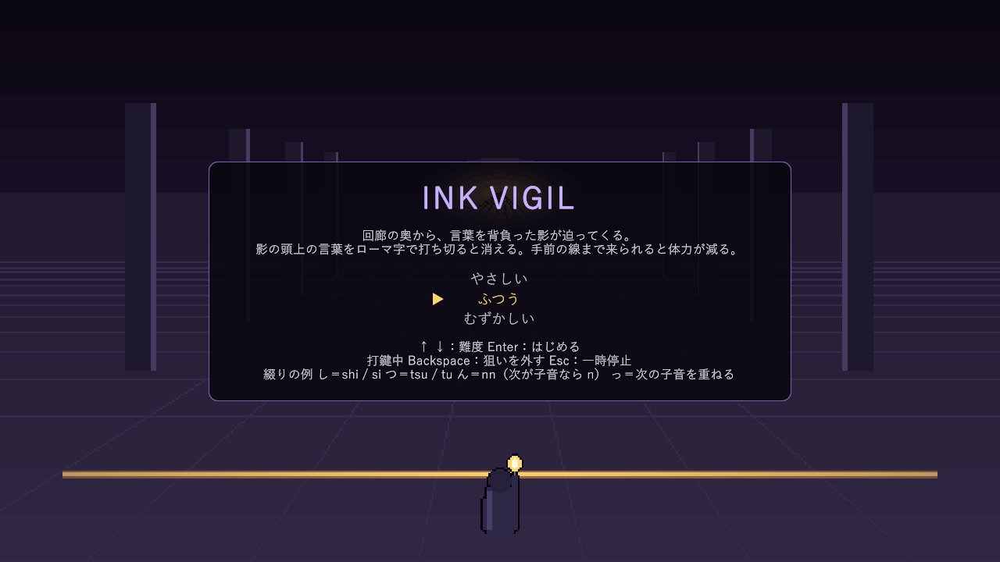 | 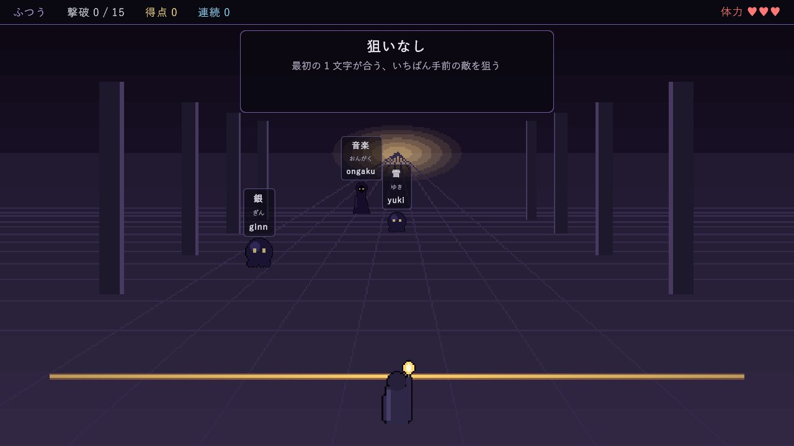 | 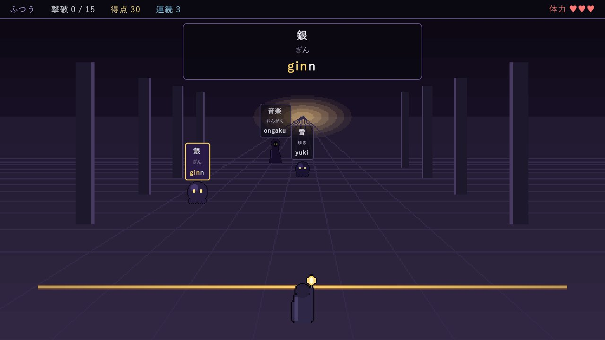 |

| 誤字 | Backspace | 別の綴り |
|---|---|---|
| 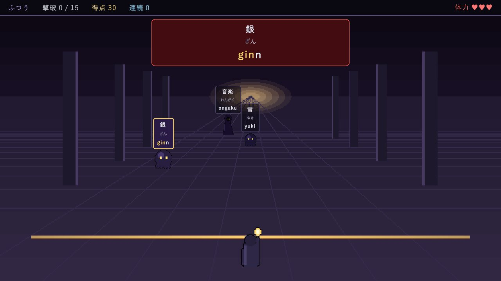 | 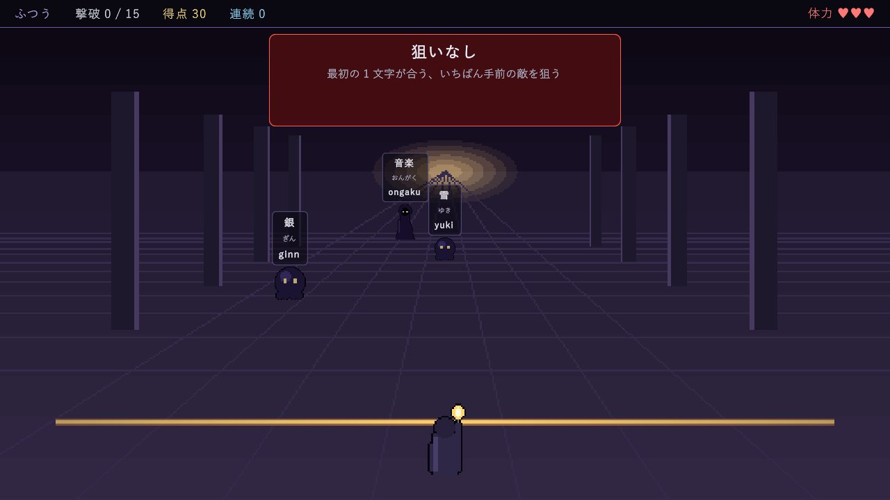 | 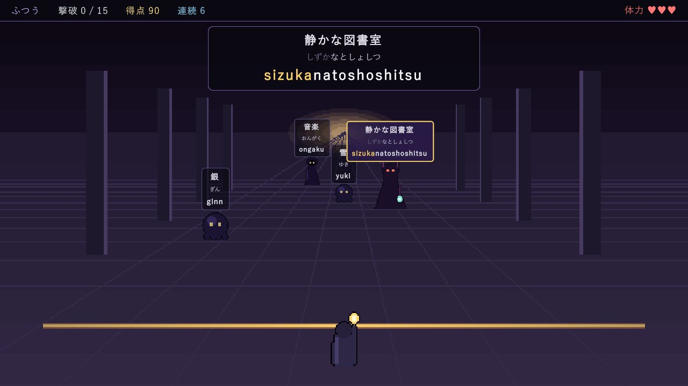 |

| 撃破 | 被弾 | 一時停止 |
|---|---|---|
| 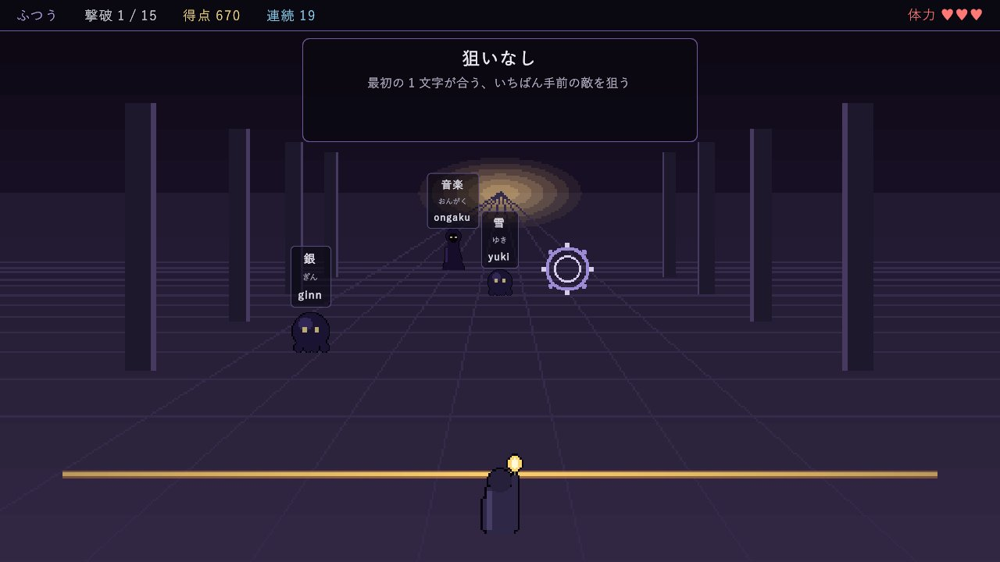 | 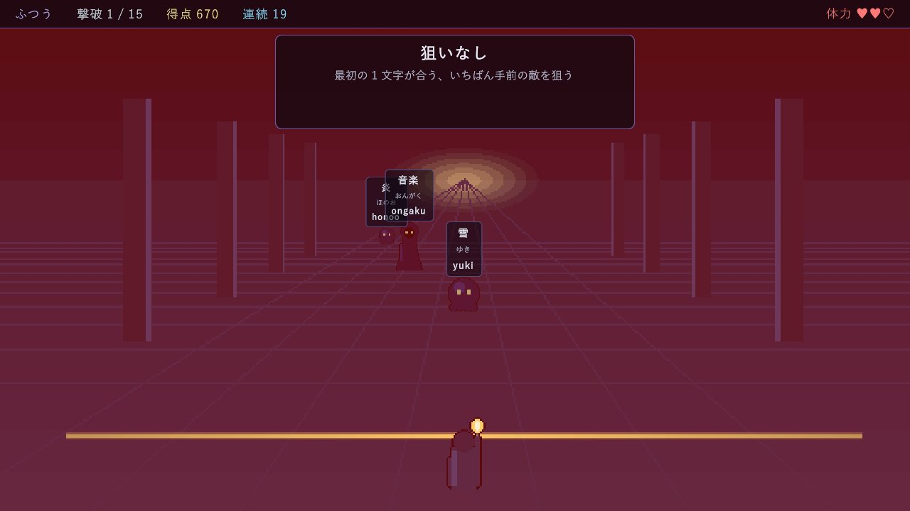 | 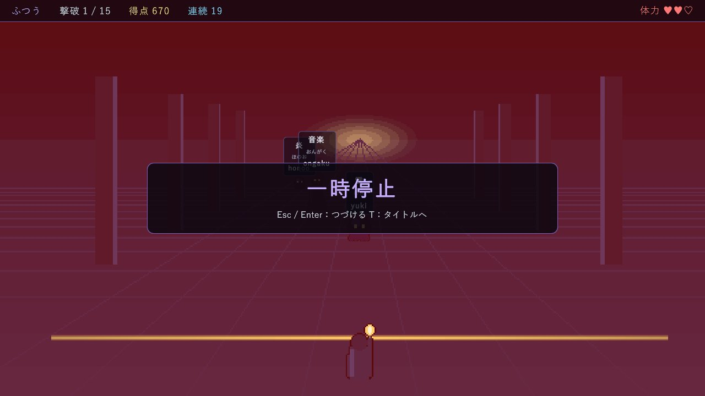 |

| クリア | 失敗 |
|---|---|
| 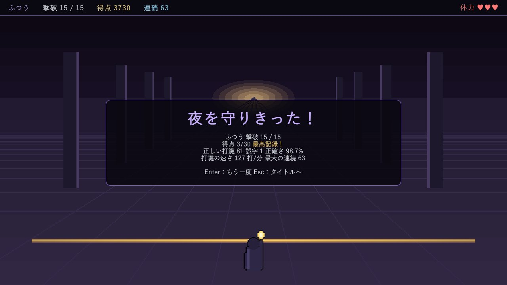 | 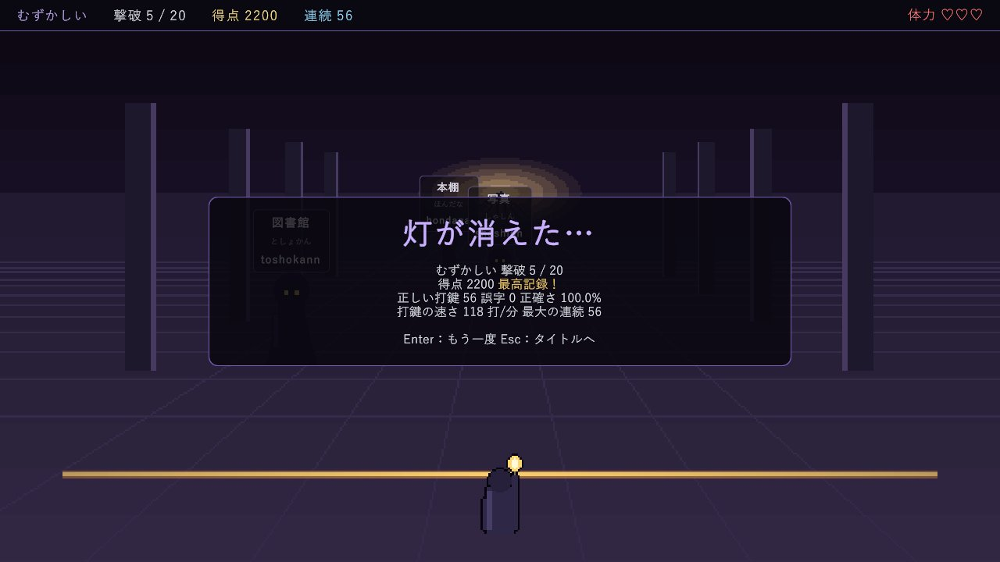 |
