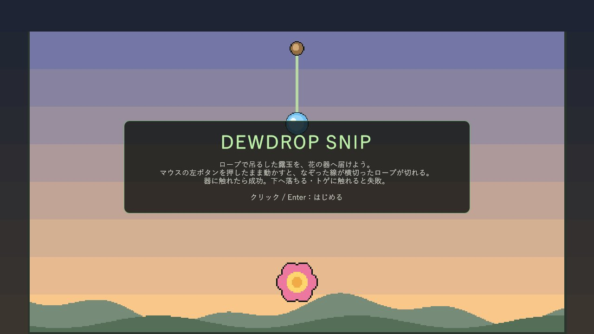
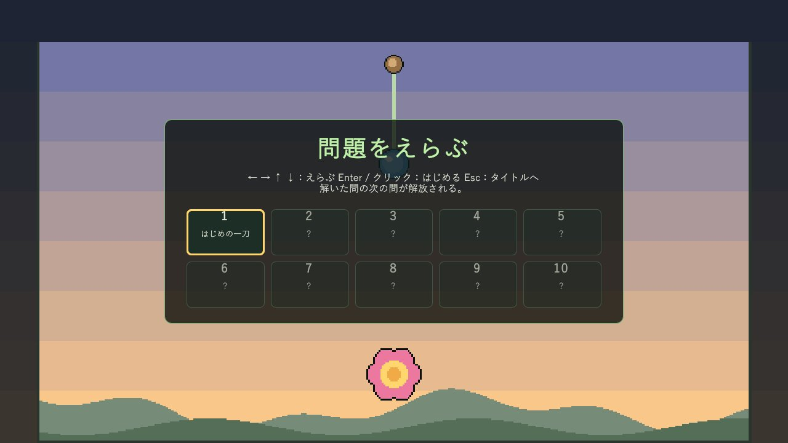
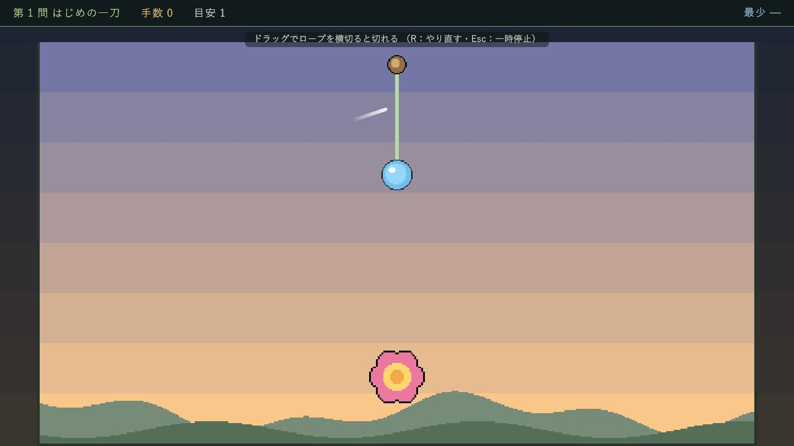
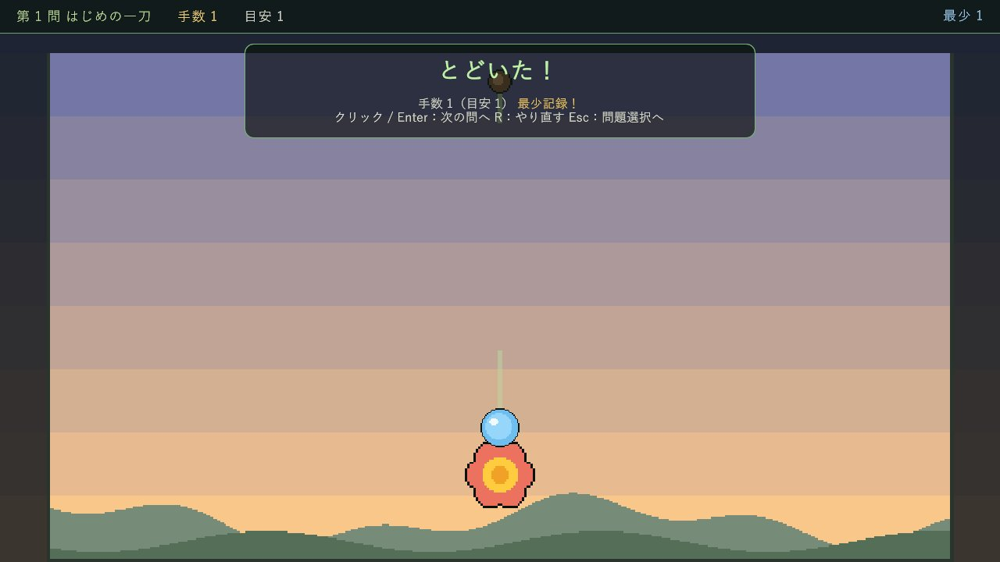
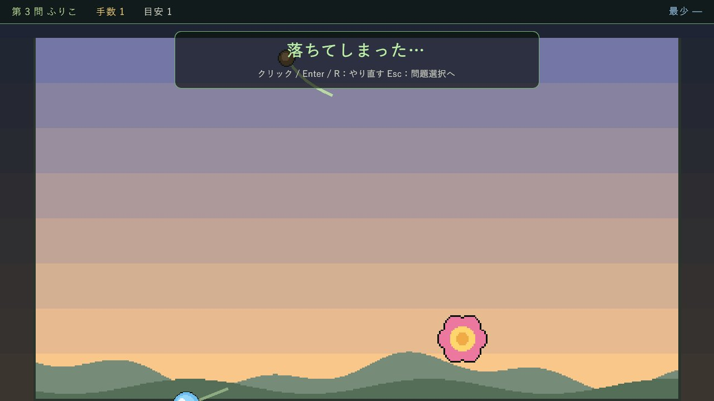
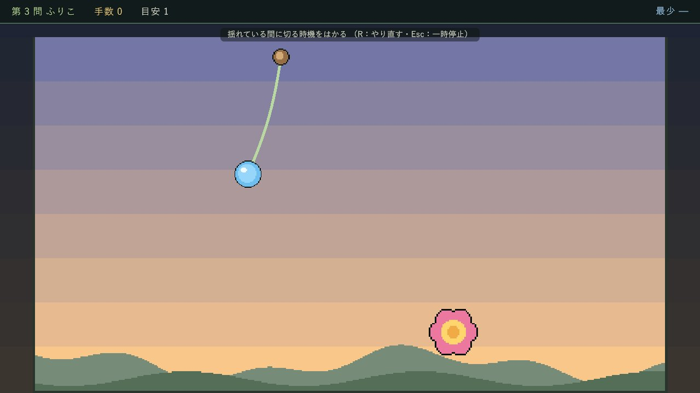
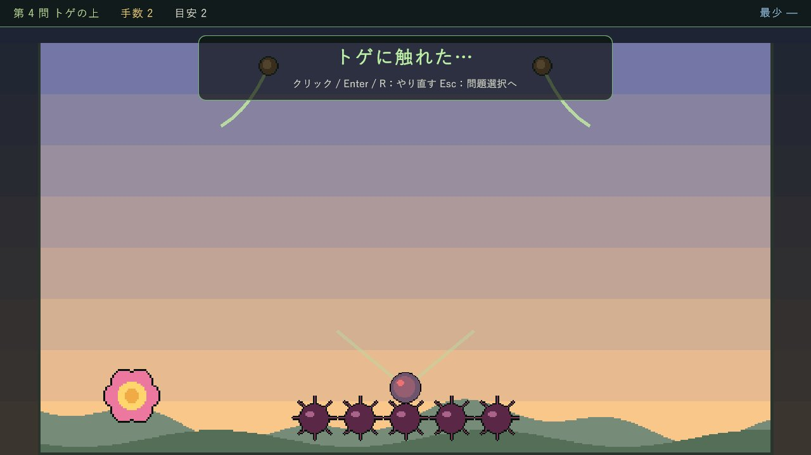
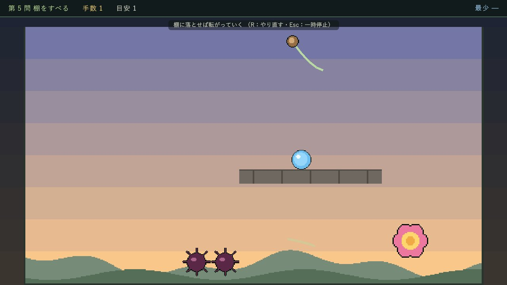
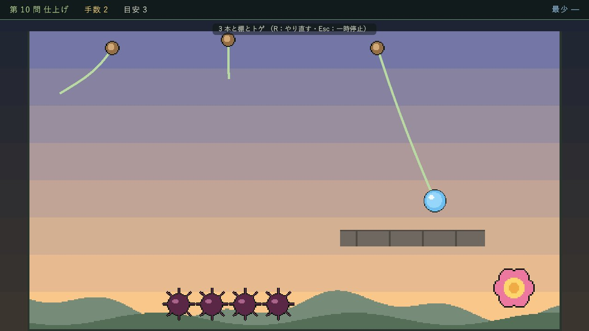
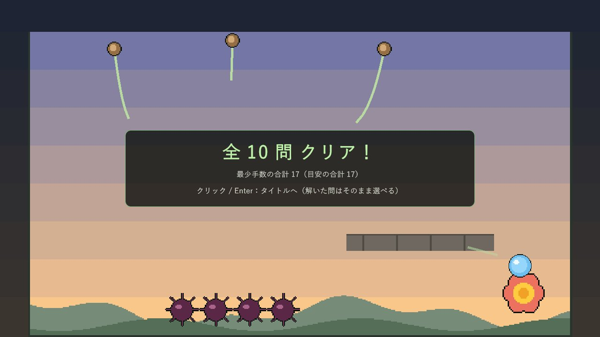

# 033 検証記録

2026-11-24実施（同日、試遊の指摘とレビュー対応の後に再検証）。

## 自動検証

| 項目 | 結果 |
|---|---|
| dev lint | 成功 |
| dev check | 成功（警告0・エラー0） |
| dev test | 成功。033 Core 68/68、App 25/25 |
| Unity EditMode | 155/155（int-geometry 52・tile-motion 10・Core 68・App 25、Mono） |
| Unity PlayMode | 33/33（実シーン17、共通証跡公開16） |
| Windowsビルド | 成功、StandaloneWindows64 |
| ビルド起動 | dev captureで起動・全場面撮影・正常終了 |
| 証跡 | JPEG品質85、12枚 |
| 撮影再現 | レビュー対応後の同じビルド（Build GUID `9f5208ca20e2419e8fcf0d0bd5d892be`）を 2 回撮影し、12 枚すべての SHA-256 が一致した（撮影記録 `20261124T101558Z-313bea45` と [`20261124T101609Z-855bb5d8`](runs/20261124T101609Z-855bb5d8/manifest.json)、どちらも画像世代 `b50e1bf12ccabb1a`）。対応前のビルドの撮影と同じ画像世代。1 回目の記録は次の公開で消える |

公開ポインタは[current.json](current.json)。乱数は使わない（撮影のシードは記録だけ）。台本は意図と Tick を順に渡すだけで場面を作る（実時間とマウスを使わない）。1 問目はマウスのなぞりの意図を渡して切り、以後は解答の手順の操縦役（`Snipper`）で解く。失敗の場面（落下・トゲ）は、なぞりの意図でわざと切って作り、やり直してから解く。

## ルールの検証

- **切ったロープは拘束を失う**：静止した吊り下げで切ると、露玉の位置が重力と減衰だけの素朴な参照（自由落下）と毎 Tick 一致する。2 本のうち片方を切ると、露玉は切ったロープの全長の 1.2 倍より遠くへ離れ、残ったロープの伸びは 8% 未満に収まる。支点側の断片は支点から垂れ、露玉側の断片は落ちて消え、以後は動かない。
- **同一ロープの重複切断安全**：ロープ全体に重なるなぞりでも 1 回（支点側の最初の節で切る）。同じ Tick の同じなぞり・支点側の断片・次の Tick の断片をなぞっても手数と状態のハッシュが変わらない。1 回のなぞりで 2 本横切れば手数 2、別々のロープは独立に切れる。終わった後の切断と Tick は状態を変えない。実シーンでも、切れたロープの断片をマウスでなぞって手数が増えないことを確かめた。
- **成功判定は物体到達時のみ**：吊られたまま目標の上で止まる配置は 3000 Tick 進めても成功しない。全部切って目標を外れると落下で失敗。吊られたまま目標に触れた Tick に成功する。成功の前の Tick はどれも触れておらず、成功した Tick に初めて触れる。1 Tick で目標を飛び越える速い落下でも、Tick 中の軌跡で触れれば成功する。同じ Tick に目標とトゲの両方へ触れたら失敗（トゲを外すと同じ Tick に成功する組で確かめた）。
- **10 問を解ける**：解答の手順（`Assets/Game/Data/Solutions.txt`）で全 10 問が目安の手数で解ける。何も切らずに 3600 Tick 進めても、どの問も成功しない。App でも操縦役で 1 問目から 10 問目まで解いて結果の画面に着き、タイトルから解いた問をまた選べる。全 10 問を解いた最終状態のハッシュ `0xAAC0BF2B` が .NET と Mono で一致した（ハッシュに設定と問の指紋を足す前は `0x10E40AFC`。動きは変えていない）。
- **再現性**：乱数を使わず、同じ問と同じ操作の列なら同じハッシュ。同じ Tick・同じ位置で切った節だけが違う組、重力・壁の摩擦だけが違う設定（今の位置は同じで次の Tick に分かれる）、目標・トゲ・壁だけが違う問はハッシュが違う。名前・案内だけが違う問は同じ。同じビルドの撮影は 2 回とも同じ 12 枚になった。
- **負例**：壊れた問題データ（閉じていない・目標や露玉がない・2 つある・数の個数・整数でない・範囲外の数・逆向きの壁・未知の項目・半径 0）と、検証で拒否する問（ロープが届かない・目安の手数・ロープ 0 本や 5 本・節の数・盤の外・露玉が初めから壁やトゲや目標に触れる・大きすぎる目標・薄すぎる壁（境界値））、範囲外の設定、範囲外のなぞりの点、長さ 0 のなぞり、未定義の操作を拒否する。

## 入力と画面

- マウスの押下・移動・解放は PassThrough のアクションで 1 つずつ拾い、起きた時刻を付けて 1 本の列に入れる。App は時刻までの Tick を進めてから線分を渡すので、なぞりはその時刻を含む Tick の境目の形で判定される（App のテストで 12.5 Tick 目の入力が 12 Tick を進めた後に効くことを確かめた）。
- 1 フレームで画面を大きく横切るドラッグでも切れる。押しただけ（長さ 0）では切れない。R で初期状態のハッシュに戻る。フォーカスを失うとなぞりを打ち切って一時停止し、戻った直後のクリック（押下から離すまでと、そのクリックによる問題選択の札のクリック）は捨てる。
- ロープの Mesh の各節の両端は Core の節点の位置と一致し、切った節と露玉へつながる節は描かない。露玉の位置も Core と一致する。いちばん節の多い 10 問目で、Core の Tick p95 0.159 ms・描画の更新 p95 0.015 ms、割り当て 0 バイト（`ProfilerRecorder` のフレームの割り当てで、何もしないフレームと比べた）。計測は開発機の Unity エディタのバッチ実行（Mono）、CPU の時間だけ。
- 遊んだ後にタイトルへ戻ると、露玉の位置・HUD・軌跡・切った印が起動直後と一致する。問題選択の未解放の札は押せず、解いた問の次の札が解放される（キーでもクリックでも選べる）。
- Stage Prefab の部品（背景・露玉・目標・切った印・ロープの Mesh・軌跡・支点 4・壁 6（タイル表示）・トゲ 10）がそろっているかを照合し、壊した複製では理由が返る。設定アセットの値を検証し、描画できない節の数・音量 NaN・軌跡 0 Tick を拒否する。

## 気づいたこと

- 1 マス = 4096 単位では、露玉への拘束の補正が丸めで 0 になる不感帯ができ、振り子が真下から外れた位置で止まった。1 マス = 65536 単位にした。
- 毎 Tick の処理で `ReadOnlyCollection`（壁・トゲの一覧）を `foreach` で回すと、列挙子が箱に入って 1 Tick に 64 バイト割り当てた（027 の知見と同じ）。番号で回す。
- バッチ実行の画面は 16:9 ではなく、盤の左右が切れた。カメラの大きさを画面の縦横比から決める（盤の幅が収まるまで引く）。
- 結果の表示を画面の下に置くと、トゲの上の失敗の場面が隠れた。上の帯の下に置く。

## 試遊の指摘とレビュー対応

- **タイトルのクリックで問が始まる（試遊）**：タイトルでクリックすると問題選択へ移り、同じクリックを離したときにカーソルの下の札の `clicked` が届いて、問題選択を飛ばして問が始まることがあった。札のクリック（`Choose`）は、問題選択の画面で押したクリックにだけ 1 回効くようにした（押下の時点の画面を覚える）。App と PlayMode（タイトルで札の位置を押して離し、札のクリックを届けても問題選択に留まり、押し直すと始まる）に回帰テストを置いた。
- **P2-1 離した位置までの線分**：切断は移動の出来事でだけ判定していたので、押して離すまでに移動が届かない場合や、最後の移動と解放が同じ入力の更新で届いた場合（位置のコールバックの時点でボタンが離れている）に、離した位置までの線分を取りこぼした。解放のときも、最後の点から離した位置までの線分で切る。App（押下 → 解放だけ、移動 → 解放）と PlayMode（位置と解放を 1 つの `MouseState` で送る）に回帰テストを置いた。
- **P2-2 フォーカス復帰のクリックと札**：復帰のクリックの押下 → 離す → 札のクリック、の順では捨てる印が解除済みで札が反応した。上の「問題選択の画面で押したクリック」の規則で、捨てた押下は札のクリックの持ち主にならないので、札のクリックが離す前・後のどちらに届いても効かない。両方の順序と、次のクリックが効くことを App でテストした。
- **P3-1 ロープ・軌跡の置き場の座標系**：`Mismatch` で、ロープの Mesh と軌跡の Transform が Stage と同じ座標系（位置 0・回転なし・大きさ 1、軌跡はローカル座標）であることも確かめる。複製をずらす・大きくする・回す・世界座標にすると理由が返る。
- 回帰テスト（App 4 件・PlayMode 3 件）は、修正前のコードで失敗することを確かめた。ゲームの動き（Core）は変えていないので、撮影の画像は対応前と同じ。
- **PR レビュー P3 ハッシュの範囲**：`Hash()` は物理の設定と問の定義を含まず、重力だけが違う試合の初期ハッシュが一致した（次の Tick で露玉の位置が分かれる）。設定の全ての値と、問の物理的な定義（露玉の初期位置・ロープ・壁・トゲ・目標）の指紋（`PuzzleRun.Fingerprint`）を混ぜる。名前・案内・目安の手数は動きを変えないので含めない。回帰テストは修正前のコードで失敗することを確かめた。最終ハッシュは `0xAAC0BF2B`（.NET と Mono で一致）。

## 画面

| タイトル | 問題選択 | 吊り下げ |
|---|---|---|
|  |  |  |

| なぞりの途中 | 切った直後 | 成功 |
|---|---|---|
|  |  |  |

| 落下で失敗 | 振り子 | トゲで失敗 |
|---|---|---|
|  |  |  |

| 棚を滑る | 10 問目 | 全問の結果 |
|---|---|---|
|  |  |  |
