# 034 検証記録

2026-11-24 実施（同日、試遊の承認とレビュー対応の後に再検証）。

## 自動検証

| 項目 | 結果 |
|---|---|
| dev lint | 成功 |
| dev check | 成功（警告 0・エラー 0） |
| dev test | 成功。034 Core 77/77、App 23/23 |
| Unity EditMode | 110/110（tile-motion 10・Core 77・App 23、Mono） |
| Unity PlayMode | 35/35（実シーン 19、共通証跡公開 16）。解答の探索（`SolutionSearch`、`[Explicit]`）は除く |
| Windows ビルド | 成功、StandaloneWindows64 |
| ビルド起動 | dev capture で起動・全場面撮影・正常終了 |
| 証跡 | JPEG 品質 85、11 枚 |
| 撮影再現 | レビュー対応後の同じビルド（Build GUID `b6cb1846cc4747628983e7080877bf74`）を 2 回撮影し、11 枚すべての SHA-256 が一致した（撮影記録 `20261124T114201Z-d1478c7b` と `20261124T114216Z-2a0b33ac`、どちらも画像世代 `c65b11498ac07572`）。PR レビュー（導火線）対応後のビルド（`bc040de972a74ee58161691b967036de`）の撮影 [`20261124T120125Z-8e52b6bd`](runs/20261124T120125Z-8e52b6bd/manifest.json) も、11 枚すべてが同じ SHA-256 になった。対応前のビルド（`54fa3d63…`、画像世代 `27ac7c6228cd2caa`）でも 2 回の撮影が一致していた。弾の消え方と回転の減衰を変えたので画像は変わった。1 回目の記録は次の公開で消える |

公開ポインタは [current.json](current.json)。乱数は使わない（撮影のシードは記録だけ）。台本は意図と Tick を順に渡すだけで場面を作る（実時間とマウスを使わない）。1 面目はマウスの意図で引いて撃ち、以後は解答の手順の操縦役（`PlannedPilot`）で解く。負けの場面は 5 面目でわざと真上へ弱く 3 発撃って作り、やり直してから解く。

## ルールの検証

- **ドラッグ距離から初速が一貫**：初速は離した位置の引きだけの関数（`Launch.Velocity`）。向きは引きの逆、速さは引きの長さに比例し `MaxPull` で頭打ち、`MinPull` 未満（境界の直下の float を含む）・有限でない引きは取り消し。同じ引きなら何度でも、どの弾の種類でも同じ初速。App でも、寄り道したドラッグと真っすぐのドラッグが同じ離した位置なら同じ初速の命令になる。実シーンでマウスでドラッグして撃った弾の初速が、離した位置の引きの初速と画面の座標の丸めの範囲で一致する。
- **弾道プレビュー**：`Trajectory` の点は半陰的オイラーの閉じた式と一致する。実際の Physics2D（Script モードで 1 Tick に 1 回 `Simulate`）で何にも触れずに飛ぶ弾の位置と、通常・重い・爆発の 3 種とも 40 Tick の間 1e-4 m 以内で一致した（質量に依らない）。重力の設定を -9.81・-5・-19.62 m/s² に変えても一致する（プロジェクト全体の重力は書き換えない）。構えている間の点は、プレビューの 3 Tick おきの位置に描かれる。
- **壊れた部材が二重得点しない**：同じ Tick に同じ部材への 2 回の衝突・爆発・消滅線が重なっても、得点・壊れた数は 1 回分。壊れた後の衝突・消滅線の報告は得点もハッシュの HP も変えない。壊れた部材の接合は 1 回だけ外し、Physics2D が力で外した接合（重複の報告を含む）は 2 度外さない。
- **停止後のみ結果確定**：標的が全て壊れても、動いている間は勝ちにならない（静止の Tick 数が 1 足りないときも）。止まった状態が 30 Tick 続いたら勝ち。最後の弾の後の揺れの間に標的が壊れても勝ち。弾切れで止まって標的が残れば負け。揺れが続いても撃ってから 720 Tick で静止とみなす。角速度だけが残っていても静止しない。
- **5 面をクリア可能**：解答の手順（`Assets/Game/Data/Solutions.txt`）を実シーンのゲームの画面遷移で再生し、5 面とも勝って全面の結果に着いた。手順は PlayMode の `[Explicit]` テスト `SolutionSearch` が、実際の Physics2D で角度 × 引きの長さ（× 起爆の Tick）を総当たりして見つけた。
- **目標命中で構造が崩れる**：3 面目は重い弾 1 発の命中で、2 段の氷の塔の部材が 4 つ以上 0.3 m 以上動き、3 つ以上壊れる。2 面目（接合した砦）は崩すと接合が外れ、物理からも消える。
- **再現性**：面を読み込むたびに局所の物理のシーンを作り直す。各面の解答を再生した後、別の面を挟んでもう一度、さらにフレームをまたいで古いシーンが片付いた後にもう一度再生すると、試合のハッシュと全部材の位置が一致した。何も撃たずに 900 Tick 進めても、5 面とも部材は 1 cm 以上動かず、ダメージも受けない。
- **負例**：壊れた面データ（閉じていない・stage の外・発射台がない・2 つある・数の個数・数でない・NaN・範囲外の数・未知の弾や素材・負の番号・未知の項目）と、検証で拒否する面（標的なし・弾 0 発や 6 発・地面にめり込む・盤の外・部材の重なり・小さすぎる・発射台に近すぎる・発射台が盤の外・接合の番号が範囲外・自己接合・外れる力 0・接していない接合・同じ組の接合）、範囲外の設定（NaN・MinPull ≥ MaxPull・上向きの重力・素材の値が無限大・素材がない）、範囲外の部材番号の報告、有限でないマウスの座標を拒否する。

## 入力と画面

- 発射台の近くを押して引き、離すと撃つ。発射台から遠い押下では構えない。短い引き・右クリック・Esc は取り消しで、弾を消費しない（Esc は構えていなければ一時停止）。
- 爆発の弾は、飛行中の新しいクリックか Space で 1 回だけ起爆する。撃った離しや押したままでは起爆しない。起爆すると弾は消え、爆発の演出が出る。
- フォーカスを失うと構えを取り消して一時停止し、戻った直後のクリック（押下から離すまで）は捨てる。
- R でやり直すと、弾と全ての部材が初期配置に戻る（物理の世界ごと作り直す）。遊んだ後にタイトルへ戻ると、部材の位置・HUD・構えた弾の表示が起動直後と一致する。未解放の面の札は押せない。
- Stage Prefab の部品（背景・地面・発射台・構えた弾・ゴム・爆発・弾道の点 32・土ぼこり 12・部材と弾の見本 7）がそろっているかを照合し、壊した複製（絵の欠け・タイル表示でない・見本が Stage の外・ゴムの座標系）では理由が返る。設定アセットはコードの既定値と同じで、Physics2D は Script モード。

## 気づいたこと

- 部材の当たりの大きさを変えると体が起きる（`StartAsleep` でも）。組み終えてから眠らせないと、面の始めに積み上げが 1.5 cm 沈んだ。
- 局所の物理のシーンの名前は作った世界をまたいで重複できない（テストで世界を 2 つ作ると例外）。番号は全体で数える。
- 部材どうしの衝突は、各部材が自分の `OnCollisionEnter2D` で自分の撃力だけを報告する。片方から 2 つ分を報告すると、両方が同じ衝突を 2 回数える。

## 試遊の承認とレビュー対応

- 2026-11-24 に人間の動作確認の承認を受領。
- **P2-1 重力の設定が物理に効かない**：`SiegeConfig.Gravity` は弾道プレビューだけに使われ、Physics2D はプロジェクトの重力（-9.81）のままだった。重力を -19.62 にすると、40 Tick 後のプレビューが約 2.2 m ずれる。物理の世界が、動く体ごとの `gravityScale` を「設定の重力 ÷ プロジェクトの重力」にする（プロジェクト全体の重力は書き換えない）。PlayMode で重力 -9.81・-5・-19.62 と 3 種の弾の一致を確かめる。
- **P2-2 検証済みの設定を外から書き換えられる**：`SiegeFlow.Config` は内部の設定そのものを返していた。複製を返す。Unity 側も、検証した設定アセットの複製を 1 つだけ作り、Flow・物理の世界・描画が同じ値を使う。
- **P3-1 勝敗が決まったときに弾が物理に残る**：静止で弾を消す命令を次の Tick に出していたので、静止で勝敗が決まると次の Tick がなく、弾が残った。静止した Tick の結果（`SiegeRun.ShotRemovedThisTick`）として返し、Flow が同じ Tick に世界へ消させる。
  - 地面に落ちた弾は転がり続け、静止せずに寿命（480 Tick）で消えていたので、この回帰テストは修正前のコードでも通ってしまった。弾に回転の減衰（`ShotAngularDamping`、既定 3。飛ぶ間の位置には効かない）を与えて転がりを止め、盤に残ったまま静止して負けた Tick に弾が消えることを確かめる。
- 回帰テスト（App 2 件・PlayMode の重力 2 通りと弾の消去）は、修正前のコードで失敗することを確かめた。
- **履歴でずれる物理**：対応中に、同じ面の再生がフレームをまたいだ後だけ部材の位置がわずかにずれることに気づいた。Unity の衝突のコールバックの順番がメモリの配置で変わり、同じ Tick に壊れた部材を消す順番が変わって、Box2D の体の並びが変わっていた。同じ Tick に壊れた部材と外す接合を番号順に並べて消す。
- **PR レビュー P2 導火線の燃えている爆発の弾**：触れた直後に盤全体が止まると、導火線（90 Tick）が満了する前に静止（30 Tick）で弾を消し、起爆しなかった。導火線が燃えている間は静止で決着させず、弾も消さない（起爆の後に静止で決着する）。撃ってから 720 Tick のタイムアウトは上限として残す。Core に回帰テスト 2 件を置き、修正前のコードで失敗することを確かめた。撮影の画像は変わらなかった。
- 回転の減衰で 2 面目の手順が勝てなくなったので、解答を探し直した。小数 3 桁に丸めた引きでは 2 面目が勝てなかったので、探索は丸めずに書き出す。

## 画面

| タイトル | 面選択 | 構えと弾道 |
|---|---|---|
| 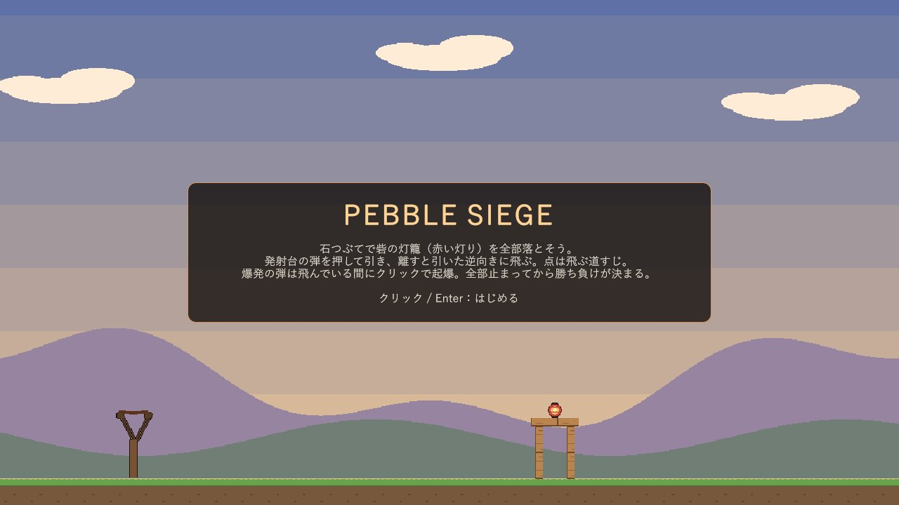 | 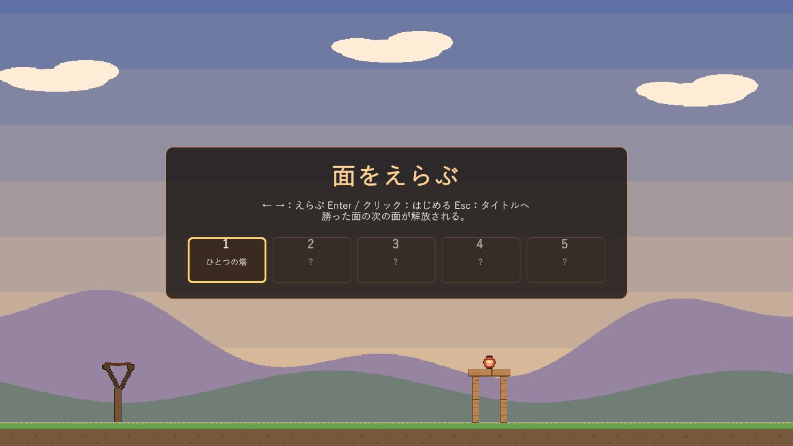 | 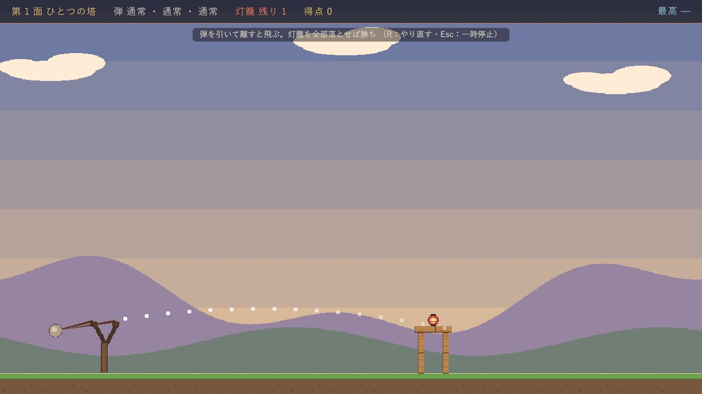 |

| 撃った直後 | 命中 | 勝ち |
|---|---|---|
| 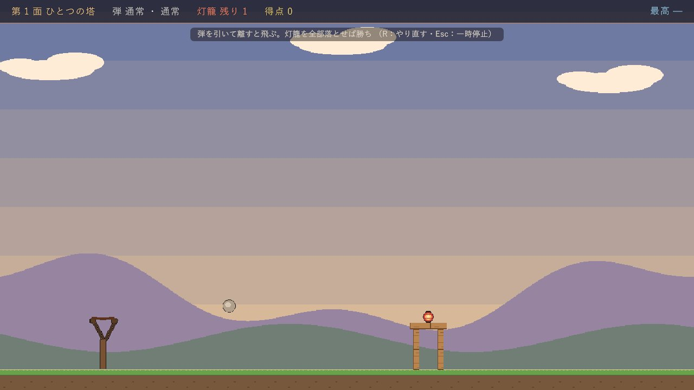 | 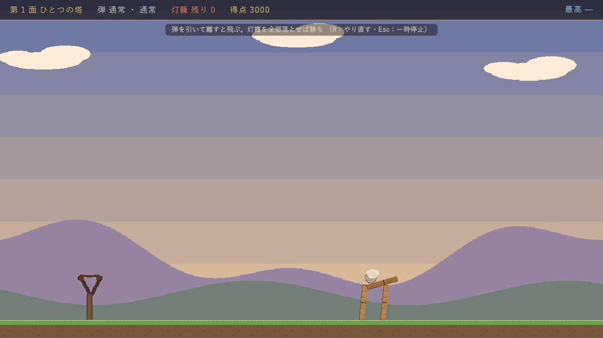 | 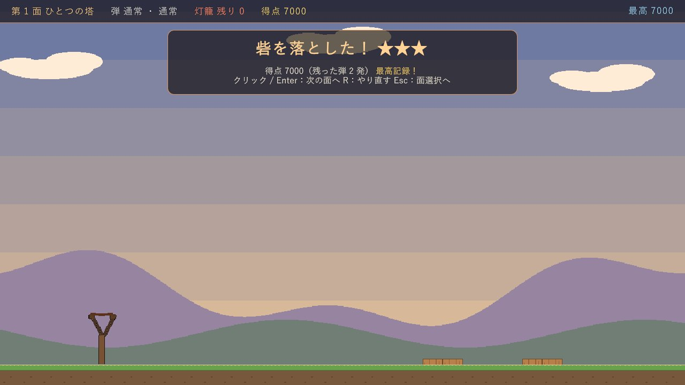 |

| 塔の崩落 | 爆発 | 負け |
|---|---|---|
| 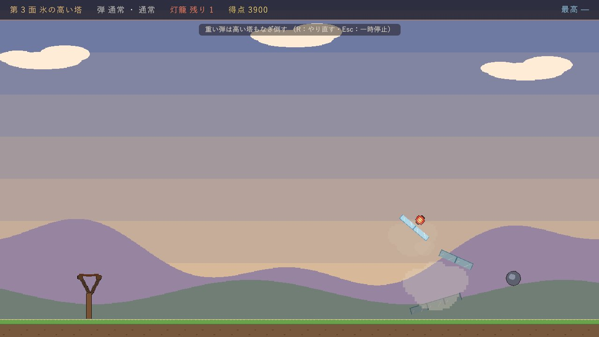 | 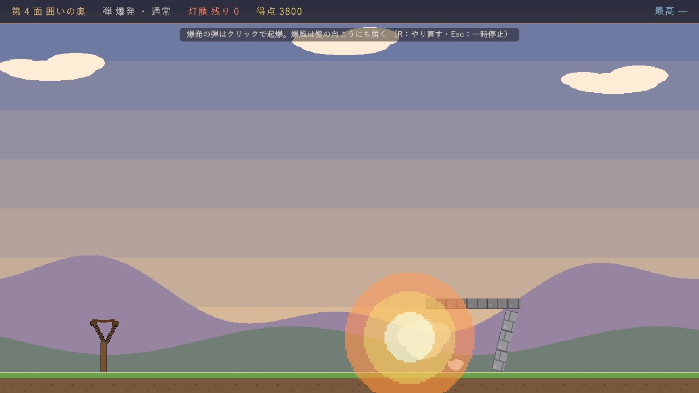 | 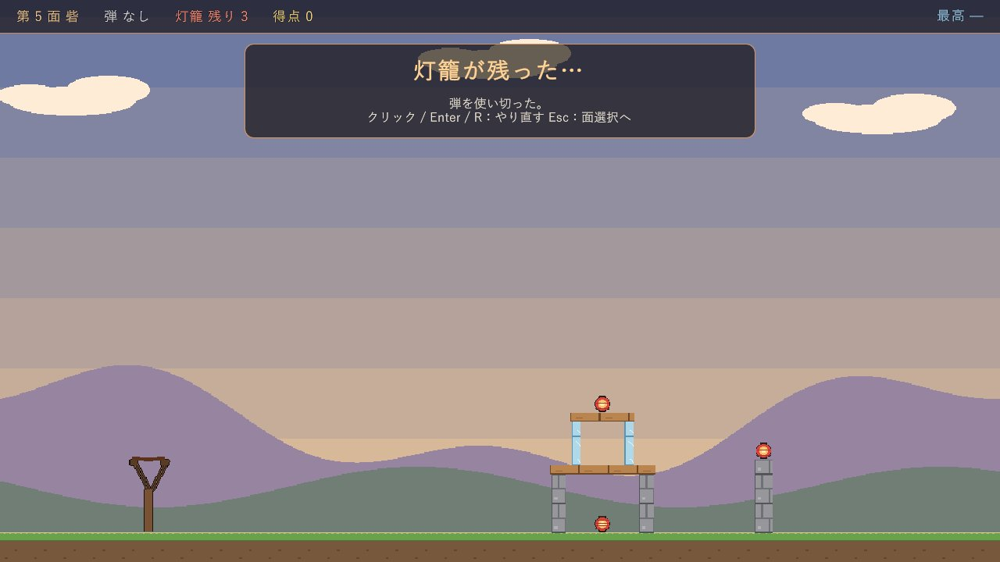 |

| 砦の勝ち | 全面の結果 |
|---|---|
| 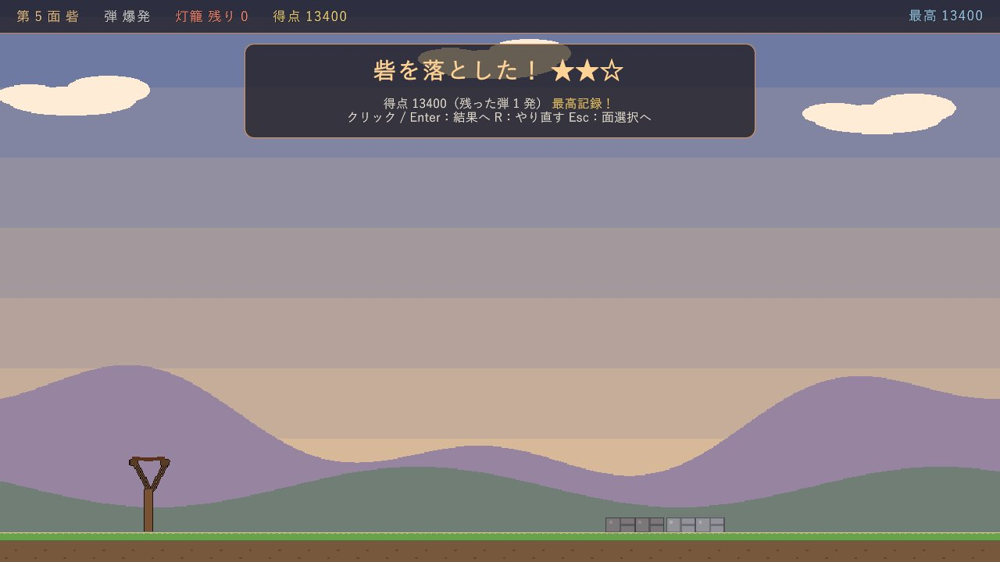 | 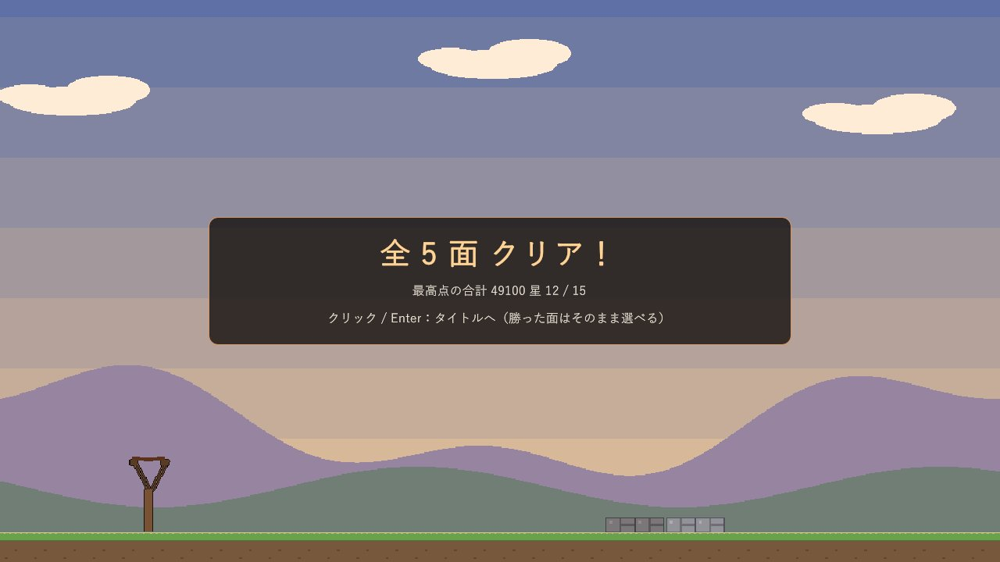 |
