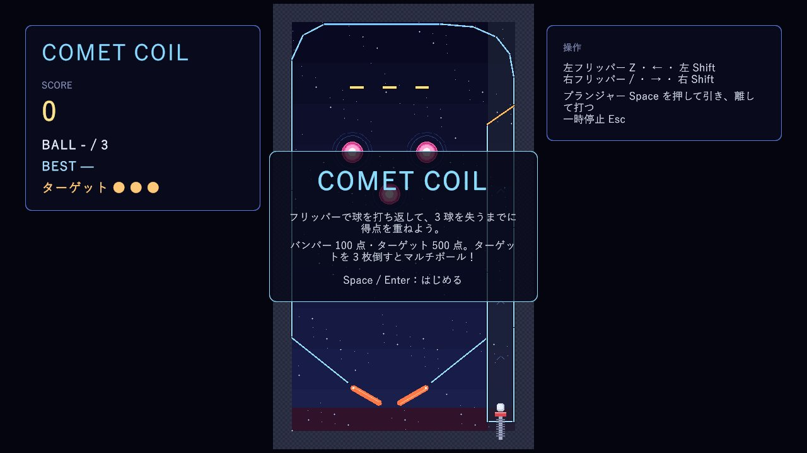
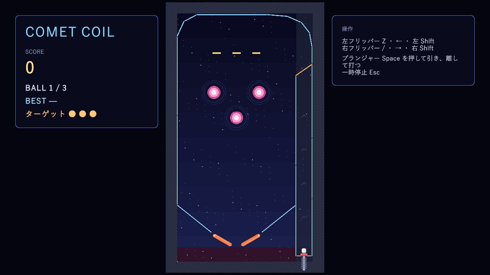
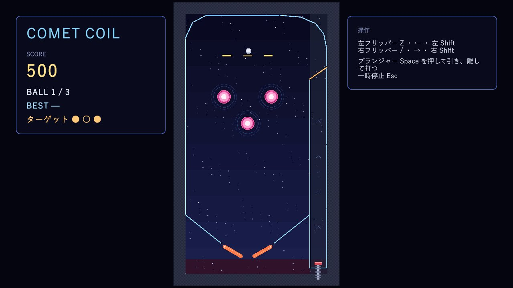
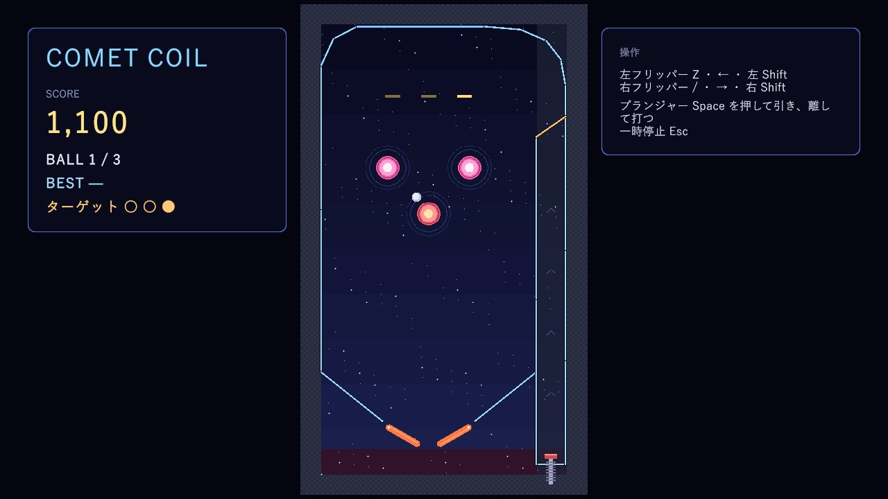
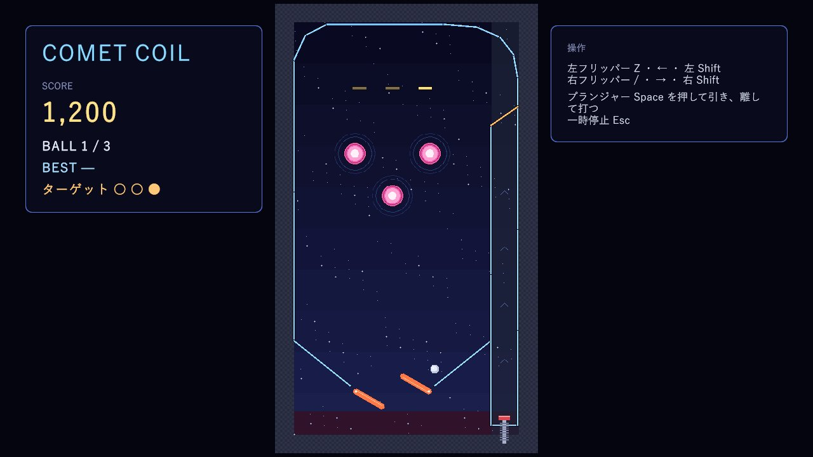
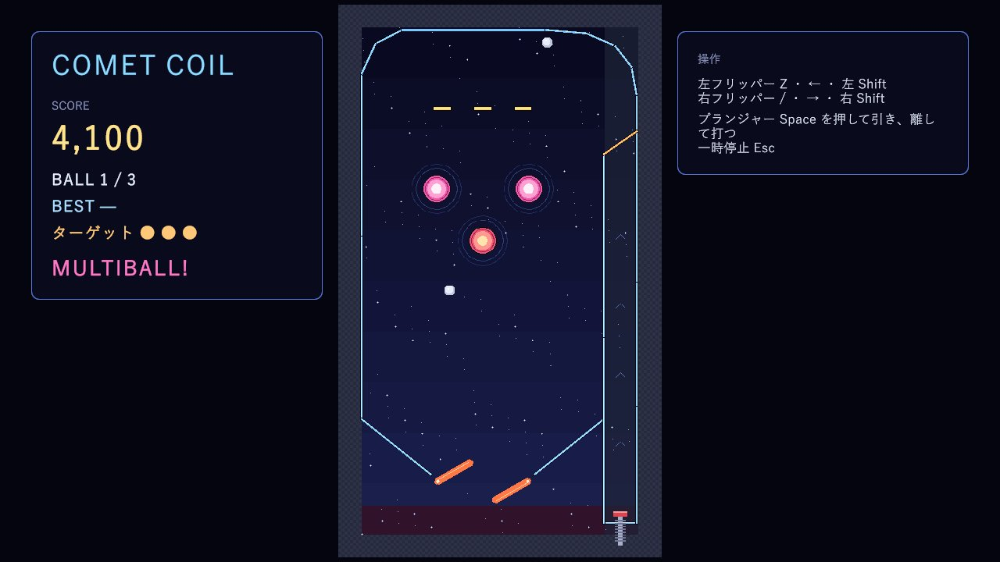
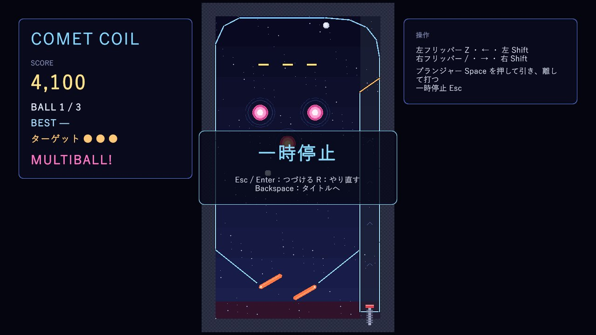
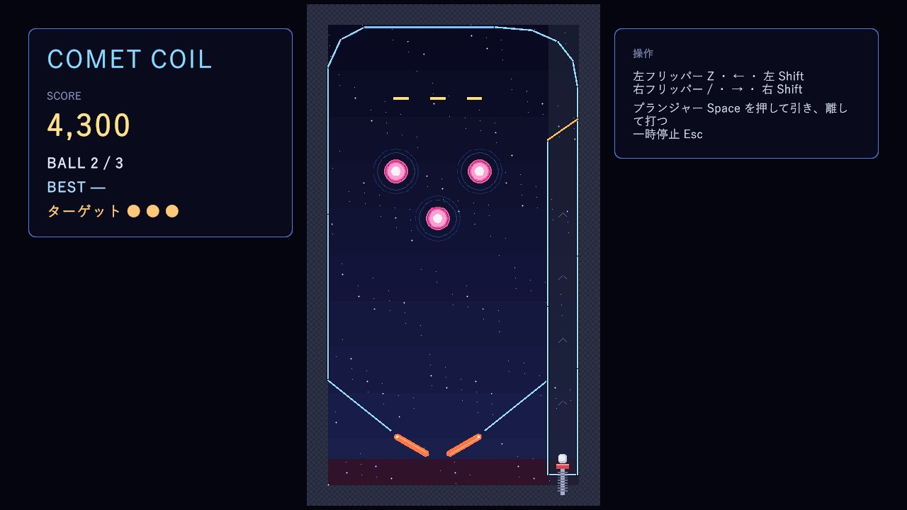
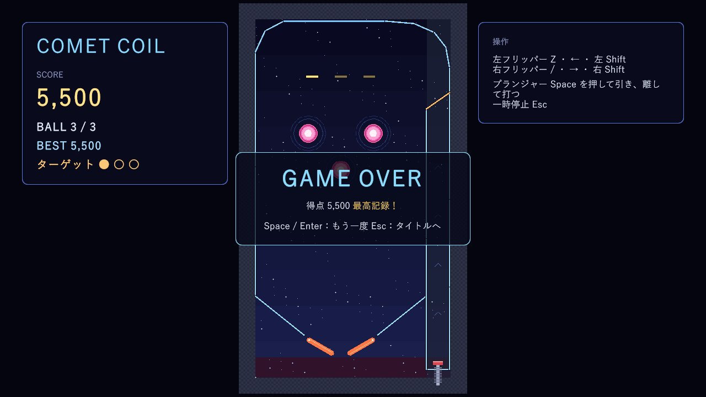

# 035 検証記録

2026-11-25 実施。同日、レビュー対応の後に人間の動作確認の承認を受領した。

## 自動検証

| 項目 | 結果 |
|---|---|
| dev lint | 成功 |
| dev check | 成功（警告 0・エラー 0） |
| dev test | 成功。035 Core 96/96、App 20/20 |
| Unity EditMode | 178/178（int-geometry 52・tile-motion 10・Core 96・App 20、Mono） |
| Unity PlayMode | 29/29（実シーン 13、共通証跡公開 16） |
| Windows ビルド | 成功、StandaloneWindows64 |
| ビルド起動 | dev capture で起動・全場面撮影・正常終了 |
| 証跡 | JPEG 品質 85、10 枚 |
| 撮影再現 | 同じビルド（Build GUID `99ee976167ee472eb04d6f7a1ab2ccf1`）を 2 回撮影し、10 枚すべての SHA-256 が一致した（撮影記録 `20261124T162131Z-143ea061` と `20261124T162203Z-b4579bbd`、どちらも画像世代 `6435f94707a8bfbf`）。レビュー対応後のビルド（`718f96d60337469c92e4ddaaba1028a1`）の撮影 [`20261124T165328Z-ed5e0c5a`](runs/20261124T165328Z-ed5e0c5a/manifest.json) も、10 枚すべてが同じ SHA-256 になった。以前の記録は次の公開で消える |
| .NET との一致 | 撮影の試合（試合のシード 1、操縦役のシード 12、最初の球は 40 Tick 引いて打つ）は 2577 Tick・5,500 点で終わった。.NET で同じ手順を再現した結果と同じ |
| 性能 | マルチボール（300 Tick すべて台の上に 2 個）で Core の Step p50 0.101 ms・p95 0.140 ms・最大 0.211 ms、描画の更新 p95 0.009 ms、割り当て 0 バイト（Unity エディタのバッチ実行、Mono、`ProfilerRecorder` の「GC Allocated In Frame」で 4096 バイトの割り当てを検出できることも確認） |

公開ポインタは [current.json](current.json)。撮影の台本は意図と Tick を順に渡すだけで場面を作る（実時間とキーを使わない）。最初の 1 球はプランジャーの意図で引いて打ち、以後は操縦役（`Autopilot`）が遊ぶ。

## ルールの検証

- **バンパー反射と得点が一致**：反射の式（法線成分を反発係数で返し、接線成分はそのまま、動く面は相対速度）を固定の値で確かめ、2 万例の乱数で反射の後に面へ近づかないことを確かめた。真上から落とした球はバンパーで 1 回だけ 100 点になり、横の速さ 0 のまま「弾き + 反発」の速さで上へ跳ねる。本番の台で乱数の操作を 3 万 Tick 続け、毎 Tick「出来事の数 × 点 = 得点の増分」で、当たったバンパーから球が離れていくことを確かめた。
- **球喪失は 1 度だけ計上**：ドレインへ落ちた球・横から台の外へ出た球は 1 回だけ失い、次の球をレーンへ出す。同じ Tick に 2 個失っても球の番号は 1 つだけ進む。マルチボールで片方を失っても 1 球は続き、残りも失ったときに 1 回だけ終わる。3 球目で終わり、その後の入力はハッシュも Tick も変えない。
- **球を複製できない**：プランジャーはレーンの球を 1 回だけ打ち、打った後に引いても何も出ない。マルチボールは台の上が 1 個のときだけ 1 個増え、マルチボール中にもう一度 3 枚倒しても増えない。2 個の球が同じ Tick に最後の 2 枚を倒しても増えない。乱数の操作で長く遊び、毎 Tick「レーン + 台の上 = 出した数 − 失った数」、台の上は 2 個以下、レーンは 1 個以下。
- **高速球の連続衝突検出**：経路の点の列と保守的前進の結果を、全ての点を調べる走査と 2 万例で照合した。最大の速さで薄い壁へ 16 通りの角度、ポストへ 24 方向から当て、壁の向こうへ抜けず、Tick の終わりに内側にいない。最大の速さで振るフリッパーに上から来る球を乱数で 300 通り当て、腕の反対側へ抜けない。距離の判定は BigInteger の別の式（射影）の参照実装と照合した。
- **フリッパーのアクチュエータ**：押した最初の区間から加速し、上限の速さで上の角度に着いて止まる（区間の数を参照の計算と照合）。離すと戻る。途中で離すと折り返す。先端の 1 区間の移動は「球の半径 + フリッパーの半径」より小さく、破る設定は台の読み込みで拒否する。
- **再現性**：操縦役の 20 シードがすべて 3 球を失って終わる。シード 1（4289 Tick）・6（27384 Tick）の最終ハッシュが .NET と Mono で一致した。同じキー操作を 30〜240fps・不規則な間隔のフレームで届けても同じ状態になる。
- **負例**：壊れた台のデータ 20 通り（バンパー・ターゲットの数、16 マスを超える線分、台の外、フリッパーの回る範囲の壁、半径 0、長さ 0 の扉、レーンの置き場と重なる壁、90 度を超える回転、外向きのフリッパー、長すぎるフリッパー、狭いレーン、高すぎるドレイン、2 つ目のフリッパーやレーン、未知の行、数でない値、値の数、行番号）と、範囲外の設定（すり抜けるフリッパーの速さ・1 区間で球の半径を超える速さ・最小 > 最大・球 0 個など）、未定義の意図と NaN の時刻を拒否する。

## 入力と画面

- 実シーンで Z を押すと、押下を反映した Tick の次の Tick でフリッパーが上がり始め、描画の回転も Core の角度と同じ（入力が即応）。束ねた 3 つのキーのどれでも上がり、片方を離してももう片方を押している間は上がったまま。
- Space を押している間はプランジャーと球が下がって見え、離すと打ち出す。
- 操縦役で遊ばせた 900 Tick の間、球・フリッパー・ターゲットの描画が毎 Tick Core の状態と一致した。バンパーは当たった Tick から 8 Tick だけ光る。
- 3 球を失うと結果（得点・最高記録）が出て、Space で新しいシードの試合を始める。遊んだ後にタイトルへ戻ると、球・フリッパー・プランジャー・ターゲット・バンパー・HUD が起動直後と一致する。
- フォーカスを失うと一時停止してキーを離したとみなし、戻っても自動では再開しない。再開しても押したままのキーは押していないとみなす（押し直すと効く）。
- Stage Prefab の照合は、壁の位置・向き・長さ、扉の絵、バンパーの大きさ、ターゲットの位置、フリッパーの軸と絵、球の大きさ、背景の絵を、置くときと同じ関数の値と比べる。壊した複製 14 通り（プランジャーの拡大率・回転、背景の拡大率・位置を含む）で理由が返る。設定アセットはコードの既定値と同じ。

## 気づいたこと

- 接触した区間の残りを捨てると、斜面を滑る球が止まり続けた。反射後の速度で残りを進める。
- 接触のたびに位置の端数を捨てると、遅い滑りが積み上がらず、フリッパーの軸の上で球が釣り合って止まった。端数を保つ。
- 当たる相手を選ぶとき、フリッパーへ「近づいているか」を面の速さとの相対で判定すると、先端が速く遠ざかる間に球が今の姿勢へ食い込んだ。区間の中ではフリッパーを止まった姿勢として扱い、近づいているかも止まった姿勢で判定する。
- バンパーを光らせた Tick の初期値を `long.MinValue` にしていたので、「今の Tick − 光った Tick」が桁あふれし、タイトルと試合の始めに全てのバンパーが光っていた。タイトルへ戻った表示のテストで見つけ、初期値の印を比べる前に除く。

## レビュー対応

- **P2-1 一時停止をまたぐと別の割り当てのキーが効かない**：Unity 側で「3 つのキーのどれかが押されているか」をまとめ、変わったときだけ意図にしていた。一時停止で Flow がキーを離したとみなしても、Unity 側のまとめは押したままだったので、Z を押したまま再開して ← を押しても意図が出なかった。キーごとの押下・解放を組の中の番号つきで送り、どのキーが押されているかは Flow がキーごとのビットで持つ。一時停止・フォーカス喪失・開始でビットを空にするので、前から押したままのキーは離して押し直すまで効かず、新しく押した別のキーは効く。新しいキーを離すと（古いキーを押したままでも）下がる。App のテスト（一時停止とフォーカス喪失の両方、押し替え）と実シーンのテストを足した。実シーンのテストは修正前のコードで失敗した。
- **P3-1 左右のフリッパーの重なり**：左右の回る範囲を 1 度刻みで組み合わせ、刻みの間に先端が動く弧の長さを両方ぶん余裕に足して、重なる台を拒否する。重なる 2 通りの配置を拒否し、離れた配置は通るテストを足した（修正前のコードで失敗）。
- **P3-2 プランジャーの拡大率**：Prefab の照合で、プランジャーの回転・拡大率と、背景の位置・回転・拡大率も確かめる（描画は位置しか動かさない）。壊した複製 4 通りを足した（修正前のコードで失敗）。
- 撮影の画像は変わらなかった。

## 画面

| タイトル | プランジャーを引く | 打ち出し |
|---|---|---|
|  |  |  |

| ターゲット | バンパー | フリッパーで打つ |
|---|---|---|
|  |  |  |

| マルチボール | 一時停止 | 1 球の終わり |
|---|---|---|
|  |  |  |

| 結果 |
|---|
|  |
