# 036 検証記録

2026-11-25 実施。

## 自動検証

| 項目 | 結果 |
|---|---|
| dev lint | 成功 |
| dev check | 成功（警告 0・エラー 0） |
| dev test | 成功。036 Core 87/87、App 14/14 |
| Unity EditMode | 163/163（int-geometry 52・tile-motion 10・Core 87・App 14、Mono。調整用の `[Explicit]` 2 件は除く） |
| Unity PlayMode | 27/27（実シーン 11、共通証跡公開 16） |
| Windows ビルド | 成功、StandaloneWindows64 |
| ビルド起動 | dev capture で起動・全場面撮影・正常終了 |
| 証跡 | JPEG 品質 85、11 枚 |
| 撮影再現 | 同じビルド（Build GUID `4f77499217f84baf98b1cf45cf982340`）を 2 回撮影し、11 枚すべての SHA-256 が一致した（撮影記録 `20261124T182842Z-f2d0fecd` と [`20261124T182904Z-aba49f20`](runs/20261124T182904Z-aba49f20/manifest.json)、どちらも画像世代 `2aed8ea9e139cc73`）。1 回目の記録は次の公開で消える |
| .NET との一致 | 操縦役のシード 1 は 7 打・4086 Tick・最終ハッシュ 0x6E6BB7DA。Mono の EditMode でも同じ。平らなフェアウェイでの着地点の差の表も同じ |
| 性能 | 予測線（ウッド、最初の着地まで）p50 0.086 ms・p95 0.089 ms・最大 0.143 ms、飛んでいる球の Core の Step p95 0.001 ms、描画の更新（実際の軌跡を打ち出しから進め直す）p50 0.125 ms・p95 0.212 ms、割り当て 0 バイト（Unity エディタのバッチ実行、Mono、`ProfilerRecorder` の「GC Allocated In Frame」。4096 バイトを割り当てたフレームは 4458 バイトとして検出した） |

公開ポインタは [current.json](current.json)。撮影の台本は意図と Tick を順に渡すだけで場面を作る（実時間とキーを使わない）。ラウンドのシードは 1。1 番ホールの 1 打目は木に当たる打ち方、2 打目は池に入る打ち方を実際と同じ関数で探して打ち、以後は操縦役（`Autopilot`、シード 3）が回る。撮影のラウンドは 4600 Tick・11 打（1 番 5・2 番 3・3 番 3）で終わり、最終ハッシュは 0x04A13B00。

## ルールの検証

- **カップイン判定が球速度条件を満たす**：速さちょうど上限で入り、+1 では通り過ぎる。1 Tick でカップをまたぐ速さでも、入った点の速さが上限以下なら入る。縁をちょうどかすめても入らない。飛んでいる球は上を通り、着地した点が円の内側で着地後の速さが上限以下なら入る。入った後の Step では状態が変わらない。
- **障害物衝突で再計算**：木に当たった球は手前で反射し、その Tick の残りを新しい速度で進む（当たらない場合と着地点が変わる）。高さちょうどと 1 単位上、最大の速さで細い木をすり抜けないこと（点を全部調べる走査と 2 万例で接触の有無と時刻を照合）。予測線も同じ計算で木を含む。
- **OB 後の打数加算**：OB と池は +2（打球と罰打）で前の位置から打ち直す。上を飛んで場内に着地すれば罰はない。1 打球で 1 回だけ数える。上限の打数に達する打球が OB になる場合と、連続 OB も確かめた。
- **予測と実際**：ずれ 0 なら木・風・打点を含めて全 Tick で軌跡が一致する。ずれの符号どおりに着地点が横へずれ、`ShotLog` の差は実際の距離と一致する。平らなフェアウェイでの差の表と、操縦役 20 シードの分布は作品 README の「予測と実際の差分」。
- **風と傾斜・メーター**：向かい風で短く、追い風で長く、横風で風下へ着く。傾斜では低いほうへ曲がり、坂の上では止まらず平らなところで止まる。インパクト帯の端ちょうどと 1 Tick 外、2 回目なしのミス、1 回目なしの取り消し（打数不変）、3 回目の無視。
- **再現性**：操縦役の 20 シードが全ホール par 以内。シード 1 の最終ハッシュが .NET と Mono で一致した。同じキー操作を 30〜240fps・不規則な間隔で届けても同じ状態になる。同じビルドの撮影は 2 回とも同じ 11 枚になった。
- **負例**：壊れたコース 17 通りと範囲外の設定を拒否する。Stage Prefab を壊した複製 12 通り（木・カップ・ティー・地面・傾きの矢印・予測線の親）で照合が理由を返す。設定アセットの NaN・バナー 0 秒・掃引の上限を超えるクラブの速さを拒否する。

## 入力と画面

- Space の 3 回押し（振り始め・パワー・インパクト）で打ち、描画の球は Core の位置から高さの分だけ上、影は地面にある。球が動いている間はメーターを出さない。
- 予測線の点と着地の印は Core の予測と同じ値。打った後の軌跡は、打ち出しから同じ関数で進め直した点。
- ←→ を押し続けると向きが繰り返し、離すと止まる。↑↓ でクラブ、W/A/S/D で打点。打点の印は HUD の円の上で段の位置に動く。
- Tab で全体とグリーンの表示を切り替え、グリーンでは傾きの矢印を出す。カメラの大きさは変換後の範囲から決めた値と一致する。
- 操縦役で 3 ホールを終えるとスコアカードが出て、Enter で新しいシードのラウンドが 1 番から始まる。カップインの球は描かない。
- 打った後にタイトルへ戻ると、球・影・旗・カメラ・ホール・HUD が起動直後と一致し、予測線と軌跡は残らない。
- フォーカスを失うと一時停止して振りを取り消し（打数は増えない）、戻っても自動では再開しない。フォーカスがない間のキーは捨てる。
- 設定アセットはコードの既定値（抵抗・クラブの速さ・転がりの減速・カップの速さの上限）と同じ。

## 画面

| タイトル | 構えと予測線 | メーター |
|---|---|---|
| 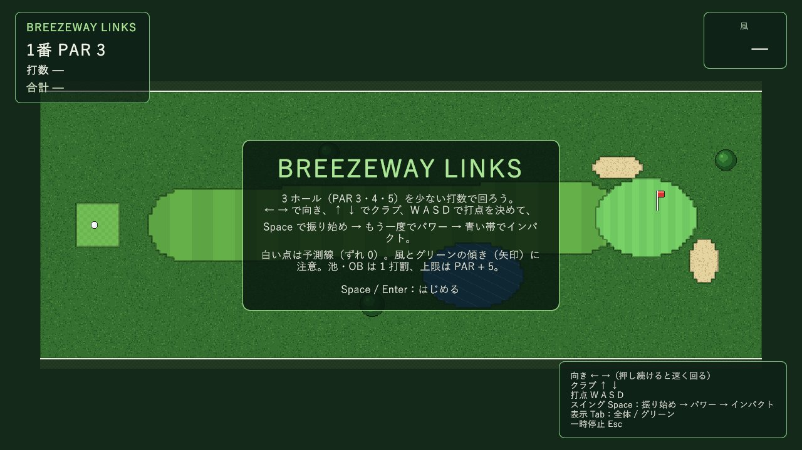 | 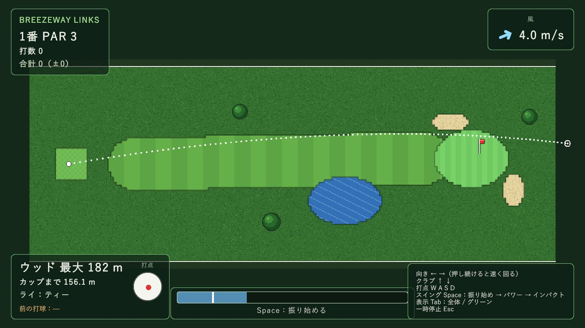 | 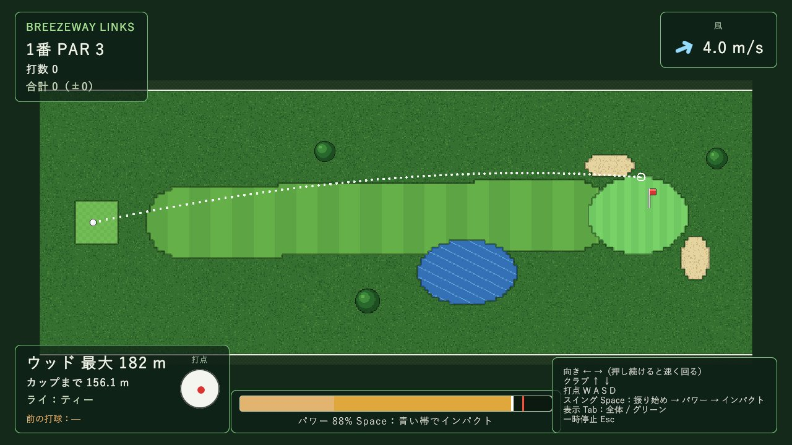 |

| 飛行中 | 木 | 池 |
|---|---|---|
| 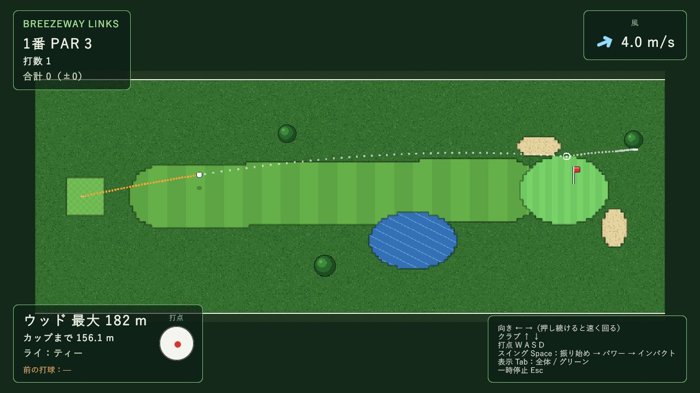 | 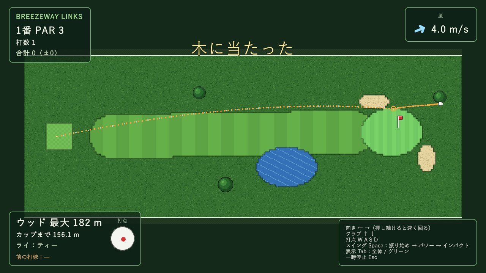 | 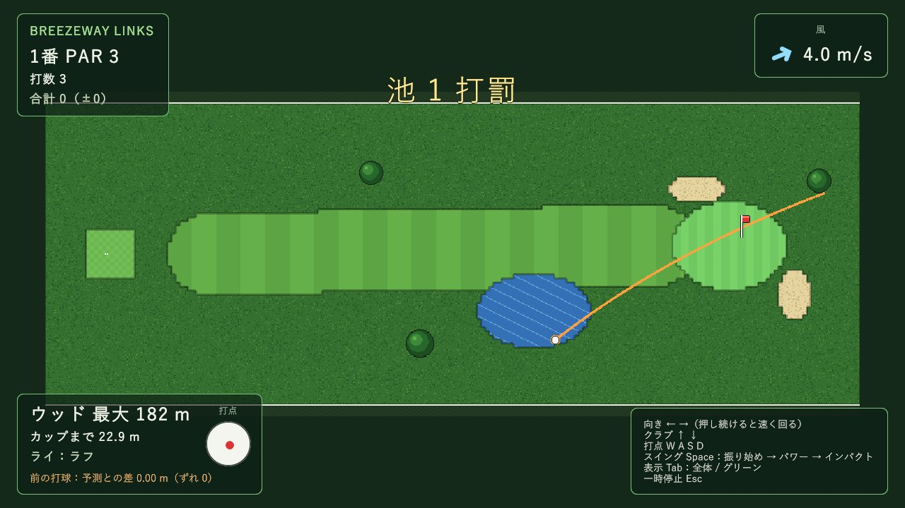 |

| グリーン | パット | カップイン |
|---|---|---|
| 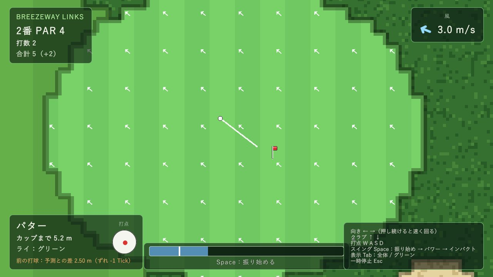 | 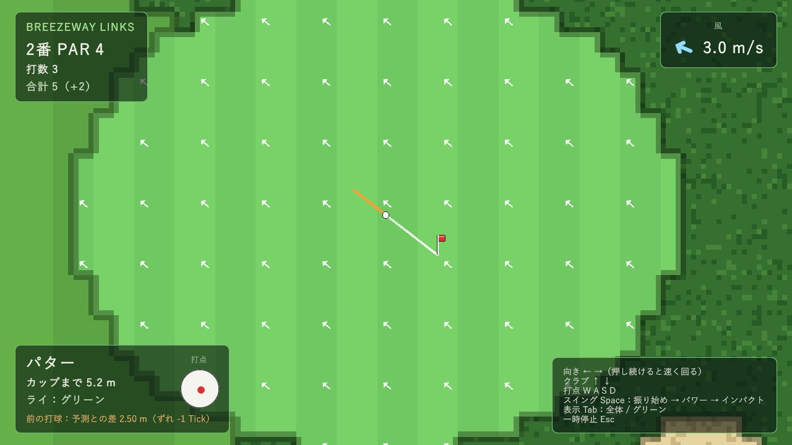 | 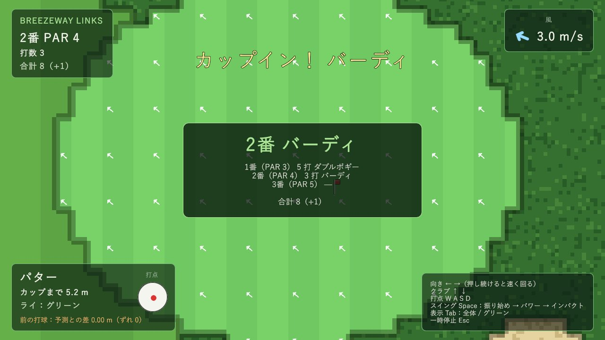 |

| 一時停止 | 結果 |
|---|---|
| 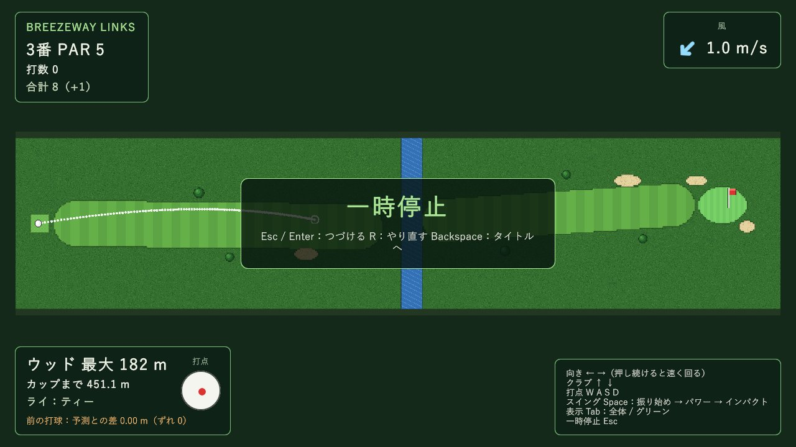 | 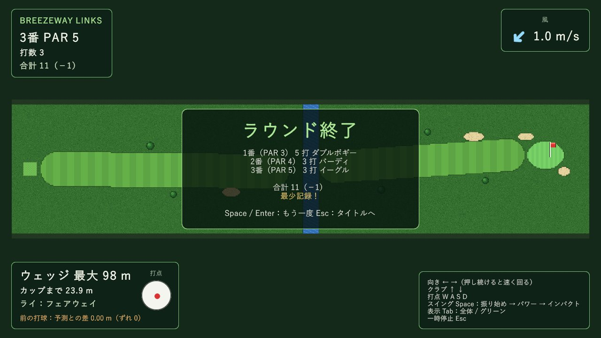 |
