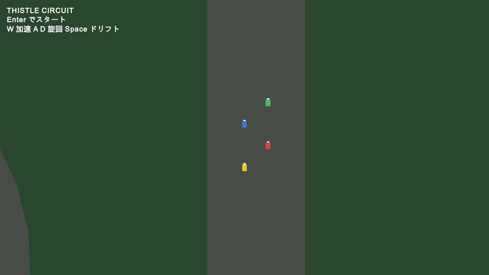
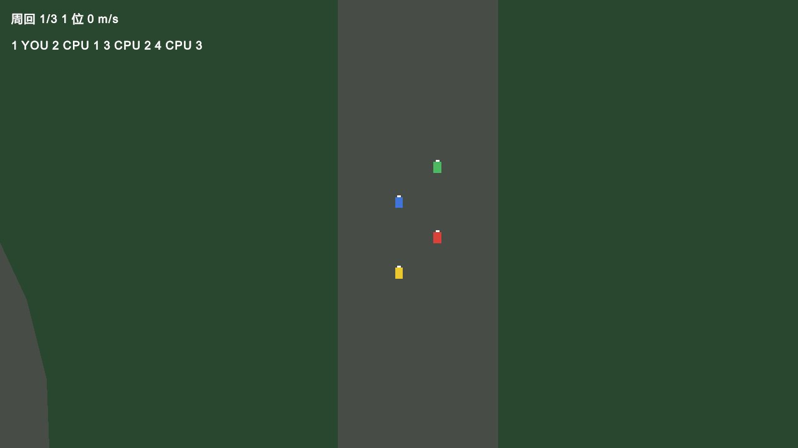
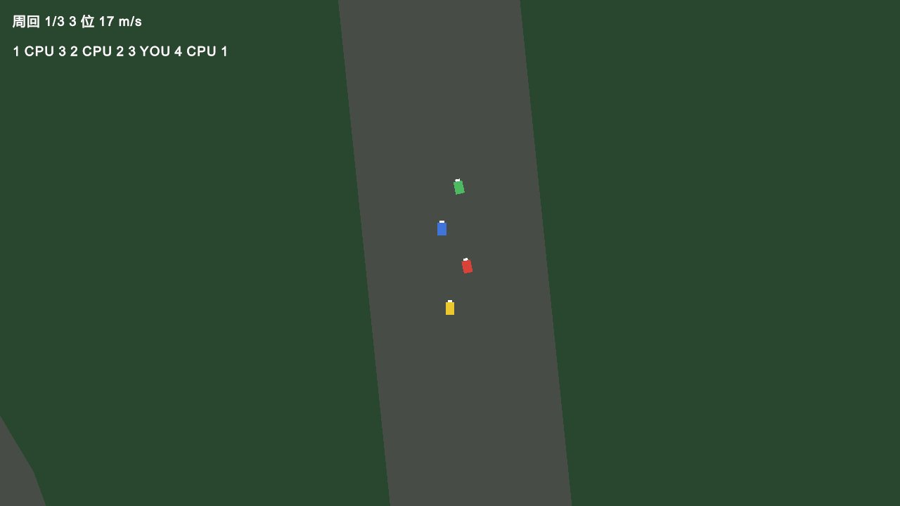
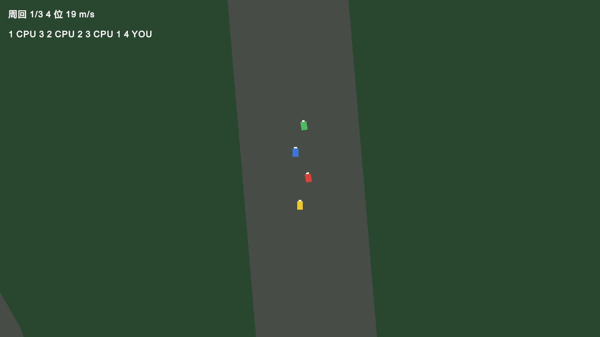
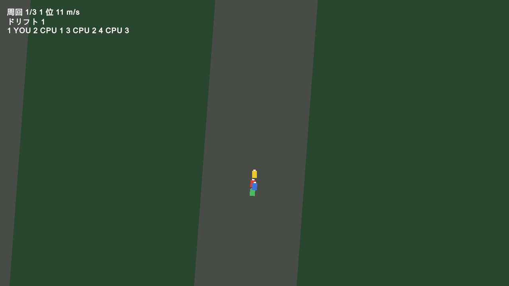
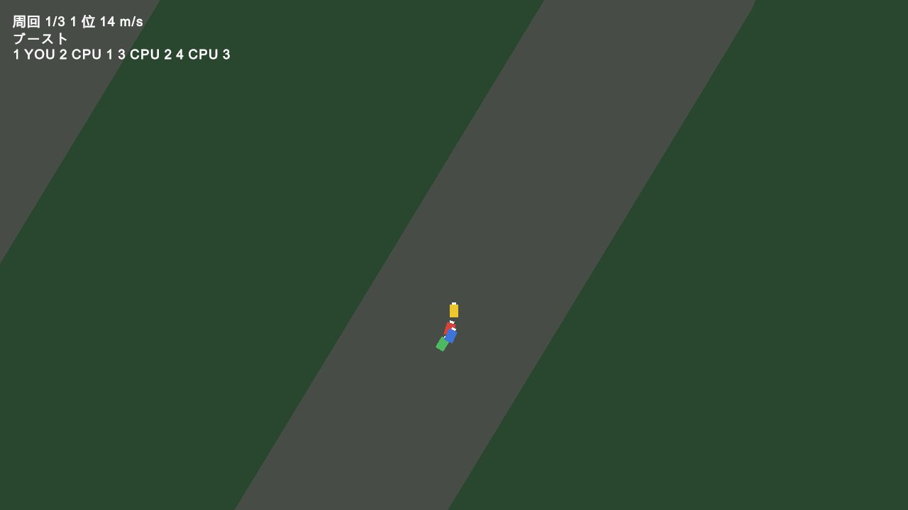
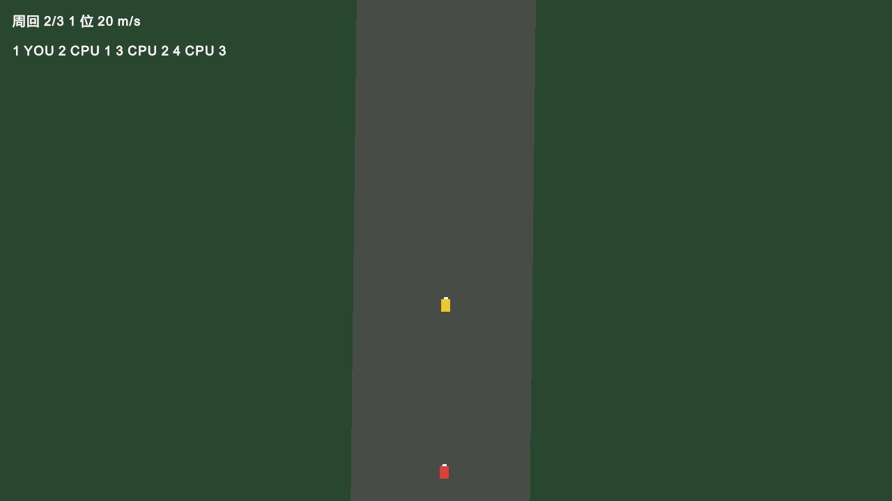
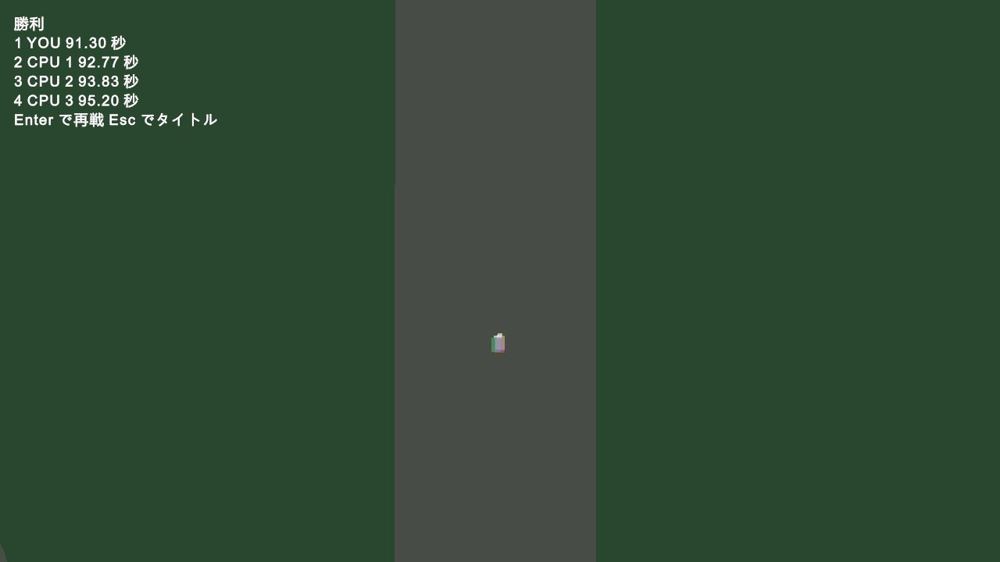

# 037 検証記録

2026-11-25 実施。

## 自動検証

| 項目 | 結果 |
|---|---|
| dev lint | 成功 |
| dev check | 成功（警告 0・エラー 0） |
| dev test | 成功。Core 39/39、App 8/8 |
| Unity EditMode | 109/109（パッケージ・Core・App・証跡の公開。Mono。固定ハッシュ `1723866012` を含む） |
| Unity PlayMode | 24/24（実シーン 8、共通証跡公開 16） |
| Windows ビルド | 成功、StandaloneWindows64 |
| ビルド起動 | dev capture で起動・全場面撮影・正常終了 |
| 証跡 | JPEG 品質 85、8 枚 |
| 撮影再現 | 同じビルド（Build GUID `84fae615640a4c898f6ee334202ea6c4`）を 2 回撮影し、8 枚すべての SHA-256 が一致した（撮影記録 `20261124T220813Z-2d4bf198` と [`20261124T220839Z-f68f3858`](runs/20261124T220839Z-f68f3858/manifest.json)、どちらも画像世代 `e14ed32e37e7da65`）。1 回目の記録は次の公開で消える |
| .NET との一致 | 同じ入力列 400 Tick のハッシュ `1723866012` が .NET と Mono で一致した |
| 性能 | 実コースを走っている 300 Tick で、Core の Step は p50 0.053 ms・p95 0.058 ms・最大 0.134 ms。車と追従カメラの更新は p50 0.002 ms・p95 0.003 ms・最大 0.024 ms。割り当て 0 バイト（Unity エディタのバッチ実行、Mono、`ProfilerRecorder` の「GC Allocated In Frame」。4096 バイトを割り当てたフレームは 4458 バイトとして検出した）。対象は 4 台とこのコースの壁。HUD の文字列はこの計測に含めていない |

公開ポインタは [current.json](current.json)。撮影の台本は操縦役を Tick で進めるだけで場面を作る（実時間とキーを使わない）。結果は 1 位 YOU、2〜4 位が CPU の完走。

## ルールの検証

- **逆走で周回を稼げない**：フィニッシュを逆向きに横切っても周回は 0。順方向に全ゲートを通過すると 1 周。線の上にちょうど乗る横断は進まない。
- **チェックポイント飛ばし不可**：次が 1 のとき 2 を横切っても印は 1 のまま。壁で止まった移動は、止まる前の予定位置にゲートがあっても通過にしない。
- **全車の順位が確定**：完走 Tick・周回・区間の進み・同着のどれでも順位は 1〜4 の置換。時間切れの未完走にも順位が付く。結果の後の操作では変わらない。
- **車両と壁**：加速が上限に届く Tick 数、速さ 0 では旋回しない、後退は旋回の符号が逆、ミニターボは 8 Tick ちょうどでブーストし 1 Tick 不足では出ない。正面の壁では半径の位置で止まり、接線方向へ滑る。最大の速さで薄い壁をすり抜けない。
- **CPU**：実コースで 3 台が 3 周を 20000 Tick 未満で完走する。鼻先を壁に付けた状態から回復して次のゲートへ進む。曲率の大きい角でドリフトし、出口でブーストする。操縦役のプレイヤーは 1 位で完走し、入力なしは最下位になる。
- **再現**：乱数はない。30〜240fps と同じ入力列でハッシュが一致する。フォーカスを失うとドリフトの溜めはブーストにならず消える。ブースト残り・溜め・回復・次のゲートを変えるとハッシュが変わる。

## 入力と画面

- ←→ または A D で旋回、W または ↑ で加速、S または ↓ でブレーキ、Space でドリフト。カメラは自機の少し前方を見て、進行方向が画面の上になる。
- 車の描画位置と向きは Core の位置・角度と一致する。Stage Prefab の点を 1 つ動かすと照合が不一致になる。設定のコースを外すと検証が拒否する。
- 操縦役で 3 周を終えると結果が出て、Enter で最初のグリッドからやり直す。タイトルへ戻すと、起動直後と同じ配置になる。
- フォーカスを失うと一時停止してドリフトを消し、戻っても自動では再開しない。

## 画面

| タイトル | グリッド | 直線 |
|---|---|---|
|  |  |  |

| 順位 | ドリフト | ブースト |
|---|---|---|
|  |  |  |

| 1 周 | 結果 |
|---|---|
|  |  |
