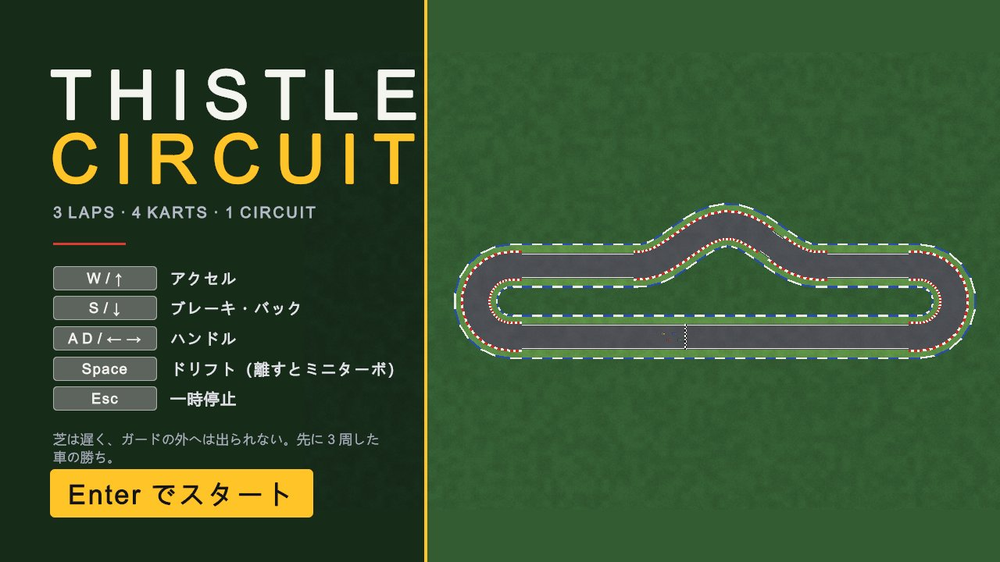
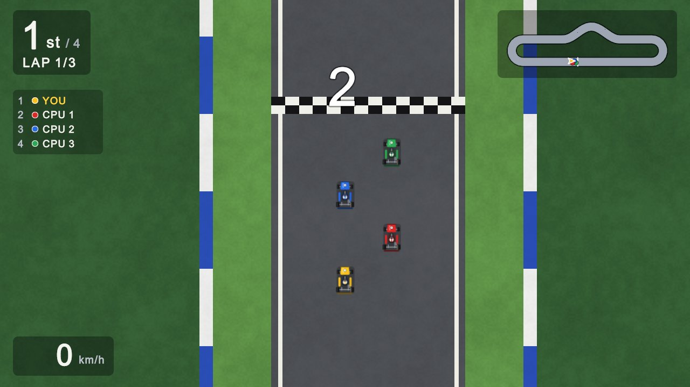
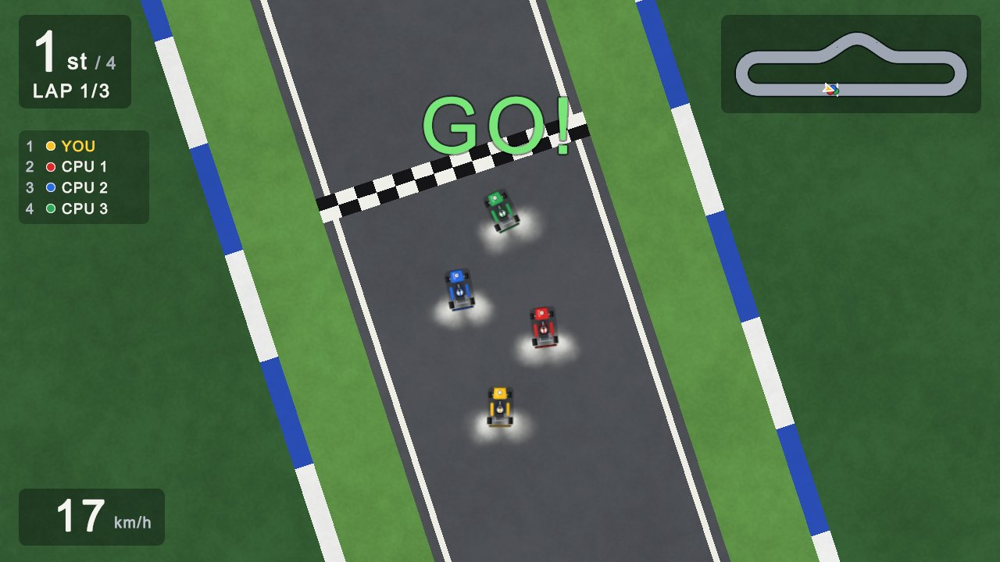
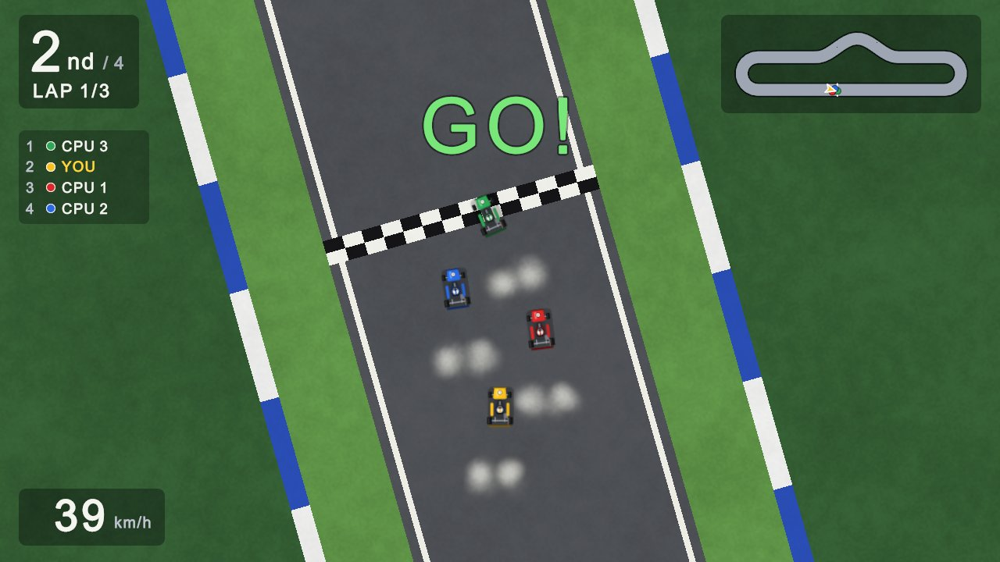
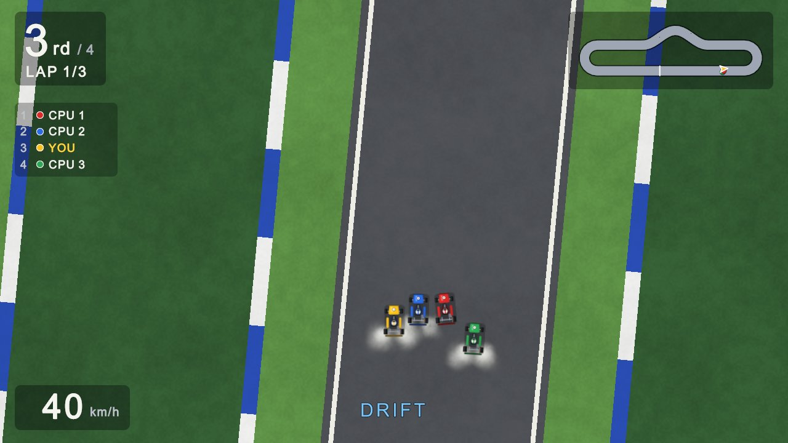
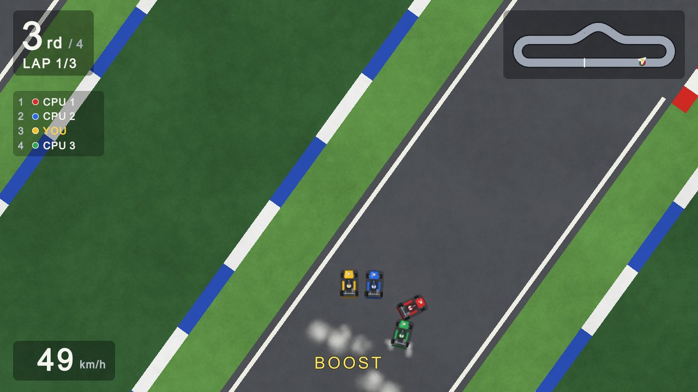
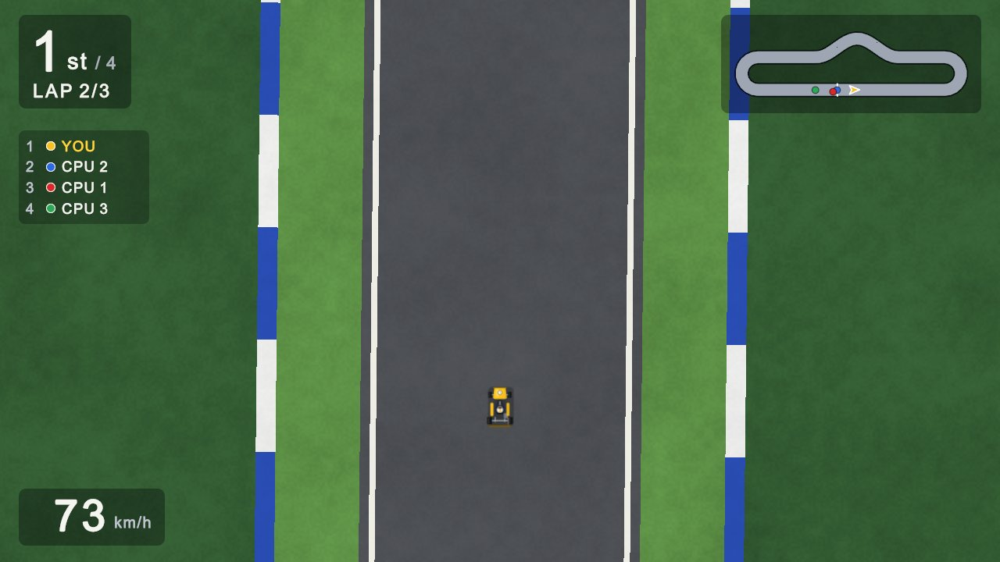
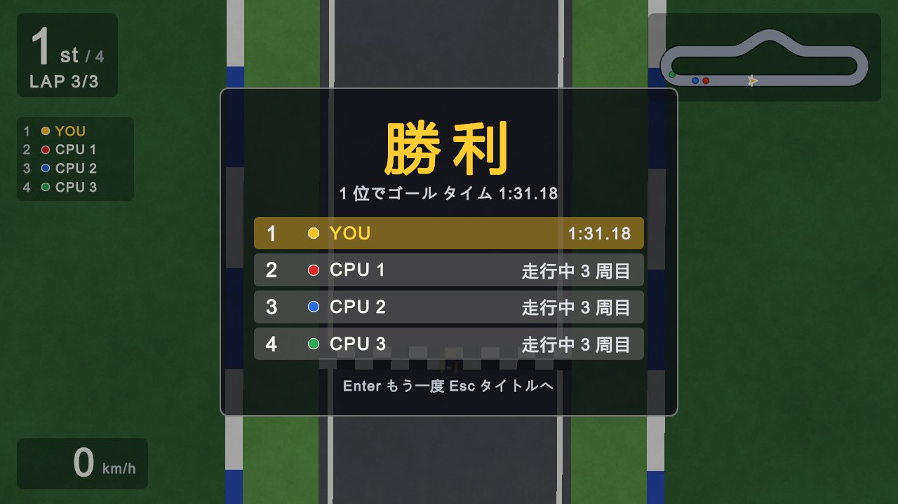

# 037 検証記録

2026-11-25 実施。試遊の指摘（タイトル画面、プレイヤーのゴールで結果へ、ミニマップ、車同士の接触、芝とガード、車の絵、煙）を受けた改修後の記録。

## 自動検証

| 項目 | 結果 |
|---|---|
| dev lint | 成功 |
| dev check | 成功（警告 0・エラー 0） |
| dev test | 成功。Core 68/68、App 24/24 |
| Unity EditMode | 154/154（パッケージ・Core・App・証跡の公開。Mono。固定ハッシュ `108021296` を含む） |
| Unity PlayMode | 32/32（実シーン 16、共通証跡公開 16） |
| Windows ビルド | 成功、StandaloneWindows64 |
| ビルド起動 | dev capture で起動・全場面撮影・正常終了 |
| 証跡 | JPEG 品質 85、8 枚 |
| 撮影再現 | 同じビルド（Build GUID `b158013042664a4cabb4903d41138317`）を 2 回撮影し、8 枚すべての SHA-256 が一致した（撮影記録 `20261125T002036Z-b06d23a4` と `20261125T002156Z-d425caed`、どちらも画像世代 `d6e53dc5319ee0cc`）。レビュー対応（ゲートの線の上・一時停止後のキー）の後のビルド（Build GUID `f1495b8e058c4610bdf6f87ebff8e2e2`）の撮影 `20261125T031741Z-12c92442`、キーを時刻つきで集める対応の後のビルド（Build GUID `84e59f01f07643b1a2a1c421916c8196`）の撮影 [`20261125T041037Z-41a9d8c3`](runs/20261125T041037Z-41a9d8c3/manifest.json) も同じ画像世代になった。古い記録は次の公開で消える |
| .NET との一致 | 同じ入力列 400 Tick のハッシュ `108021296` が .NET と Mono で一致した |
| 性能 | 実コースを走っている 300 Tick で、Core の Step は p50 0.062 ms・p95 0.077 ms・最大 1.191 ms。車・煙・追従カメラの更新は p50 0.034 ms・p95 0.088 ms・最大 0.182 ms。割り当て 0 バイト（Unity エディタのバッチ実行、Mono、`ProfilerRecorder` の「GC Allocated In Frame」。4096 バイトを割り当てたフレームは 4458 バイトとして検出した）。対象は 4 台・車同士の接触・このコースのガード壁・煙の粒 384 個。HUD とミニマップの描画はこの計測に含めていない |

公開ポインタは [current.json](current.json)。撮影の台本は操縦役を Tick で進めるだけで場面を作る（実時間とキーを使わない）。結果はプレイヤーが完走した Tick に出る（1 位 YOU、CPU 3 台は走行中のまま順位が付く）。

## ルールの検証

- **逆走で周回を稼げない**：フィニッシュを逆向きに横切っても周回は 0。順方向に全ゲートを通過すると 1 周。線の上を動くだけ・線の上に止まって手前へ戻る・奥から線を経て手前へ戻る移動は進まない。線の上にちょうど止まった次の Tick に奥へ出ると 1 回だけ数える（実コースの 0 番ゲート x = 108000 で、107999 → 108000 → 108001）。
- **チェックポイント飛ばし不可**：次が 1 のとき 2 を横切っても印は 1 のまま。壁で止まった移動は、止まる前の予定位置にゲートがあっても通過にしない。ゲートはガードからガードまで張るので、芝の上で横切っても数える。
- **全車の順位が確定**：完走 Tick・周回・区間の進み・同着のどれでも順位は 1〜4 の置換。プレイヤーが先に完走すると、走行中の CPU にも進みの順で順位が付く。CPU が全員先に完走した後でプレイヤーが完走すると 4 位。結果の後の操作では変わらない。
- **終了**：プレイヤーが完走した Tick にレースが終わり、その Tick に結果へ移る（CPU の完走を待たない）。結果の後は CPU も進めない。プレイヤーが完走しなければ 20000 Tick で終わる。
- **芝とガード**：ターマックの端の線の上まではターマック、1 mm 外は芝。芝では速さを 150 へ 12 ずつ下げる（ブースト中も）。遅い車と後退は芝で遅くならない。下の直線から内側へ真っすぐ走ると、芝には入れるがガードの半径手前で止まり、周回もゲートも進まない（近道できない）。
- **車同士**：追突では追った側が遅く、前の車が速くなり、2 台の速さの和を保つ。反発 0 では法線方向の速さがそろう。始めも終わりも離れているが途中ですれ違って触れる組を、相対軌跡の掃引で見つける。ちょうど接するだけでは触れない。重なった止まった 2 台は速さを得ずに離れる。横に食い込んで並走する 2 台は押し離されるだけで、その Tick の移動を失わない。完走した車は幽霊で触れない。検証を通る最大の速さと半径で、4 台の乱数の配置 6000 組の掃引が上限を超えない。
- **CPU**：プレイヤーがグリッドに止まったままでも、CPU 3 台は止まった車をよけて 3 周を完走する。前の車をよける筋は、自分のいる側で、前の車と中心線の両方から直径 + 余裕だけ離れ、ターマックの中に収まる。後ろ・隣の筋・遠い車・完走した車はよけない。鼻先を壁に付けた状態から回復して次のゲートへ進み、回復の直後にまた回復に入らない。曲率の大きい角でドリフトし、出口でブーストする。
- **再現**：乱数はない。30〜240fps と同じ入力列でハッシュが一致する。フォーカスを失うとドリフトの溜めはブーストにならず消える。
- **一時停止と押したままのキー**：W・A を押したまま一時停止して再開すると、W・A は離して押し直すまで効かないが、新しく押した ↑・← はすぐ効き、離すと止まる（PlayMode で仮想キーボードから確かめた）。入力はキーごとに番号を付けて Flow に送り、Flow がキーごとに押下を持つ。
- **入力の時刻**：キーは Input System のコールバックで起きた時刻つきで集める。時刻を指定した仮想キーボードの状態イベントで、1 フレームの間に押して離した W が押下・解放の 2 つの意図として、それぞれの時刻のまま届くことを PlayMode で確かめた。その 2 つを 1 フレームでまとめて Flow に渡しても、別々のフレームで渡しても同じハッシュになり、押さなかった場合とは違う位置になる。

## 入力と画面

- タイトルはコースの全景を北が上で画面の右に置き、左の札に操作とルールを出す。PlayMode でガードまでの範囲が札に隠れず画面に収まることを確かめた。
- レース中は順位（1st / 4）、周回、順位表、ミニマップ（北が上、プレイヤーは向きの分かる三角）、速さ（km/h）、DRIFT / MINI TURBO / BOOST、スタートの 3・2・1・GO を出す。ミニマップの車の点は写像の箱の中に入る。
- 車の絵は真上から見たカート（タイヤ、フレーム、カウル、ゼッケン、シート、ドライバー、ヘルメット、エンジン、影）で、1.5 m × 1.0 m。当たりの円は直径 1.2 m。
- 煙：スタートの加速、前進中のブレーキ、ドリフトで後輪から白い煙、芝では土ぼこり。粒はレースの Tick で歳を取るので、同じ Tick の並びで描けば同じ絵になる（PlayMode で 2 回の通しの粒の位置が一致）。タイトルへ戻ると消える。
- 地面は Track の点から作った 1 枚のメッシュで、Prefab のメッシュと頂点を照合する。頂点を 1 つ動かす、芝の幅を変えると不一致になる。

## 画面

| タイトル | グリッド | スタートの煙 |
|---|---|---|
|  |  |  |

| 順位 | ドリフト | ブースト |
|---|---|---|
|  |  |  |

| 1 周 | 結果 |
|---|---|
|  |  |
