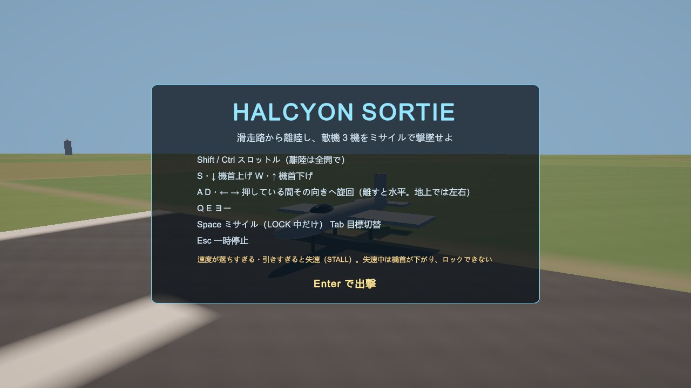
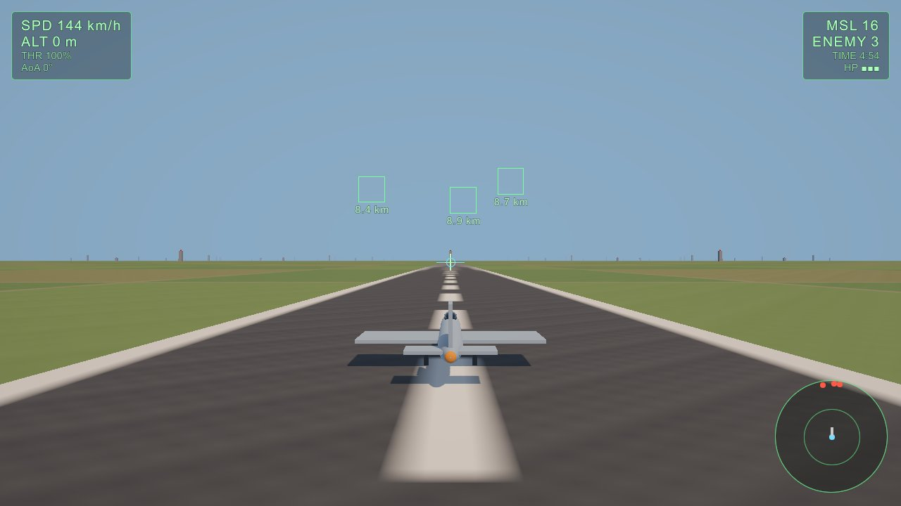
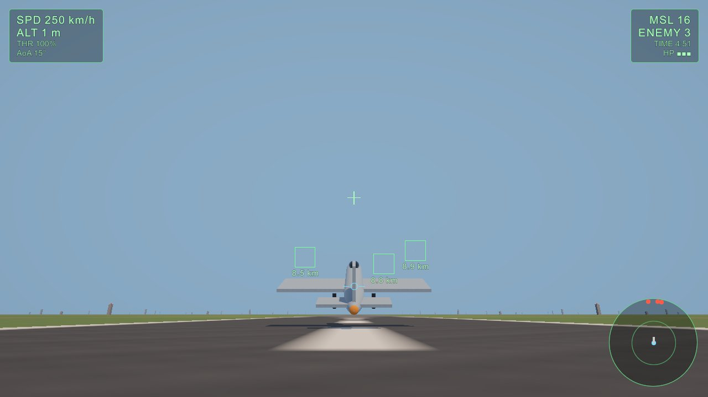
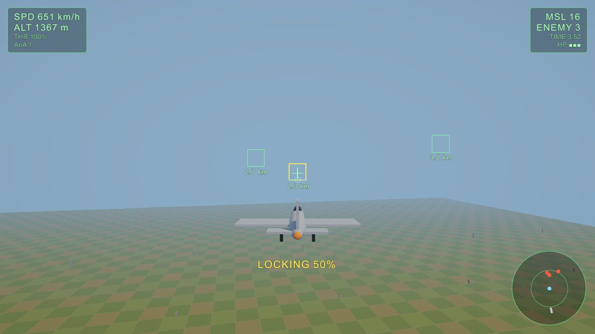
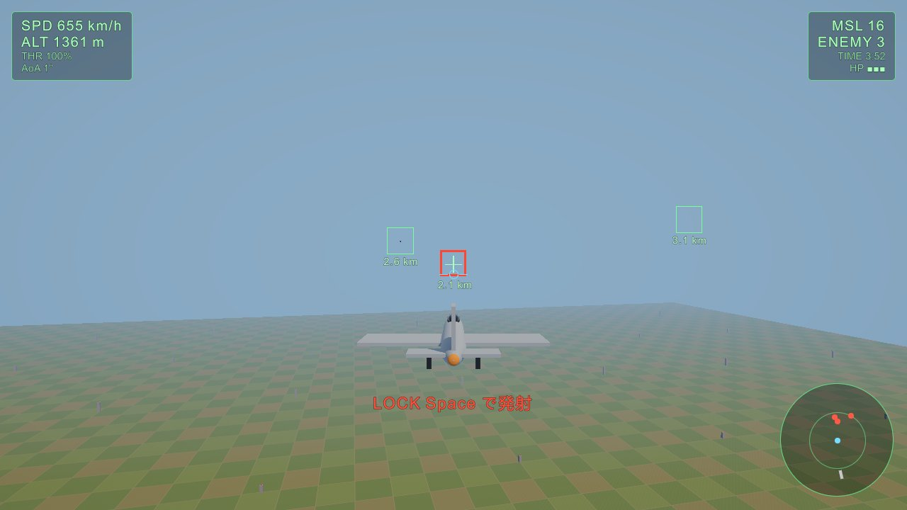
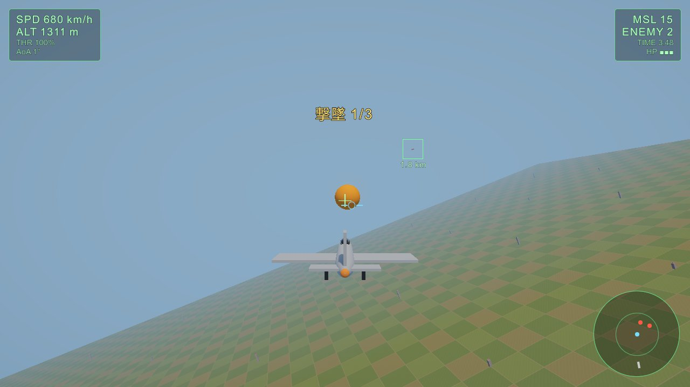
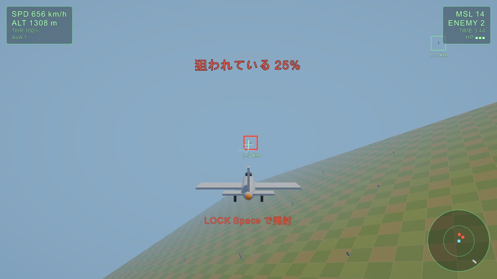
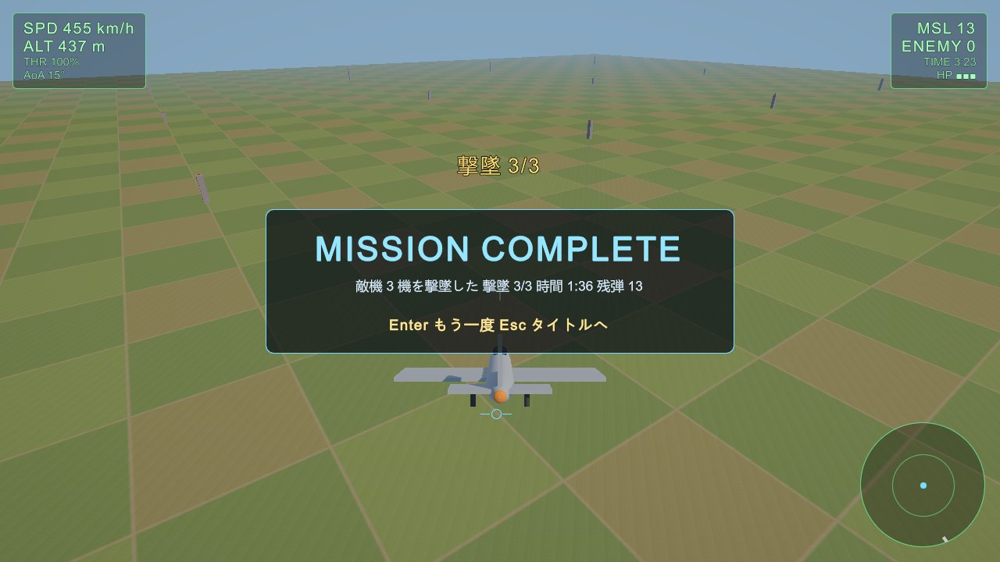
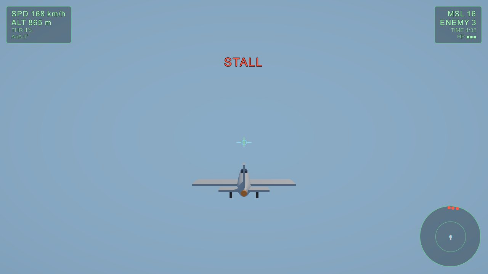
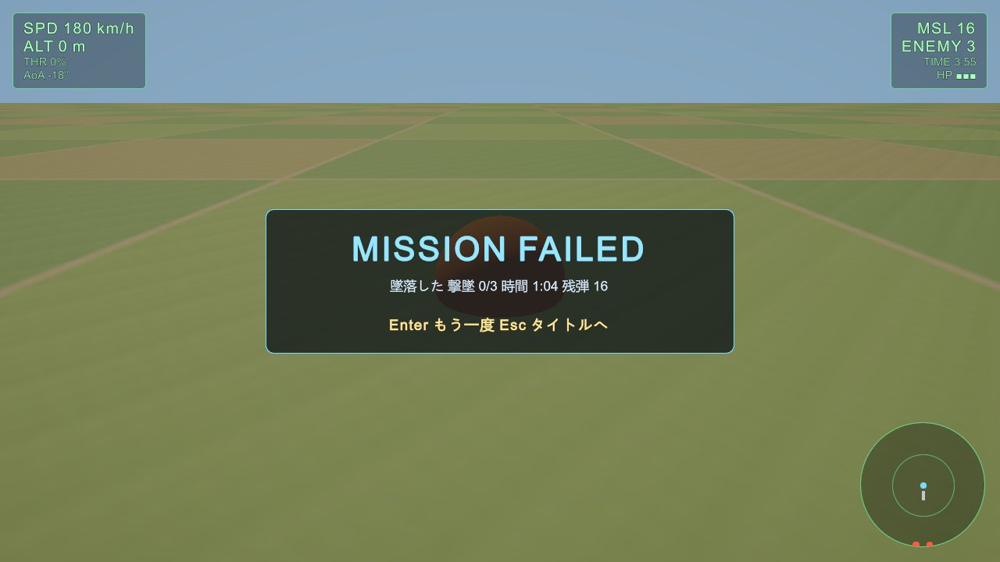

# 038 検証記録

2026-11-25 実施。2 回目の試遊の指摘（1 機落とした後は後ろに張り付かれて一方的にロックされる）を受けて、敵の役割・旋回の補助・2 段階の警告を入れた後の記録。

## 自動検証

| 項目 | 結果 |
|---|---|
| dev lint | 成功 |
| dev check | 成功（警告 0・エラー 0） |
| dev test | 成功。Core 72/72、App 18/18 |
| Unity EditMode | 152/152（パッケージ・Core・App・証跡の公開。Mono。飛行モデル 3000 Tick のハッシュ `1290656686` と、操縦役のシード 1 の最終ハッシュ `2464520460` を含む） |
| Unity PlayMode | 28/28（実シーン 12、共通証跡公開 16） |
| Windows ビルド | 成功、StandaloneWindows64 |
| ビルド起動 | dev capture で起動・全場面撮影・正常終了 |
| 証跡 | JPEG 品質 85、11 枚 |
| 撮影再現 | 同じビルド（Build GUID `bef7f2b023fe49328d3111da0f860a6e`）を 2 回撮影し、11 枚すべての SHA-256 が一致した（撮影記録 `20261125T114016Z-f7c4b630` と [`20261125T114026Z-995e3525`](runs/20261125T114026Z-995e3525/manifest.json)、どちらも画像世代 `04e70d74b5be95af`）。1 回目の記録は次の公開で消える |
| .NET との一致 | 上の 2 つのハッシュが .NET と Mono で一致した |
| 性能 | 敵と交戦し、ミサイル 1 発と煙 30 粒が出ている 300 Tick（撮影と同じシード 2）。Core の Step は p50 0.034 ms・p95 0.085 ms・最大 0.867 ms。機体・ミサイル・爆発・煙の描画の更新は p50 0.098 ms・p95 0.173 ms・最大 0.754 ms。描画の更新だけのフレーム 60 枚の割り当ては全て 0 バイト。Core の Step だけのフレームは平均 298 バイト（ミサイルの誘導と近接の BigInteger）。Unity エディタのバッチ実行、Mono、`ProfilerRecorder` の「GC Allocated In Frame」。4096 バイトを割り当てたフレームは 4128 バイトとして検出した。何もしないフレームでもエンジンが時々 52〜56 バイトを数えるので、0 でないフレームが 1 割以下で 64 バイト以下なら割り当てなしとみなす。HUD の文字の更新とカメラの計算はこの計測に含めていない |

公開ポインタは [current.json](current.json)。撮影の台本は Tick で進めるだけで場面を作る（実時間とキーを使わない）。1 本目は操縦役（シード 2）で離陸から 3 機撃墜まで、2 本目（シード 3）は決まった操縦で上昇・失速・墜落する。

## ルールの検証

- **機首と速度方向のずれ**：水平飛行から 1 Tick 引くと迎角が正になり、機首は速度の向きより上を向く。20 Tick 引いた後に離すと、揚力が速度を機首の向きへ寄せて迎角が半分未満になる。ヨーで機首を右へ振ると横滑り角が負になり、風見と横力で 1/4 未満に戻る。迎角・横滑り角は機首を 800 単位上げた姿勢・400 単位右へ振った姿勢でちょうどその値になる。HUD では十字（機首）と翼つきの円（速度の向き）を別々に投影し、離陸直後は十字が円より上に描かれることを PlayMode で確かめた。
- **失速に操作上の意味**：迎角が失速角を 1 単位超えると揚力が 40% に落ち、失速角ちょうどでは落ちない。速さが失速速度を 1 単位下回ると失速。舵の効きは半分の速さで 1/4。失速中は引き続けても機首が下がって高度を失う。推力なしで上り続けると速度が落ちて失速する。引き続けた旋回は直進より 20 m/s 以上遅くなる。失速中はロックオンが切れる。
- **離陸**：60 m/s 未満は機首上げを押しても機首が上がらず浮かない。それより速く機首を上げると約 61 m/s・約 250 m で浮く。機首を上げずに走ると滑走路の端から出て墜落、横へ曲がり続けると滑走路の横から出て墜落。止まっていれば曲がらない。PlayMode で Shift と S のキーだけで離陸した。
- **ロック解除で発射拒否**：LOCK の 1 Tick 前の発射は「未ロック」で拒否し、LOCK した次の Tick で発射できる。目標が円錐の外へ 1 Tick 出ると LOCK が外れ、次の発射は拒否する。距離の外・失速中・弾切れ・再装填中・地上・墜落後・終了後もそれぞれの理由で拒否し、発射を要求しなかった場合と同じ状態（ハッシュ）になる。PlayMode で、地上と、空中で LOCK していないときの Space が拒否され、残弾が減らないことを確かめた。
- **目標撃墜時に追尾終了**：同じ目標に 2 発撃ち、先の 1 発が当たると、残りの 1 発は追尾をやめて向きを変えずに直進し、寿命で消える。他の敵へ乗り換えない。同じ Tick に 2 発が当たる位置でも、撃墜は 1 回で、2 発目は当たらずに追尾をやめる。
- **誘導の分離**：比例航法は衝突コース（視線が回らない）では曲げず、目標が右へ動けば右へ曲げ、係数に比例する。倍精度の式と 500 例で照合した。運動は要求の前向きの成分を捨て、横向きを上限で切る。6 G の敵のミサイルは直進する機体に当たり、500 m に迫られてから 90° 傾けて引けば外れる。
- **近接の判定**：ちょうど 12 m は当たらず、1 µm 内側は当たる。1 Tick で 400 m 進むミサイルが 7 m 横を飛び抜けても当たる。倍精度の最小距離と 3000 例で照合した。
- **後ろを取られた場面**：敵を 600 m 後ろに置き、キーだけで 0.2 秒遅れて押す操縦役（旋回の補助を通す）で 20 シード × 60 秒。敵の発射は合計 2 発、狙われている時間 5%、LOCK 11/20、撃墜 10/20（調整前は真っすぐ逃げると 30 秒で 2.2 発、急旋回でも後ろの敵を前に出せず 0/20）。同じ操縦役で通しのミッションは 40 シード全勝。
- **敵の役割**：ロックするのは攻撃役 1 機だけ。攻撃役は 10 秒追うか撃ったら離脱し、次の Tick に別の敵が攻撃役になる。舵の効き 25% の敵は 100% の敵より 60 Tick で回る角度が小さい。
- **旋回の補助**：右のキーを 5 秒押すと 60° 以上曲がり、傾きは 55〜110°、高度の変化は 80 m 未満、失速しない。離すと 2 秒で翼が水平に戻る。上下のキーだけなら傾きを変えない。失速角の 3/4 を超えたら引かない。
- **敵のロック**：敵の円錐はプレイヤーと別（8°）。敵の機首から 10° のプレイヤーはロックされず、6° ならロックされる。
- **ミッション**：3 機撃墜で成功。プレイヤーが落ちた Tick に最後の敵を落としても失敗。墜落・区域外 10 秒（中へ戻ると数え直す）・制限時間で失敗。終わった後の操作と Step は状態を変えない。操縦役は 20 シード全てで離陸から 3 機を撃墜する（試しに回した 60 シードも全勝、最長 197 秒）。
- **再現**：同じシードは同じ配置、違うシードは違う配置。30・47.3・60・144・240 fps で同じキーの時刻の列を渡すと同じハッシュになる。フォーカスを失うと一時停止し、押していたキーとまだ渡していない発射を捨てる。

## 画面

| タイトル | 滑走 | 離陸 |
|---|---|---|
|  |  |  |

| ロック中 | LOCK | 発射 |
|---|---|---|
|  |  |  |

| 撃墜 | 狙われている警告 | 成功 |
|---|---|---|
|  |  |  |

| 失速 | 失敗（墜落） |
|---|---|
|  |  |
