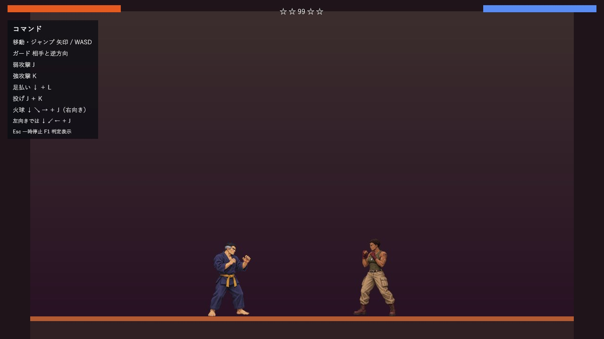
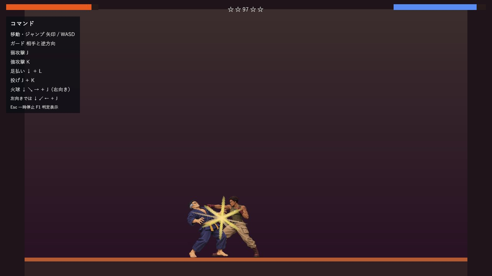
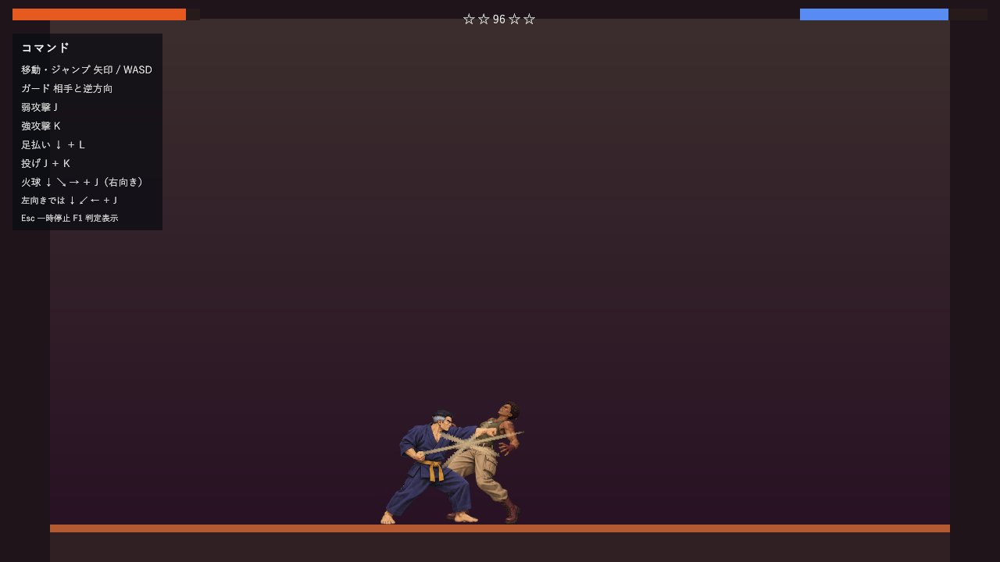
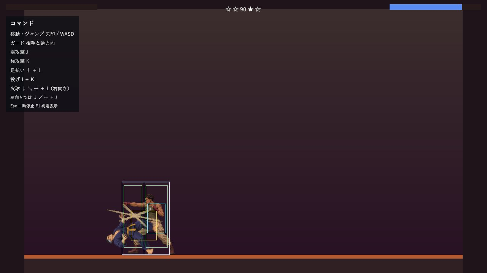
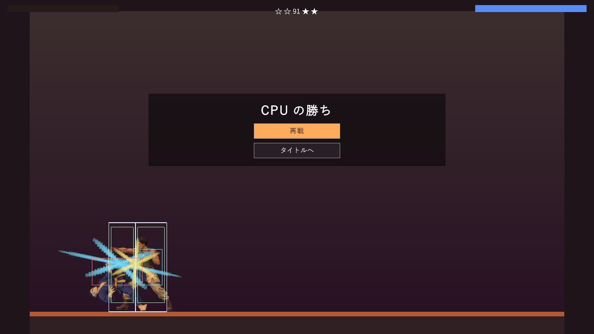

# 039 検証記録

2026-11-26、レビュー対応後の動作承認を受領。作品を完了として記録した。

2026-11-25〜26 実施。キャラクター素材・選択画面・コマンド表・技の演出とダウン姿勢の表示サイズを更新した Windows ビルドで再撮影した。

2026-11-26 レビュー対応：必殺は弱ボタンだけで成立し、方向コマンド後も J＋K は投げを優先。空中のヒット硬直が切れたら空中状態へ戻して落下を続ける。方向と攻撃ボタンの保持状態をハッシュに追加した。効果音は Core の攻撃開始・ヒット・ガード・KO の累計から取り出し、通常ガード・CPU の空振り・描画間の複数 Tick に対応した。回帰テストは、必殺・落下・ハッシュの修正を一時的に外すと 9 件が失敗することも確認した。音の通知は自動検証済み、実際の聞こえ方は試遊で確認する。

初回レビュー修正後の Windows ビルド（Build GUID `3ac17069b6014286b4e715d88d9b4a62`）でも全場面を撮影して正常終了し、既存 10 枚と SHA-256 が一致した。[最新の撮影記録](current.json)。ビルドログにはライセンスクライアントの署名検証警告が残ったが、ビルド結果は Success、終了コードは 0。

## 自動検証

| 項目 | 結果 |
|---|---|
| dev lint | 成功 |
| dev check | 成功（警告 0） |
| dev test | 成功。Core 43/43、App 15/15 |
| Unity EditMode | 120/120（パッケージ・Core・App・証跡の公開。Mono） |
| Unity PlayMode | 22/22（実シーン 6、共通証跡公開 16） |
| Windows ビルド | 成功、StandaloneWindows64 |
| ビルド起動 | dev capture で起動・全場面撮影・正常終了 |
| 証跡 | JPEG 品質 85、10 枚 |
| 撮影再現 | PR レビュー対応後の同一ビルド `e95166e97ee341698314ac64a31cf2ce` の2回で10枚の SHA-256 が一致。画像世代 `e48dd7a09194d8f2`。撮影 ID `20261125T153312Z-68f9beca` と `20261125T153339Z-72f26307`（[最新の記録](current.json)） |
| 性能 | 試合中の 120 Tick。Core の Step は p95 0.005 ms。描画の更新は p95 0.006 ms。描画のフレームの割り当ては、落ちついた基準（330 バイト。スクリプトと描画を止めても同じ）からの増分が 30 フレームすべて 0。4096 バイトを割り当てたフレームは 4458 バイトとして検出した。Unity エディタのバッチ実行、Mono、`ProfilerRecorder` の「GC Allocated In Frame」 |

公開ポインタは [current.json](current.json)。撮影の台本は Tick で進める（シード 1）。タイトル、シンダー選択、ラウンド開始、火球、ヒット、ガード、投げ、判定箱、KO、結果。

反応 8 Tick の CPU に対して、反応 16 Tick で同じ判断を 6 Tick 保持する操縦役は 20 戦中 8 勝。入力なしの側は 2 本先取で負ける。

## 画面

| タイトル | キャラ選択 | ラウンド開始 |
|---|---|---|
|  |  |  |

| 火球 | ヒット | ガード |
|---|---|---|
|  |  |  |

| 投げ | 判定箱 | KO |
|---|---|---|
|  |  |  |

| 結果 |
|---|
|  |

## PR レビュー対応後の検証

延長で本数差が付いた場合の勝者確定、投げの先行入力、CPU の投げ間合いを修正。Core 43/43・App 15/15・Unity EditMode 120/120・PlayMode 22/22、lint・check と Windows ビルドが成功。CPU の投げ修正後、人に近い操縦役は20戦中8勝。

修正後 Build GUID `e95166e97ee341698314ac64a31cf2ce`。画像世代 `e48dd7a09194d8f2`。撮影 ID `20261125T153312Z-68f9beca` と `20261125T153339Z-72f26307` の10枚が一致（[最新の記録](current.json)）。
