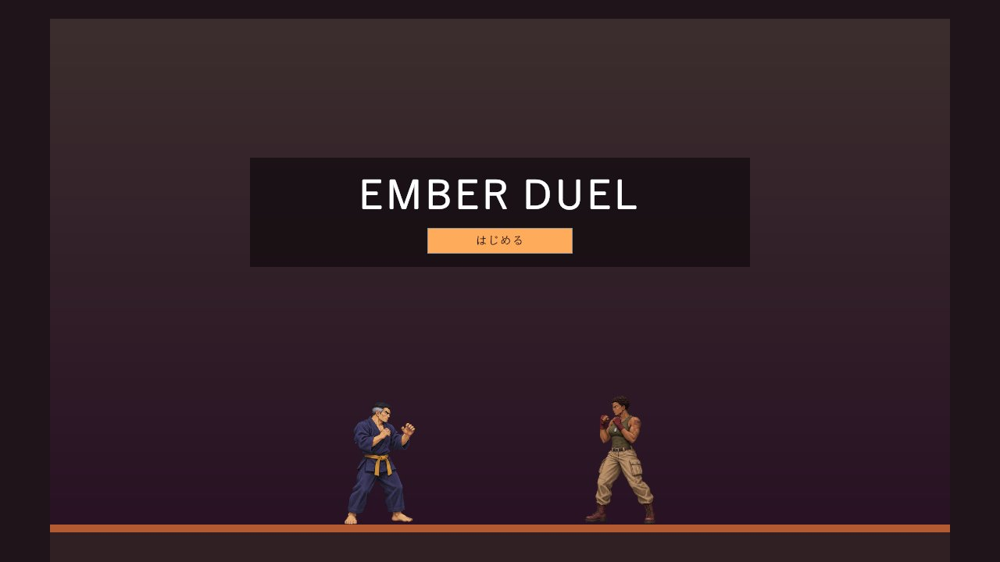
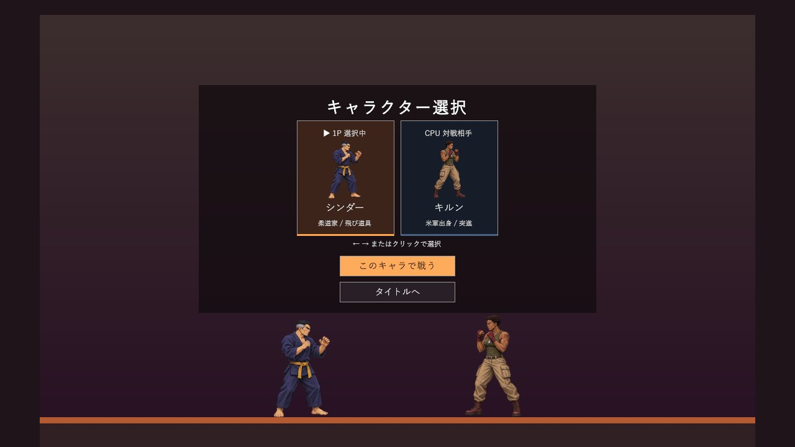
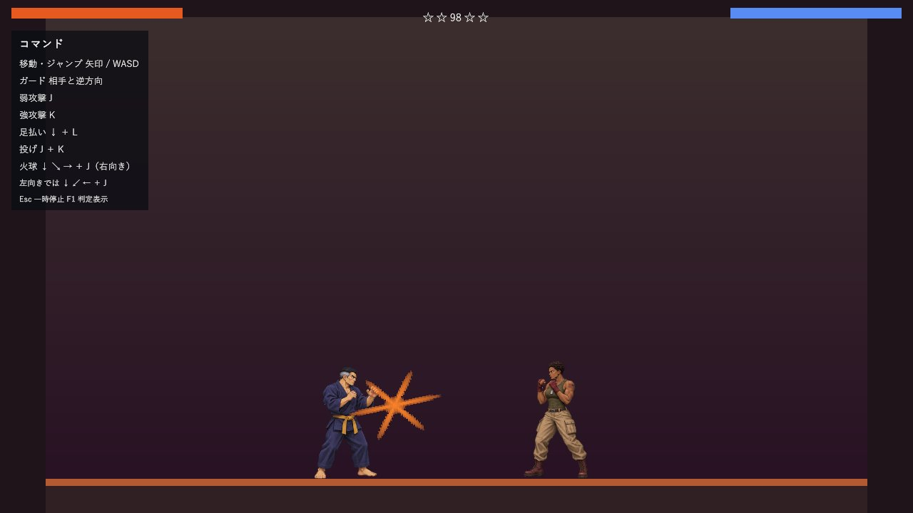
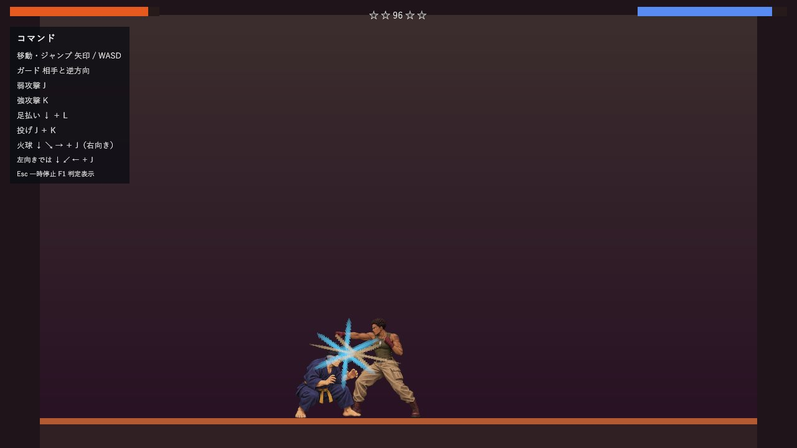
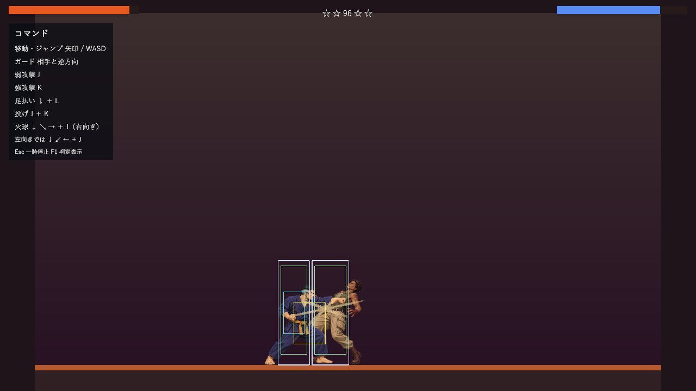
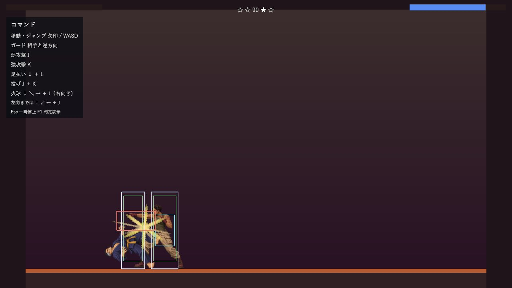
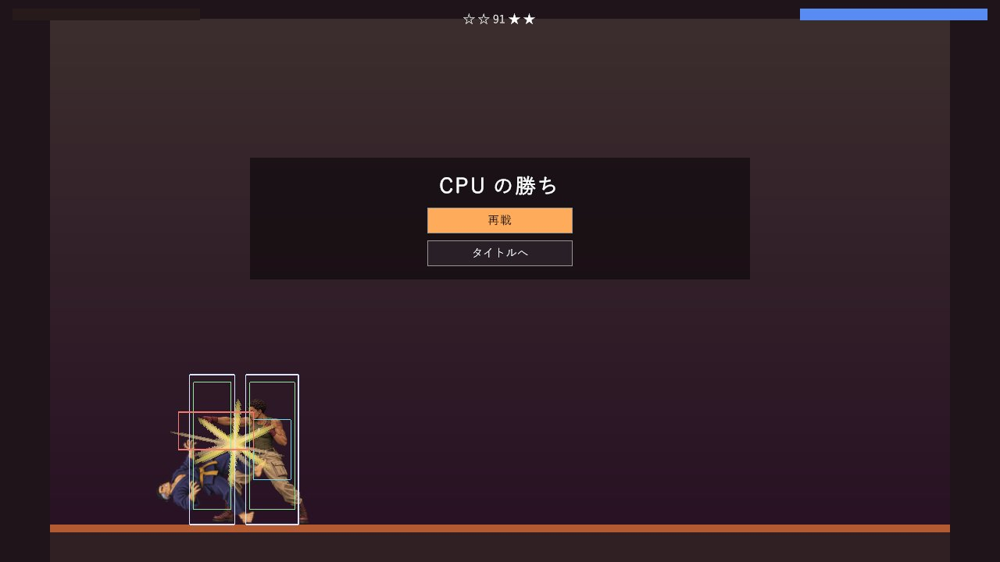

# 039 検証記録

2026-11-25〜26 実施。キャラクター素材・選択画面・コマンド表・技の演出とダウン姿勢の表示サイズを更新した Windows ビルドで再撮影した。

## 自動検証

| 項目 | 結果 |
|---|---|
| dev lint | 成功 |
| dev check | 成功（警告 0） |
| dev test | 成功。Core 18/18、App 8/8 |
| Unity EditMode | 88/88（パッケージ・Core・App・証跡の公開。Mono） |
| Unity PlayMode | 22/22（実シーン 6、共通証跡公開 16） |
| Windows ビルド | 成功、StandaloneWindows64 |
| ビルド起動 | dev capture で起動・全場面撮影・正常終了 |
| 証跡 | JPEG 品質 85、10 枚 |
| 撮影再現 | 同一ビルド（Build GUID `daabfc4e41d348f8a209c526a864ec6d`）で撮影した 10 枚の SHA-256 が一致。画像世代 `77cdb5e4d9000786`、[撮影マニフェスト](runs/20261125T150604Z-030e8d8f/manifest.json) |
| 性能 | 試合中の 120 Tick。Core の Step は p95 0.005 ms。描画の更新は p95 0.006 ms。描画のフレームの割り当ては、落ちついた基準（330 バイト。スクリプトと描画を止めても同じ）からの増分が 30 フレームすべて 0。4096 バイトを割り当てたフレームは 4458 バイトとして検出した。Unity エディタのバッチ実行、Mono、`ProfilerRecorder` の「GC Allocated In Frame」 |

公開ポインタは [current.json](current.json)。撮影の台本は Tick で進める（シード 1）。タイトル、シンダー選択、ラウンド開始、火球、ヒット、ガード、投げ、判定箱、KO、結果。

反応 8 Tick の CPU に対して、反応 16 Tick で同じ判断を 6 Tick 保持する操縦役は 20 戦中 3 勝。入力なしの側は 2 本先取で負ける。

## 画面

| タイトル | キャラ選択 | ラウンド開始 |
|---|---|---|
|  |  |  |

| 火球 | ヒット | ガード |
|---|---|---|
|  |  |  |

| 投げ | 判定箱 | KO |
|---|---|---|
|  |  |  |

| 結果 |
|---|
|  |
