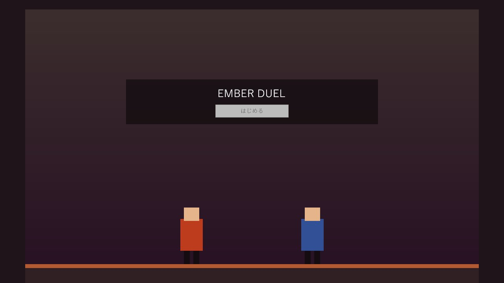
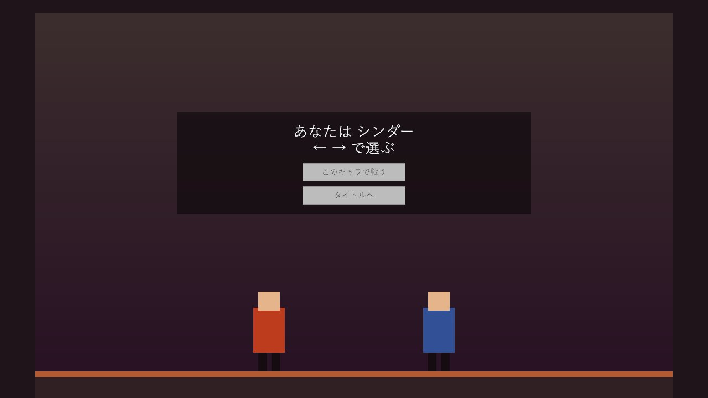
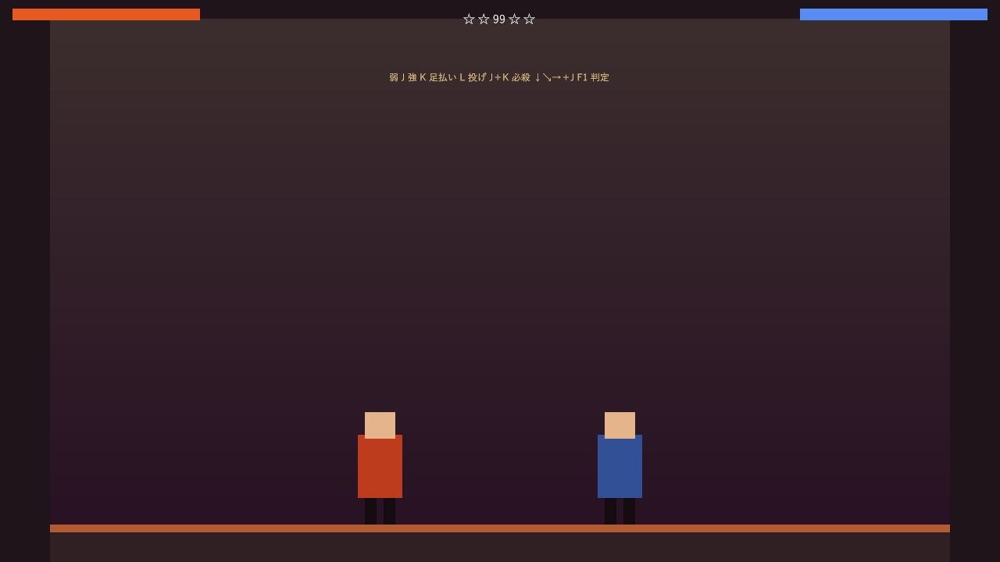
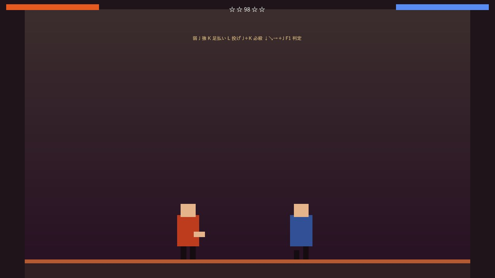
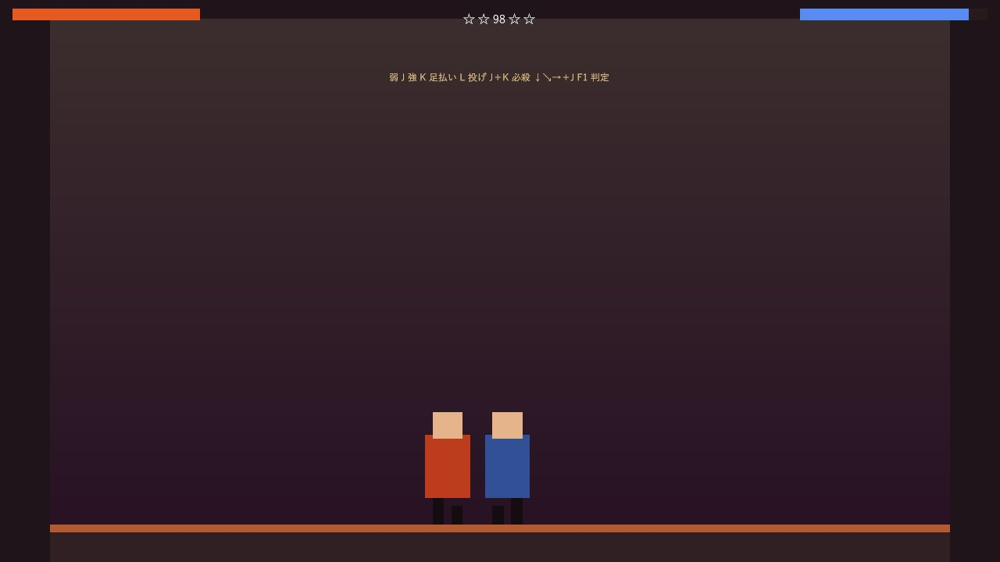
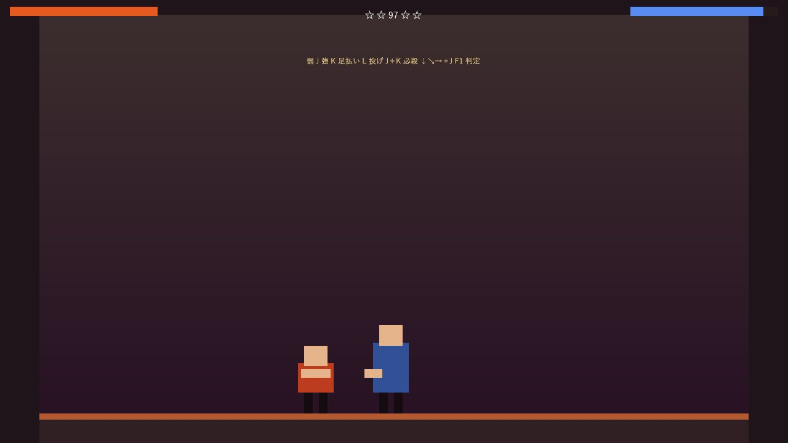
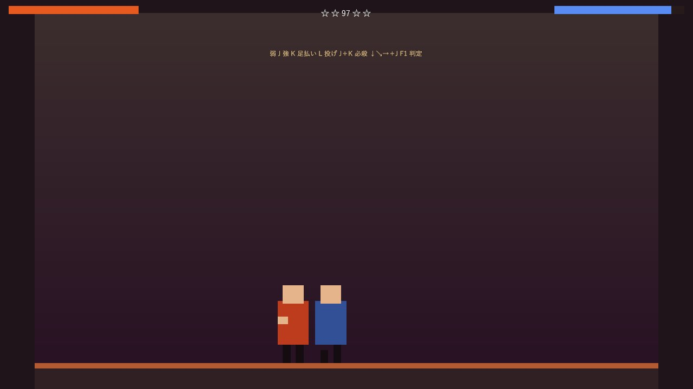
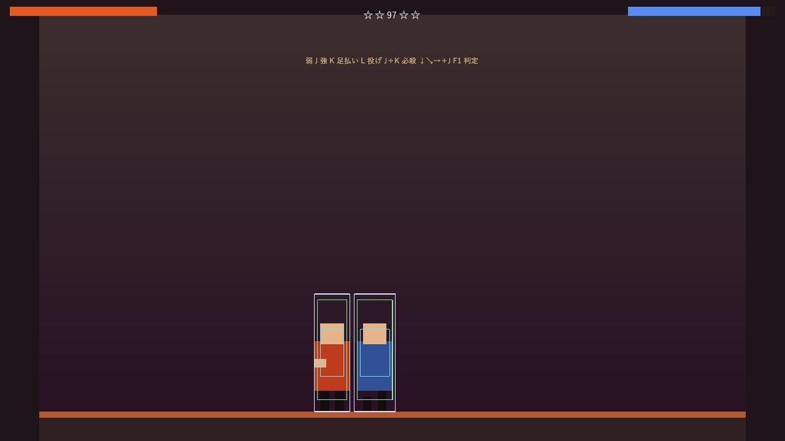
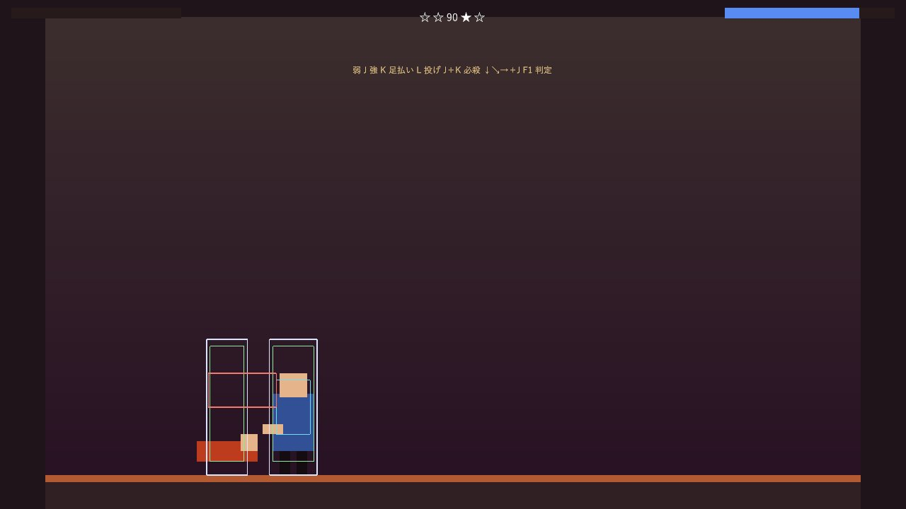
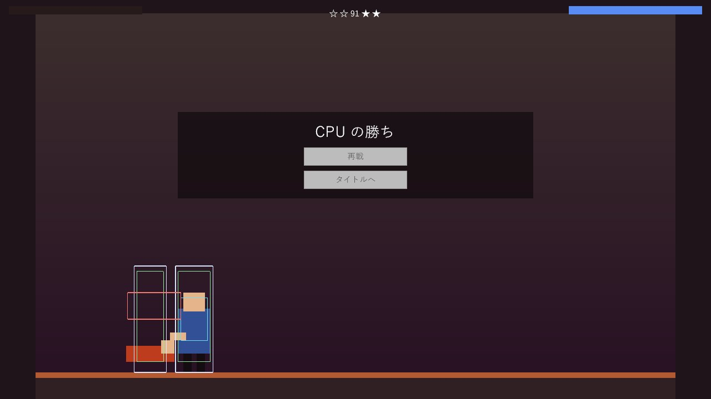

# 039 検証記録

2026-11-25 実施。キャラの絵が自動分割で 14×14 になっていたので、1 枚のスプライト（40×76）に直してから撮り直した。

## 自動検証

| 項目 | 結果 |
|---|---|
| dev lint | 成功 |
| dev check | 成功（警告 0） |
| dev test | 成功。Core 18/18、App 8/8 |
| Unity EditMode | 88/88（パッケージ・Core・App・証跡の公開。Mono） |
| Unity PlayMode | 20/20（実シーン 4、共通証跡公開 16） |
| Windows ビルド | 成功、StandaloneWindows64 |
| ビルド起動 | dev capture で起動・全場面撮影・正常終了 |
| 証跡 | JPEG 品質 85、10 枚 |
| 撮影再現 | 同じビルド（Build GUID `d8cbf8cc9148415d9022b4adfd1edd99`）を 2 回撮影し、10 枚すべての SHA-256 が一致した（撮影記録 `20261125T140700Z-59560edc` と [`20261125T140720Z-ff92fcbb`](runs/20261125T140720Z-ff92fcbb/manifest.json)、どちらも画像世代 `c48ed460e9a3720b`）。1 回目の記録は次の公開で消える |
| 性能 | 試合中の 120 Tick。Core の Step は p95 0.004 ms。描画の更新は p95 0.003 ms。描画のフレームの割り当ては、落ちついた基準（330 バイト。スクリプトと描画を止めても同じ）からの増分が 30 フレームすべて 0。4096 バイトを割り当てたフレームは 4458 バイトとして検出した。Unity エディタのバッチ実行、Mono、`ProfilerRecorder` の「GC Allocated In Frame」 |

公開ポインタは [current.json](current.json)。撮影の台本は Tick で進める（シード 1）。タイトル、シンダー選択、ラウンド開始、火球、ヒット、ガード、投げ、判定箱、KO、結果。

反応 8 Tick の CPU に対して、反応 16 Tick で同じ判断を 6 Tick 保持する操縦役は 20 戦中 3 勝。入力なしの側は 2 本先取で負ける。

## 画面

| タイトル | キャラ選択 | ラウンド開始 |
|---|---|---|
|  |  |  |

| 火球 | ヒット | ガード |
|---|---|---|
|  |  |  |

| 投げ | 判定箱 | KO |
|---|---|---|
|  |  |  |

| 結果 |
|---|
|  |
