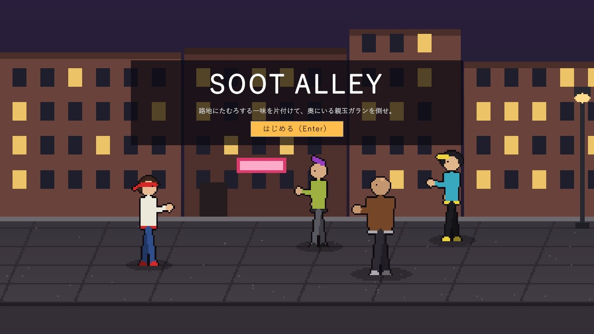
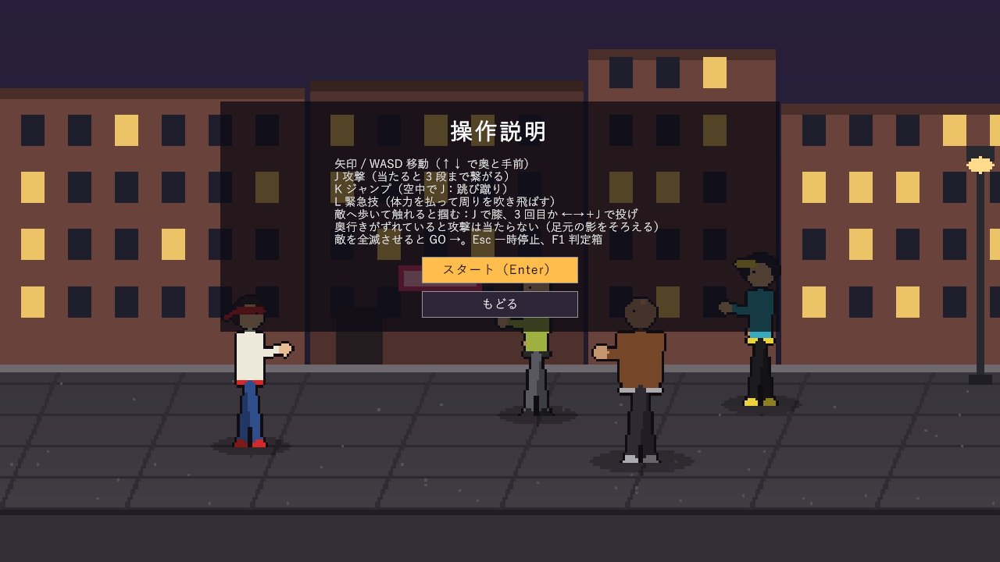
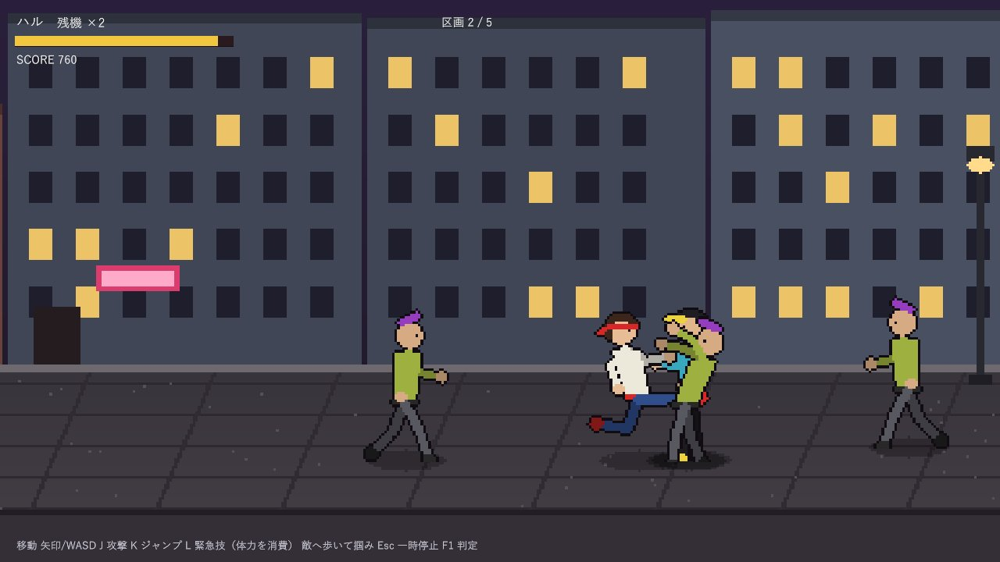
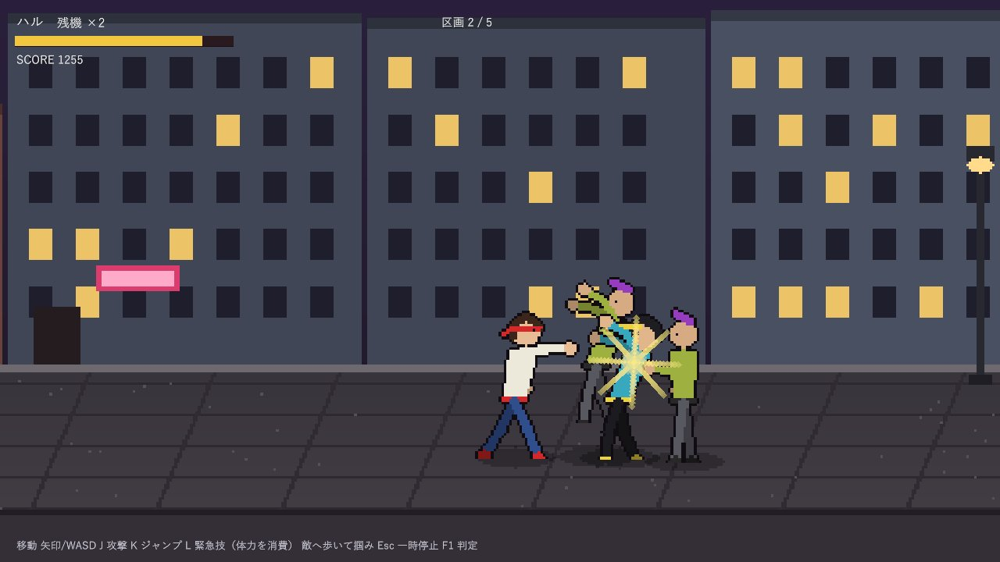
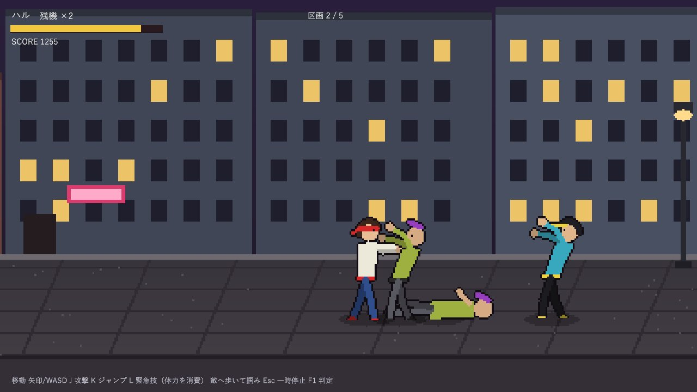
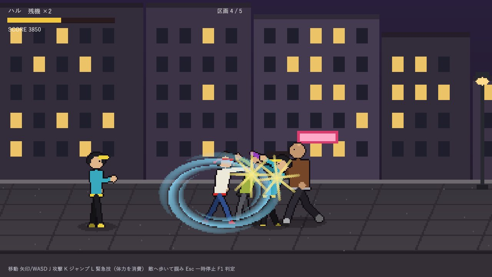
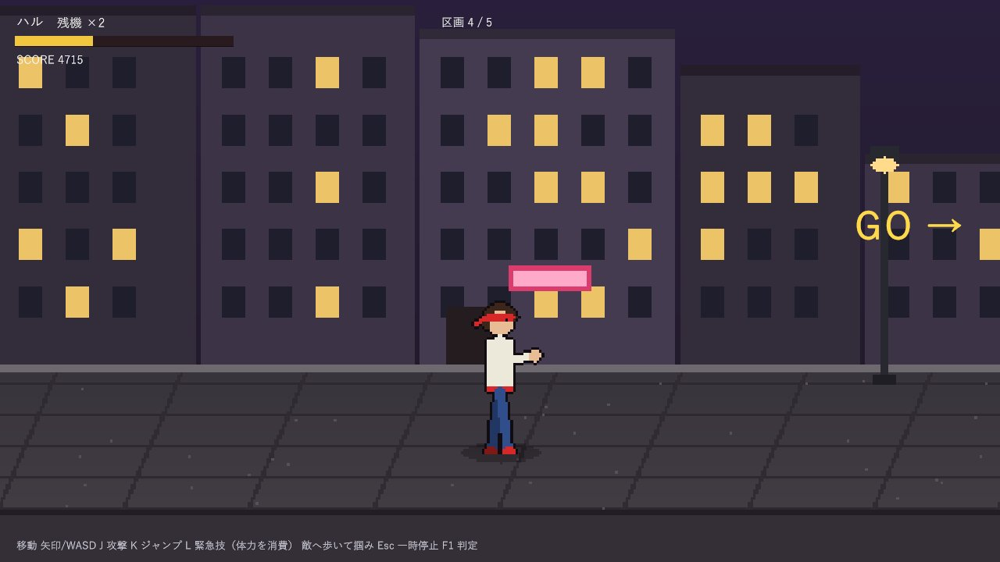
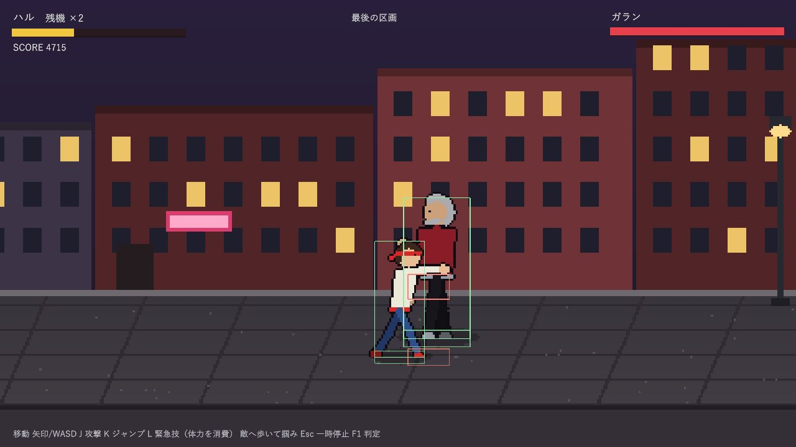
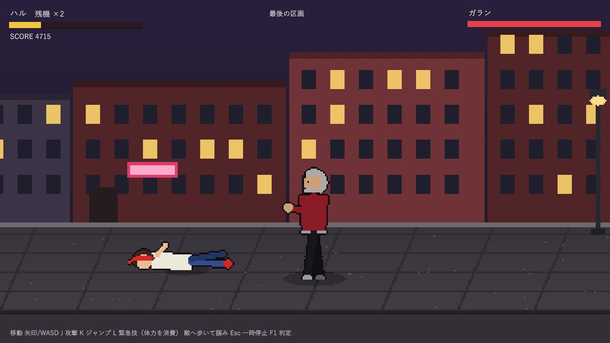
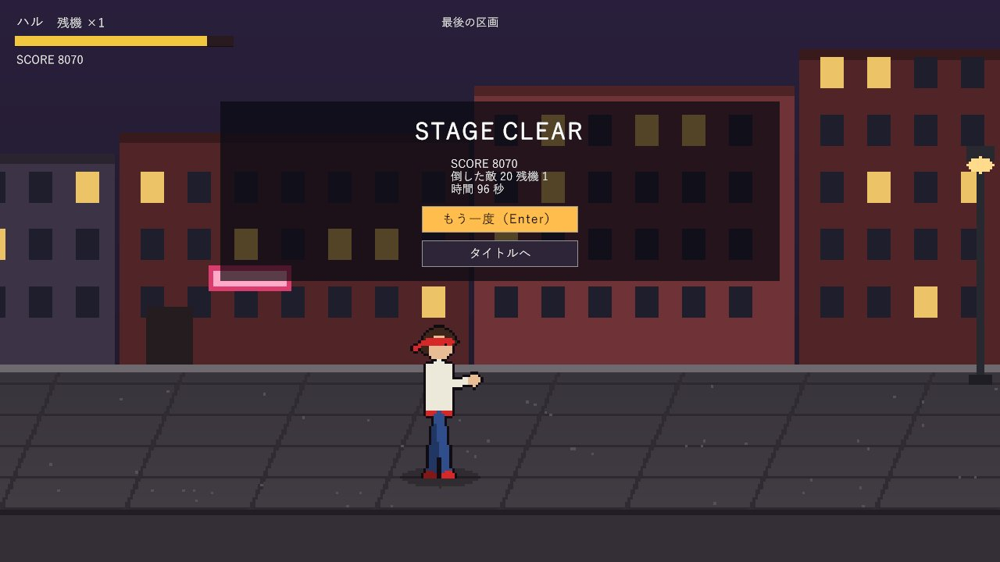

# 040 検証記録

2026-11-26 実施。状態は「検証待ち」（人間の試遊を待つ）。

## 自動検証

| 項目 | 結果 |
|---|---|
| dev lint | 成功 |
| dev check | 成功（警告 0） |
| dev test | 成功。Core 79/79、App 13/13 |
| Unity EditMode | 154/154（パッケージ・Core・App。Mono） |
| Unity PlayMode | 24/24（実シーン 8、共通の証跡公開 16） |
| Windows ビルド | 成功、StandaloneWindows64（ビルドログにライセンスクライアントの署名検証の警告が残るが、結果は Success・終了コード 0） |
| ビルド起動 | dev capture で起動・全場面撮影・正常終了 |
| 証跡 | JPEG 品質 85、11 枚 |
| 撮影再現 | 同一ビルド `19c9f3c5c232408bbdf9e9dea1097b3d` の 2 回で 11 枚の SHA-256 が一致。画像世代 `27e00fa1fbaab000`。撮影 ID `20261125T164853Z-59116086` と `20261125T164906Z-12945dcd`（[最新の記録](current.json)）。1 回目の記録は次の公開で消える |
| 固定ハッシュ | 台本の乱闘 835690622、操縦役の通し（シード 1、5621 Tick）2026387232 が .NET と Mono で一致 |
| 性能 | 敵の置き場 8 体を全て使った乱戦の 240 Tick。Core の Step は p95 0.065 ms、描画の更新（判定箱なし）は p95 0.026 ms。判定箱ありの描画のフレームの割り当ては、落ちついた基準（330 バイト）からの増分が 30 フレームすべて 0。4096 バイトを割り当てたフレームは 4458 バイトとして検出した。Unity エディタのバッチ実行、Mono、`ProfilerRecorder` の「GC Allocated In Frame」 |

撮影の台本は Tick で進める（シード 1）。操縦役で面を進め、緊急技と奥行きのずれの場面だけキー入力と配置で作る。最後は入力なしで再戦して敗北の画面を撮る。

## 画面

| タイトル | 操作説明 | 乱戦 |
|---|---|---|
|  |  |  |

| コンボの 3 段目 | 掴み | 緊急技 |
|---|---|---|
|  |  |  |

| GO → | 奥行きがずれて当たらない（判定箱） | ボス戦 |
|---|---|---|
|  |  |  |

| 面クリア | 敗北 |
|---|---|
|  |  |

判定箱（F1）は、箱の正面を奥行きの中心の高さに、奥行きの帯を地面に描く。08 では攻撃箱（赤）と喰らい箱（緑）の正面は重なって見えるが、地面の帯が離れているので当たらない。
