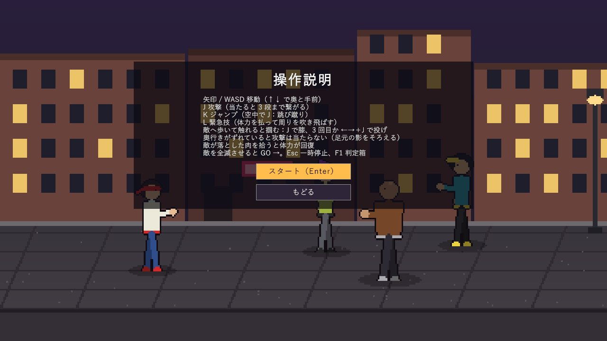
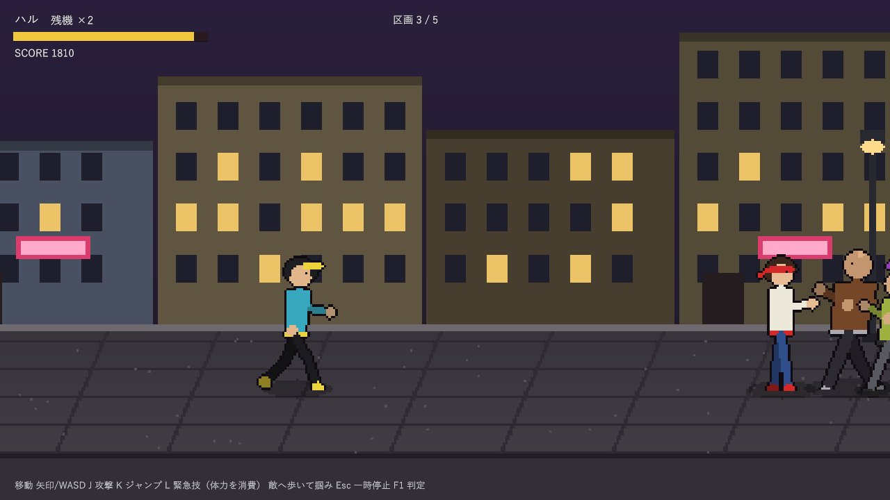
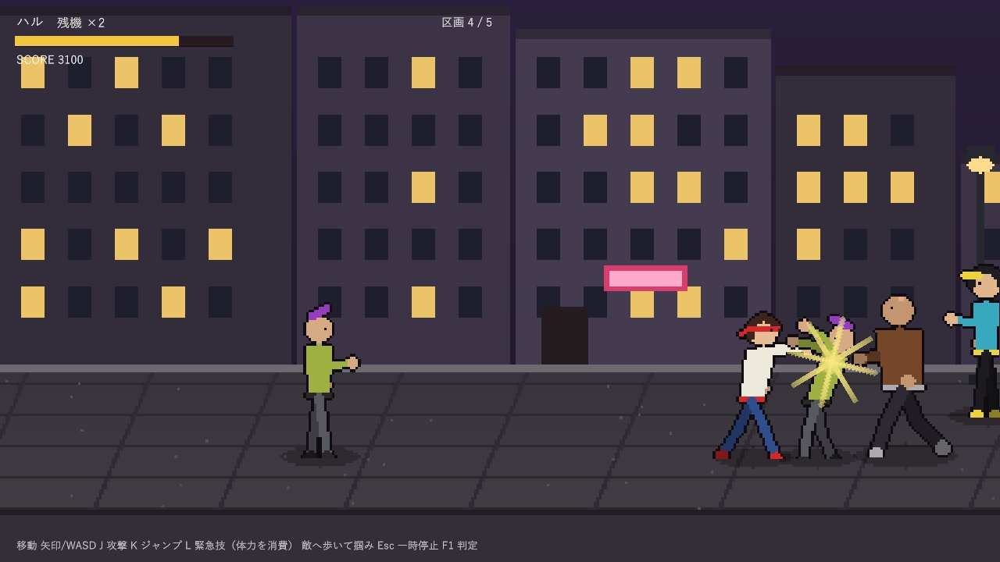
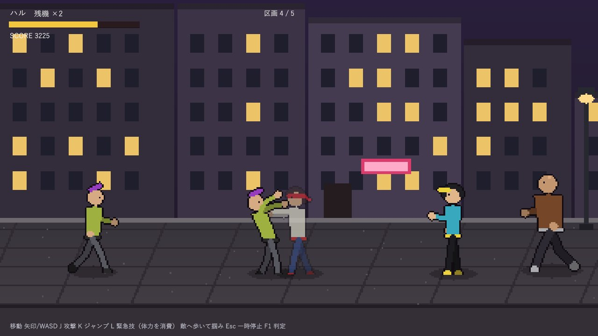
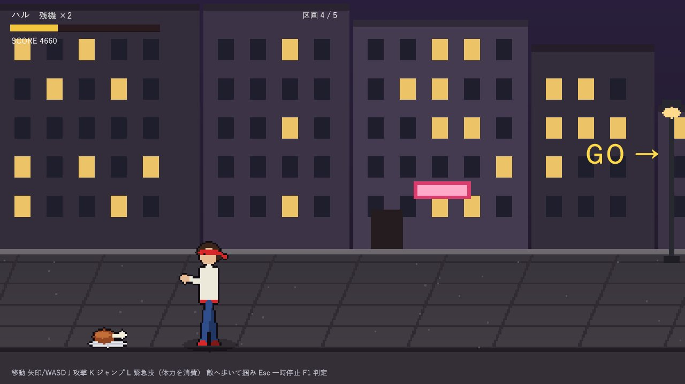
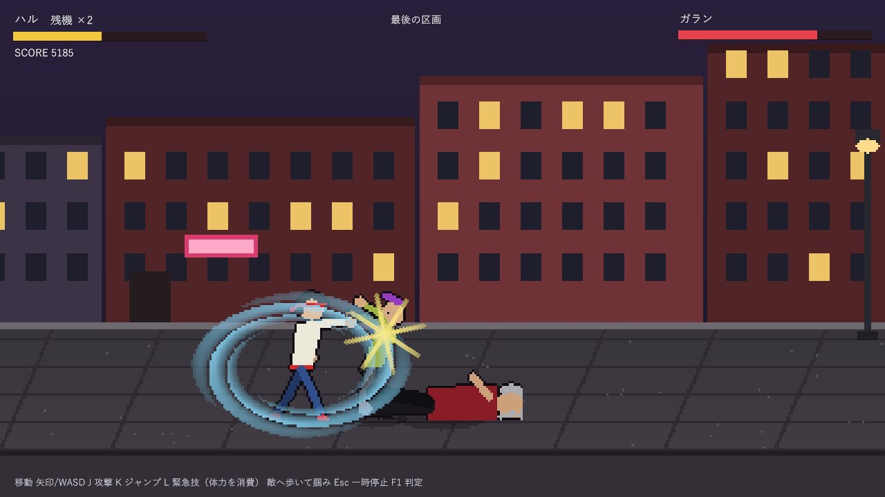
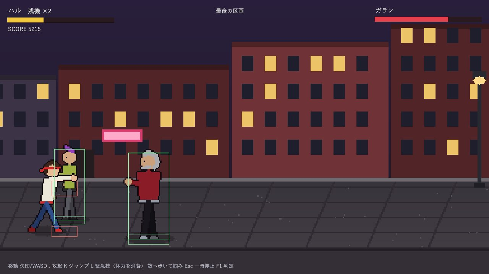
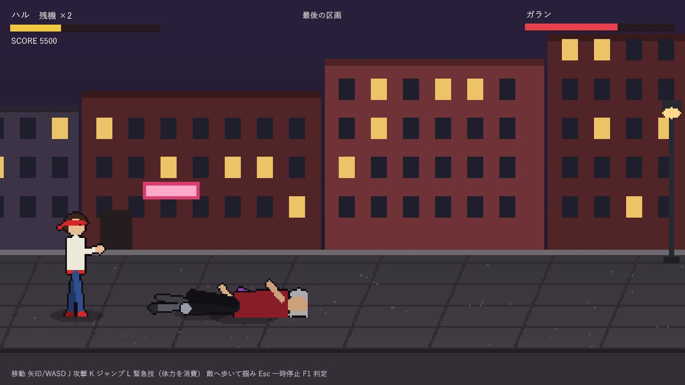
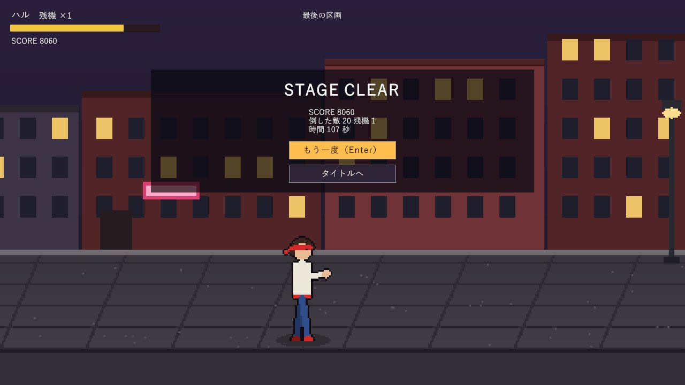
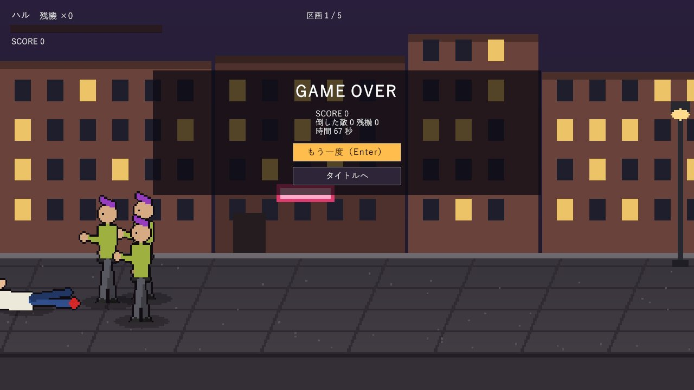

# 040 検証記録

2026-11-26 実施。2026-11-26 に動作承認を受領し、作品を完了として記録した。

2026-11-26 レビュー対応：ヒットストップ中に押した緊急技を止まり明けまで持ち越す、同じ Tick の中の押下と解放を取りこぼさない、状態のハッシュに設定・技表・面の指紋と AiEnabled を混ぜる、毎 Tick 参照する読み取り専用の窓口を 1 回だけ作る。修正後の Windows ビルド（Build GUID `5a86de77ac554700835ee99ee380e6e0`）でも全場面を撮影して正常終了し、画像世代は `1347d24f9af404fd` のまま（12 枚の SHA-256 が修正前と一致）。撮影 ID `20261125T172106Z-9ceceeea`。

2026-11-26 PR レビュー対応：怯まない打撃（大男・ボスへのジャブ）を受けた敵が攻撃を続けたまま攻撃権を返し、同時に攻める敵が `MaxAttackers` を超える問題を、攻撃権は怯み・ダウンに移るときだけ返すよう修正。回帰テストを書く途中で、動かないプレイヤーには押し合いで止まる距離（大男 24 px・チンピラ 20 px）が攻撃を始める距離（22 px・18 px）より遠く、敵が永久に攻撃しない問題も見つけ、攻撃を始める距離を押し合いの距離 ＋ 2 px 以上にした。敵が実際に攻めるようになり、撮影の台本は場面の順序と条件を直した（12 枚、画像世代 `30adf74770d1c254`）。

2026-11-26 試遊の指摘に対応：回復アイテム（倒した敵が落とす肉）を追加し、区画を片付けた後の画面が一気にプレイヤーの位置へ飛ばず 1 Tick に `ScrollSpeed`（3 px）ずつ進むようにした。

## 自動検証

| 項目 | 結果 |
|---|---|
| dev lint | 成功 |
| dev check | 成功（警告 0） |
| dev test | 成功。Core 96/96、App 17/17 |
| Unity EditMode | 175/175（パッケージ・Core・App。Mono） |
| Unity PlayMode | 24/24（実シーン 8、共通の証跡公開 16） |
| Windows ビルド | 成功、StandaloneWindows64（ビルドログにライセンスクライアントの署名検証の警告が残るが、結果は Success・終了コード 0） |
| ビルド起動 | dev capture で起動・全場面撮影・正常終了 |
| 証跡 | JPEG 品質 85、12 枚 |
| 撮影再現 | PR レビュー対応後の同一ビルド `a96387260e574729a1e71edb74577e92` の 2 回で 12 枚の SHA-256 が一致。画像世代 `30adf74770d1c254`。撮影 ID `20261125T173634Z-6e87ef2e` と `20261125T173650Z-b50311a9`（[最新の記録](current.json)） |
| 固定ハッシュ | 台本の乱闘 1754081946、操縦役の通し（シード 1、6160 Tick）4278129782 が .NET と Mono で一致 |
| 性能 | 敵の置き場 8 体を全て使った乱戦の 240 Tick。Core の Step は p95 0.111 ms、描画の更新（判定箱なし）は p95 0.030 ms。判定箱ありの描画のフレームの割り当ては、落ちついた基準（330 バイト）からの増分が 30 フレームすべて 0。4096 バイトを割り当てたフレームは 4458 バイトとして検出した。Unity エディタのバッチ実行、Mono、`ProfilerRecorder` の「GC Allocated In Frame」 |

撮影の台本は Tick で進める（シード 1）。操縦役で面を進め、緊急技と奥行きのずれの場面だけキー入力と配置で作る。最後は入力なしで再戦して敗北の画面を撮る。

## 画面

| タイトル | 操作説明 | 乱戦 |
|---|---|---|
|  |  |  |

| コンボの 3 段目 | 掴み | GO → |
|---|---|---|
|  |  |  |

| 回復アイテム | 緊急技 | 奥行きがずれて当たらない（判定箱） |
|---|---|---|
|  |  |  |

| ボス戦 | 面クリア | 敗北 |
|---|---|---|
|  |  |  |

判定箱（F1）は、箱の正面を奥行きの中心の高さに、奥行きの帯を地面に描く。09 では攻撃箱（赤）と喰らい箱（緑）の正面は重なって見えるが、地面の帯が離れているので当たらない。
