# 041 検証記録

2026-11-26 実施。自動検証を一通り通し、状態を「検証待ち」として記録した。レビュー対応（ダメージ式・重みと報酬の合計・セーブ I/O）の後に再撮影した。

## 自動検証

| 項目 | 結果 |
|---|---|
| dev lint | 成功 |
| dev check | 成功（警告 0） |
| dev test | 成功。Core 21/21、App 6/6 |
| Unity EditMode | 89/89（IntGeometry 52、TileMotion 10、Core 21、App 6。Mono） |
| Unity PlayMode | 24/24（実シーン E2E 8、共通の証跡公開 16） |
| Windows ビルド | 成功、StandaloneWindows64 |
| ビルド起動 | dev capture で起動・全 15 場面撮影・正常終了 |
| 証跡 | JPEG 品質 85、15 枚 |
| 撮影再現 | 同一ビルド `b7c30a0ec8af4102b734d3b61b9c168e` の連続 2 回で 15 枚すべての SHA-256 が完全一致。画像世代 `fe9cf2cce37ade99`。撮影 ID `20261125T202042Z-cdd01810` と `20261125T202115Z-206b6e10`（[最新の記録](current.json)） |
| 固定ハッシュ | 操縦役のシード 1 完走（2,448 Tick・218 歩・14 戦、データ指紋 `0xAF9AE773`）の最終状態ハッシュ `0x87AC4C76` が .NET・Mono・実機撮影の 3 環境で一致 |
| 性能 | フィールド定常進行 180 Tick：Core の Step p95 0.000 ms、描画の更新 p95 0.017 ms。描画フレームの GC 割り当て増分は 24 フレーム中 0 フレーム（4096 バイトを割り当てた確認フレームは 5368 バイトとして検出）。Unity エディタのバッチ実行、Mono、`ProfilerRecorder` の「GC Allocated In Frame」 |

撮影の台本（`EmberlockCaptureScenario`）は隔離された一時セーブ領域を使い、シード 1 と Tick 進行だけで全 15 場面を決定的に撮影する。

## 画面

| 01. タイトル | 02. あそびかた | 03. 灯守りの町（フィールド） |
|---|---|---|
| 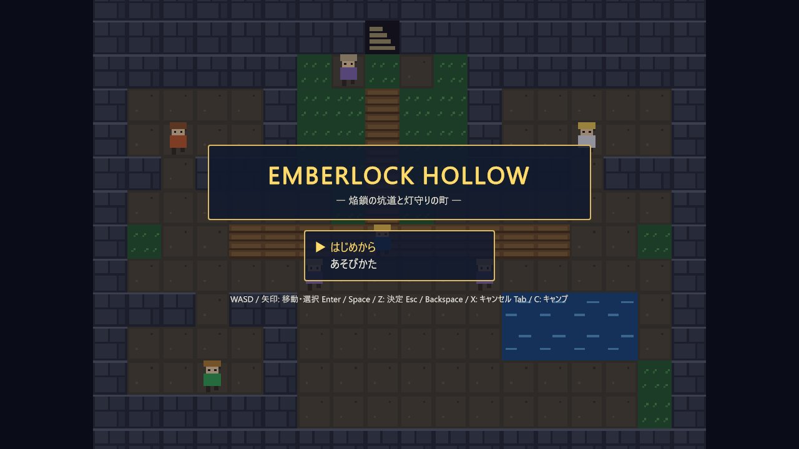 | 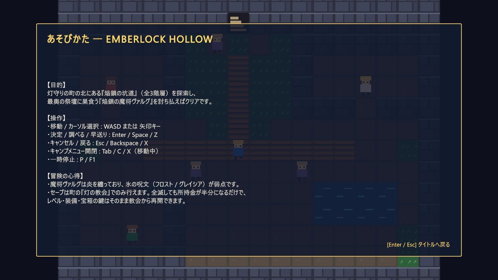 | 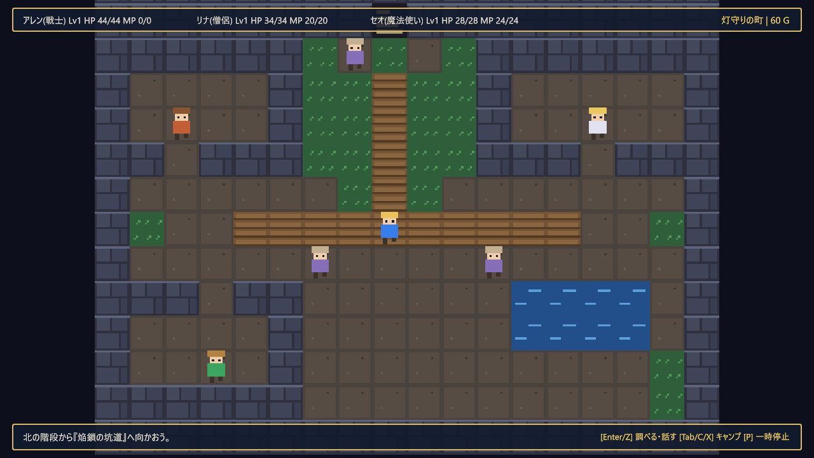 |

| 04. よろず屋（購入・即時装備差分） | 05. 灯の教会（セーブ完了） | 06. 坑道 B1F（宝箱取得） |
|---|---|---|
| 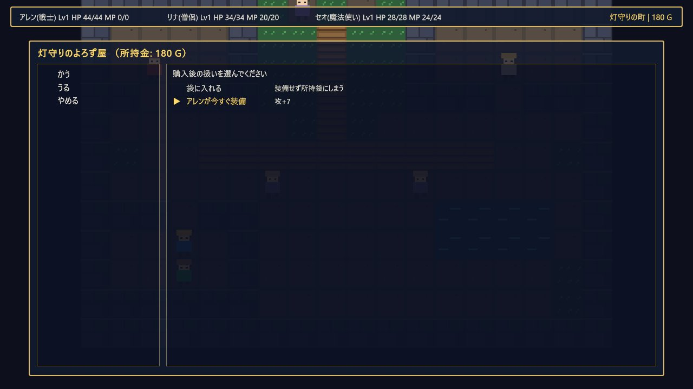 | 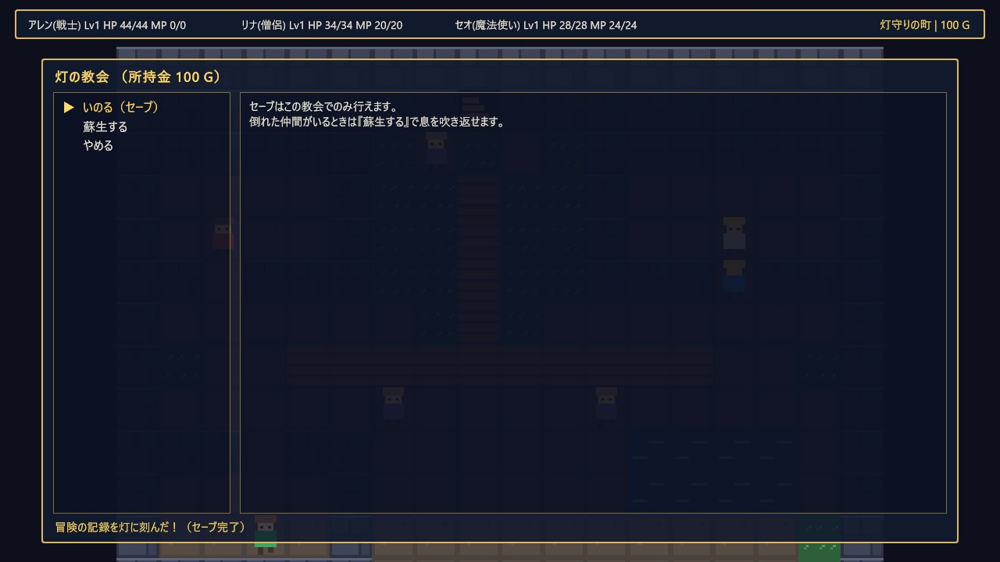 | 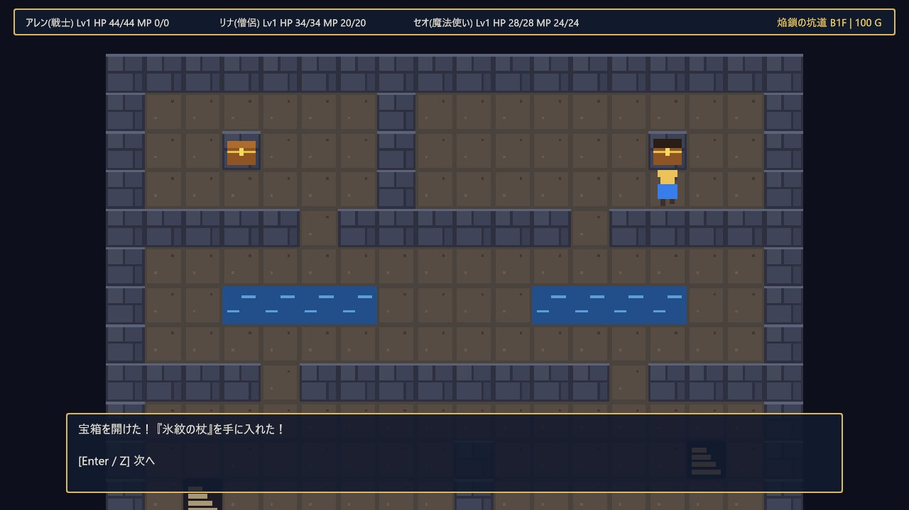 |

| 07. 通常戦闘（コマンド選択） | 08. 呪文ダメージ演出 | 09. レベルアップ表示 |
|---|---|---|
| 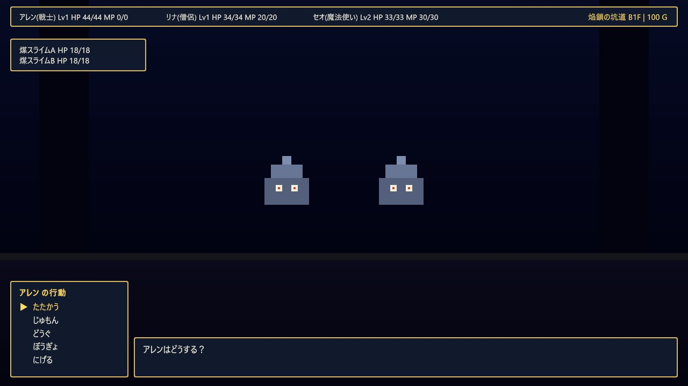 | 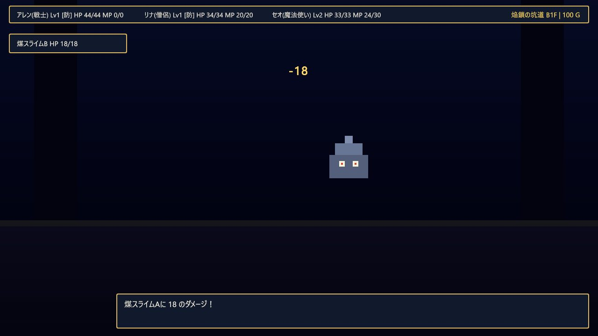 | 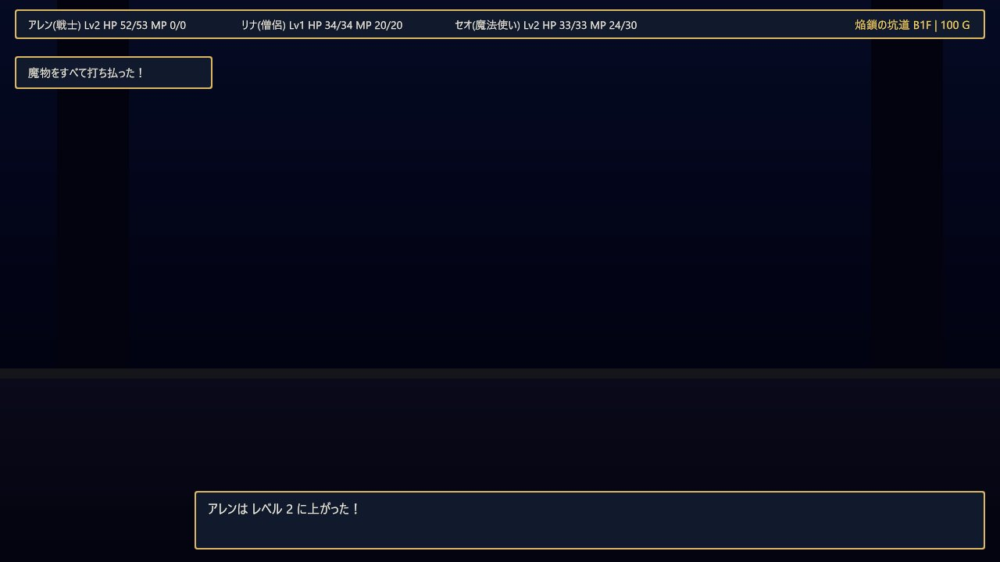 |

| 10. MP 不足グレーアウトと拒否表示 | 11. 全滅後の教会復帰（所持金半減） | 12. 焔鎖の魔将ヴァルグ戦 |
|---|---|---|
| 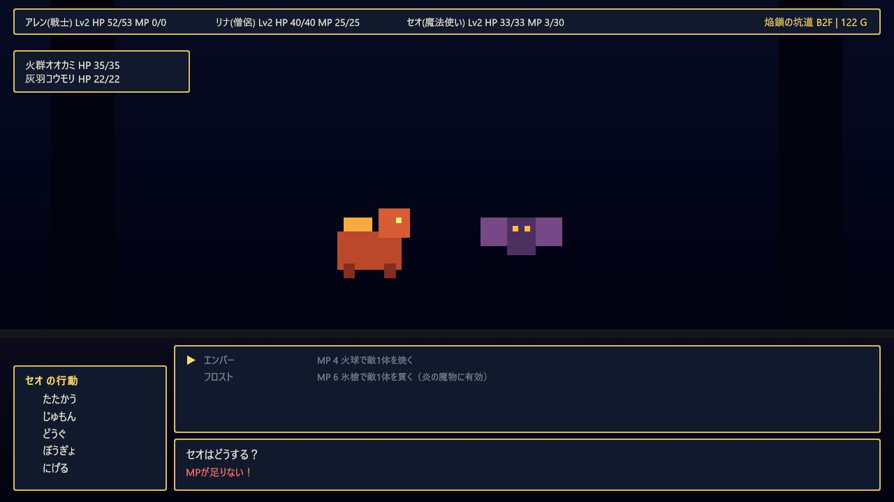 |  | 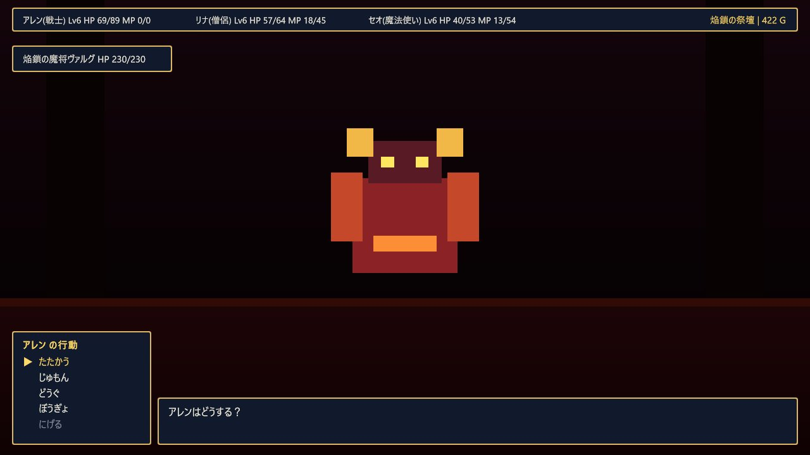 |

| 13. エンディング | 14. 冒険の記録（リザルト） | 15. 破損セーブ検知タイトル |
|---|---|---|
| 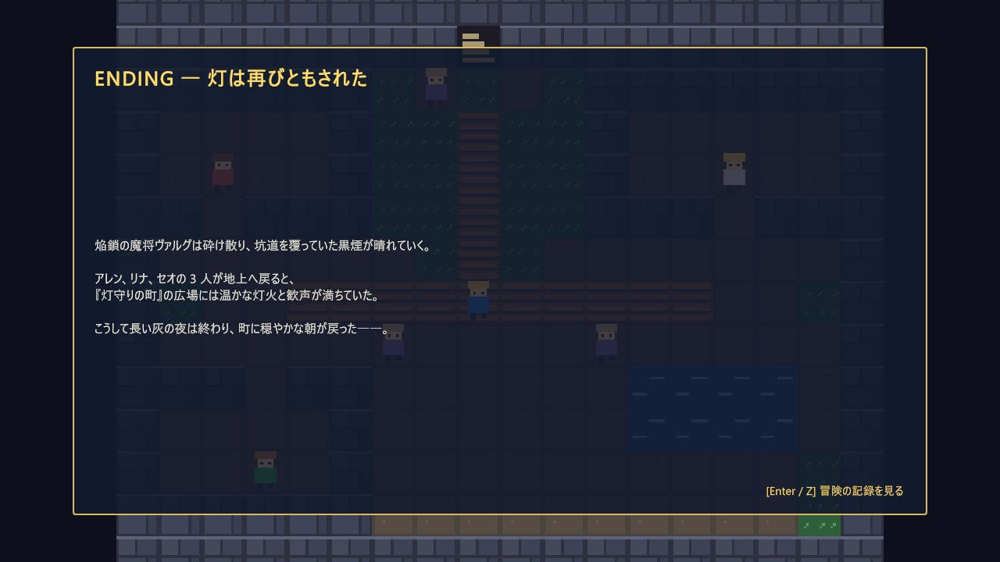 | 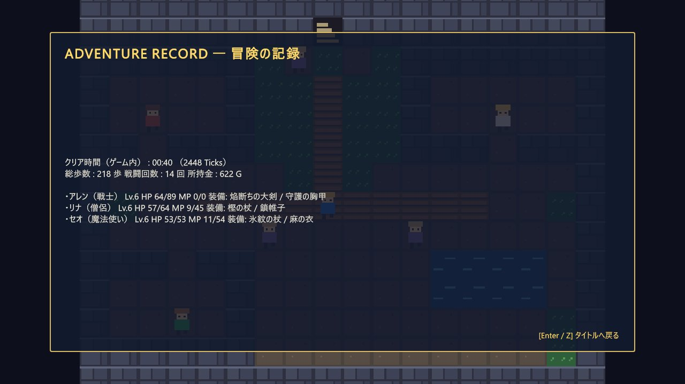 | 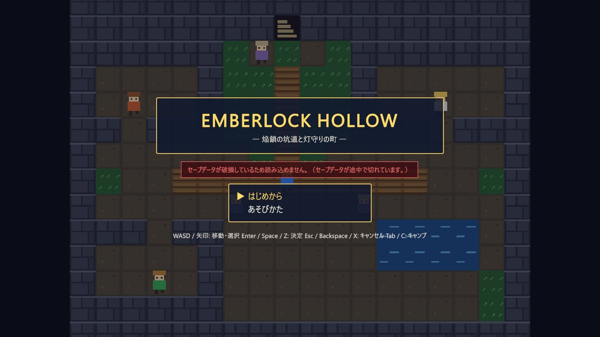 |
