# 042 検証記録

2026-11-26 実施。同日に人間の動作承認を受領し、レビュー対応（下記）の後に「完了」。

## 自動検証

| 項目 | 結果 |
|---|---|
| dev lint | 成功 |
| dev check | 成功（警告 0） |
| dev test | 成功。Core 105/105、App 18/18 |
| Unity EditMode | 185/185（パッケージ・Core・App。Mono） |
| Unity PlayMode | 33/33（実シーン 17、共通の証跡公開 16） |
| Windows ビルド | 成功、StandaloneWindows64（ビルドログにライセンスクライアントの署名検証の警告が残るが、結果は Success・終了コード 0） |
| ビルド起動 | dev capture で起動・全場面撮影・正常終了 |
| 証跡 | JPEG 品質 85、15 枚 |
| 撮影再現 | 同一ビルド `ce702f9ad531462e854edd90fadadb35` の 2 回の撮影（撮影 ID `20261125T214241Z-444f9116` と `20261125T214258Z-2336131b`）で 15 枚の SHA-256 が一致。画像世代 `30a5ecef495cd4c6`（[最新の記録](current.json)） |
| 固定ハッシュ | 戦利品の生成 `0x897152A8`、操縦役の通し（シード 1、12,683 Tick）`0x7F2DB26E` が .NET と Mono で一致（レビュー対応でハッシュに飛び道具の半径と最も希少な品を足した。動きは変わらず、Tick 数も同じ） |
| 通し | 操縦役で 20 シード全部が番人を倒す（最長 16,228 Tick）。攻撃・照準・薬を 10 Tick 遅れて決める操縦役も 10 シード全勝（合計 19 回倒れる） |
| 性能 | 3 階で敵 13 体が追跡し、地面の品が上限の 48、番人の弾が飛ぶ 600 Tick。Core の Step は p50 0.008 ms / p95 0.009 ms / 最大 0.144 ms、描画の更新（Stage）は p50 0.027 ms / p95 0.030 ms / 最大 0.626 ms。描画物 55 個。Unity エディタのバッチ実行、Mono、Stopwatch |

撮影の台本は Tick で進める（シード 1）。操縦役で 3 階まで降りて番人を倒し、持ち物の画面は台本で開いて品を選ぶ。最後に新しい試合（シード 2）で、攻撃も薬も使わない操縦役で倒れる場面と復活を撮る。

## 画面

| タイトル | 操作説明 | 最初の戦い |
|---|---|---|
| 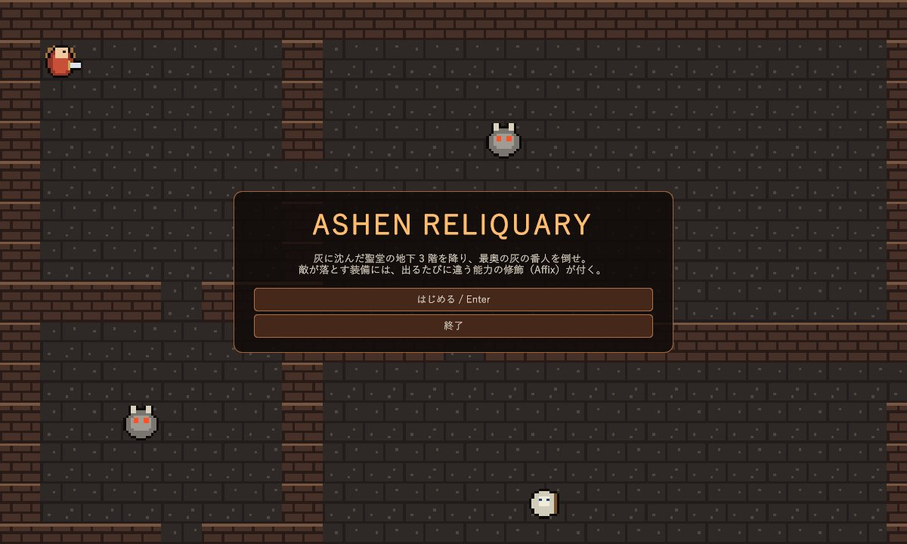 | 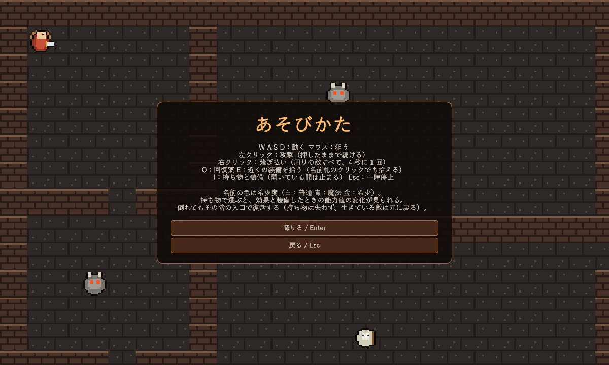 | 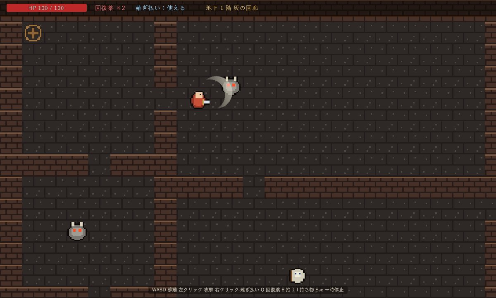 |

| ドロップと名前札 | 持ち物と説明・比較 | 装備中の品と能力値 |
|---|---|---|
| 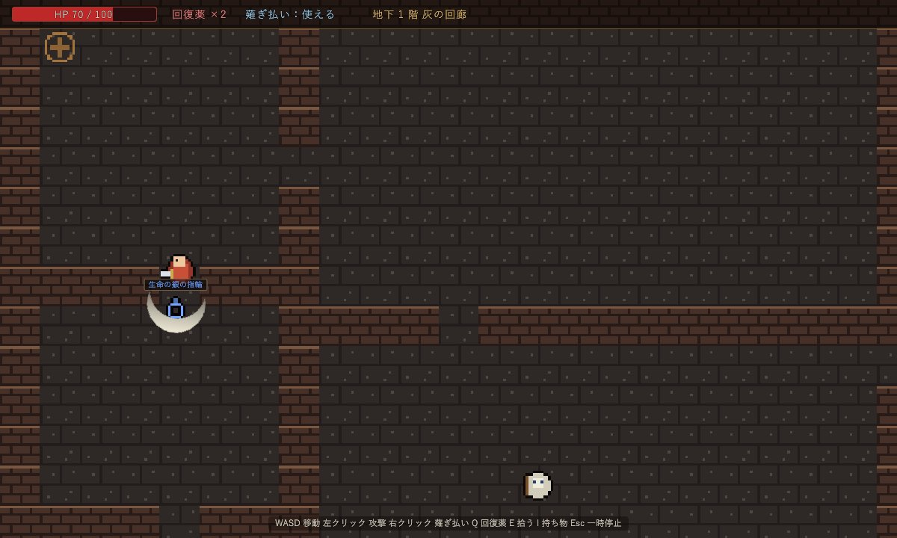 | 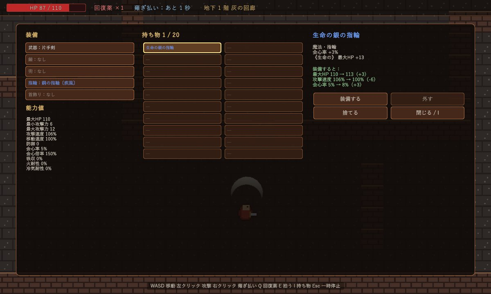 | 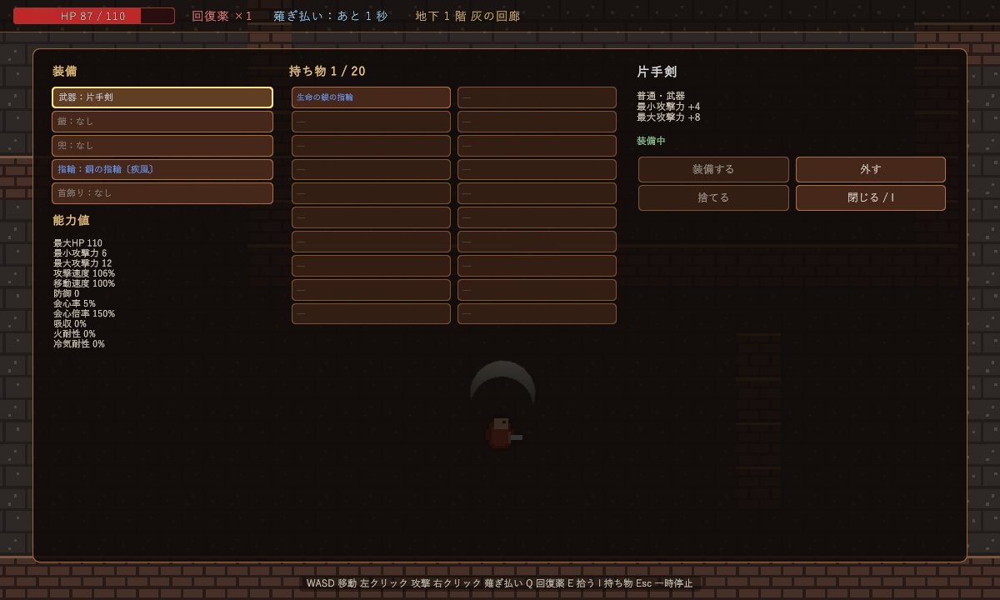 |

| 地下 2 階 | 角獣の突進の構え | 地下 3 階 |
|---|---|---|
| 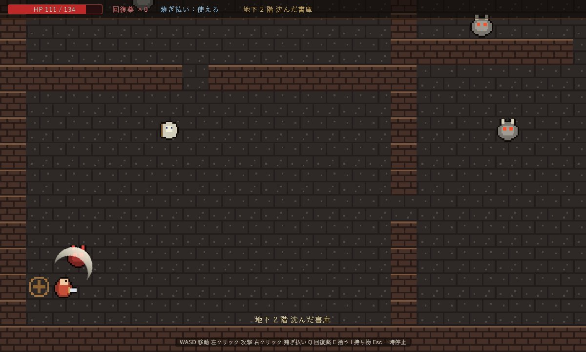 | 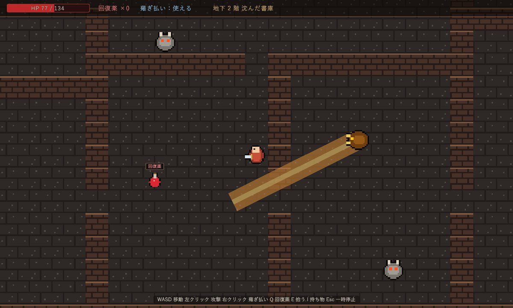 | 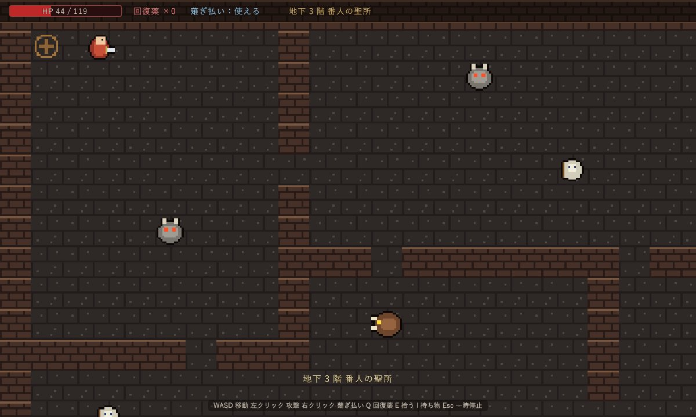 |

| 灰の番人（激昂） | 番人のドロップ（希少 2 つ） | 結果 |
|---|---|---|
| 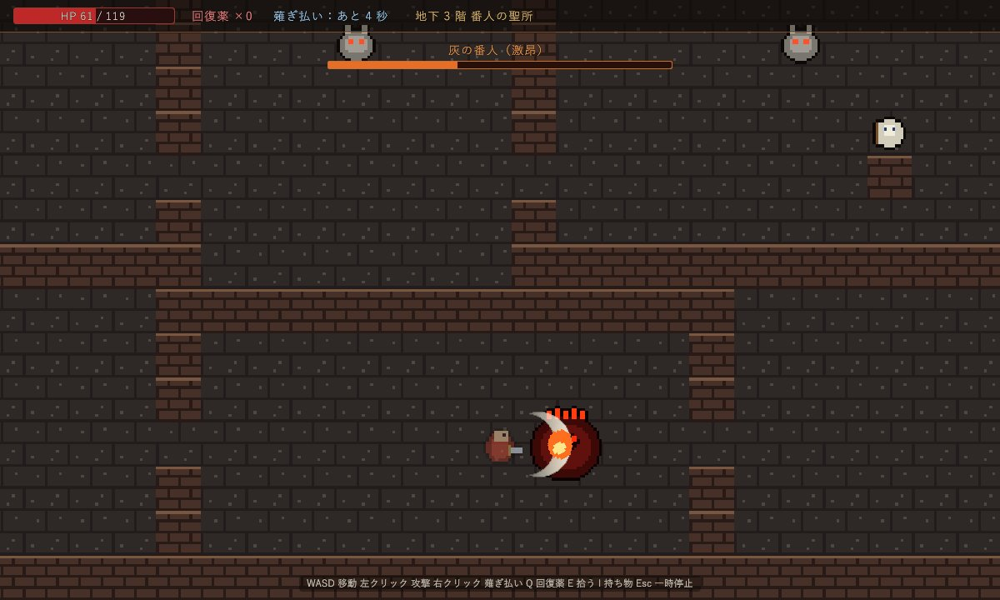 | 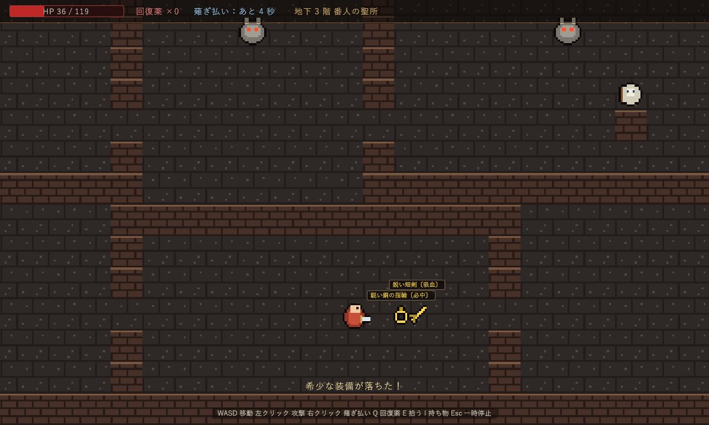 | 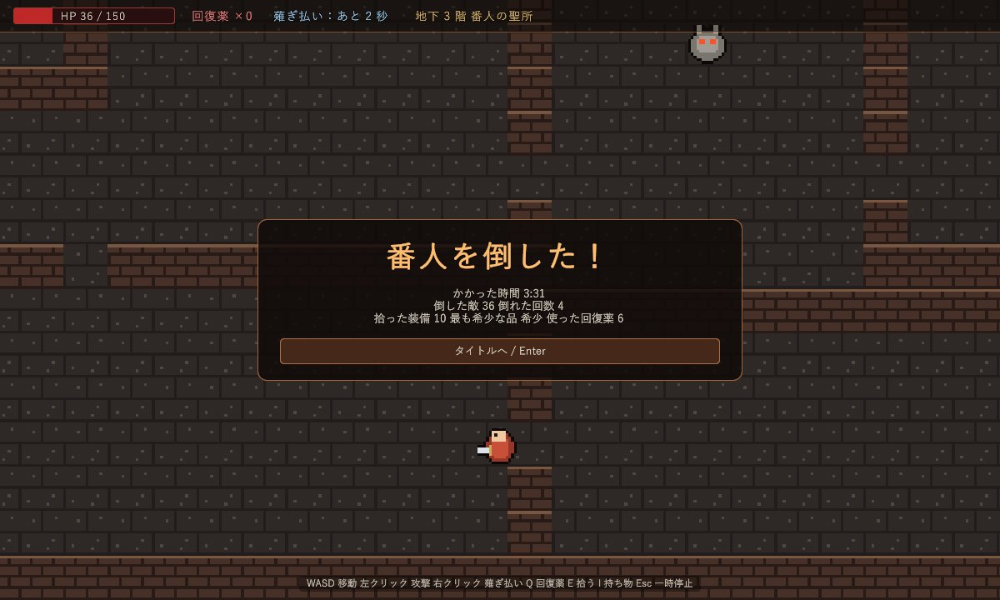 |

| 倒れた | 入口で復活 | 一時停止 |
|---|---|---|
| 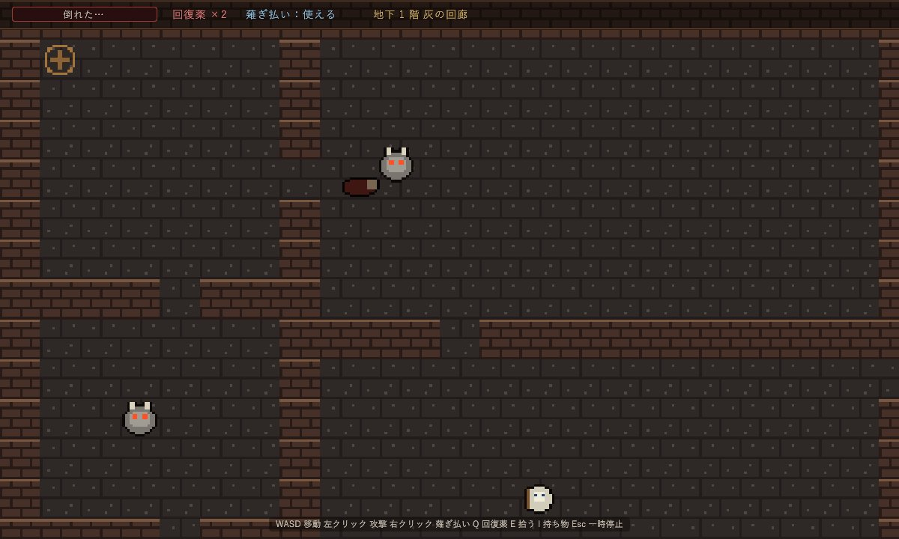 | 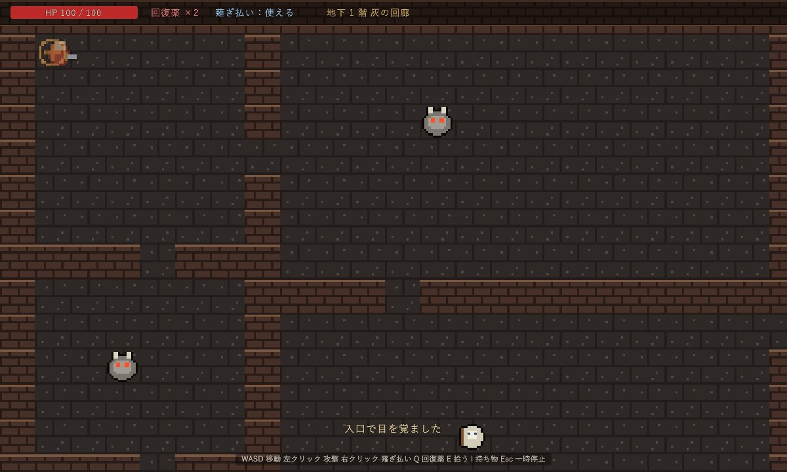 | 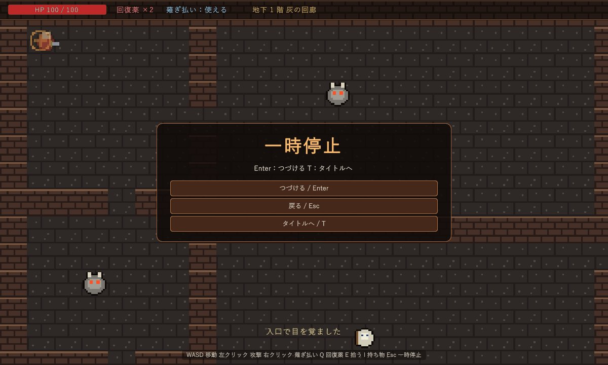 |

05 の右の欄は Core の `ItemText.Describe`（名前・希少度と枠・基礎の性能・Affix ごとの行）と、装備したときの能力値の差（`ItemText.Compare`、装備一式から計算し直した値）をそのまま出している。

## 撮影で見つけて直した問題

- 画面下の案内の文（「希少な装備が落ちた！」など）をフレーム数で消していたため、Tick だけを進める撮影では前の試合の文が別の試合の場面に残った。試合と Tick（120 Tick）で消すようにした。
- 番人のドロップの名前札 2 つが重なった。先に置いた札と重なる間は上へずらす。
- 倒れる場面を作る操縦役がまっすぐ敵へ歩いて壁で止まった。自動操縦の経路で歩き、攻撃と薬だけを外す操縦役にした。

## レビュー対応（2026-11-26）

- 試合が可変の `Equipment` を公開していて、`DelveRun.Equip` を通さずに付け替えると能力値が計算し直されなかった。枠ごとの参照と試算用の複製だけを公開した。
- 初期武器（`StartWeapon`）が戦利品のデータに無い・武器でない設定が検証を通っていた。データとの相互検証を足し、理由と ID を含む例外にした。
- 状態のハッシュに飛び道具の半径と最も希少な品を足した。
- 自動操縦が持ち物の満杯で回復薬も探さなくなっていた。回復薬は持ち物のマスを使わないので、満杯でも探す。回帰テストは、修正前のコードで失敗することを確かめた（初めの版は、操縦役が階段を降りて次の階で薬を拾ったため修正前でも通った）。
- 移動キーを 1 つの Button 型のアクションに束ねていたため、A を押したまま一時停止して再開した後に左矢印を押しても移動が再開しなかった。物理キーごとのアクションにし、意図にキーの番号を付け、`HeldControls` もキーごとに持つ。PlayMode のテストは修正前のコードで失敗することを確かめた。
- 弾・突進との当たりを自機の移動後の位置だけで掃引していたため、移動の途中でかすめた弾が当たらなかった。自機の経路（横 → 縦の折れ線）を移動量の割合で区間に分け、相手を分け目の時刻へ補間して区間ごとに掃引する（025）。
- 描画・撮影台本は変わらず、シード 1 の通しのハッシュも変わらない（`0x7F2DB26E`）ので、画像は撮り直していない（上の撮影記録のまま）。
