# 043 検証記録

2026-11-26 実施。状態は「検証待ち」（人間の試遊と承認の前）。

## 自動検証

| 項目 | 結果 |
|---|---|
| dev lint | 成功 |
| dev check | 成功（警告 0） |
| dev test | 成功。Core 70/70、App 22/22 |
| Unity EditMode | 154/154（パッケージ 62・Core 70・App 22。Mono） |
| Unity PlayMode | 27/27（実シーン 11、共通の証跡公開 16） |
| Windows ビルド | 成功、StandaloneWindows64（ビルドログにライセンスクライアントの署名検証の警告が残るが、結果は Success・終了コード 0） |
| ビルド起動 | dev capture で起動・全場面撮影・正常終了 |
| 証跡 | JPEG 品質 85、13 枚 |
| 撮影再現 | 同一ビルド `9f3d40a1a8664a1daac8b4ad7481fd05` の 2 回の撮影（撮影 ID `20261126T044453Z-d7ef6dad` と `20261126T044505Z-3e60822b`）で 13 枚の SHA-256 が一致。画像世代 `f8e6d11bf7ecf4fd`（[最新の記録](current.json)） |
| 固定ハッシュ | 操縦役の通し（シード 1、990 行動で生還）の最終ハッシュ `0x48E3B9C7` が .NET と Mono で一致 |
| 通し | 操縦役（PlayerView だけで判断）は 40 シード中 38 勝、20 シードの決着はいずれも 2,000 行動以内。実シーンでも操縦役で決着まで進め、25 操作ごとに「描いた敵は視界の中・描いた地形は既知のマスだけ」を確かめた |
| 性能 | 実シーンの操縦役の通し（648 操作）で、1 操作（自機の行動と敵の行動・視界・既知マップの更新）が p50 0.748 ms / p95 1.279 ms / 最大 9.239 ms、描画の更新（Stage）が p50 0.368 ms / p95 0.506 ms / 最大 1.244 ms。描画物 10 個（プール）。Unity エディタのバッチ実行、Mono、Stopwatch。シードは起動ごとに変わる |

撮影の台本は 1 操作ずつ進める（シード 1）。操縦役で 5 階まで降りて生還し、持ち物の画面は台本で開いて品を選ぶ。最後に新しい試合（シード 2）で、足踏みだけを続けて倒れる場面を撮る。場面の判定も PlayerView（画面に出ている情報）だけで行う。

## 画面

| タイトル | 遊び方 | 1 階の始め |
|---|---|---|
|  | 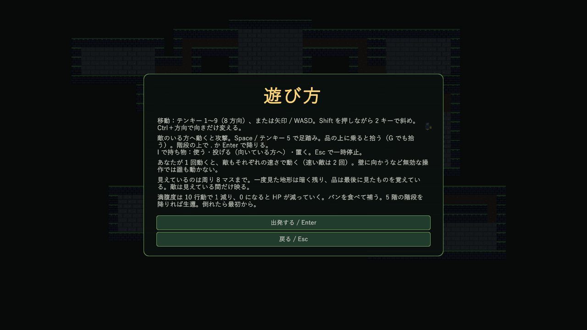 | 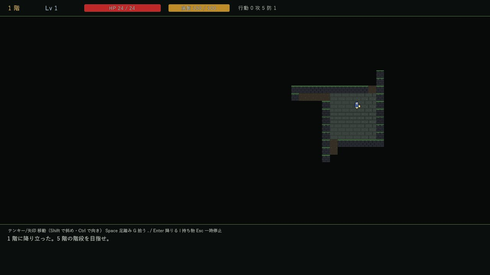 |

| 探索の途中（既知マップ） | 戦い | 持ち物 |
|---|---|---|
| 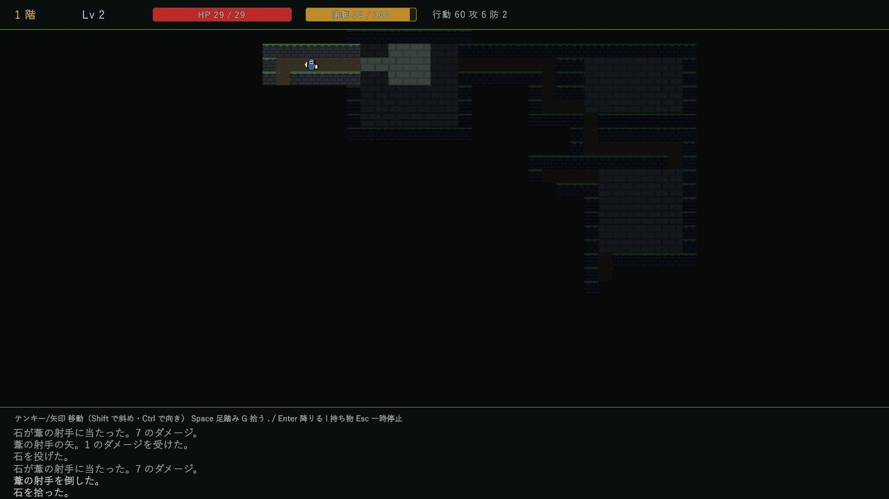 | 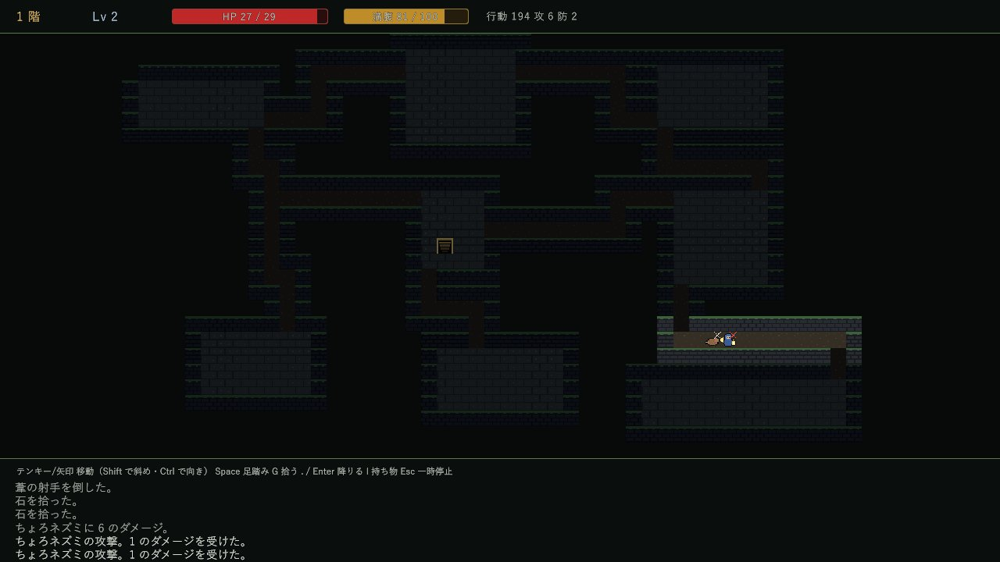 | 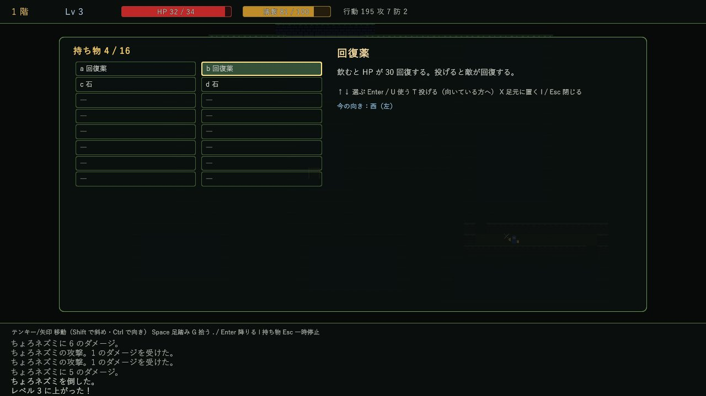 |

| 投げる | 3 階 | 空腹の案内 |
|---|---|---|
| 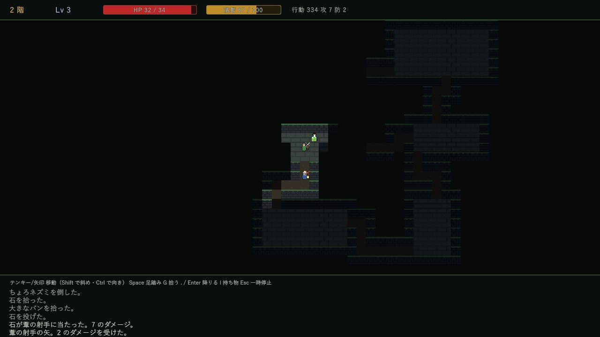 | 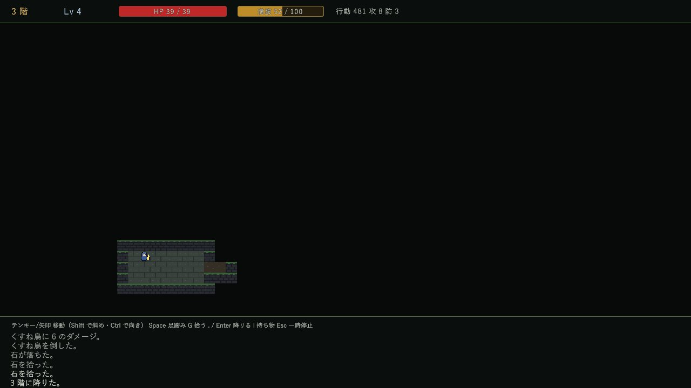 | 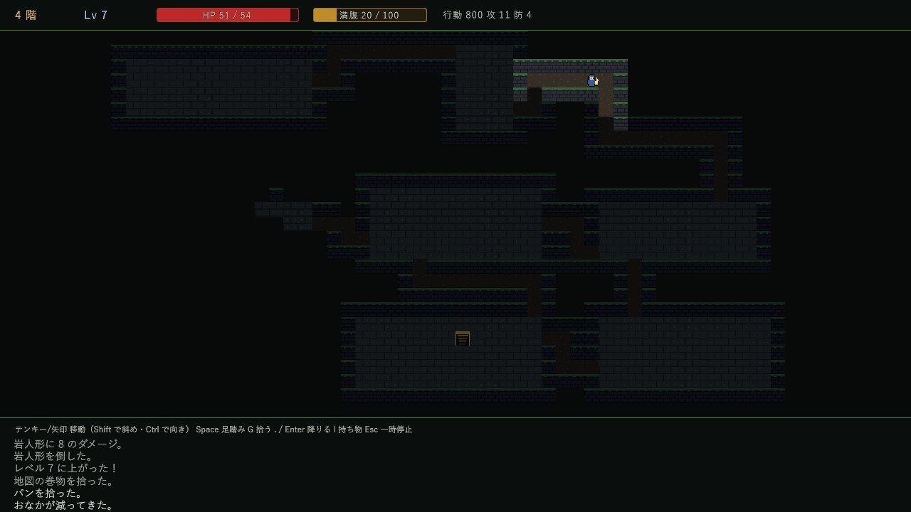 |

| 5 階 | 生還 | 倒れた |
|---|---|---|
| 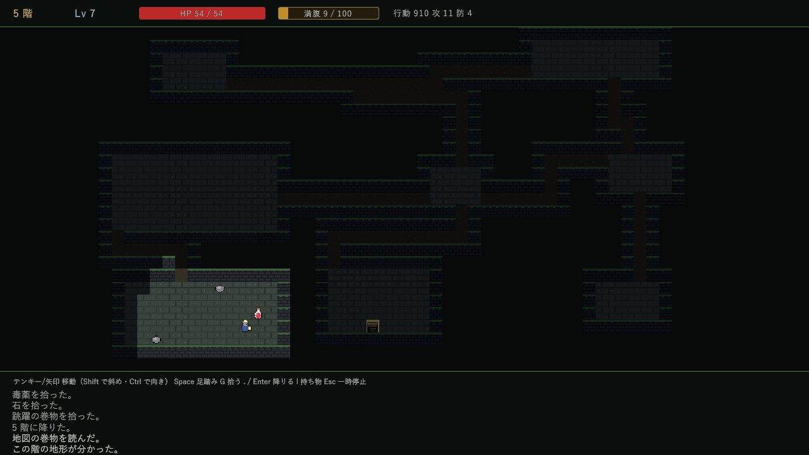 | 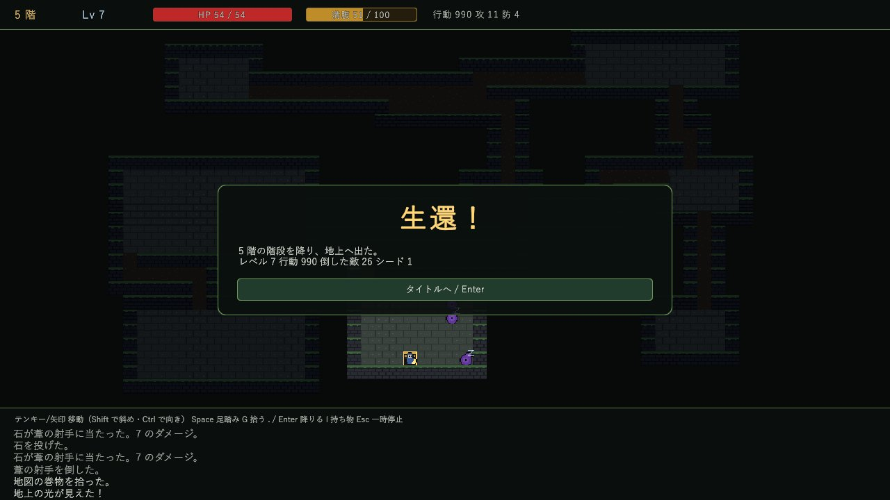 | 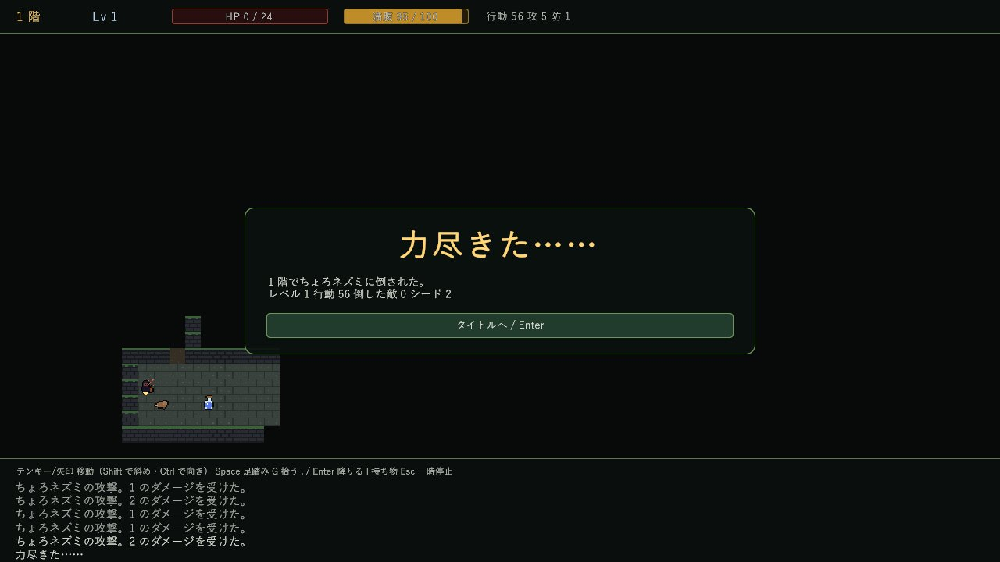 |

| 一時停止 |
|---|
| 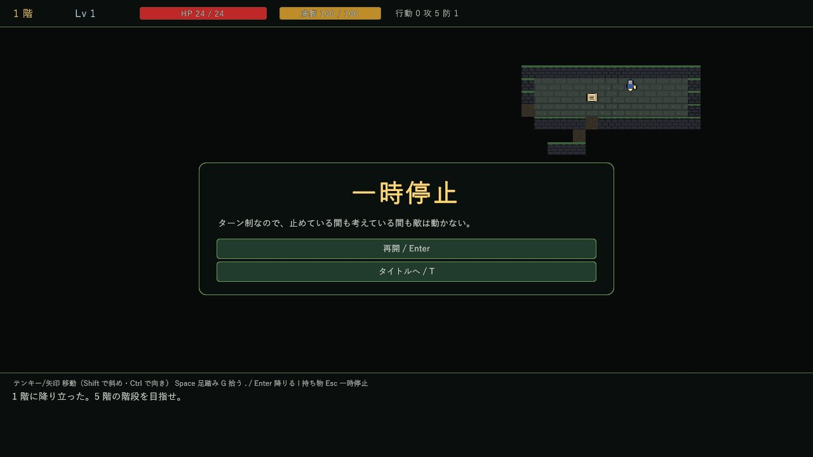 |

明るいマスが今の視界、暗いマスが一度見た地形（既知マップ）、黒は未知。品は視界の外では最後に見たもの（半透明）、敵は視界の中だけ描く。

## 撮影で見つけて直した問題

- 2 試合目で足踏みを続ける操縦役が、満腹度が 20 に減る前に敵に倒されて空腹の場面を作れなかった。空腹の場面は 1 試合目（操縦役が 5 階の手前で満腹度 20 を切る）で撮るように並べ替えた。
- タイトルの背景（見本の階）が盤を埋める壁で見づらかった。見本も遊んでいるときと同じく「床と床に接する壁」だけを描き、Prefab に焼く範囲と照合の範囲も合わせた。
- 攻撃が当たった印が敵の絵をほぼ隠した。印を小さくしてマスの右上に出す。
