# 043 検証記録

2026-11-26 実施（試遊 1 回目の調整：画角を自機の周りに寄せる・M で全体の地図・持ち物の左右選択と品の絵、の後に撮り直し）。2026-11-26 に人間の動作承認を受け、レビューの指摘（敵・品の数の検証の桁あふれ、試合が使う設定の公開）を直して再検証した。

## 自動検証

| 項目 | 結果 |
|---|---|
| dev lint | 成功 |
| dev check | 成功（警告 0） |
| dev test | 成功。Core 73/73、App 27/27 |
| Unity EditMode | 162/162（パッケージ 62・Core 73・App 27。Mono） |
| Unity PlayMode | 29/29（実シーン 13、共通の証跡公開 16） |
| Windows ビルド | 成功、StandaloneWindows64（ビルドログにライセンスクライアントの署名検証の警告が残るが、結果は Success・終了コード 0） |
| ビルド起動 | dev capture で起動・全場面撮影・正常終了 |
| 証跡 | JPEG 品質 85、14 枚 |
| レビュー対応後 | 規則は変えていないので、シード 1 の固定ハッシュ `0x48E3B9C7` はそのまま一致。dotnet・EditMode・PlayMode を流し直し、Windows ビルドも成功（画像は下の撮影のビルドのもの） |
| 撮影再現 | 同一ビルド `dcc8daa46e634d609732416cafb1c07c` の 2 回の撮影（撮影 ID `20261126T072315Z-a7b8018a` と `20261126T072404Z-77658f83`）で 14 枚の SHA-256 が一致。画像世代 `d23543d08120a5e3`（[最新の記録](current.json)）。1 回目の記録は次の公開で消える |
| 固定ハッシュ | 操縦役の通し（シード 1、990 行動で生還）の最終ハッシュ `0x48E3B9C7` が .NET と Mono で一致 |
| 通し | 操縦役（PlayerView だけで判断）は 40 シード中 38 勝、20 シードの決着はいずれも 2,000 行動以内。実シーンでも操縦役で決着まで進め、25 操作ごとに「描いた敵は視界の中・描いた地形は既知のマスだけ」を確かめた |
| 性能 | 実シーンの操縦役の通し（1,289 操作）で、1 操作（自機の行動と敵の行動・視界・既知マップの更新）が p50 0.785 ms / p95 1.281 ms / 最大 10.790 ms、描画の更新（Stage）が p50 0.410 ms / p95 0.590 ms / 最大 1.202 ms。描画物 15 個（プール）。Unity エディタのバッチ実行、Mono、Stopwatch。シードは起動ごとに変わる |

撮影の台本は 1 操作ずつ進める（シード 1）。操縦役で 5 階まで降りて生還し、持ち物の画面は台本で開いて品を選ぶ。最後に新しい試合（シード 2）で、足踏みだけを続けて倒れる場面を撮る。場面の判定も PlayerView（画面に出ている情報）だけで行う。

## 画面

| タイトル | 遊び方 | 1 階の始め |
|---|---|---|
| 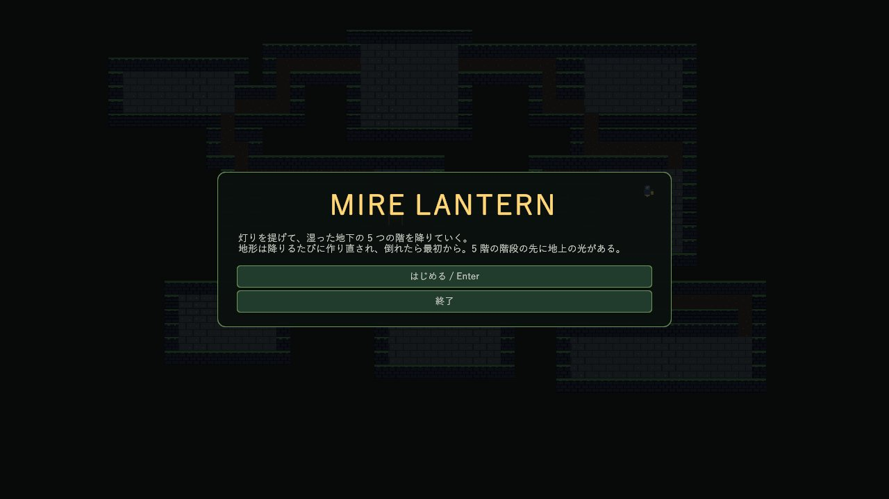 | 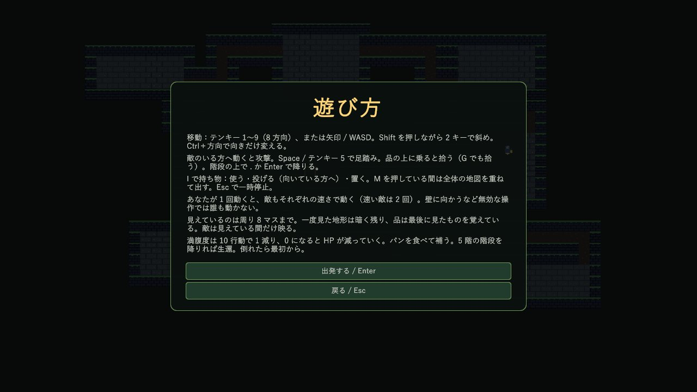 | 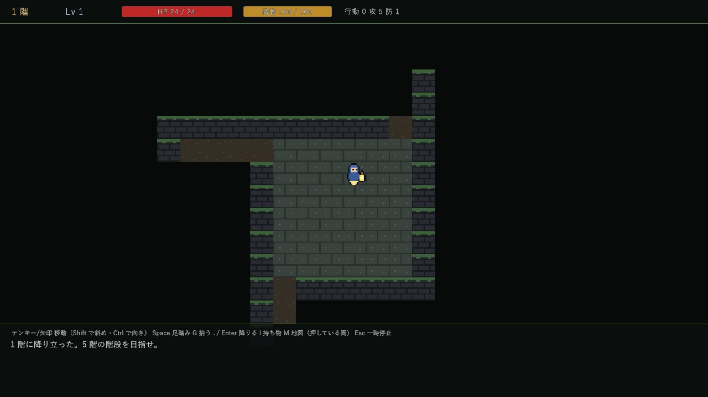 |

| 探索の途中（既知マップ） | 全体の地図（M を押している間） | 戦い |
|---|---|---|
| 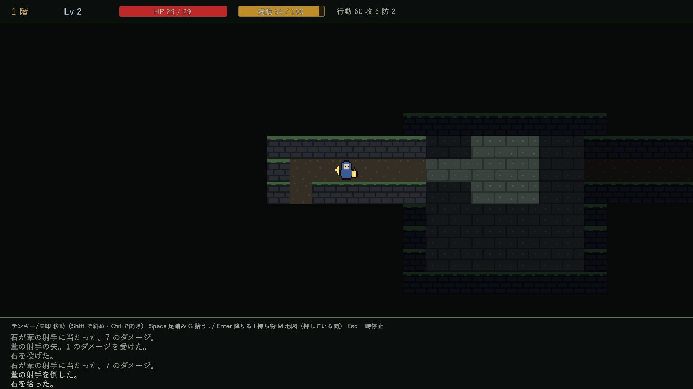 | 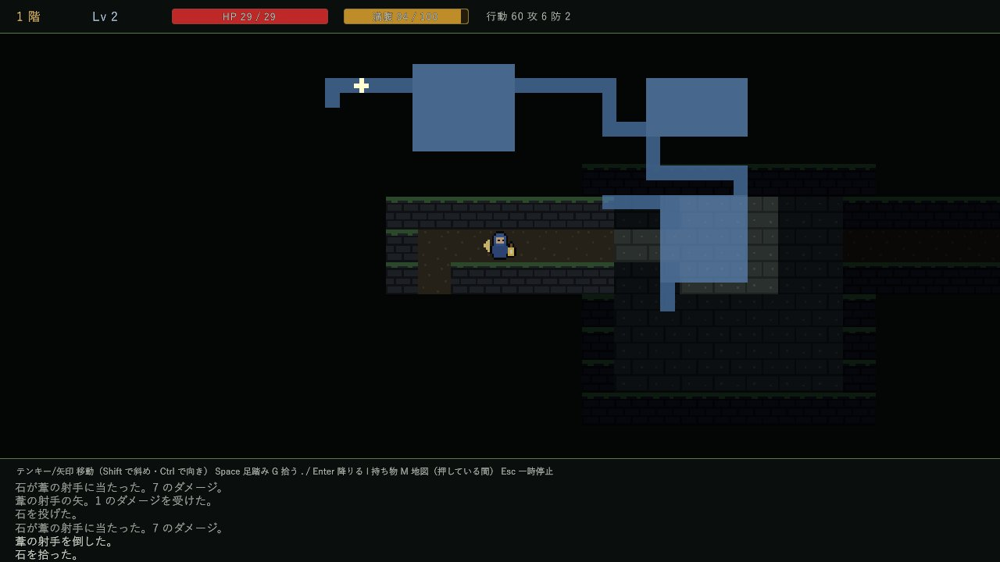 | 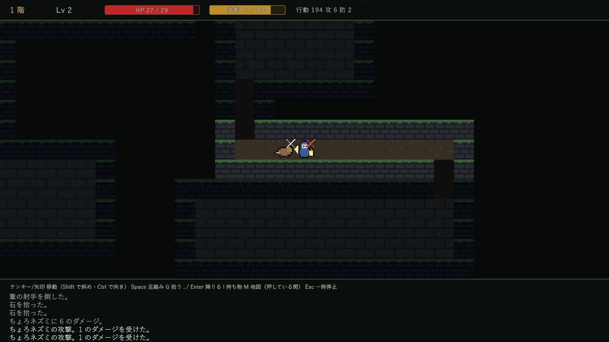 |

| 持ち物 | 投げる | 3 階 |
|---|---|---|
| 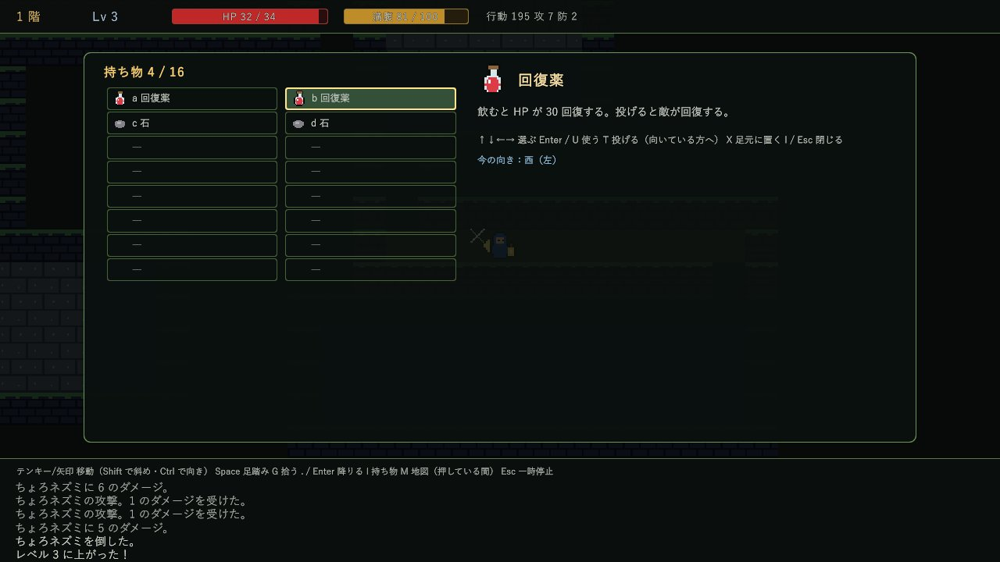 | 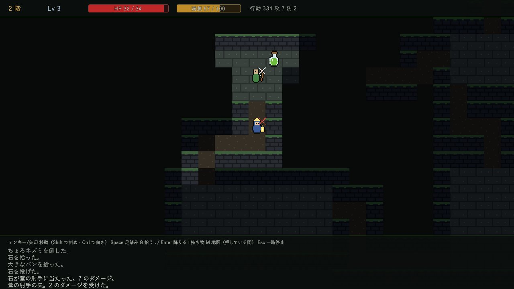 | 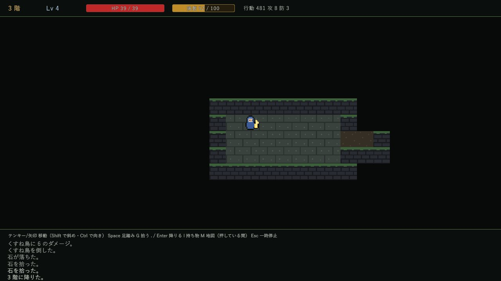 |

| 空腹の案内 | 5 階 | 生還 |
|---|---|---|
| 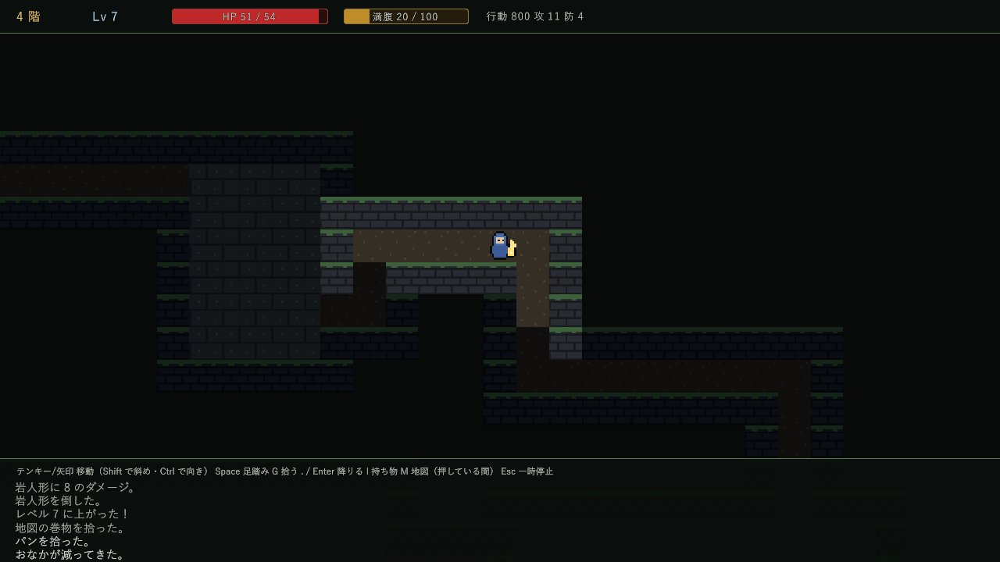 | 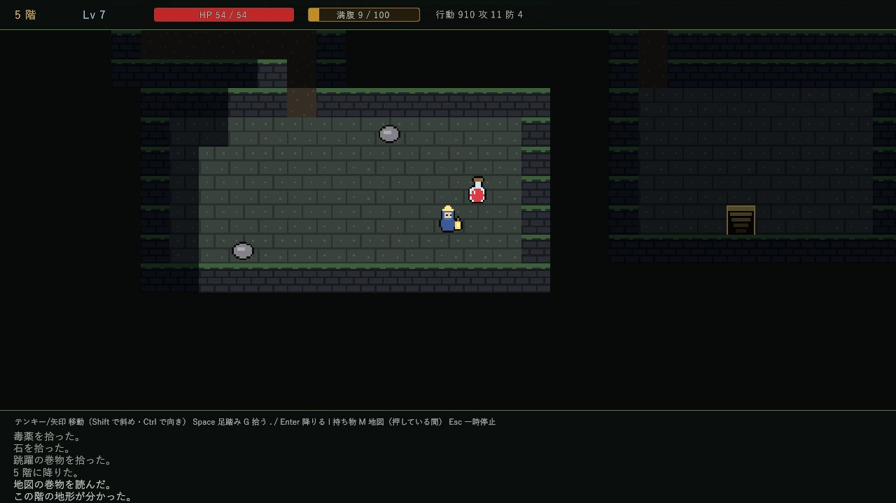 | 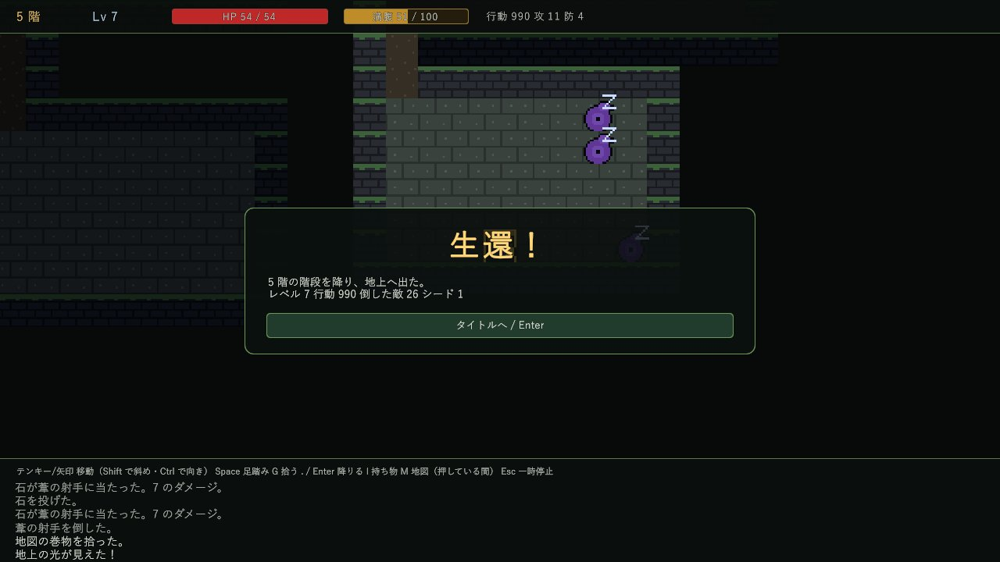 |

| 倒れた | 一時停止 |
|---|---|
| 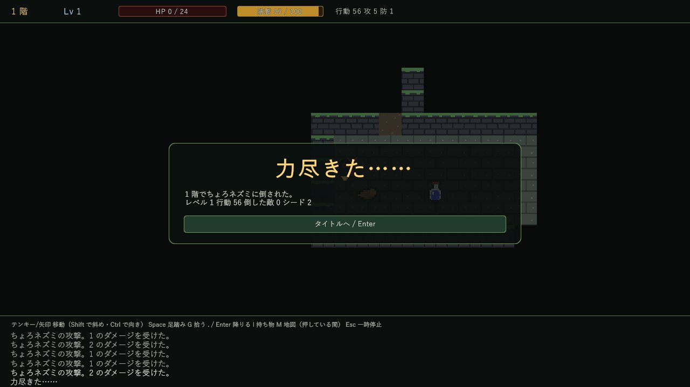 | 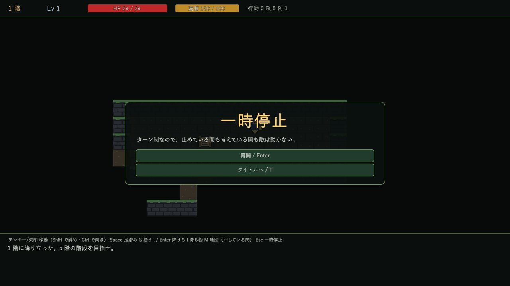 |

試合中は自機を中心に周り 13 行ぶん（16:9 では横に約 30 マス）を映す。明るいマスが今の視界、暗いマスが一度見た地形（既知マップ）、黒は未知。品は視界の外では最後に見たもの（半透明）、敵は視界の中だけ描く。全体の地図は M を押している間だけ重ね、見た床と階段・記憶の品（黄の点）・見えている敵（赤の十字）・自機（白の十字）だけを描く。

## 撮影で見つけて直した問題

- 2 試合目で足踏みを続ける操縦役が、満腹度が 20 に減る前に敵に倒されて空腹の場面を作れなかった。空腹の場面は 1 試合目（操縦役が 5 階の手前で満腹度 20 を切る）で撮るように並べ替えた。
- タイトルの背景（見本の階）が盤を埋める壁で見づらかった。見本も遊んでいるときと同じく「床と床に接する壁」だけを描き、Prefab に焼く範囲と照合の範囲も合わせた。
- 攻撃が当たった印が敵の絵をほぼ隠した。印を小さくしてマスの右上に出す。
- 全体の地図の床がほぼ不透明に見え、下の画面が読めなかった。UI Toolkit の合成は線形の色空間で行われ、暗い画面の上では同じ不透明度でも明るく濃く出る。床の不透明度を 150/255 から 85/255 に下げた。
- （レビュー対応の再検証で）PlayMode の `BackToTitleLooksLikeStartup` が、実行ごとのシードで近くの敵に倒されて結果の画面へ移り、まれに失敗した。足踏みの前に敵を除くようにした。
