# 044 検証記録

2026-11-26 実施（レビュー対応の後に撮り直し、テストを流し直した）。

## 自動検証

| 項目 | 結果 |
|---|---|
| dev lint | 成功 |
| dev check | 成功（警告 0） |
| dev test | 成功。Core 128/128、App 55/55 |
| Unity EditMode | 245/245（パッケージ 62・Core 128・App 55。Mono） |
| Unity PlayMode | 33/33（実シーン 18、共通の証跡公開 15） |
| Windows ビルド | 成功、StandaloneWindows64（ビルドログにライセンスクライアントの署名検証の警告が残るが、結果は Success・終了コード 0） |
| ビルド起動 | dev capture で起動・全場面撮影・正常終了 |
| 証跡 | JPEG 品質 85、18 枚、1280×720 |
| 撮影再現 | 同一ビルド `303b7c03ccc54f30a14ccc349490af99` の 2 回の撮影（撮影 ID `20261126T144048Z-a5aa3d7b` と `20261126T144120Z-bc56c044`）で 18 枚の SHA-256 が一致。画像世代 `7e5151444a4b59ae`（[最新の記録](current.json)）。1 回目の記録は次の公開で消える |
| 固定ハッシュ | 操縦役の通し（シード 1、ボス撃破）の最終ハッシュ `0x0C54A0A7` が .NET と Mono で一致 |
| 題材固有テスト | エネルギー不足のカードは拒否し状態・乱数・ハッシュを変えない／複数効果の出来事の列が書いた順で固定／廃棄のカードは捨て札・山札・手札へ戻らない（40 シードの乱択対戦で全局面の領域の不変条件） |
| 通し | 操縦役は 20 シード全勝、人寄りの操縦役（1 枚ずつ貪欲・15% で無作為）は 10 シード中 7 勝。実シーンでも操縦役で決着まで進め、97 Tick ごとに HUD のエネルギー・手札・敵の HP が演出の卓と一致することを確かめた |
| 性能 | 実シーンの操縦役の通しで、カードの解決（Core が効果を最後まで解決する 1 操作）が 49 回で p50 0.006 ms / p95 0.433 ms / 最大 1.040 ms、描画の更新（場と HUD）が 2,768 回で p50 0.039 ms / p95 0.552 ms / 最大 6.373 ms。最多の手札 5 枚・敵 2 体。入力待ちの戦闘 60 フレームの GC 割り当ては p50 1,774 B / 最大 2,318 B（HUD の文字列を毎フレーム作る分）。Unity エディタのバッチ実行、Mono、Stopwatch と ProfilerRecorder。シードは起動ごとに変わる |

撮影の台本は意図と操縦役と Tick で進める（シード 1）。戦 1 は手強い方を選び、カードの選択・対象の矢印・解決の演出の途中・敵の番を撮る。その後は操縦役でボスまで進め、報酬と除去・休憩・ボスの呼び声・決着・結果を撮る。最後に新しい挑戦（シード 2）でターン終了だけを続けて倒れる場面を撮る。

## 画面

| タイトル | 遊び方 | ルート（戦 1 の 2 択） |
|---|---|---|
| 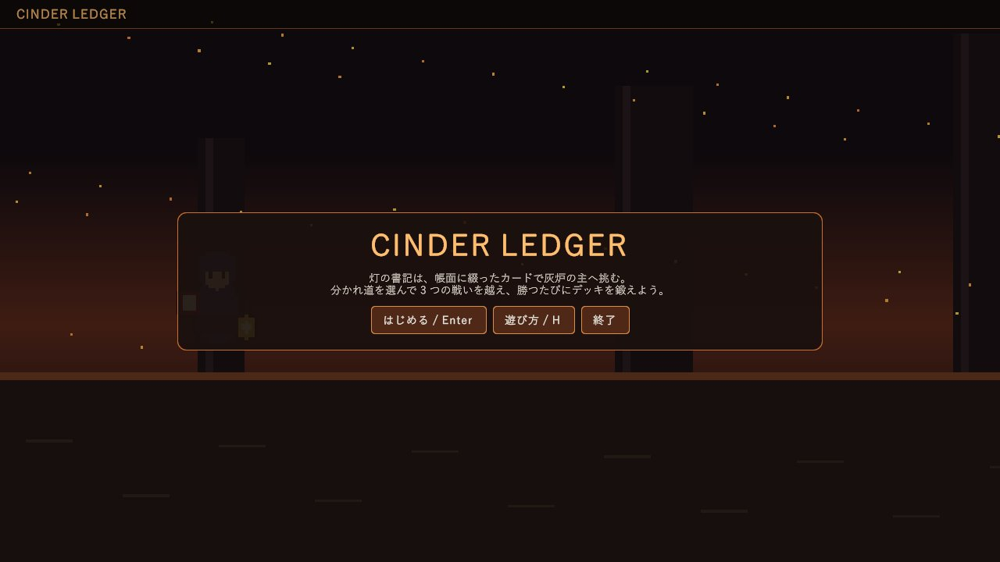 | 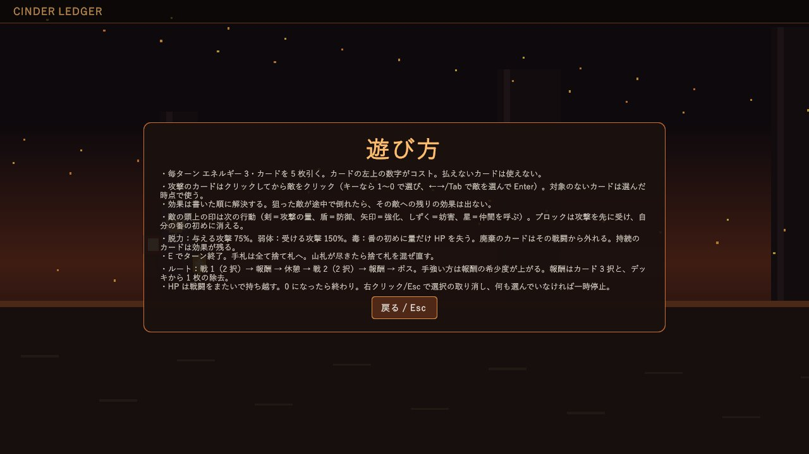 | 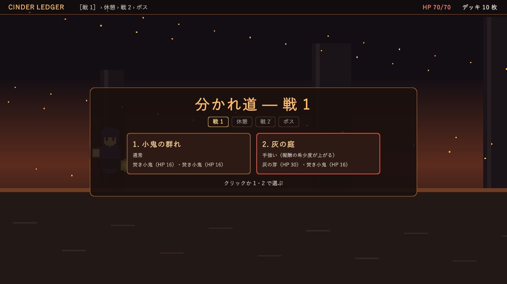 |

| 最初のターン（意図の表示） | 対象を選ぶ（矢印と印） | 解決の演出の途中 |
|---|---|---|
| 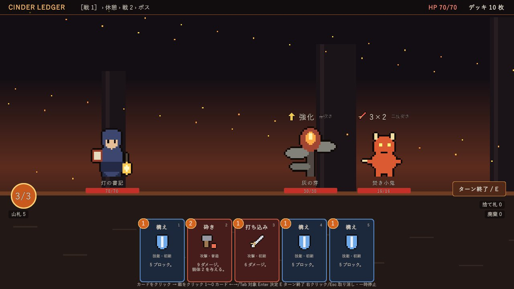 | 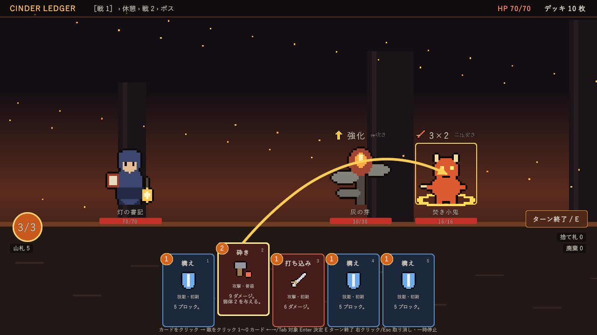 | 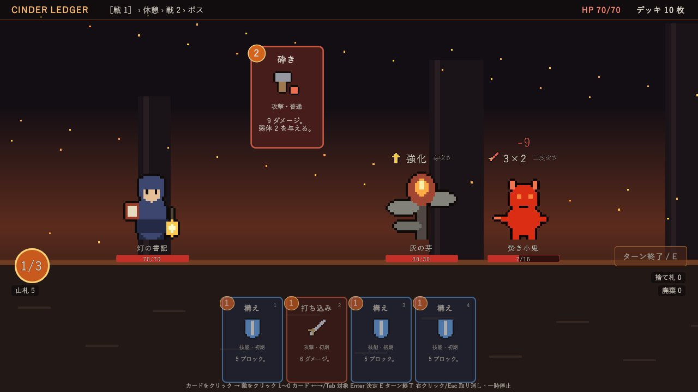 |

| 敵の番 | 報酬（カード 3 択と除去） | 除去の候補を選んだ |
|---|---|---|
| 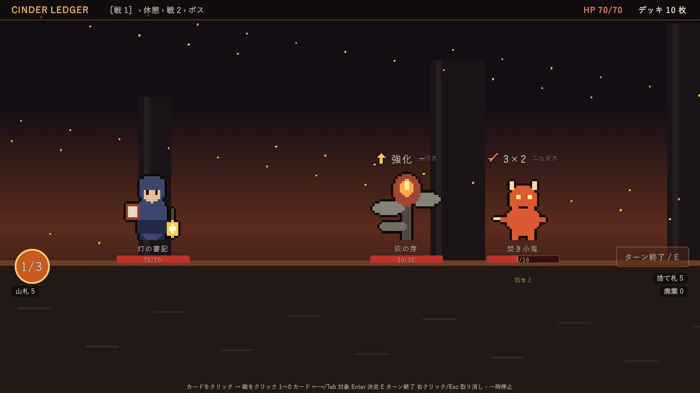 | 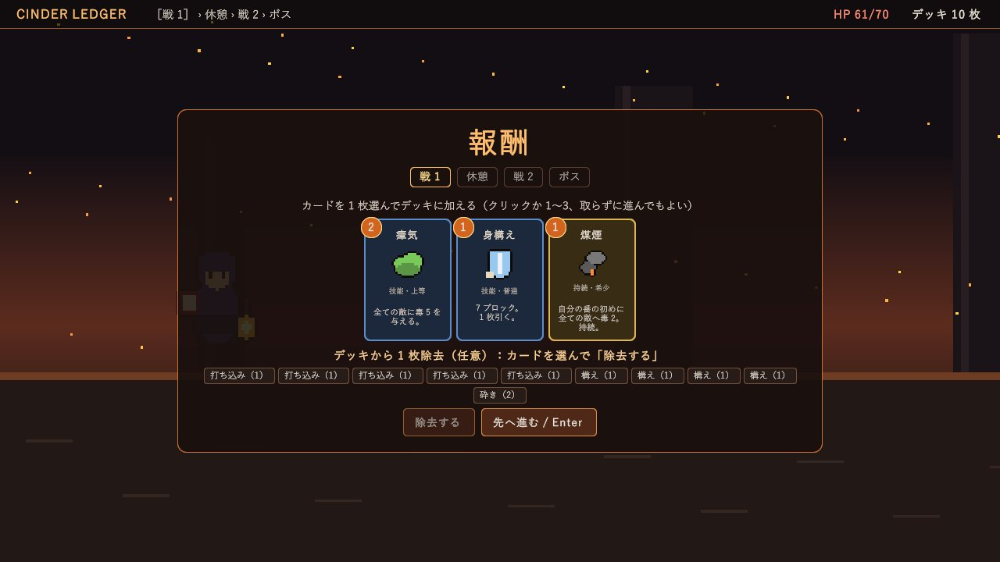 | 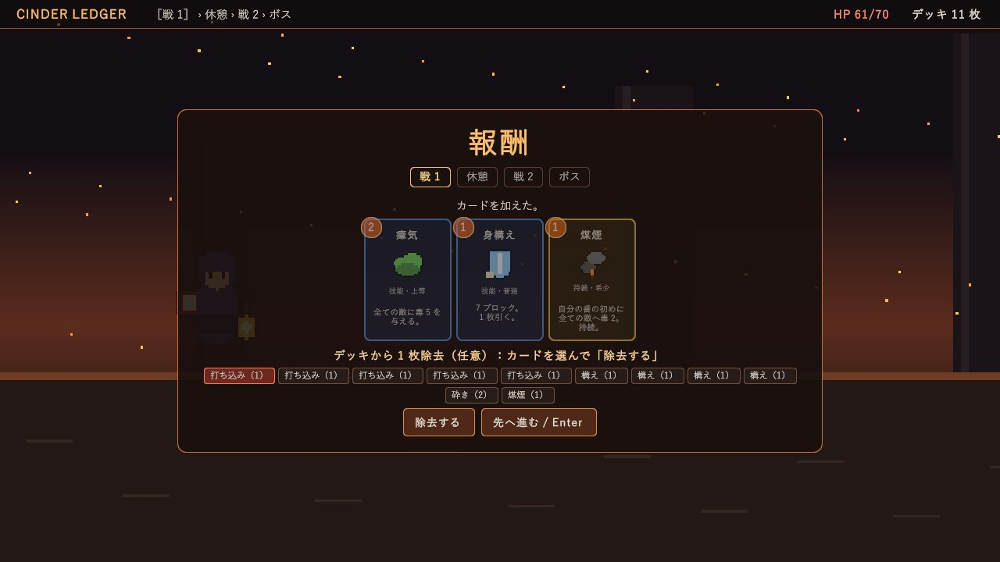 |

| 休憩 | 戦 2 の 2 択 | ボスの節 |
|---|---|---|
| 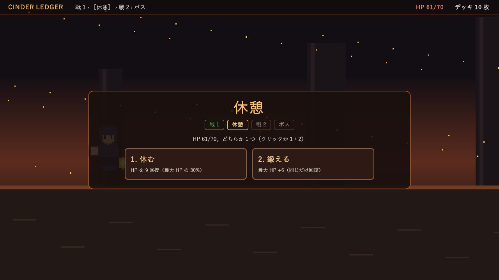 | 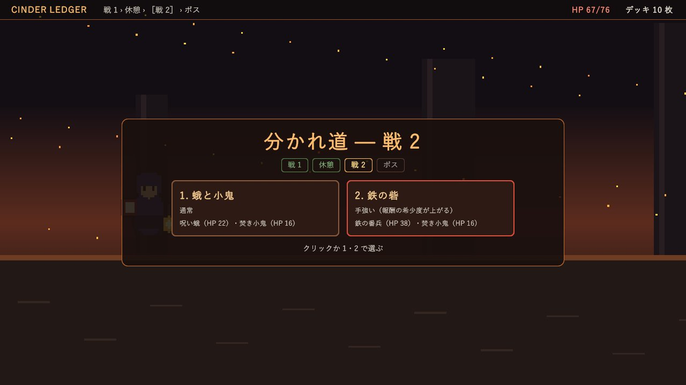 | 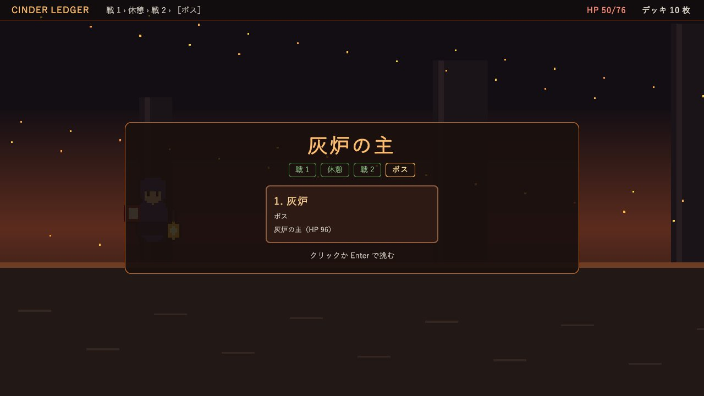 |

| ボス戦 | 呼び声（HP 半分で一度だけ） | 決着 |
|---|---|---|
| 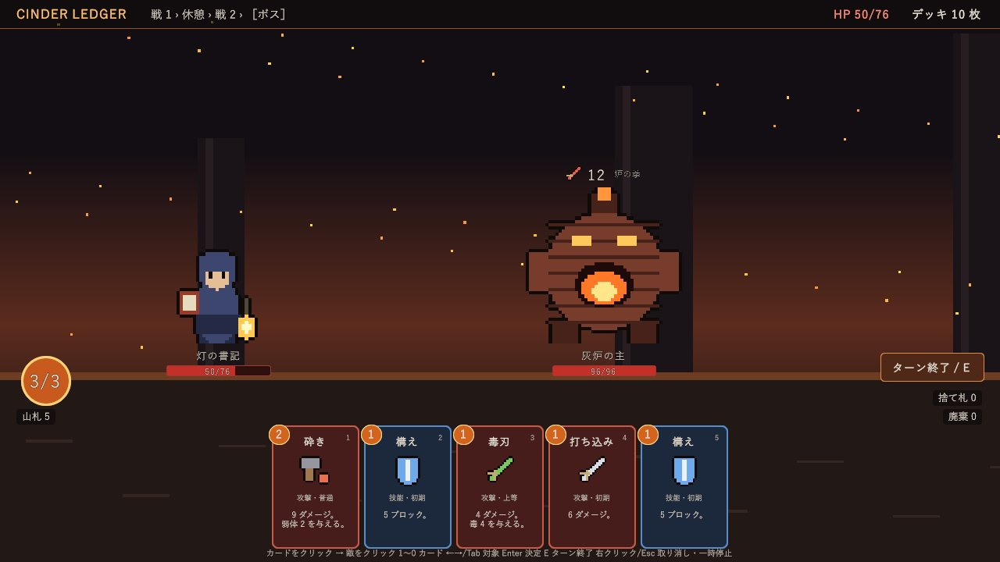 | 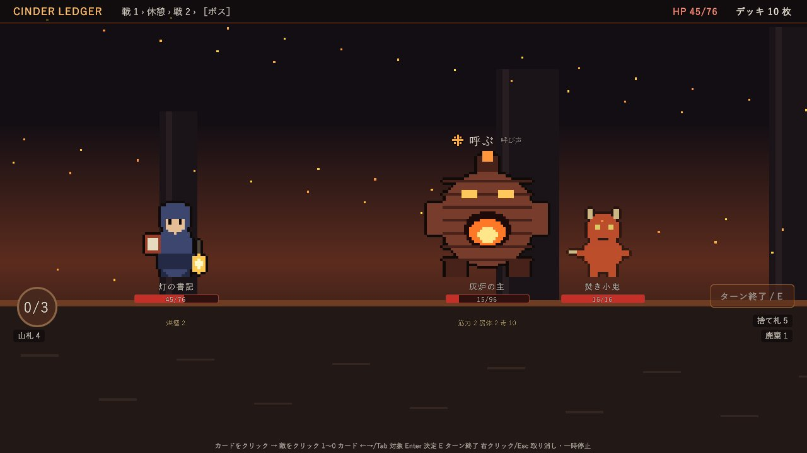 | 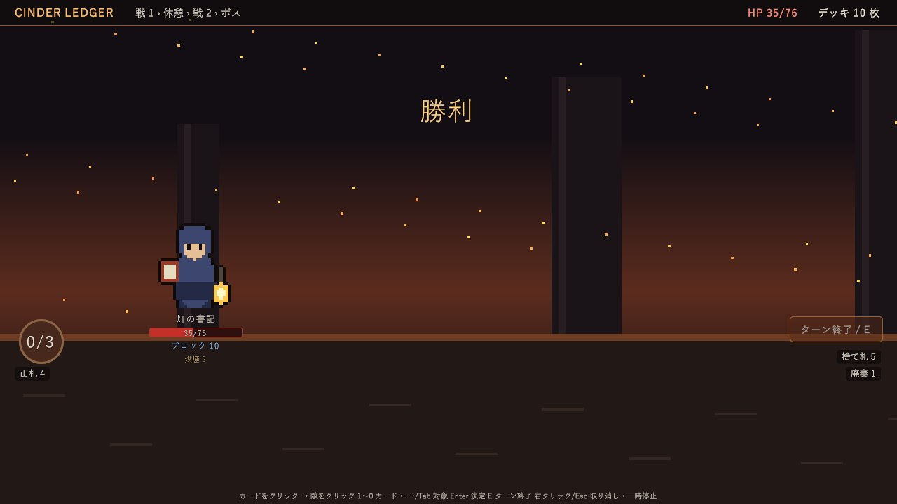 |

| 結果（勝利） | 結果（敗北） | 一時停止 |
|---|---|---|
| 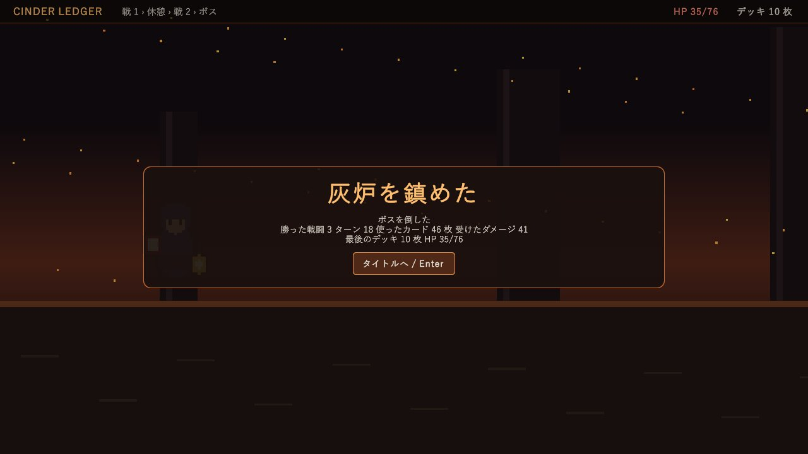 | 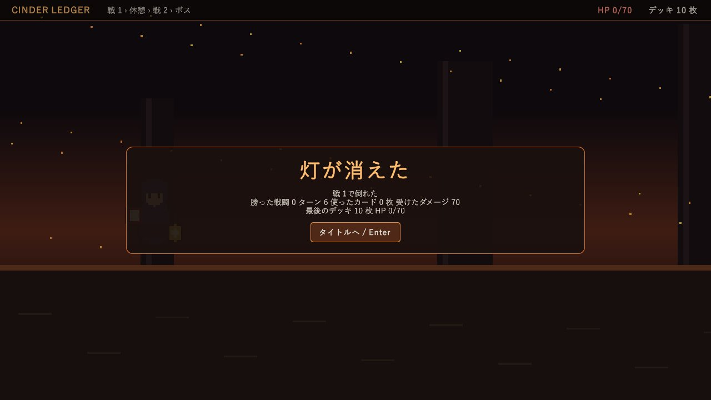 | 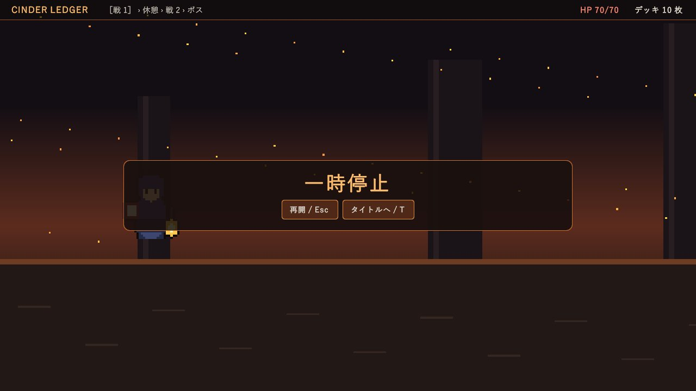 |

「解決の演出の途中」では Core はカードを解決し終えているが、画面は出来事を 1 つずつ卓に当てはめて描くので、当たった数字と HP の減りが当たった時点で出る。

## 撮影・テストで見つけて直した問題

- 対象の矢印が撮影に写らなかった。カードを選ぶと手札を作り直し、新しい要素は次のフレームで配置されるので、そのフレームでは矢印の始点が決まらない。撮影は 1 フレーム置いて描き直してから撮るようにした（遊んでいるときは次のフレームで出る）。
- 解決中のカードの大きな表示が敵の意図に重なった。自機と敵の間に寄せた。
- 2 体の遭遇で 1 体目を倒すと、2 体目が 1 体目の立ち位置へ詰めて動いた（立ち位置の割り当てが倒れた敵の位置を誰にでも渡していた）。敵は番号の位置に立ち、倒れた敵の位置は呼ばれた敵だけが使うようにし、PlayMode に回帰テストを置いた。
- PlayMode の性能計測に足した `Unity.Profiling` の参照が `Game.Unity` 名前空間に解決されてコンパイルに失敗し、`dev test -Unity` は前回の結果ファイルを読んで「通った」ように見えた。`global::` を付け、結果ファイルを消してから流し直した。

## レビューで直した問題

- 初期デッキの `deck` 行の枚数を、カードの列へ展開した後で検証していた。`deck strike 2147483647` のようなデータは検証の前に資源を使い切る。展開の前に、各行が 1 枚以上・合計 40 枚以下かを long で数え、行番号付きで拒否する。
- 1 フレームの Tick の上限が `MaxTicksPerFrame + 1`（9）になっていた。8 にそろえ、超えた遅れは追いつかずに捨てることを README とテストに書いた。
- 敵の意図の見積もりが `Damage` だけを攻撃として数え、最後の量を回数倍していた。ブロックぶんの攻撃（`damage_block`）が「防御」と出る、「3→8」が「8×2」と出る、同じ行動の弱体の付与が後の攻撃に効かない、ターン終了で 0 に戻るプレイヤーの弱体を数える、の食い違いがあった。効果列を書いた順にたどって見積もり、差し替えた敵の行動と出荷データの 20 シードで、見積もりと実際の攻撃（防がれた分を含む）をプレイヤーの番の途中と行動の直前の 2 時点で照合する。ターン終了を出来事（`TurnEnded`）として記録し、卓がプレイヤーの番の途中かを知る。
- 一時停止の間も Tick が進み、通知の表示期限が過ぎていた。一時停止の間は Tick を進めない。
- ターン開始の順序が README（ブロック 0 → 毒 → 持続 → エネルギー → 引く）と違い、エネルギーの補充が毒より先だった。README の順序に合わせ、毒で倒れたときはエネルギーの補充を記録しないことをテストした。
- 撮影の画面の大きさが前回（1200×720）と今回（1280×720）で違った。ウィンドウの大きさの違いで、内容は同じ。
