# 045 検証記録

2026-11-27 実施。2 回の試遊の調整（ぶつかる音の間隔・レベル・戦闘画面の絵・眺める自動プレイ・相手の立ち位置・経験値のメーター・草むら 3 の Lv・自動プレイはクリアで止める）とレビュー対応（自動プレイの記録・一時停止中の方向キー・再登場時の状態異常・地図の到達可能性・`RandomSeries.Range` の int 全域・記録の書き込み失敗）の後に撮り直し、テストを流し直した。

## 自動検証

| 項目 | 結果 |
|---|---|
| dev lint | 成功 |
| dev check | 成功（警告 0） |
| dev test | 成功。Core 123/123、App 21/21（パッケージ int-geometry 60/60。共通パッケージを変えたので全作品も成功） |
| Unity EditMode | 214/214（パッケージ 70・Core 123・App 21。Mono）。共通パッケージを変えたので 041（99/99）・043（170/170）・044（254/254）も流して成功 |
| Unity PlayMode | 29/29（実シーン 12、共通の証跡公開 17） |
| Windows ビルド | 成功、StandaloneWindows64（ビルドログにライセンスクライアントの署名検証の警告が残るが、結果は成功・終了コード 0） |
| ビルド起動 | dev capture で起動・全場面撮影・正常終了 |
| 証跡 | JPEG 品質 85、21 枚、1280×720 |
| 撮影再現 | 同一ビルド `709d7883eef94f39aedddc5c3e07cc6e` の 2 回の撮影（撮影 ID `20261126T175005Z-d615a4cf` と `20261126T175031Z-47069f3e`）で 21 枚の SHA-256 が一致。画像世代 `f7aa2995d7748948`（[最新の記録](current.json)）。1 回目の記録は次の公開で消える |
| 固定ハッシュ | シード 1 のトレーナー戦の最終ハッシュ `443020148`、操縦役の通し（シード 1、3 人目に勝って結果画面）の世界のハッシュ `4002173971` が .NET と Mono で一致 |
| 題材固有テスト | 相性の 3×3 の全組と一致補正・相性・乱数の掛ける順、命中は `Next(100) < 命中` の境界（命中 100 でも乱数を 1 回引く、外れたら状態異常も起きない）／手持ち 6 で捕まえるとボックス、ボックスも満杯なら捕獲玉を投げられず玉も減らない、50 シード × 400 手の乱択の出し入れで全局面が上限内／眠り（持続 2・3 の両方）と毒（4 回）が解除予定のターンの開始で治り、控えでも予定どおり治る |
| 通し | 操縦役（キー入力だけを Flow に送る）は 20 シード全てでクリア（戦闘 41〜116 回、全滅 0〜1 回、17 シードで 6 種すべて捕獲）。実シーンでも操縦役で結果画面まで進め、タイトルへ戻った姿が起動直後と一致することを確かめた |
| 眺める自動プレイ | 人の間合いの操縦役（会話は 60 Tick 読んでから送る・戦闘の文は送らずに流す・メニューの操作の間に 16 Tick 待つ）がシード 1 でクリア（101,227 Tick ＝人の速さで約 28 分、4.5 倍で約 6 分）。実シーンで F9 の切り替え、人のキーを混ぜないこと、実時間 30 秒で 4〜5 倍ぶん進むこと、フォーカスを失っても止まらないこと、P で止めて P か Enter で再開できること、クリアの結果画面で止まって 2 周目に入らないこと、記録ファイルを変えないことを確かめた |
| 性能 | 実シーンで描画の更新（Stage と HUD）300 回の p95 0.016 ms、戦闘の 1 ターンの解決（Core の `Battle.Submit`）200 回の p95 0.004 ms。手持ち 6 匹。Unity エディタのバッチ実行、Mono、Stopwatch（この PC の CPU 時間）。GC の割り当ては計っていない（HUD の文字列を毎フレーム作る） |

撮影の台本はシード 1 の Flow を、操縦役（回復所に寄ったら記録する）でクリアまで遊び、各場面に最初に着いた Tick を撮る。戦闘の出来事は、当ててから 4 Tick 目（文を送れるようになる前）に撮る。てもち・ずかんは仲間が 3 匹になった最初のフィールドで、ボックスは 3 匹以上で最初に回復所のメニューを開いたときに開いて撮る。最後に壊れたセーブを書いてタイトルを読み直す。

## 画面

| タイトル | あそびかた | 最初の 1 匹 |
|---|---|---|
|  |  |  |

| 灯ノ村 | 野生が現れた | 戦闘のコマンド |
|---|---|---|
| 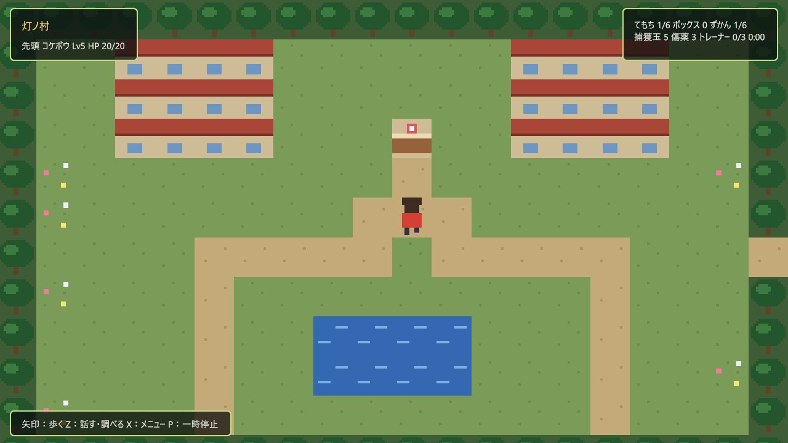 | 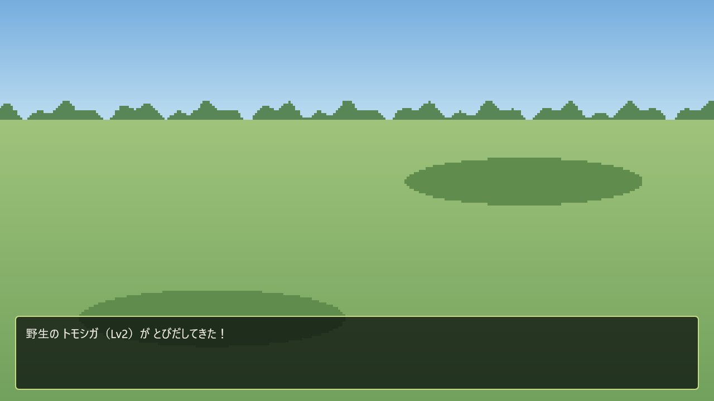 | 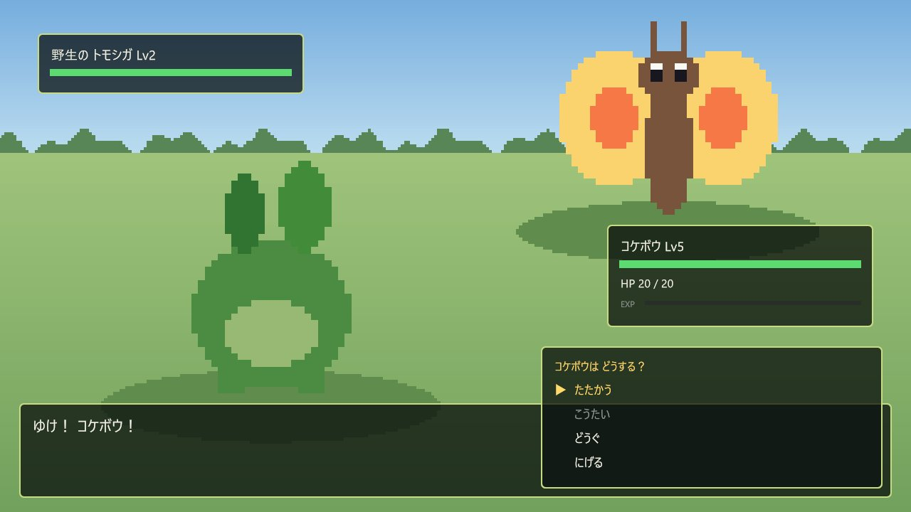 |

| 技を選ぶ | 効果は ばつぐん | 状態異常（毒） |
|---|---|---|
| 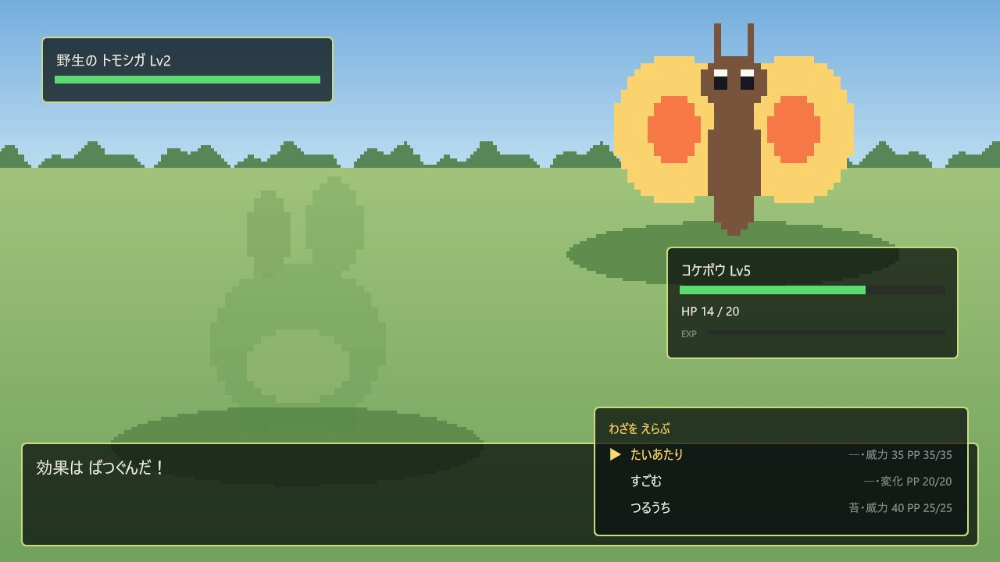 | 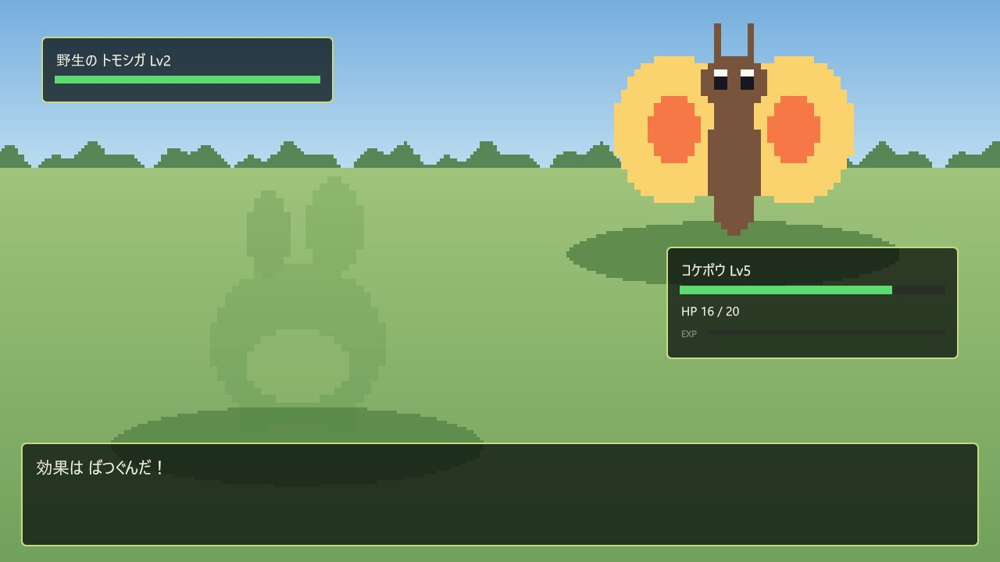 | 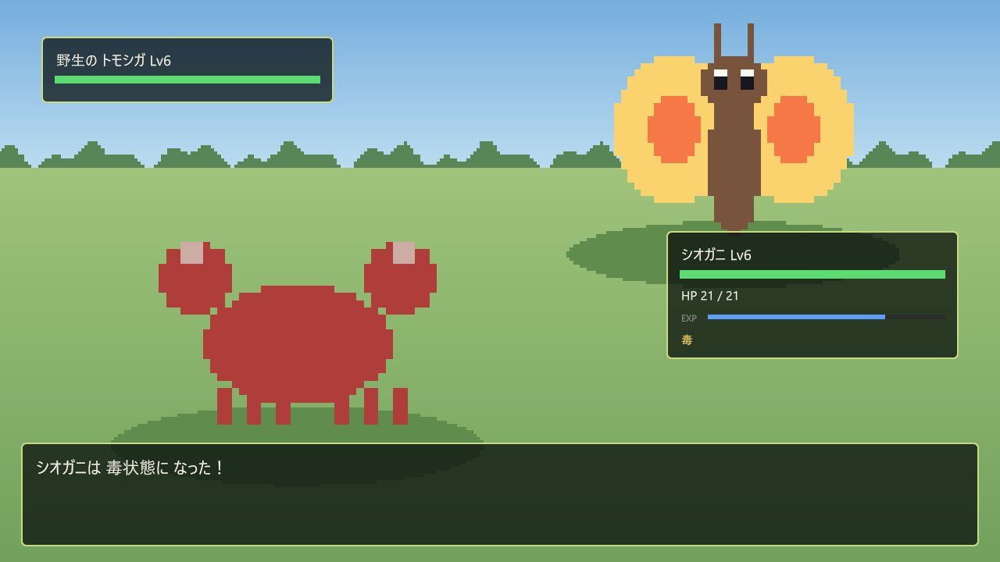 |

| てもち | ずかん | 捕まえた |
|---|---|---|
| 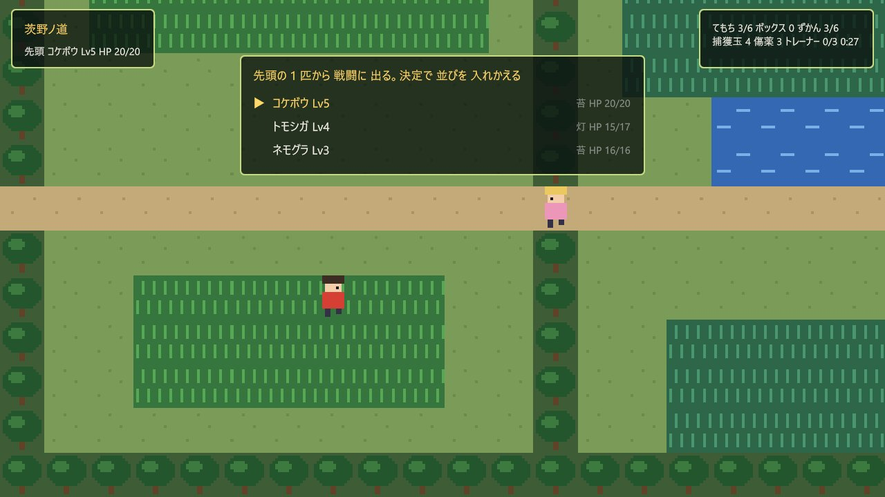 | 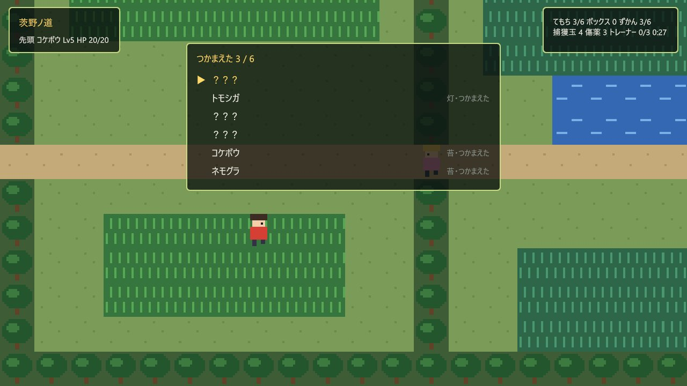 | 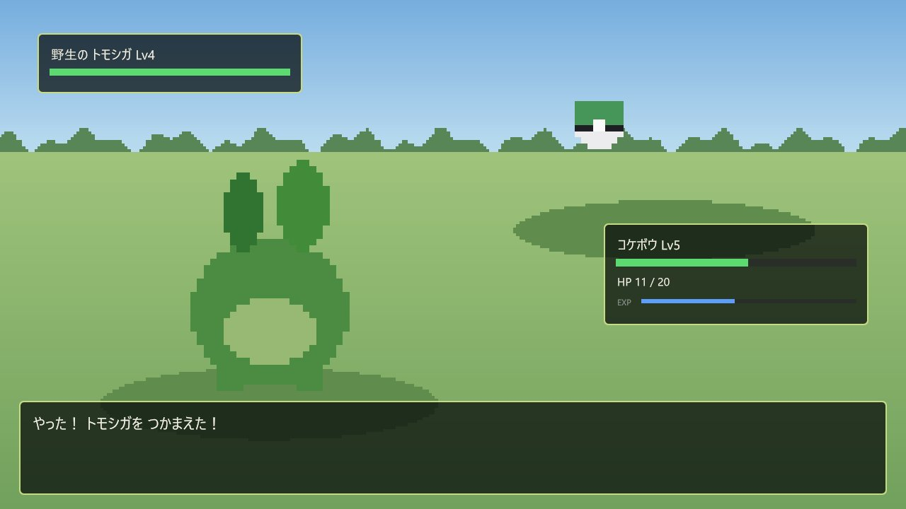 |

| 回復所のボックス | レベルアップ | 技の入れ替え |
|---|---|---|
|  | 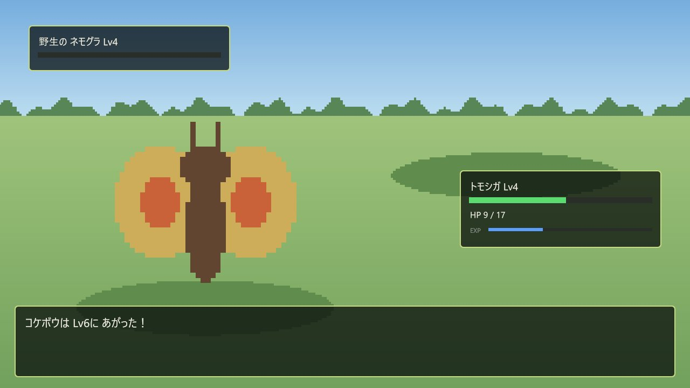 | 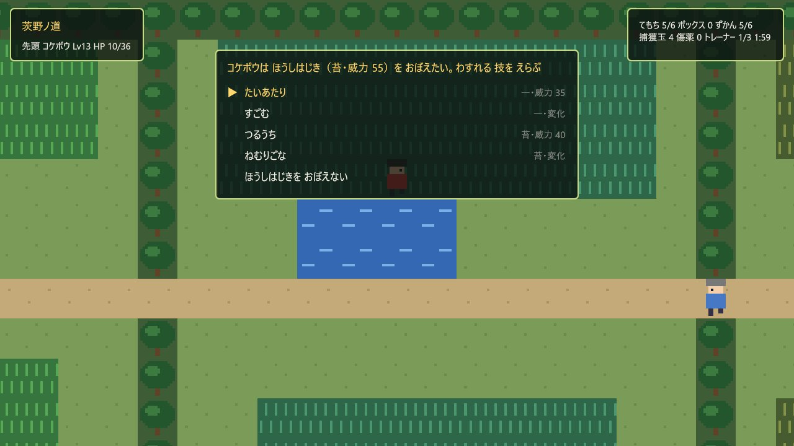 |

| 回復所で記録 | トレーナーが道を塞ぐ | トレーナー戦 |
|---|---|---|
|  | 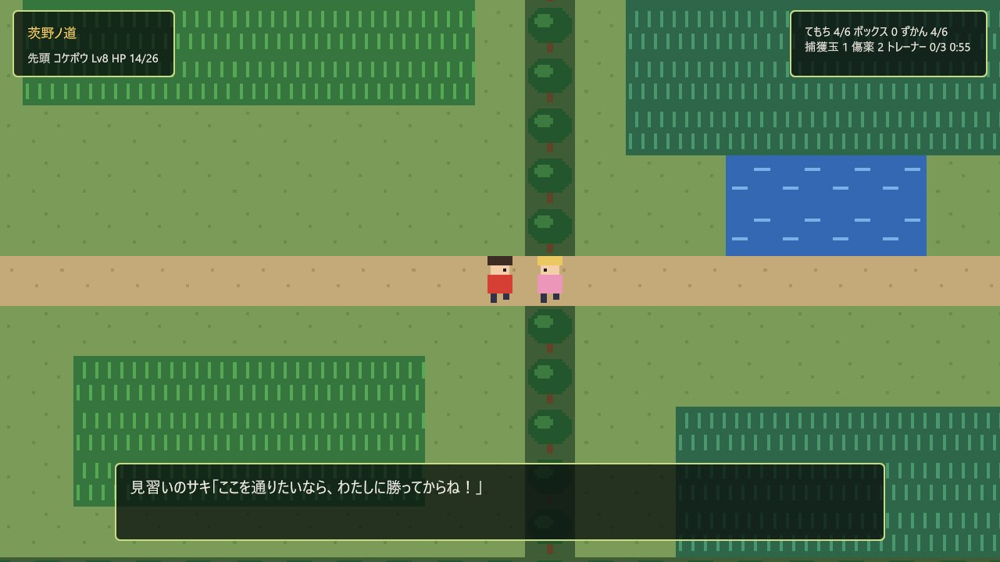 | 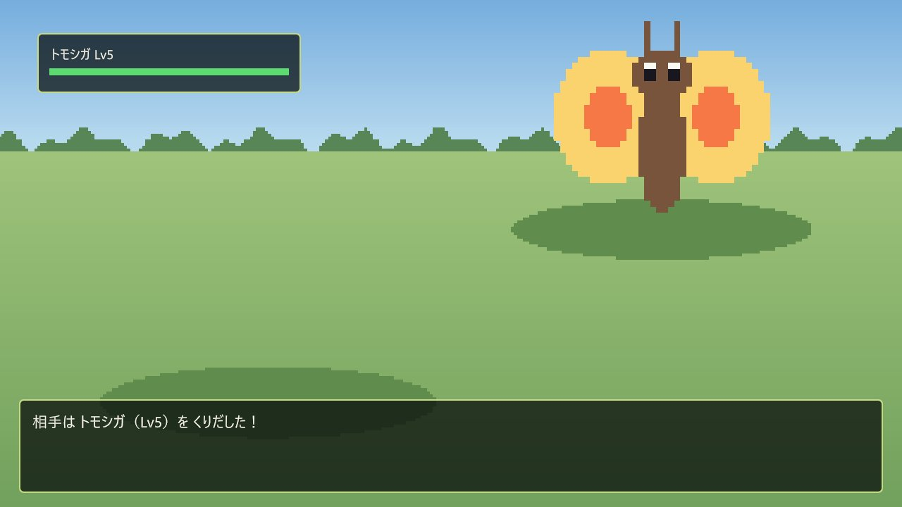 |

| 結果 | 記録を出したタイトル | 壊れたセーブの案内 |
|---|---|---|
| 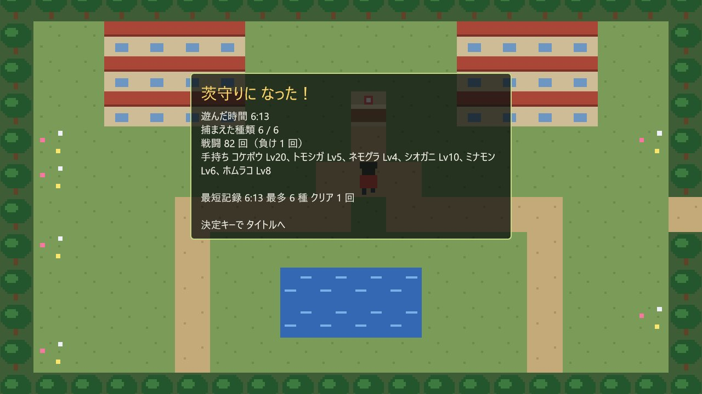 | 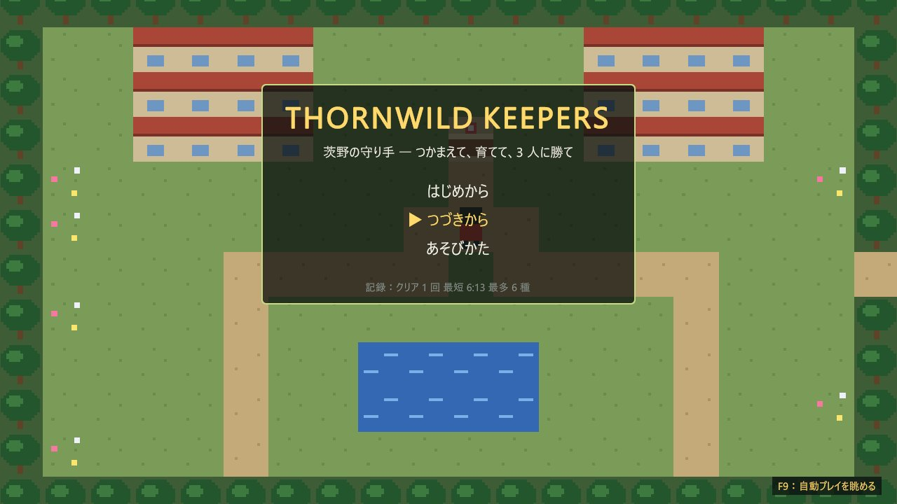 | 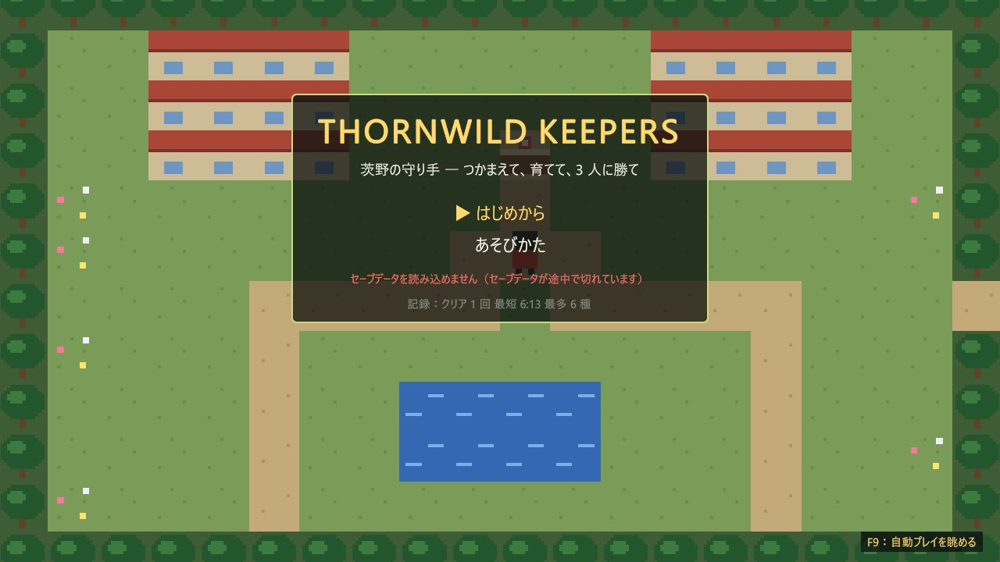 |
