# 046 検証記録

2026-11-27 実施。セッション 4（PlayMode 実シーン・撮影の再現・記録）の時点。

## 自動検証

| 項目 | 結果 |
|---|---|
| dev lint | 成功 |
| dev check | 成功（警告 0） |
| dev test | 成功。Core 76/76、App 35/35 |
| Unity EditMode | 125/125（パッケージ tile-motion 10・Core 76・App 35・ビルドの前の検証 4。Mono） |
| Unity PlayMode | 28/28（実シーン 12、共通の証跡公開 16） |
| Windows ビルド | 成功、StandaloneWindows64（ビルドログにライセンスクライアントの署名検証の警告が残るが、結果は成功・終了コード 0）。ビルドの前の検証フックが本番シナリオを検証して通過 |
| 壊したシナリオのビルド | `-> hall_meeting` を `-> hall_meetng` に変えて `dev build 046` を流すと、`BuildFailedException: シナリオの検証に失敗しました` と `行 203：存在しないラベル hall_meetng を参照しています`（ほか 2 行）でビルドが止まることを確かめてから戻した |
| ビルド起動 | dev capture で起動・全場面撮影・正常終了 |
| 証跡 | JPEG 品質 85、18 枚、1280×720 |
| 撮影再現 | 同一ビルド `5dddf3f69d9147ffb1a5f9cc5de21963` の 2 回の撮影（撮影 ID `20261126T193210Z-cc1bd92e` と `20261126T193534Z-bbfeee0a`）で 18 枚の SHA-256 が一致。画像世代 `96931cf519223dde`（[最新の記録](current.json)）。1 回目の記録は次の公開で消える |
| 固定ハッシュ | スクリプトの指紋 `FE5A8E61`。各結末の代表の選び方の最終ハッシュ 真相 `41310A48`・通常 `82B1D343`・バッド `BED96A3E` が .NET と Mono で一致し、撮影の結果画面の状態とも一致 |
| 題材固有テスト | 存在しないラベル参照（飛ぶ・条件・選択肢）を行番号付きで拒否し、ビルドの前の検証フックがビルドを止める／既読 2 → 未読 → 既読の並びで未読の直前に止まる・2 周目は最初の選択肢まで送って止まる・実シーンで Ctrl を押したまま最初の未読で止まる／選択肢でクイックセーブ → 選んで進める → クイックロードで選ぶ前の変数・表示・ハッシュに戻り、別の選択肢を選べる（ファイル経由、シーンを読み直した「つづきから」でも同じ） |
| 通し | 3 つの結末を実シーンで結果画面まで読み、タイトルへ戻った表示が起動直後と一致。全 27 通りの選び方が結末で終わる（真相 2・通常 5・バッド 20） |
| 計測 | シナリオのコンパイル（構文解析・検証・網羅探索）は中央値 3.57 ms・最大 6.71 ms（10 回、Mono、Unity エディタのバッチ実行、この PC の Stopwatch）。毎フレームの処理は文字送りと HUD の文字の更新だけで、性能は計測の対象にしていない |

撮影の台本は乱数を使わず、入力と Tick だけで進める。1 周目はバッド（途中、最初の選択肢でクイックセーブ → 別の選択肢を選ぶ → クイックロードを撮る）、2 周目は既読のスキップで最初の選択肢まで進み、1 周目と違う枝で未読に止まるところを撮って真相へ、3 周目は通常。最後に壊れたクイックセーブを書いてタイトルを読み直す。

## 画面

| タイトル | 操作説明 | 地の文の文字送り |
|---|---|---|
|  | 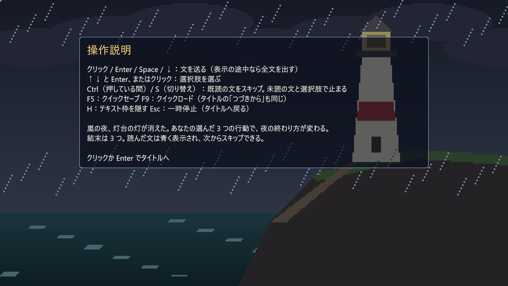 | 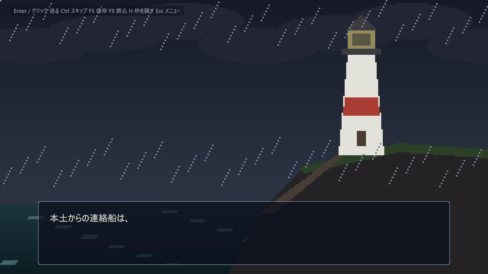 |

| 台詞と立ち絵 | 二人の立ち絵 | 選択肢 |
|---|---|---|
| 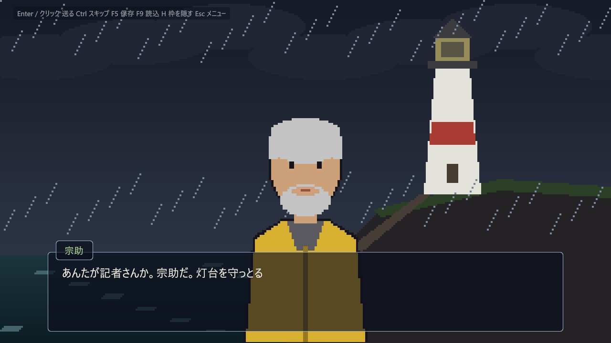 | 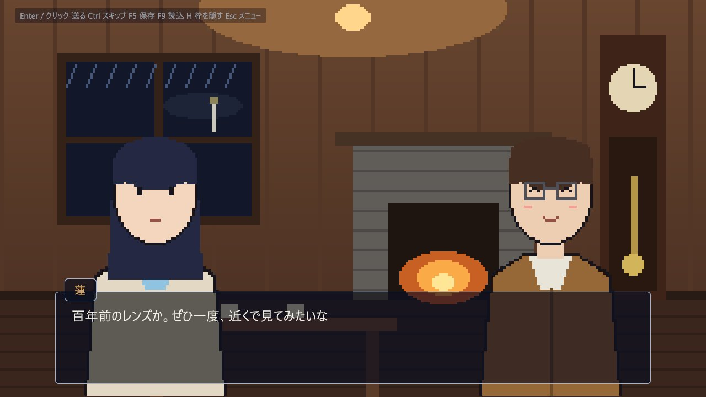 | 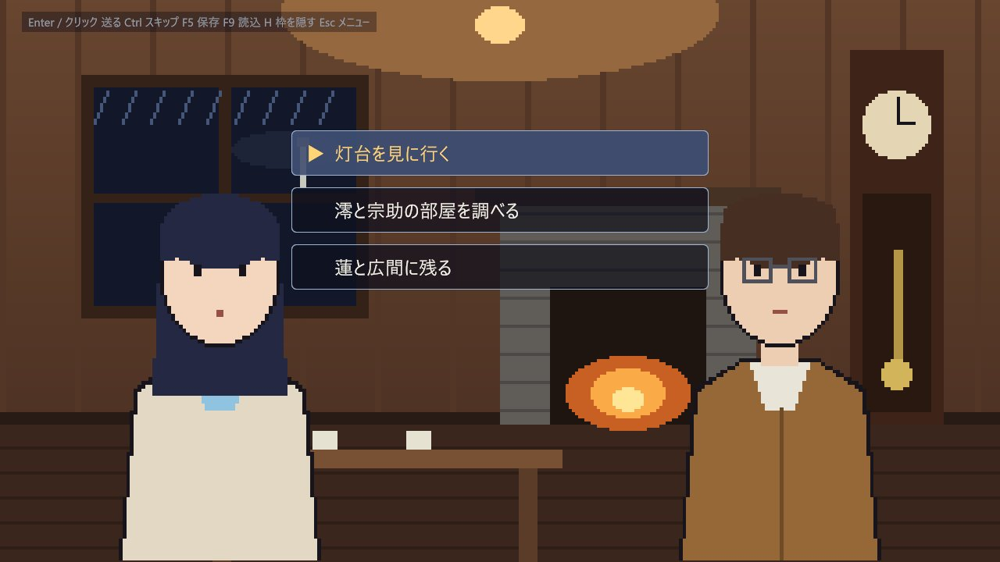 |

| 選択肢でクイックセーブ | クイックロードで選ぶ前へ | 消えた灯の夜明け |
|---|---|---|
| 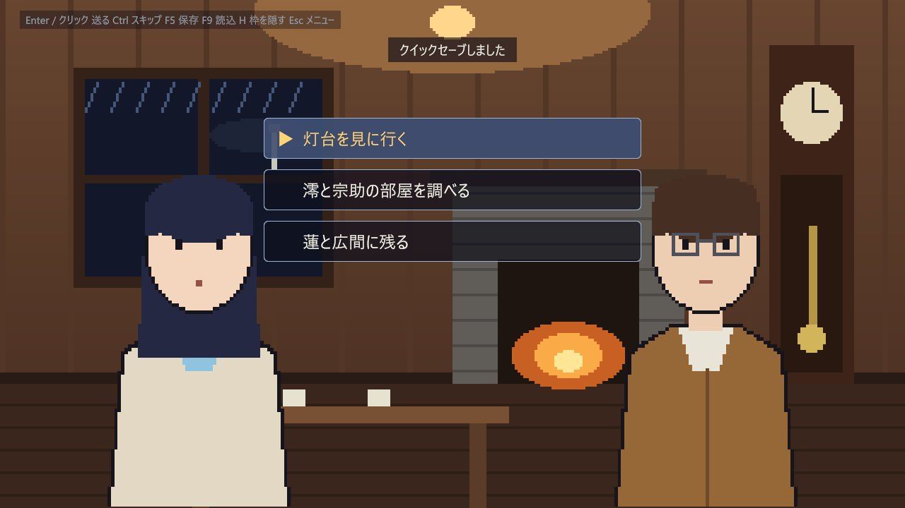 |  | 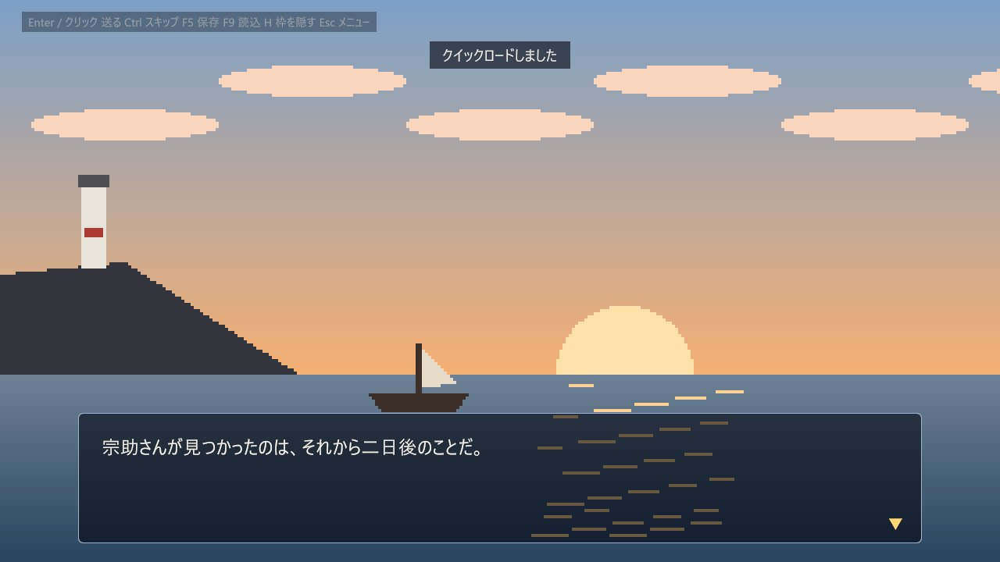 |

| 結果（消えた灯） | 既読の文（青） | 既読のスキップ中 |
|---|---|---|
| 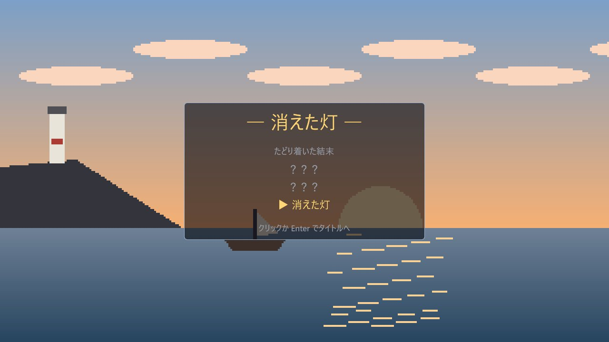 | 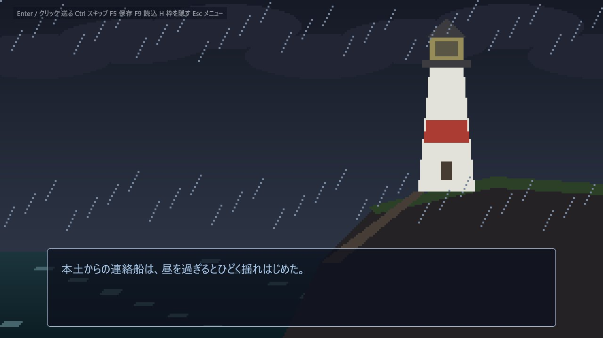 | 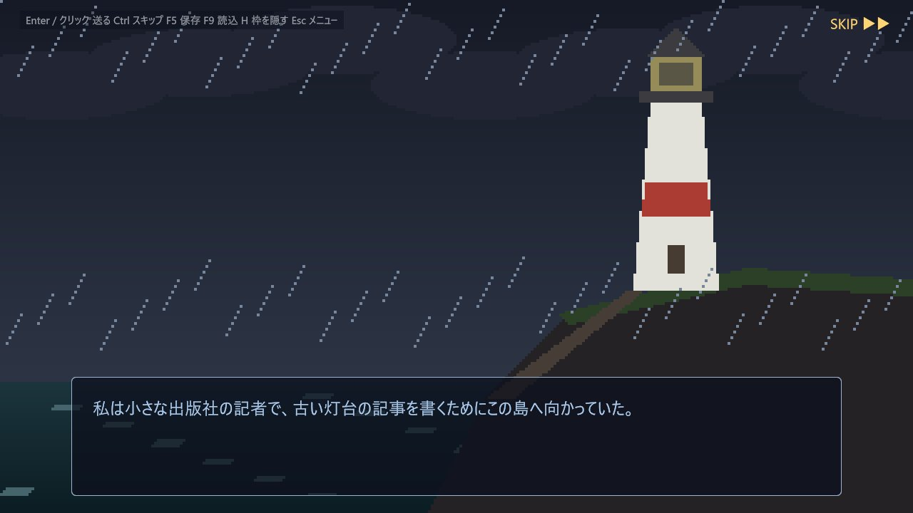 |

| 未読でスキップが止まる | 倉庫で宗助を見つける | 結果（灯は戻る） |
|---|---|---|
| 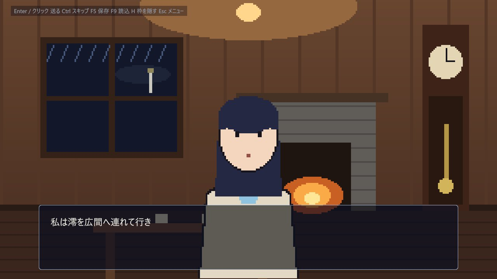 | 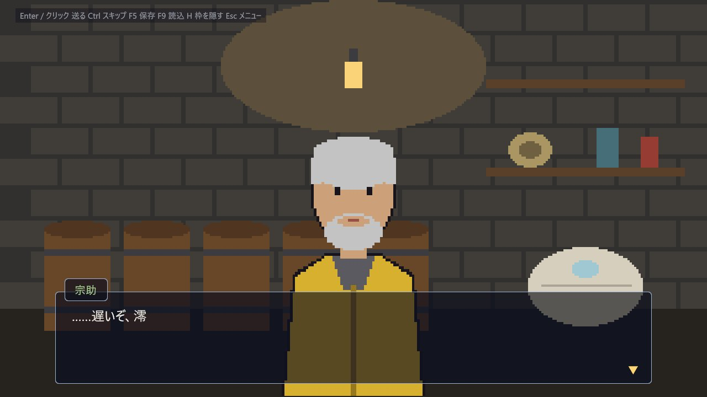 |  |

| 午前三時の選択肢 | 結果（3 つの結末に到達） | 壊れたクイックセーブの案内 |
|---|---|---|
| 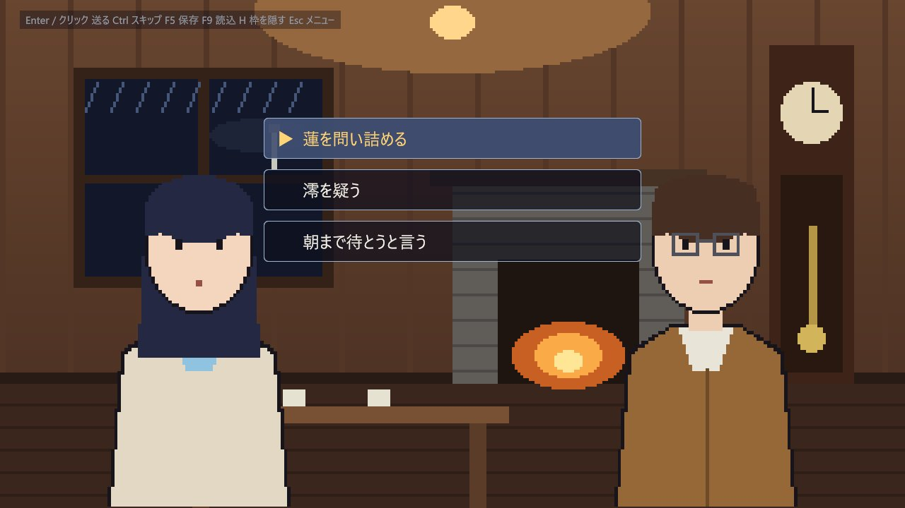 | 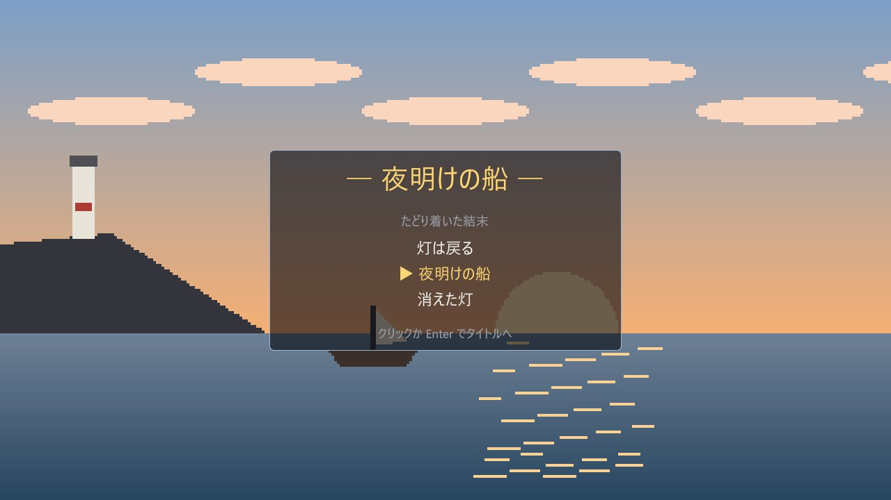 | 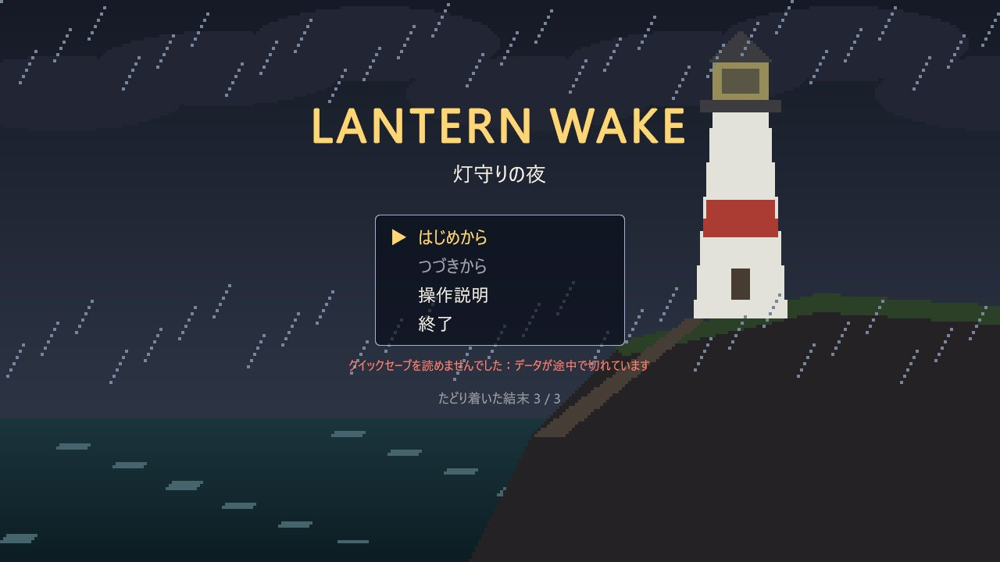 |
