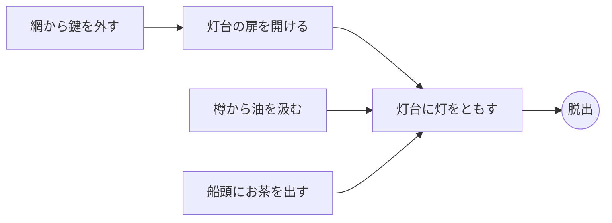

# 047. ポイント＆クリックADV

仕様書：[plan/games/047-point-click.md](../../plan/games/047-point-click.md)　実装計画：[plan/games/047-point-click-implementation.md](../../plan/games/047-point-click-implementation.md)

## 環境

- Unity：6000.6.9f1
- 対象プラットフォーム：Windows (StandaloneWindows64)
- 入力方式：マウスが主、キーボードを併用（Input System）

## 起動手順

```
dev gui 047      # エディタで開く
dev build 047    # Windows ビルド
dev run 047      # ビルドを起動
dev capture 047  # 証跡を evidence/ に撮る（画像は captures/<画像世代>/、撮影記録は runs/）
```

## 操作

（セッション 3 で記入）

## 採用ルール

| 項目 | 採用ルール |
|---|---|
| 動詞 | 見る（look）・取る（take）・使う（use）・話す（talk）の 4 つ。動詞を選ばずにクリックしたら歩く（出口なら移動）。持ち物を選ぶと「使う ＜持ち物＞ → ＜対象＞」になる |
| ルールの選び方 | 同じ（動詞・対象・使う持ち物）で条件が成り立つ最初のルール。ただし**どの到達状態でも当たるルールは高々 1 つ**であることを検証するので、書いた順には依存しない。当たらなければ動詞ごとの既定の返事 |
| 持ち物どうし | 「A を B に使う」と「B を A に使う」は同じ組（番号の小さい方を道具に正規化） |
| 持ち物 | 1 周で 1 回だけ手に入る（失った後も二度と手に入らない）。同時に 8 個まで。**持っていない持ち物を使う・対象にする命令は Core が拒否**し、状態を何も変えない |
| 謎 | `solve` で解く。**`solve` を含むルール・話題には「その謎が未解決」の条件をコンパイラが足す**ので、解決済みの謎は二度解けない（もう一度同じ行為をすると既定の返事） |
| 歩く | 主人公は床を左右にだけ歩く（Tick ごとに整数の距離）。部屋の物への行為は、その物の立ち位置まで歩いて**着いた Tick に解決**する。歩いている途中の新しい命令は前の命令を置き換える（前の命令は捨てる） |
| 持ち物だけへの行為 | 持ち物を見る・持ち物どうしを組み合わせるのはすぐ解決し、歩くのをやめる |
| 出口 | 歩く（動詞なし）か、持ち物なしで使うと移動。鍵のかかった出口は「閉まっていて通れない。」 |
| 会話 | 人物に「話す」と、`talk` のルール（あいさつ）の後に会話になる。条件の成り立つ話題が選択肢に並び、「さようなら」で終わる。会話中は会話以外の操作を拒否する |
| 部屋の移動 | 世界の状態（全部屋の物の表示・出口の鍵・持ち物・フラグ・謎）は 1 つで、移動は「今いる部屋」と位置だけを変える。拾った物・開けた扉は戻っても元に戻らない |
| 脱出 | `@goal` の謎を解いたら脱出（試合の終わり）。以後の操作は全て拒否する。敗北はない（行き詰まりがないことを検証するため） |
| 再現性 | 乱数は使わない。整数と Tick だけの規則なので、同じルール表と同じ命令の列なら .NET と Mono で同じ状態ハッシュになる（ハッシュにはルール表の指紋を混ぜる） |

## 舞台と謎

嵐の夜、灯台の灯が消えた。灯をともせば、船頭が小舟で町へ送ってくれる。部屋は灯台守小屋・船着き場・灯室の 3 つ（`Assets/Game/Data/Rules.txt`）。

| 謎 | 解き方 | 持ち物・会話 |
|---|---|---|
| 網から鍵を外す | 小屋の包丁を船着き場の漁網に使う → 錆びた鍵 | |
| 灯台の扉を開ける | 錆びた鍵を小屋の灯台への扉に使う（鍵の出口が開く） | 網から鍵を外した後 |
| 樽から油を汲む | 包丁で油樽の栓をこじ、空き瓶を樽に使う → 油の瓶 | |
| 船頭にお茶を出す | 船頭に「町へ戻れませんか？」「火を持っていませんか？」と聞く。カップをストーブに使ってお湯、**茶葉とお湯のカップを組み合わせて**お茶。お茶を船頭に渡す → マッチ | NPC の会話・持ち物の組み合わせ |
| 灯台に灯をともす（脱出） | 灯室のランプに油の瓶、続けてマッチを使う | 上の 3 つの後 |

依存グラフ（`PuzzleGraph.ToMermaid` の出力。テストで照合する）：



解答手順は `Assets/Game/Data/Walkthrough.txt`（テストと撮影が再生する。ゲーム本体は使わない）。

## ルール表の文法

1 行 1 文。`#` で始まる行はコメント。語は空白で区切り、文は「…」で書く（中に空白を含めてよい）。ID は英小文字・数字・`_`（物・人物・出口は「部屋.名前」）。ID は種類をまたいで一意。

| 文 | 書き方 | 意味 |
|---|---|---|
| 開始 | `@start 部屋` | 最初の部屋 |
| 部屋 | `@room 部屋 名前 width 幅 start 位置` | 床の幅（整数の単位）と、最初の部屋なら始めの位置 |
| 物 | `@object 部屋.名前 表示名 rect 左 下 右 上 stand x [hidden]` | 当たりの矩形（部屋の座標、y は床から上、高さ 1080）と立ち位置。`hidden` は最初は隠れている。重なったら後に書いた方が手前 |
| 人物 | `@npc 部屋.名前 表示名 rect … stand x [hidden]` | 話せる相手 |
| 出口 | `@exit 部屋.名前 表示名 rect … stand x -> 部屋 at x [locked] [hidden]` | 行き先の部屋と入った位置。`locked` は `unlock` で開く |
| 持ち物 | `@item 持ち物 名前` | |
| フラグ | `@flag フラグ` | bool だけ（数値は作らない） |
| 謎 | `@puzzle 謎 名前 [after 謎 …]` | `after` は先に解く謎（直接のものだけ書けばよい）。宣言と、ルールから導いた依存を照合する |
| 目標 | `@goal 謎` | 解いたら脱出 |
| ルール | `look 対象 [when 条件] : 効果 ; 効果 …` | 対象は物・人物・出口・持ち物 |
| | `take 対象 …`・`talk 対象 …`・`use 対象 …` | 持ち物なしで使う。出口は書けない（移動になる） |
| | `use 持ち物 on 対象 …` | 対象は物・人物・出口・別の持ち物 |
| 話題 | `topic 部屋.人物 話題 「問い」 [when 条件] : 効果 …` | 効果の文は人物の返事 |

- 条件：`has 持ち物`・`solved 謎`・`フラグ` と、それぞれの否定 `!has 持ち物`・`!solved 謎`・`!フラグ` を `and` でつなぐ（`or` は作らない。ルールを分けて書く）。
- 効果：`give 持ち物`・`lose 持ち物`・`set フラグ`・`clear フラグ`・`solve 謎`・`show 物`・`hide 物`・`unlock 出口`・`「文」`。書いた順に適用する。
- 持ち物に書けるルールは `look` と「`use 持ち物 on 持ち物`」だけ。

### 検証（`RuleCompiler`、誤りは行番号と理由付きで全て返す）

| 段 | 拒否するもの |
|---|---|
| 構文 | 未知の宣言・動詞・効果、書式の違い、閉じていない「、空の効果 |
| 名前 | 未宣言の部屋・物・持ち物・フラグ・謎（綴りの 1 文字違いも）、種類をまたいだ ID の重複、出口でない物の `unlock`、人物でない相手の話題 |
| 形 | 部屋の外の矩形・立ち位置・入る位置、同じ部屋への出口、持ち物を取る／持ち物と話す、持ち物をそれ自身に使う、出口を持ち物なしで使う規則、条件の重複、1 つのルールで同じ謎を二度解く |
| 見る | `look` の規則のない物・人物・出口・持ち物（何もない返事を作らない） |
| 文 | 空の文、上限（既定 60 字）を超える文、制御文字、12 字を超える表示名 |
| 数 | 行数・部屋・物・持ち物・フラグ・謎・ルール・話題・条件・効果の上限（展開の前に数える）、作品として求める数（部屋 3・謎 5） |
| 状態空間 | 下の探索で見つかる誤り |

### 状態空間の探索（`StateSpace`）と依存グラフ（`PuzzleGraph`）

位置・向き・Tick を除いた抽象状態（今の部屋・会話の相手・持ち物・手に入れた持ち物・フラグ・謎・物の表示・出口の鍵）を、開始から**今の状態で取れる全ての行為**（今の部屋の見えている物 × 4 動詞と持ち物、持ち物どうし、出口への移動、会話の話題と「さようなら」）で幅優先にたどる。行為は遊ぶときと同じ `World.Perform` を歩かずに呼ぶので、探索と試合の規則は食い違わない。

- **詰みなし**：到達できる全ての状態から脱出に届く（脱出した状態から逆向きにたどって確かめる）。届かない状態があれば、そこへの手順を添えて拒否する。
- **使われないルール**：どの到達状態でも選ばれないルール・話題を拒否する。
- **曖昧さ**：同じ行為で 2 つのルールの条件が同時に成り立つ到達状態があれば拒否する。
- **持ち物の違反**：二度手に入れる・持っていない物を失う・8 個を超える手順があれば拒否する（試合中に起きたら例外で止める）。
- **状態数の上限**（既定 100,000）を超えたら拒否する。
- **依存グラフ**：謎 P が解けている到達状態で必ず解けている謎の集合を「P より先に解く謎」として導き、`@puzzle … after …` の宣言の推移閉包と照合する。脱出の謎は他の全ての謎の後に解けなければならない（「謎全解決で脱出」）。README の図は宣言の推移簡約から `PuzzleGraph.ToMermaid` で描く。

## 設計上の選択

- **Core**（`Game.Core`）：ルール表の構文解析（`RuleParser`）・名前の解決と検証（`RuleCompiler`）・コンパイル結果（`RuleBook`）・世界の状態とルールの解決（`World`）・状態空間の探索（`StateSpace`）・依存グラフ（`PuzzleGraph`）。世界は `RuleBook` だけを読み、構文解析の型を使わない。
- 当たりの矩形は int-geometry の `Rect`、状態のハッシュは tile-motion の `StateHash` を使う。

## テスト

（セッション 4 で記入）

## 未実装範囲

- 仕様書の Out of scope：フルボイス、複数章。
- セーブ・ヒント機能・2D の自由移動（経路探索）は作らない。

証跡画像はJPEG（`.jpg`）、品質85を標準とし、保存したJPEGのSHA-256をマニフェストに記録する。
