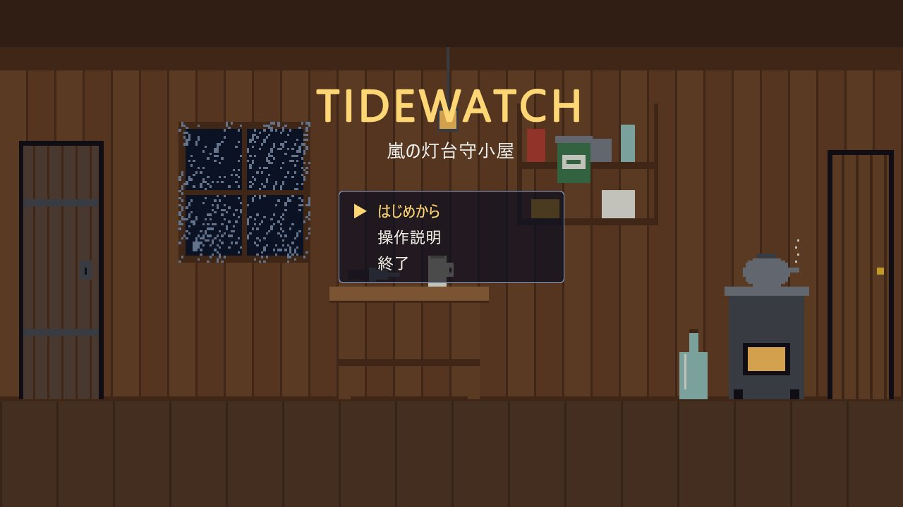
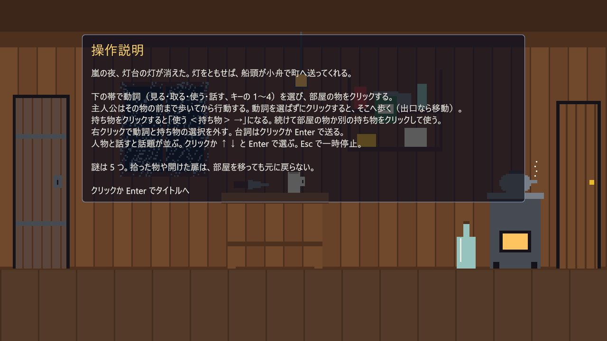
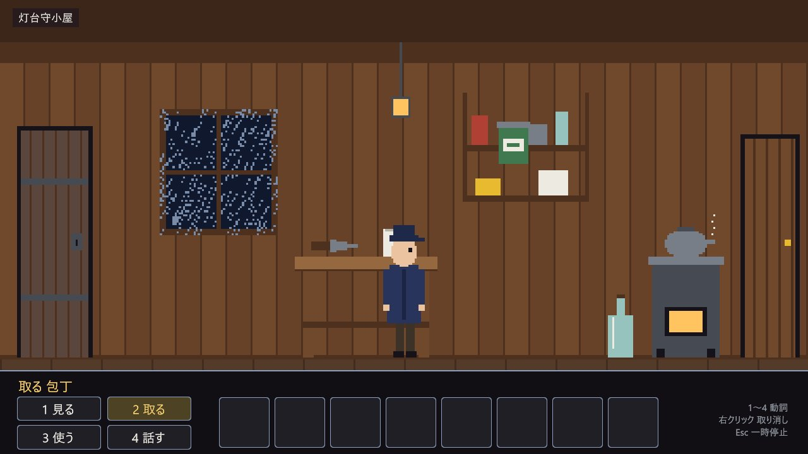
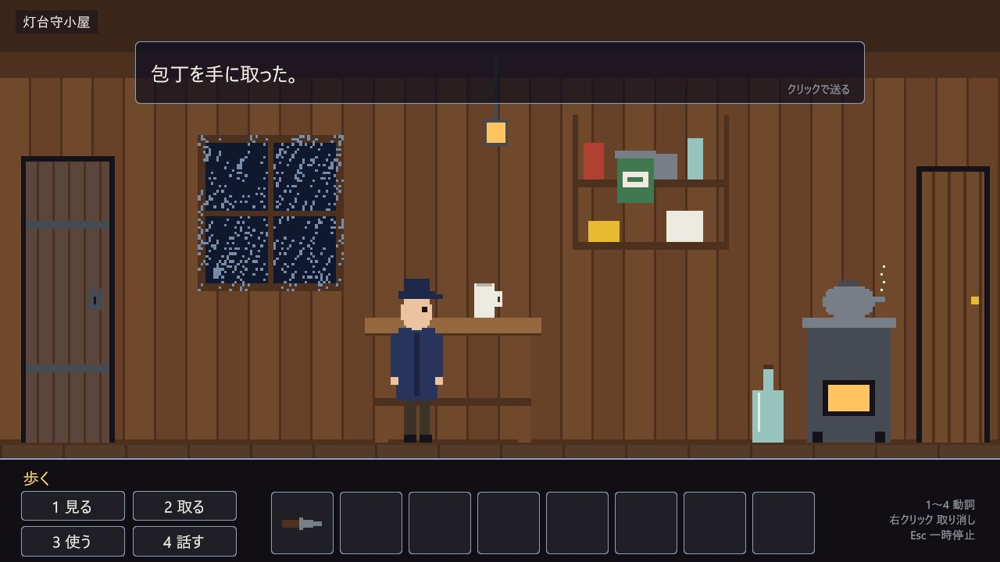
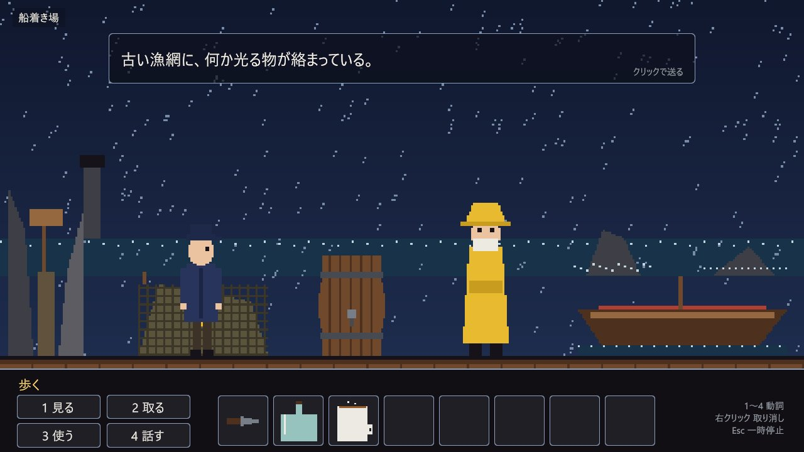
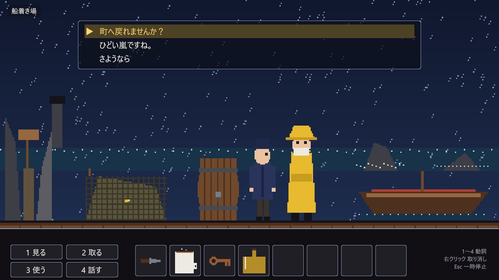
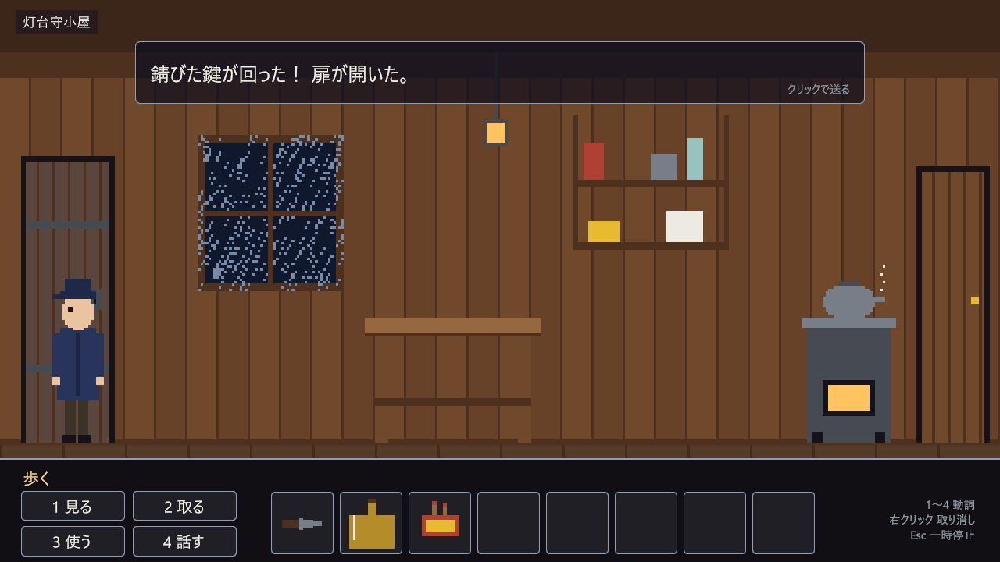

# 047 検証記録

2026-11-27 実施（セッション 4）。試遊 1 回目で見つかった「灯をともした後に効果音が鳴り続けて先へ進めない」不具合を直してから、テストを流し直して撮り直した。

## 自動検証

| 項目 | 結果 |
|---|---|
| dev lint | 成功 |
| dev check | 成功（警告 0） |
| dev test | 成功。Core 105/105、App 27/27 |
| Unity EditMode | 208/208（パッケージ int-geometry 60・tile-motion 10・Core 105・App 27・Editor 6。Mono） |
| Unity PlayMode | 27/27（実シーン 11、共通の証跡公開 16） |
| Windows ビルド | 成功、StandaloneWindows64（ビルドログにライセンスクライアントの署名検証の警告が残るが、結果は成功・終了コード 0）。ビルドの前の検証フックが本番のルール表を検証して通過 |
| 壊したルール表のビルド | `use knife on dock.net` を `use knife on dock.nett` に変えて `dev build 047` を流すと、`BuildFailedException: ルール表の検証に失敗しました` と `行 88：対象 dock.nett は物・人物・出口・持ち物のどれとしても宣言されていません` でビルドが止まることを確かめてから戻した |
| ビルド起動 | dev capture で起動・全場面撮影・正常終了 |
| 証跡 | JPEG 品質 85、13 枚、1280×720 |
| 撮影再現 | 同一ビルド `c332997e7dcb42ddb44e2c0ef57ff8ab` の 2 回の撮影（撮影 ID `20261126T213752Z-7979e84c` と `20261126T213757Z-eb4bef3a`）が同じ画像世代 `705ee999028c0e62` になり、13 枚の SHA-256 が一致した。修正後のビルド `8cca5736d7b44e22ac8e98ab5902024e` の 2 回の撮影（`20261126T215253Z-78b0b72a` と `20261126T215258Z-75b5105c`）も同じ画像世代だった（[最新の記録](current.json)）。前の記録は公開の整理で消えている |
| 固定ハッシュ | ルール表の指紋 `76455E02`。本番の解答手順の最終ハッシュ（Core で歩いて `1AB9ED74`、Flow を通して `CDF6223E`）が .NET と Mono で一致。撮影の最終状態は `62B934D2`（台本の操作が加わるので別の値。同一ビルドの 2 回で一致） |
| 題材固有テスト | 所持しないアイテム（未取得・使用済み・組み合わせの片方）の使用を Core が拒否して状態を変えない、画面の空の枠は選べない／解決済みの謎は二度解けない（同じ行為・組み合わせの逆順・話題）／本番のルール表の全 1,615 状態から脱出に届く（探索と、テスト側の別の列挙と不動点の両方）、わざと詰む表（唯一の瓶を捨てる・鍵を別の箱で失う）を拒否し、詰む本番の表ではビルドが止まる |
| 完了判定 | 解答手順で全 5 謎を解いて結果画面まで（実シーン・撮影）／拾った物・開けた扉は部屋を往復しても戻らない（Core・App・実シーン） |
| 計測 | ルール表のコンパイル（構文解析・検証・状態空間の探索）は Mono で中央値 335.7 ms・最大 337.5 ms、.NET で中央値 48.9 ms・最大 50.3 ms（5 回、この PC の Stopwatch）。起動時に 1 回だけ。毎フレームの処理は歩く 1 Tick と HUD の文字の更新だけで、性能は計測の対象にしていない |

撮影の台本は乱数を使わず、解答手順（`Assets/Game/Data/Walkthrough.txt`）と Tick だけで進める。途中で動詞・持ち物の選択とマウスの下の物を台本から渡し、命令文を撮る。

## 画面

| タイトル | 操作説明 | 動詞と命令文 |
|---|---|---|
|  |  |  |

| 包丁を拾う | 持ち物を使う命令文 | 持ち物の組み合わせ |
|---|---|---|
|  |  |  |

| 船着き場 | 会話の話題 | 船頭の返事 |
|---|---|---|
|  |  |  |

| 灯台への扉が開く | 灯室 | 灯がともる |
|---|---|---|
|  |  |  |

| 結果 |
|---|
|  |

撮影記録：[current.json](current.json)
